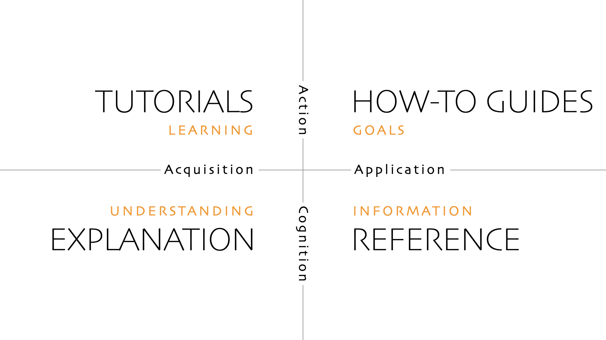

# 10. Documentation

> Write down what code cannot say: why. Everything else rots.

**When this actually happens:** Continuously. A little with every change, not as a phase
before launch. Documentation written in a dedicated push at the end is documentation
written when you have forgotten the reasons.

**Research status, 2026-10-15:** Primary-source findings and gathered diagrams are
recorded in [Research findings for chapter review](#research-findings-for-chapter-review).
That section flags claims in the existing examples for correction. The formal
chapter review and interactive port have not started.

---

## Entry criteria

None. This runs alongside everything else.

---

## The work

### The rule

**Code says what. Documentation says why.**

A comment restating the code is worse than no comment, because it adds a second thing
that can drift out of date — and it will, silently.

```ts
// Bad: says what the code already says
// Increment the retry count
retries += 1

// Good: says what the code cannot
// Stripe's webhook delivery retries for up to 3 days, so we can be
// patient here. Anything past 5 attempts means our handler is broken,
// not that Stripe is being slow.
if (retries > 5) await alertOncall()
```

The second comment survives refactoring because it documents a constraint from outside
the codebase. The first one is deleted the moment the line changes.

### Document decisions, not descriptions

Descriptions of how the system works rot on contact with the next refactor. Records of
*why you chose something* stay true forever, because the decision was made at a fixed
point in time under fixed constraints.

That is what an ADR captures:

```markdown
# ADR 004: Drizzle over Prisma

**Date:** 2026-03-14
**Status:** Accepted

## Context
We need typed database access with migrations. Prisma is the default
choice; Drizzle is the main alternative.

## Decision
Drizzle.

## Reasoning
- Migrations are SQL files we read and commit. When something breaks in
  production we debug SQL, not the ORM's intentions.
- No separate schema language or generation step in the build.
- Closer to SQL, so query optimization is direct ([09](09-performance-optimization.md)).

## Consequences
- More verbose for simple queries than Prisma.
- Smaller ecosystem; fewer answers when stuck.
- Team members who know Prisma need a short ramp-up.

## Alternatives considered
- **Prisma** — better DX, but the generation step and query engine add
  opacity we did not want at this size.
- **Raw SQL + Zod** — maximum control, too much boilerplate.
```

Write it when the decision is made, while the alternatives are still fresh. Never edit an
accepted ADR — supersede it with a new one. The record of what you believed at the time
is the value; editing it destroys exactly that.

Number them sequentially in `docs/adr/`. Write one for anything expensive to reverse:
database choice, auth strategy, hosting, major dependencies, architectural boundaries.

### The README

The most-read and most-neglected document. Four sections:

```markdown
# Project Name

One paragraph: what this is and who it is for. Understandable by
someone with no context, including you at 2am in eight months.

## Running locally
Exact commands. Prerequisites. Env vars — point at `.env.example`.
Someone should get from clone to running app without asking anyone.

## Architecture
A short paragraph and, if useful, one diagram. Not exhaustive — enough
to orient. Link to ADRs for the reasoning.

## Deploying
How code reaches production. How to roll back. Where the logs are.
Who to contact when it is on fire.
```

That last section is what you will want at 3am, when you are least capable of working it
out from first principles.

### Comments worth writing

**Non-obvious constraints.**
```ts
// Stripe caps metadata values at 500 characters. Longer values are
// silently truncated, which caused a silent data-loss bug in Feb.
```

**Deliberate deviations from the obvious approach.**
```ts
// Deliberately not using a transaction. The webhook can be delivered
// twice, and the upsert is idempotent; a transaction here caused lock
// contention under load.
```

**Genuinely tricky logic**, where the reader will otherwise assume it is a mistake.
```ts
// Off-by-one is intentional: the API's date ranges are inclusive on
// both ends, unlike ours.
```

**Known limitations.**
```ts
// Only handles the first 1000 results. Fine today (max observed: 40);
// revisit if that changes.
```

### Documentation that maintains itself

The best documentation cannot drift, because it is executable or enforced:

- **Types.** A well-named type documents shape better than prose, and the compiler keeps
  it honest.
- **Tests.** They describe intended behavior and fail when the description stops matching
  ([06](06-testing.md)).
- **`.env.example`.** Documents required configuration, and the app stops booting when it
  drifts ([04](04-project-setup.md)).
- **Good names.** `retryUntilStripeConfirms` needs no comment. Renaming is often the
  correct alternative to explaining.

Prefer these over prose wherever the choice exists.

### What not to write

- **Comments restating code.** Noise that rots.
- **Documentation of obvious functions.** A JSDoc block on `getUserById` explaining that
  it gets a user by ID is pure cost.
- **Exhaustive API docs by hand.** Generate them, or skip them.
- **Long architecture documents** describing current structure in detail. They are wrong
  within a month. Describe boundaries and reasoning; leave details to the code.
- **Anything you will not maintain.** Wrong documentation is worse than none — people
  trust it and act on it.

### Commit messages are documentation

`git log` is the highest-density record of why the codebase looks like this. Treat the
body as documentation with a permanent home that cannot drift from the change it
describes. See [05 — Development](05-development.md#commits-and-branches).

---

## Artifacts

- `README.md` — what, run, architecture, deploy
- `docs/adr/NNN-title.md` — one per significant decision
- `.env.example` — every key, no values
- Comments explaining constraints and reasoning, not mechanics

---

## Definition of done

Ongoing, but for each change:

- [ ] Non-obvious decisions have an ADR or a comment explaining why
- [ ] New env vars are in `.env.example`
- [ ] README still accurate if setup or deploy changed
- [ ] No comments that merely restate code
- [ ] Commit body explains why

Periodically:

- [ ] A fresh clone can be run using only the README
- [ ] No documentation describes things that no longer exist

---

## Scaling to a team

- **The README becomes onboarding.** Have the next person set up from it and note every
  point they got stuck. Those notes are the fix list.
- **ADRs get much more valuable** — they stop the same debate recurring every six months
  with a new participant.
- **Add `CONTRIBUTING.md`** for conventions, branch naming, review expectations.
- **Assign ownership per area.** Unowned documentation rots fastest.
- **Document the on-call runbook** before you need it ([16](16-incident-management.md)).

---

## Traps

**Writing docs as a phase before launch.** By then you have forgotten the reasoning, which
was the only part worth capturing.

**Documenting what instead of why.** The what is in the code, is more accurate there, and
cannot drift.

**Editing accepted ADRs.** Supersede instead. The historical record is the point.

**Architecture documents that describe structure.** Obsolete in a month. Document
boundaries and reasoning.

**Trusting stale documentation.** Wrong docs cause worse outcomes than missing docs,
because people act on them confidently. Delete aggressively.

**Skipping the rollback section in the README.** The single line you will most want at
3am and be least able to reconstruct.

**Writing prose where a type or a rename would do.** Prose rots; types do not.

---

## Research findings for chapter review

Gathered 2026-10-15 for this chapter and its possible W-6 companion. These findings
are inputs to the chapter review, not a completed cold-reader pass. The worked
examples above still need the corrections identified below. Full source notes:
[Stage 10 source research](../reference/stage-10-source-research.md). Image provenance:
[Stage 10 gathering ledger](../reference/cheatsheet-sources.md#stage-10-gathering-round--2026-10-15).

### Choose the document by the reader's task

The opening rule needs a narrower scope. Explaining *why* matters for decisions
and implementation comments, but a reader also needs instructions and factual
reference. [Diátaxis](https://diataxis.fr/start-here/) separates four needs:

| Reader needs to… | Write… | Example for a small app |
| --- | --- | --- |
| Learn through a guided exercise | A tutorial | Build and run a first example |
| Complete a known task | A how-to guide | Roll back a deployment |
| Look up exact facts | Reference | Required configuration keys and defaults |
| Understand a choice or concept | Explanation | Why webhook processing must tolerate duplicate deliveries |

These examples apply the framework to this playbook. They do not require four
new folders or a separate documentation site. A README can orient the reader and
link to the appropriate document.



Source: Daniele Procida, [Diátaxis](https://diataxis.fr/). Unmodified source image;
[CC BY-SA 4.0](https://creativecommons.org/licenses/by-sa/4.0/), recorded in the
[source repository license](https://github.com/evildmp/diataxis-documentation-framework/blob/main/LICENSE.rst).

### Preserve an ADR's reasoning and expose its current status

The chapter already supplies an ADR example, naming convention and location;
those are not missing. What needs clarification is its lifecycle. Michael
Nygard's [original ADR guidance](https://cognitect.com/blog/2011/11/15/documenting-architecture-decisions)
keeps replaced records and marks them superseded with a link to the replacement.
[MADR's template](https://github.com/adr/madr/blob/4.0.0/template/adr-template.md)
also gives records explicit status metadata.

For the chapter revision, distinguish a draft that can change during review from
an accepted decision whose historical context and reasoning are preserved. A
later replacement needs a new record and a discoverable supersession link on the
old one. “Never edit” must not leave a superseded decision looking current.
The existing `docs/adr/NNN-title.md` location is this playbook's convention, not a
universal ADR requirement.

### Keep useful architecture views and verify living instructions

A small diagram can document current structure without becoming an exhaustive
inventory. C4's [system-context guidance](https://c4model.com/diagrams/system-context)
shows the system, its users and external dependencies. Its
[review checklist](https://c4model.com/diagrams/checklist) asks for a clear scope,
named elements, a key and labeled relationships. Stage 03 owns architecture
design; this chapter should teach how to keep the resulting view useful.

The gathered [banking-system example](../reference/stage10-c4-system-context.png)
and [its key](../reference/stage10-c4-system-context-key.png) are by Simon Brown,
[C4 model](https://c4model.com/diagrams/system-context), CC BY 4.0. They illustrate
documentation scope, not this repository's architecture.

“Documentation that maintains itself” also needs qualification. Generation keeps
an output aligned with its input; it does not establish that either is complete
or correct. [Write the Docs' docs-as-code guidance](https://www.writethedocs.org/guide/docs-as-code/)
puts documentation through version control, review and automated checks. For
this chapter, propose checks with observable outcomes: run the README setup from
a clean clone, execute examples against the stated version, and regenerate
derived files before comparing them. A type check alone cannot prove the setup
instructions work.

### Recheck the provider claims in worked examples

| Existing claim | Source finding | Correction to make during chapter review |
| --- | --- | --- |
| Stripe metadata longer than 500 characters is silently truncated | [Stripe metadata guidance](https://docs.stripe.com/metadata) states a 500-character value limit; it does not substantiate silent truncation. | Remove the unsupported behavior and incident claim. Use the documented limit, or store a larger record elsewhere and put its ID in metadata. |
| More than five webhook attempts proves the handler is broken | [Stripe webhook delivery guidance](https://docs.stripe.com/webhooks#automatic-retries) describes retries for up to three days in live mode and a different sandbox schedule. It supplies no universal five-attempt diagnosis. | Separate provider delivery behavior from an application's chosen alert threshold. |
| Prisma's generation step and query engine added opacity for the sample ADR's team | [Prisma's September 2025 release](https://www.prisma.io/changelog/2025-09-10) made its Rust-free engine and driver adapters generally available in v6.16.0; this does not remove client generation. | Treat opacity as the team's judgment, not an inherent defect. Tie the reasoning to a stated version, evaluated configuration and actual project constraints. |
| An environment example makes the app stop booting when configuration drifts | A sample file is documentation; enforcement needs validation. | Verify the actual startup validation before claiming it exists. Keep secrets out of examples; safe placeholders or defaults can still help readers. |

### W-6 material to carry forward

The Diátaxis map is the strongest candidate for a documentation overview. An ADR
lifecycle and a short “which document do I need?” lookup would make useful
companions; the C4 example supports the architecture-documentation boundary.
These are gathered candidates, not new registered sheets. Prefer editable text
for ADR templates and command examples rather than screenshots of prose.

The user's [nine-template graphic](../reference/doc-templates-dev-team.jpeg)
adds a useful artifact menu: onboarding, conceptual and architecture guides,
how-to instructions, reference, conventions, troubleshooting, changelog and
release notes. It shows descriptions, not completed templates, and omits ADRs.
Treat “every team needs” as a prompt to assess reader needs, not a requirement
to create nine documents. Image provenance and template-source verification are
recorded separately in the [gathering ledger](../reference/cheatsheet-sources.md#user-supplied-follow-up--2026-10-15).
Docuwiz's [public starter kit](https://github.com/docuwiz-io/documentation-starter-kit)
does contain the nine Markdown templates. Review sample infrastructure choices,
validation claims and release promises before using one; a filled example is
not evidence about your project. The graphic's original URL and reuse license
are still unconfirmed.

Kirran Mushtaq's [project documentation library article](https://www.linkedin.com/pulse/project-management-documentation-library-practical-guide-mushtaq-pwuaf/)
adds ownership, access control, version discipline and regular review. Carry
those maintenance questions into chapter review; its project-governance
inventory reaches beyond this stage's developer-documentation scope.

Deferred: the full chapter correction spec/plan, cold-reader completeness and
consultability checks, corrected worked examples, the AI-in-documentation
section, the interactive port, W-6 sheet design and registration. W-3 and W-6
completion counts do not change in this research round.
