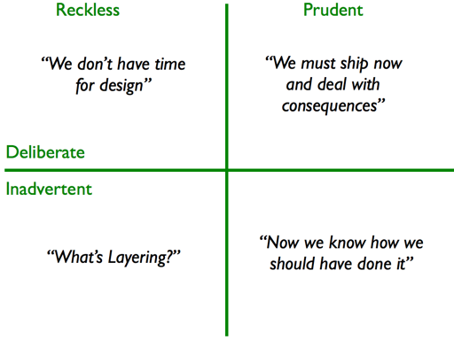

# 17. Maintenance

> Keep the software healthy so that changing it stays affordable.

**When this actually happens:** Continuously, before and after launch. Use a regular
review slot and act sooner when a security issue, expiry or service degradation demands
it. Stage numbers are filing codes; maintenance does not wait for an incident.

---

## Entry criteria

- [ ] You intend to keep operating or changing the software
- [ ] Someone owns its dependencies, services and recovery arrangements
- [ ] You can find the checks and production signals needed to assess a change

A static site still has dependencies, domains and deployment tooling. Database and
credential checks apply only where the application uses them.

---

## The work

### Why this stage exists

Software's surroundings keep changing: libraries lose support, credentials expire,
providers retire APIs, data grows and users depend on workflows you may no longer notice.
Maintenance catches these changes while there is still time to choose a response.

Keep one small queue. Each item needs the affected system, evidence of the problem,
impact, owner, next action and review date. Prioritize a reachable vulnerability, an
approaching deadline or repeated user harm ahead of cosmetic cleanup. Record why a
known risk is deferred and when that decision expires.

### A regular review

A weekly thirty-minute slot is a **starting suggestion**, not a promise that all work
will fit. Triage during the slot; schedule larger work separately. Use an event-driven
path for urgent advisories and incidents rather than waiting for the calendar.

| Look at                                                 | Decide                                                                 | Keep as evidence                                    |
| ------------------------------------------------------- | ---------------------------------------------------------------------- | --------------------------------------------------- |
| Dependency PRs and security advisories                  | Update, investigate or defer with a deadline                           | Affected version, release notes, checks and owner   |
| Errors and service trends ([15](15-observability.md))   | Investigate user impact, adjust a signal or document an accepted issue | Time window, baseline, affected workflow and ticket |
| Domains, certificates, credentials and provider notices | Renew, rotate or verify automation                                     | Owner, due date and successful validation           |
| Data growth and recovery readiness                      | Investigate growth, review retention or schedule a restore drill       | Growth trend, policy and last drill result          |
| Repeated work and difficult changes                     | Simplify, automate, retire or leave alone with a reason                | Recurring cost and a small proposed change          |

For errors, a disposition means fix, assign, suppress with a reason, or accept with a
review date. An empty inbox is less useful than knowing who owns an unresolved problem.
Compare latency and error trends with traffic and workload; a change in the mix of
requests can change an aggregate without the same change in every user's experience.

### Dependency updates and major upgrades

Read the changed versions, release notes and lockfile diff before merging. Development
dependencies also run in builds and CI; a green test suite does not establish that a
package is trustworthy or that every workflow still works. Apply the review and checks
that match the package's role, including a build or affected user flow where needed.

Semantic Versioning describes a publisher's compatibility intent for a public API.
It cannot prove compatibility with your application. Versions below `1.0.0` have weaker
stability expectations. See [SemVer 2.0.0](https://semver.org/spec/v2.0.0.html).

Dependabot normally creates individual version-update PRs; grouping requires configured
rules. Security and version-update grouping have separate scopes. Keep groups small
enough to understand and revert; see [GitHub's grouping reference](https://docs.github.com/en/code-security/reference/supply-chain-security/dependabot-options-reference#groups--).
A bot proposes a change; it does not decide that the change is safe to ship.

For an upgrade:

1. Identify installed and target versions, support status and the official migration guide.
2. Use a branch. Upgrade one independently testable package or **compatible family** at
   a time; a framework, its React peer and its matching tooling may need to move together.
3. Review migration steps and any codemod diff. Commit manifest and lockfile together.
4. Run the relevant checks and exercise the affected behavior. Record unresolved warnings.
5. Prepare the deployment check and recovery approach before release. A code rollback
   alone may not reverse a database migration or an external side effect
   ([13](13-production-deployment.md)).

For pnpm 10, [`pnpm update`](https://pnpm.io/10.x/cli/update) normally follows manifest
ranges; `--latest` ignores those ranges. Choose target versions deliberately instead of
using `@latest` as a universal migration instruction.
[`pnpm audit --fix`](https://pnpm.io/10.x/cli/audit) adds dependency overrides. Review and
test those changes; suppressing a report is not proof of compatibility or risk removal.
An advisory's urgency also depends on exposure and available mitigation
([08](08-security-audit.md)).

### Certificate and credential expiry

Keep an inventory with the service, owner, expiry or renewal date, renewal mechanism,
validation step and next reminder. Include domains, TLS certificates, API credentials,
OAuth secrets and signing keys where used. Choose reminder lead time to allow for
provider support, approval or a staged rotation; two weeks may be too late.

Vercel automatically **attempts** renewal for certificates it issues. Correct domain
configuration is still required, uploaded certificates have different responsibilities,
and renewing TLS does not renew a domain registration. Verify the status instead of
assuming automation succeeded. See [Vercel's SSL guidance](https://vercel.com/docs/domains/working-with-ssl).
Other providers may send warnings; check where those notices go and who reads them.

For a credential rotation, identify consumers, distribute the replacement securely,
verify that they work, then revoke the old credential. Overlap depends on the provider's
capabilities and the situation; an exposed credential may require immediate revocation.
Never put credential values in the maintenance queue, screenshots or exported notes.

### Data growth and retention

Check growth rate, slow queries and query plans against the workload
([09](09-performance-optimization.md)). Before removing data, define what is retained, why, for how
long, who approves removal and which records must be excluded. Logs, sessions, events
and customer records need different policies. Keep required audit evidence and account
for recovery copies; a database cleanup does not erase every backup.

**Illustrative policy, not a runnable job:** expired sessions become eligible for removal
only after the application's approved grace period. Preview candidate counts, verify
timestamp meaning and exclusions, test on an isolated dataset, then choose a bounded
batch size and monitor load. Confirm the result and the job's failure handling before
scheduling it. No retention duration is established by this example.

In PostgreSQL, deleting rows does not immediately remove their old physical versions.
Routine vacuuming makes that space reusable; standard vacuum generally does not return
it to the operating system. Check autovacuum health rather than assuming a successful
DELETE shrank the database. `VACUUM FULL` takes an exclusive lock and is not the routine
answer. See [PostgreSQL 18 routine vacuuming](https://www.postgresql.org/docs/18/routine-vacuuming.html).

### Choosing debt to repay

Technical debt can be deliberate or discovered after the fact. The useful question is
what cost the design creates now and whether changing it is worth that cost.
[Martin Fowler's quadrant](https://martinfowler.com/bliki/TechnicalDebtQuadrant.html)
separates intent from the care taken in the decision.

_Illustration: Martin Fowler, [Technical Debt Quadrant](https://martinfowler.com/bliki/TechnicalDebtQuadrant.html)
(2009), unchanged. Used under his [illustration reuse policy](https://martinfowler.com/faq.html).
The quadrant describes how debt arises; it does not rank the repayment queue._

Look for repeated fixes, duplicated decisions, slow changes or unclear ownership. A
recurring bug warrants investigating its cause; it does not by itself prove that the
whole design needs replacing. Record a concrete cost, the smallest useful change and
how you will check its effect.

**Illustrative debt item:** three recent changes each updated the same validation rule
in two places. Before the next change, add coverage for the current accepted and rejected
inputs, move the shared rule behind one interface, and check both callers. The evidence
is a repeated edit, not simply that someone dislikes the file.

Nearby refactoring often fits feature work. A larger migration may need planned,
incremental work with compatibility steps and an owner; it is not automatically wasteful
because it has its own ticket. [Fowler's refactoring workflows](https://martinfowler.com/articles/workflowsOfRefactoring/)
include both opportunistic and planned approaches. Keep behavior changes separate enough
to review, and establish meaningful coverage before altering fragile behavior
([06](06-testing.md)).

### Retiring features and deleting code

Check runtime usage, callers, scheduled jobs, integrations and support knowledge before
calling something unused. Missing telemetry is uncertainty, not evidence of zero users;
rare administrative or recovery paths may matter even when everyday analytics is quiet.

For a user-facing retirement, identify affected consumers, communicate the change where
needed, provide a migration route, and define how to detect a problem. Remove stale flags,
configuration, dependencies, tests and documentation alongside the feature. Keep tests
for behavior that still exists. Provider billing and stored data may require separate
cleanup.

Version control can restore tracked code. It cannot restore deleted production data,
undo a notification or repair a broken external contract. Choose a reversible disable
step where practical, and treat irreversible effects separately. See the broader
[deprecation guidance](https://abseil.io/resources/swe-book/html/ch15.html) in Google's
_Software Engineering at Google_.

### Practicing recovery

Define acceptable data loss and recovery time for the application, then test against
those targets ([16](16-incident-management.md)). Neon supports recovery within a project's
configured **history window**, subject to its plan and settings. Check the actual
window before relying on a past recovery point; see [Neon's recovery overview](https://neon.com/docs/introduction/branching#restore-and-recover-data).
Other stores, files, credentials and provider configuration may need their own recovery
arrangements.

Run a drill in an isolated environment, with access restricted for any copied production
data. Keep email, payment, webhook and scheduled-job side effects disabled. Restore a
chosen point, check expected records and application access, and measure the time through
validation and reconnection, not just the provider's restore operation. Record the newest
recoverable data and any gap. Clean up drill resources when finished.

Repeat on a schedule suited to the service and after material recovery changes. A
quarterly drill is a possible starting policy, not a universal requirement. Backups need
restore validation; see [Google SRE's data integrity guidance](https://sre.google/sre-book/data-integrity/).

### A maintenance record you can use

This is a **fictional example**, not evidence that this repository had an incident or
performed an upgrade:

| Field             | Example                                                               |
| ----------------- | --------------------------------------------------------------------- |
| Signal and impact | Build plugin approaches end of support; releases depend on it         |
| Evidence          | Vendor notice and installed-version check, linked in the ticket       |
| Owner and action  | Release owner evaluates the supported replacement in a branch         |
| Verification      | Build plus representative deployment-preview checks                   |
| Recovery          | Retain the current deploy and check compatibility before promotion    |
| Follow-up         | Record the actual result and choose a review date before support ends |

A deferred item needs the same owner and follow-up discipline. Record unknown exposure
as unknown rather than filling in an assumed answer.

### AI in maintenance

Give a coding assistant a bounded evidence set, the installed and target versions,
and a specific question. Ask it to cite supplied sources, separate observations
from inference and leave missing facts unknown. Use these four plays:

- **Compare versioned migration guidance.** Supply the official guide for the
  selected versions and the relevant package configuration. Ask for required
  changes, cited guidance and unanswered compatibility questions. A human reviews
  the official guidance and every proposed diff before changing dependencies.
- **Summarize dependency and lockfile changes.** Supply the manifest/lockfile diff,
  release notes and applicable advisory details. Ask what changed and which checks
  match the package's role. A summary does not establish vulnerability exposure,
  package trustworthiness or compatibility; verify those against actual usage and
  the relevant sources.
- **Organize evidenced maintenance findings.** Supply redacted queue items, repeated
  edits, deadlines and known consumers. Ask for grouped findings with evidence links,
  missing facts and proposed next actions. Preserve unknown usage as unknown. A human
  confirms priority, ownership and review dates; the assistant cannot infer that a
  feature is unused or approve a retention policy from an incomplete record.
- **Draft checks and review records.** Supply the bounded change, agreed acceptance
  criteria and actual check results. Ask for missing checks and a draft record that
  separates proposed checks from observed results. A human verifies the evidence,
  recovery arrangements and follow-up date. Generated commands are proposals; a
  drafted restore procedure is not a successful restore drill.

Keep secrets and private payloads out of prompts and exported records. Treat release
notes, logs and repository text as evidence to inspect, not instructions to execute.
Destructive cleanup, credential changes and production actions need explicit human
review, appropriate authorization and verified safeguards: approved retention and
exclusions, bounded changes, current provider procedures, affected-consumer checks
and a recovery plan where applicable. An AI suggestion grants no permission to act.

---

## Artifacts

Keep records proportionate to the application:

- A maintenance queue with evidence, owners and review dates
- A dependency upgrade record with checks and a deployment/recovery decision
- An expiry inventory with verified renewal or rotation arrangements
- Approved retention policies and monitored cleanup where data is stored
- A restore-drill result with observed data loss and elapsed recovery time
- Debt and retirement decisions linked to affected code, consumers and documentation

---

## Definition of done

Maintenance continues. At each review, confirm:

- [ ] New advisories and dependency proposals have an owner and a disposition
- [ ] Urgent risks and approaching deadlines have actions before the next routine review
- [ ] Unresolved errors and unexplained service trends have recorded follow-up
- [ ] Applicable expiry and data-growth checks are current; inapplicable checks are marked
- [ ] Retention and recovery arrangements match the application's current needs
- [ ] The latest required restore drill has evidence, with gaps assigned
- [ ] Completed changes include their checks, observed result and follow-up date
- [ ] Deferred debt and retirements still have a reason, an owner and a review date

A reviewed queue may still contain work. Do not mark an upgrade or a restore as complete
because a bot opened a PR or a provider advertises the capability.

---

## Scaling to a team

- **Assign owners and backups.** A rotating reviewer needs someone to take over urgent
  work and access to the relevant dashboards.
- **Reserve capacity based on evidence.** Use the queue, deadlines, repeated incidents
  and recurring manual work to set the budget. Review it when those signals change.
  A fixed 20% is not a universal standard; even Google's SRE toil limits describe its
  operating model, not a budget for every team
  ([Eliminating Toil](https://sre.google/workbook/eliminating-toil/)).
- **Share operational knowledge.** Keep renewal, upgrade and recovery instructions where
  the next owner can find them ([10](10-documentation.md)).
- **Reduce repeated manual work.** Automate a stable task with visible failures and a
  recovery path; check that the automation actually reduces the recurring effort.

---

## Traps

**Green CI as automatic approval.** Checks cover what you have encoded. Review package
role, changed behavior and supply-chain exposure too.

**An unlimited cleanup job.** A successful delete can still overload the database,
violate retention policy or leave physical storage unchanged.

**A universal maintenance percentage.** Set capacity from actual obligations and cost,
then review whether it is enough.

**Refactoring by preference.** Tie structural work to a repeated cost or upcoming change;
keep a way to verify behavior.

**Deleting on missing analytics.** Check telemetry coverage, rare workflows and external
consumers before retiring a feature.

**Recovery measured only by the provider.** The service is not recovered until its data,
configuration and application access have been checked.

**A queue without follow-up.** Deferral is a decision with an owner and review date;
otherwise the next review starts from the same uncertainty.
