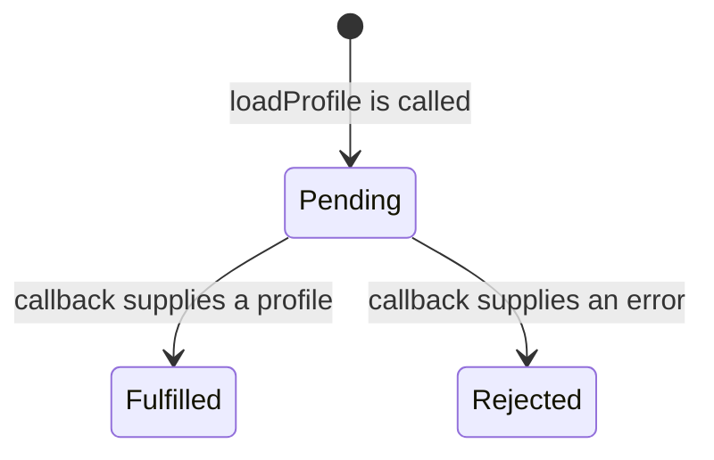

# Promises and errors: follow one result from producer to caller

Teaching prototype, 2026-11-06. For someone comfortable with functions, callbacks,
basic arrays/loops and `try/catch`, encountering promises for the first time.

By the end, you should be able to explain what a caller receives before work
finishes, connect that work to a returned promise, and handle success, failure
and cleanup deliberately.

## The problem: the function returns before its result arrives

Imagine a screen needs a person's display name. A profile lookup will supply the
record later. The caller needs a way to find out when the lookup finishes and
whether it succeeded.

We will use this tiny in-memory lookup. It simulates an error-first callback API:
the callback receives either an error or a profile. It calls the callback once,
after the current synchronous code finishes. There is no network request or
timer-duration assumption here. `queueMicrotask` is just the fixture's way to
make the callback arrive later; queue ordering belongs in the Scheduling lesson.

Use **Node 22.23.4, strict CommonJS**. Each demonstration is a separate run:
combine the shared fixture with the definitions and caller used by that demo.

<!-- example: profile-fixture -->
```js
'use strict';

const profiles = new Map([
  [1, { name: 'Ada' }],
  [2, { name: 'Lin' }],
]);

function readProfile(id, done) {
  queueMicrotask(() => {
    const profile = profiles.get(id);
    if (!profile) {
      done(new Error(`Profile ${id} was not found`));
      return;
    }
    done(null, profile);
  });
}
```

Here is a caller using that API directly:

<!-- example: callback-caller -->
```js
readProfile(1, (error, profile) => {
  if (error) {
    console.log(`caught: ${error.message}`);
    return;
  }
  console.log(profile.name);
});
console.log('request started');
```

It prints `request started`, then `Ada`. Registering a callback does not wait
for that callback to run. The caller continues; later, the lookup invokes it.

That distinction explains this tempting mistake:

<!-- example: wrong-callback-return -->
```js
function wrongName(id) {
  readProfile(id, (error, profile) => {
    if (error) return 'Guest';
    return profile.name;
  });
}
console.log(wrongName(1)); // undefined
```

There are two functions here. `return profile.name` returns from the callback.
`wrongName` has already reached its end without returning a value. Our lookup
also ignores the callback's return value. Changing that inner return cannot
make the outer function wait.

**Check your understanding:** if the lookup takes longer, does `wrongName` start
returning a profile? No. The missing completion contract is the problem; elapsed
time does not change which function the return belongs to.

## The mental model: return a promise now, observe its outcome later

A promise is an object representing an eventual outcome. The caller can receive
that object immediately and attach work to its outcome. For our lookup:



| State | Meaning in this example | What the caller has |
|---|---|---|
| Pending | The callback has not supplied an outcome yet. | The promise object. |
| Fulfilled | The lookup supplied a profile. | A fulfillment handler can receive that profile. |
| Rejected | The lookup supplied an error. | A rejection handler can receive that reason. |

Fulfilled and rejected are the two **settled** states. Once settled, this promise
cannot switch to the other result. “Resolved” is a different term: a promise can
adopt another promise that is still pending. Our adapter below resolves with a
plain profile object, so that particular resolution fulfills it. [Promise states](https://developer.mozilla.org/en-US/docs/Web/JavaScript/Reference/Global_Objects/Promise).

The lookup still decides when the result becomes available. Creating a promise
does not move work onto another JavaScript thread.

## Connect the callback API to that contract once

Wrap the callback boundary so callers receive a promise. The arrow function
passed to `new Promise` is called its **executor**. The constructor calls it
immediately and supplies two functions, `resolve` and `reject`, tied to that new
promise. These are supplied arguments, not application functions we must define.

<!-- example: promise-adapter -->
```js
function loadProfile(id) {
  return new Promise((resolve, reject) => {
    readProfile(id, (error, profile) => {
      if (error) {
        reject(error);
        return;
      }
      resolve(profile);
    });
  });
}
```

There are two callbacks in this adapter. The constructor invokes the executor
now; our lookup invokes `(error, profile) => ...` later. That later callback
retains access to `resolve` and `reject`. Calling `resolve(profile)` supplies the
promise's outcome; it does not return the profile from `loadProfile`.

Walk through the calls, rather than memorizing the syntax:

| Moment | What happens | What has returned? |
|---|---|---|
| Call `loadProfile(1)`. | The constructor creates a promise and runs its executor immediately. | `loadProfile` is still running. |
| The executor calls `readProfile`. | The lookup registers its later callback; its own call returns. | The executor reaches its end. |
| `loadProfile` returns. | The caller can attach handlers to the pending promise. | The promise, before the profile. |
| The lookup invokes its callback. | A profile leads to `resolve(profile)`; an error leads to `reject(error)`. | The callback finishes. |
| A registered reaction runs. | It receives the fulfillment value or rejection reason. | Its return value determines a derived promise's outcome. |

The executor is synchronous; the fixture's callback is later. A synchronous
executor throw can reject the promise, but a throw from that later callback
does not travel backward into the finished executor. This adapter explicitly
passes reported callback errors to `reject`. Keep transformations in the promise
chain so their throws become chain rejections. [Constructor](https://developer.mozilla.org/en-US/docs/Web/JavaScript/Reference/Global_Objects/Promise/Promise),
[callback boundaries](https://developer.mozilla.org/en-US/docs/Web/JavaScript/Guide/Using_promises).

## Transform the result and return the chain

The screen needs an uppercase display name, with a completion message on either
outcome. This version uses promise methods:

<!-- example: chain-version -->
```js
function displayNameWithThen(id) {
  return loadProfile(id)
    .then(profile => profile.name.toUpperCase())
    .finally(() => console.log(`finished ${id}`));
}
```

Each call to `then` creates a new promise. It does not replace the value inside
the original promise:

| Expression | Eventual fulfillment value |
|---|---|
| `loadProfile(id)` | A profile object such as `{ name: 'Ada' }`. |
| `.then(profile => profile.name.toUpperCase())` | The string `'ADA'`. |
| `.finally(...)`, when cleanup succeeds | The same `'ADA'`. |

Now trace `displayNameWithThen(99)`. The failure occurs in the lookup, before
there is any profile to uppercase:

| Boundary | What happens to the rejection |
|---|---|
| Lookup callback → adapter | The callback supplies an error; `reject(error)` rejects the lookup promise. |
| Lookup promise → `then` | Its success handler is skipped. With no rejection handler at this link, the derived promise rejects with the same reason. |
| Derived promise → `finally` | Cleanup prints `finished 99`. Successful cleanup preserves that rejection in the returned promise. |
| Returned promise → an awaited caller | Await throws that reason, so the caller's surrounding catch can handle it. |

The uppercase handler never runs on this path. Cleanup succeeding does not turn
the failed lookup into a successful result. Cleanup throwing is a separate
failure case discussed below.

Returning the chain lets the caller observe the whole operation. Omitting the
outer return would make this ordinary function return `undefined`, even though
the lookup continued. Omitting the return inside a block-bodied handler would
instead fulfill its derived promise with `undefined`. Identify **which function**
has lost its return before fixing it. A handler that throws rejects the promise
returned by `then`; returning another promise makes the chain follow its outcome.
[Chaining rules](https://developer.mozilla.org/en-US/docs/Web/JavaScript/Reference/Global_Objects/Promise/then).

## Express the same operation with async and await

Here is the same result, failure propagation and cleanup using `async`/`await`:

<!-- example: await-version -->
```js
async function displayNameWithAwait(id) {
  try {
    const profile = await loadProfile(id);
    return profile.name.toUpperCase();
  } finally {
    console.log(`finished ${id}`);
  }
}
```

An async function returns a promise. At `await`, this invocation pauses until
the awaited outcome is available; other JavaScript work can run. Fulfillment
supplies `profile`. Rejection throws at that expression and travels through the
`finally` block before this function's returned promise rejects. A transformation
error, such as trying to call `toUpperCase` on a non-string name, also propagates.

There is no recovery here. The caller owns the decision to show a fallback,
retry or report the error. Adding a catch that only logs and returns normally
would turn that rejection into fulfillment, possibly with `undefined`.
[Await and rejection](https://developer.mozilla.org/en-US/docs/Web/JavaScript/Reference/Operators/await).

Run this caller with the fixture, adapter and await version:

<!-- example: awaited-caller -->
```js
async function demo() {
  for (const id of [1, 99]) {
    try {
      console.log(await displayNameWithAwait(id));
    } catch (error) {
      console.log(`caught: ${error.message}`);
    }
  }
}
demo().catch(error => console.error(error));
```

The output is:

```text
finished 1
ADA
finished 99
caught: Profile 99 was not found
```

Why this order? The display-name function runs its cleanup before its returned
promise settles. Only then can the caller's await resume and print the name or
handle the rejection. The loop awaits each call, so request 99 starts after the
first caller has handled its result. Replacing the function call with
`displayNameWithThen(id)` gives the same observable outcomes in this example.

This is also where cleanup contracts matter. A throwing cleanup can replace the
original outcome. Returning an ordinary value from `Promise.finally` is ignored;
a `return` statement inside a JavaScript `finally` block can override an earlier
return or throw. Keep cleanup separate from choosing a result. [Promise.finally](https://developer.mozilla.org/en-US/docs/Web/JavaScript/Reference/Global_Objects/Promise/finally).

## Choose what completes a batch

Suppose a report should show each available profile and explain each missing
one. It can still be useful when one lookup fails. Give `allSettled` the lookup
promises and inspect its outcome records:

<!-- example: outcomes-example -->
```js
async function profileReport() {
  const outcomes = await Promise.allSettled([
    loadProfile(1),
    loadProfile(99),
  ]);
  for (const outcome of outcomes) {
    if (outcome.status === 'fulfilled') {
      console.log(`ok: ${outcome.value.name}`);
    } else {
      console.log(`failed: ${outcome.reason.message}`);
    }
  }
}
profileReport().catch(error => console.error(error));
```

With the fixture and adapter, this prints `ok: Ada` and then
`failed: Profile 99 was not found`. Each record identifies its branch: a fulfilled
record has `value`; a rejected record has `reason`. The promise from `allSettled`
waits until every input has settled, then fulfills with the records in input
order. `profileReport` prints them and returns
no value, so its own promise fulfills with `undefined`. It calls `loadProfile`
directly, so the display-name functions' cleanup messages are not part of this run.

If the task instead requires every lookup to succeed, `Promise.all` exposes that
all-success contract: it fulfills with the values or rejects when an input
rejection reaches it. It does not provide a full outcome report or cancel other
started work. Choose the contract before choosing the method.
[Retaining outcomes](https://developer.mozilla.org/en-US/docs/Web/JavaScript/Reference/Global_Objects/Promise/allSettled).

## Explain it in an interview

**What does `loadProfile(1)` return before the callback runs?**

A promise representing the lookup. Its executor has already registered the
callback, but the profile is not available to the caller yet. The caller observes
the outcome through a handler or await. A weak answer confuses the promise with
the profile itself. **Follow-up:** returning a profile from the executor does
not fulfill the promise; that return value is ignored.

**Does `then` change the original promise?**

It returns a new promise. Returning a normal value fulfills that derived promise;
throwing rejects it; returning another promise makes it follow that outcome.
A weak answer says it “updates the promise.” **Follow-up:** a handler that returns
nothing supplies `undefined` to the derived promise.

**Does await block JavaScript? When does local try/catch need it?**

Await suspends this async invocation. It does not block the whole thread while
the operation is pending. Await inside a local try makes a rejection throw at
that boundary. Simply returning a pending promise can forward its eventual
rejection to the caller without that local catch seeing it. **Follow-up:** use
await when local error handling or cleanup must span the operation; direct
promise forwarding is useful when the caller owns those responsibilities.

**Would Promise.all cancel the remaining lookups after one fails?**

No. It joins the promises and rejects its aggregate when an input rejection
reaches it; started work can continue. Use an all-success contract when a partial
answer is unusable. Use `allSettled` when the caller needs each outcome.
**Follow-up:** calling the lookup functions initiates work; `Promise.all` does
not call those functions for you. [Composition and cancellation](https://developer.mozilla.org/en-US/docs/Web/JavaScript/Guide/Using_promises).

## Apply the model to two new situations

These are the existing two page activities. Keep their published prompts and
solutions when this lesson is ported. The aim is to transfer the model, not
reproduce the profile example from memory.

**1. Save a batch in order.** The caller must observe every save, and item 3 must
not start if item 2 fails. Before changing the code, identify the promise the
caller receives and the completion that each loop method actually exposes.
Then attempt [Async iteration repair](../../../reference/cheatsheets.md#async-iteration-repair).

An adequate explanation identifies why awaiting `forEach` cannot join promises
that its callbacks return, chooses sequential initiation deliberately, and shows
how rejection reaches the awaited caller. Naming `for...of` alone does not
explain the contract.

After implementing `saveAll`, use this fixture to check initiation order. The
executor stores its supplied resolving function in `releaseFirst`, so you can
finish the first save manually:

<!-- example: save-test-fixture -->
```js
let releaseFirst;
const firstSave = new Promise(resolve => { releaseFirst = resolve; });
const started = [];
const save = item => {
  started.push(item);
  return item === 1 ? firstSave : Promise.resolve();
};
const done = saveAll([1, 2], save);
console.log(started.join(','));
releaseFirst();
done.then(result => console.log(result)).catch(error => console.error(error));
```

The repair prints `1`, then `complete`: item 2 has not started at the observation
point while item 1 remains pending. The original bug prints `1,2` at that point.
Also test these contracts separately:

| Input and supplied save behavior | Required outcome |
|---|---|
| Empty items | Fulfill with `complete`; never call save. |
| Items `[1, 2]`, both saves fulfill | Start in order and fulfill only after both saves. |
| Items `[1, 2, 3]`, save 2 rejects | Reject saveAll with that error; save 3 never starts. |

**2. Produce a partial-results report.** Some work can fail while successful
results remain useful. Attempt [Retain partial results](../../../reference/cheatsheets.md#retain-partial-results),
including one fulfillment, one rejection and empty input.

An adequate explanation distinguishes an outcome record from a recovered value,
states input order versus completion order, and says what continues after a
failure. Choosing `allSettled` should follow from the report's requirements.

## Check what you can now explain

Without rereading, trace both `id = 1` and `id = 99` through the producer,
adapter, transformation, cleanup and caller. For every boundary, say what is
returned immediately, what becomes available later, and who owns an error.
Then explain what changes if the transformation itself throws.

If any step is unclear, return to that boundary's walkthrough. The goal is to
reconstruct the behavior and make a choice, rather than recall one output.

---

### Editorial and delivery notes

This is a readable teaching prototype, not a second maintained source for the
published page. Once a pilot is implemented, the TypeScript data and generated
Markdown remain its content authority. Source findings and validation belong in
the [research record](../../../reference/javascript-source-research.md#promise-mini-lesson-source-check-2026-11-06).

The proposed reading order is problem → mental model → callback boundary → chain
→ await/caller trace → interview explanation → transfer practice. The live
section should show a useful opening explanation and learning outcomes before
collapsed detail. The current single-paragraph Row body cannot express this
sequence faithfully without adaptation; choose the smallest structured teaching
extension after reviewing the draft's depth. Keep the `/reference/javascript#async`
route, the original activities and keyboard/heading contracts.

This pilot does not authorize a whole-page teaching rewrite, new topic catalogue,
code runner, scoring or persistence. Reader review should judge whether the
walkthrough supports explanation and transfer, not how many headings it adds.
Its length is not a quota for other topics; simpler mechanisms need less space.
