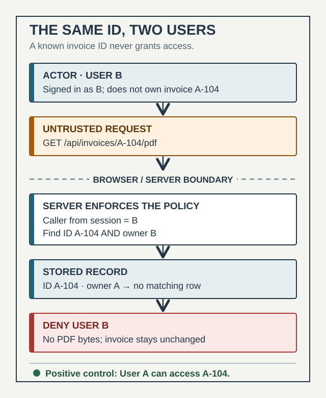

# Cheatsheets

<!-- Generated from web/src/lib/cheatsheets/. Do not edit by hand.
     Edit the sheet there and run `pnpm gen:cheatsheets` (from web/) to regenerate. -->

Look up a command or study a focused topic. Study sheets include worked
examples and local practice; stages teach lifecycle decisions.

Drawn: 29 of 31. A sheet listed as not drawn is
registered on purpose — the gap is the point, so it can be seen and filled.

| Sheet | Group | Stage | Status |
|---|---|---|---|
| Software Architecture Patterns | Architecture | 03 | Drawn |
| Design Patterns | Architecture | 03 | Drawn |
| API Design | Architecture | 03 | Drawn |
| SOLID Principles | Design Principles | 03 | Drawn |
| Clean Code | Design Principles | 05 | Drawn |
| Git Cheat Sheet | Git | 04 | Drawn |
| Git Commands | Git | 04 | Drawn |
| Git Branching & Conventions | Git | 04 | Drawn |
| Coding Standards | Standards | 05 | Drawn |
| Documentation Change Check | Standards | 10 | Drawn |
| Technical Debt Review | Standards | 17 | Drawn |
| Improvement Review | Standards | 18 | Drawn |
| Software Development Life Cycle | Standards | — | Drawn |
| Testing | Standards | 06 | Drawn |
| Playwright | Standards | 06 | Drawn |
| Code Review | Standards | 07 | Drawn |
| Deployment Environments | Standards | 12 | Drawn |
| AWS Deployment | Standards | 13 | Drawn |
| Post-Deploy Verification | Standards | 14 | Drawn |
| CI/CD Pipeline | Standards | 11 | Drawn |
| GitHub Actions | Standards | 11 | Drawn |
| Incident Management | Standards | 16 | Drawn |
| Security Audit | Standards | 08 | Drawn |
| Caching | Architecture | 09 | Drawn |
| Infrastructure Scaling | Architecture | 09 | Drawn |
| JavaScript | Languages | — | Drawn |
| DSA Patterns | Algorithms | — | Drawn |
| Node.js & Express | Languages | — | Drawn |
| Python | Languages | — | Drawn |
| Java | Languages | — | Not drawn |
| Spring Boot | Languages | — | Not drawn |

---

## Software Architecture Patterns

Six ways to arrange a system, and what each one costs you.

Belongs to [03 — Architecture](../docs/03-architecture.md).

### Event-driven

Components communicate through events.

- **Event producer** — Emits events without knowing who consumes them. — The producer must not care how many consumers exist.
- **Event broker** — Holds the ordered stream — event 1 through event N. — Consumers read at their own pace, or replay from the start.
- **Event consumers** — Independent subscribers, each reacting to what it cares about. — Adding a consumer should not require touching the producer.

### Layered

Organize system into layers with separation of concerns.

- **Presentation layer** — What the user touches. — Depends downward only.
- **Business / application layer** — The rules that make this system this system. — The layer worth protecting from the other three.
- **Data access layer** — How persistence is reached, not where it lives. — Swapping the store should stop here.
- **Persistence layer** — The store itself. — The bottom of the stack.
- **Infrastructure** — Cross-cutting concerns every layer talks to. — Logging, config, auth — the things that refuse to layer.

### Monolithic

All components built and deployed as a single unit.

- **One deployable** — Posts, comments, groups, media and live streaming ship together. — One team, one release cadence, no distributed-systems tax.
- **One database** — Every feature reads and writes the same store. — Transactions across features stay trivial.
- **The cost** — Any change redeploys everything. — It bites when teams outgrow one release train.

### Microservices

Application is composed of small, independent services.

- **API gateway** — One entry point in front of many services. — Clients should not know the service topology.
- **Service per capability** — Catalog, cart, discount and order each deploy alone. — Teams need independent release cadence.
- **Database per service** — Each service owns its own store — four services, four databases. — Shared tables reintroduce the coupling the split was meant to remove.

### MVC

Separate application into Model, View and Controller.

- **View** — Renders state and forwards user actions to the controller. — Holds no rules of its own.
- **Controller** — Receives the action, requests data, renders the view. — The traffic director, not the brain.
- **Model** — Fetches and returns data, and updates the controller. — Where the rules and the persistence live.

### Master-slave

Distribute read/write workload between master and slaves.

- **Master (primary)** — Takes every write. — One writer keeps ordering simple.
- **Slave (replica)** — Serves reads, fed by replication from the master. — Read volume is the bottleneck, not write volume.
- **Replication lag** — A replica can answer with data the master already changed. — The trade this pattern asks you to accept.

Source: Software Architecture Patterns — Sathish Kumar Subramani.

## Design Patterns

The Gang of Four set, grouped by what each one is for.

Belongs to [03 — Architecture](../docs/03-architecture.md).

### Creational — how objects are created

- **Singleton** — Ensures a class has exactly one instance and one global access point. — Config managers, loggers, caches — cases where a second instance would be a bug, not a feature.
- **Factory Method** — Defines an interface for creating an object, letting subclasses choose the concrete class. — Object creation logic is complex enough that the caller should not have to know it.
- **Abstract Factory** — Creates families of related objects without naming their concrete classes. — A whole family needs to swap together — a UI theme, a database driver set.
- **Builder** — Builds a complex object step by step, separating construction from representation. — Many optional parameters would otherwise mean a constructor nobody can read.
- **Prototype** — Creates new objects by cloning an existing one rather than building from scratch. — A template instance already exists and copying it is cheaper than reconstructing it.

### Structural — how objects are composed

- **Adapter** — Converts the interface of a class into another interface clients expect. — Integrating third-party libraries or legacy systems whose interface you cannot change.
- **Bridge** — Decouples an abstraction from its implementation so both can vary independently. — An abstraction and its implementation would otherwise multiply combinations through subclassing.
- **Composite** — Composes objects into tree structures and treats a single object and a group of them the same way. — Part-whole hierarchies where the caller should not have to check which one it has.
- **Decorator** — Adds behavior to an object dynamically, without touching its class. — Layering concerns like logging, authorization or caching without subclassing for every combination.
- **Facade** — Provides one simplified interface to a complex subsystem. — Simplifying usage for callers who need the common path, not the whole subsystem’s surface.
- **Flyweight** — Shares objects to support large numbers of fine-grained instances efficiently. — Object count is high enough that per-instance memory is the actual bottleneck.
- **Proxy** — Controls access to an object through a surrogate that stands in for it. — Access control, lazy loading, or logging need to sit in front of the real object.

### Behavioral — how objects communicate

- **Chain of Responsibility** — Passes a request along a chain of handlers until one of them handles it. — The sender should not need to know which handler, if any, will act.
- **Command** — Encapsulates a request as an object, decoupling the invoker from the thing that executes it. — Queuing, logging or undoing actions requires treating a request as data.
- **Interpreter** — Defines a grammar and a way to interpret sentences written in it. — A small language recurs often enough to justify its own grammar rather than ad hoc parsing.
- **Iterator** — Traverses a collection’s elements without exposing how the collection is stored. — Callers need to walk a collection without depending on its internal structure.
- **Mediator** — Centralizes communication between objects so they reference the mediator instead of each other. — A group of objects’ interactions have become a tangle of direct references.
- **Memento** — Captures and restores an object’s internal state without exposing that state directly. — Undo functionality needs a snapshot that does not break encapsulation to take.
- **Observer** — Notifies multiple dependents automatically when an object’s state changes. — Event handling, UI updates, notifications — anywhere one change fans out to many reactions.
- **State** — Lets an object alter its behavior when its internal state changes, as if it changed class. — A single object’s behavior branches heavily on a status field that keeps growing.
- **Strategy** — Defines a family of algorithms, encapsulates each one, and makes them interchangeable. — Payment methods, sorting, compression — the algorithm varies but the caller’s shape does not.
- **Template Method** — Defines the skeleton of an algorithm in a base class, letting subclasses override specific steps. — Several variants share most of a process and differ only in a few well-defined steps.
- **Visitor** — Adds new operations to an object structure without modifying the classes it operates on. — New operations arrive more often than new element types do.

Source: Software Design Patterns — Unrecorded — see reference/cheatsheet-sources.md.

## API Design

From HTTP fundamentals through versioning, auth and rate limits.

Belongs to [03 — Architecture](../docs/03-architecture.md).

### Fundamentals and protocol

- **API types** — REST, GraphQL, gRPC, SOAP — different answers to the same question of how a client asks a server for something.
- **Request-response lifecycle** — Client sends a request, server processes it, server returns a response — the shape every API type still fits inside.
- **HTTP methods and status codes** — GET, POST, PUT, PATCH, DELETE map to intent; status codes and headers carry the outcome.
- **Payload basics** — JSON, XML and form data as wire formats; URLs, HTTPS and TLS as the transport underneath them.

### Designing the resource

- **REST principles** — Resource-based URLs, CRUD operations mapped onto HTTP methods, consistent naming.
- **Versioning and idempotency** — A breaking change ships as a new version rather than breaking every client already live; idempotent methods are safe to retry.
- **Request and response shape** — A consistent JSON structure, pagination for large result sets, filtering and sorting as query parameters.
- **Error responses** — A standardized error shape, so a client can branch on it instead of parsing prose.

### Auth and validation

- **API keys and JWT** — A key identifies the caller; a JWT carries claims about who they are without a database round trip to check.
- **OAuth 2.0 and OpenID Connect** — Delegated authorization and identity on top of it — a client acts on a user’s behalf without holding their password.
- **RBAC and session vs token** — Role-based access control decides what an authenticated caller may do; sessions and tokens are two different ways to carry "who is this" between requests.
- **Input validation** — Validate and sanitize at the boundary, with error codes and exceptions that say what failed rather than that something did.

### Data and performance

- **SQL vs NoSQL** — Relational structure and transactions against flexible schema and horizontal scale — the trade the data model makes.
- **Caching** — Redis or similar in front of a slow read path, with rate limiting and compression protecting what caching does not.
- **Async processing and load balancing** — Work too slow for a request-response cycle moves off it; load balancing spreads traffic once one server is not enough.

### Docs, testing and security

- **OpenAPI and Swagger** — A machine-readable API specification that also generates interactive documentation and client SDKs.
- **Testing** — Unit and integration tests, automated mocks, and manual exploration with a tool like Postman.
- **Transport and injection defenses** — HTTPS and CORS at the edge; defenses against XSS, CSRF and SQL injection in the application.
- **Secrets** — Credentials and keys live outside the codebase, with logging and monitoring watching for misuse.

### Deployment and advanced patterns

- **Gateways and containers** — An API gateway as the single entry point in front of many services; Docker and Kubernetes as how those services run.
- **CI/CD** — Pipelines that build, test and deploy on every change rather than on a manual release day.
- **Beyond REST** — GraphQL and gRPC as alternatives to REST; WebSockets and webhooks for the cases a request-response cycle does not fit.
- **Microservices communication** — Services talk to each other the same way clients talk to the API — the design principles above apply internally too.

Source: Master Plan for API Design — Shalini Goyal.

## Caching

Choose reusable work, set a freshness rule, invalidate after writes, and verify the same user outcome.

Belongs to [09 — Performance Optimization](../docs/09-performance-optimization.md).

### Choose the boundary

Cache a result only when its ownership scope and tolerated staleness are defined. These are application decisions, not a command to add a cache everywhere.

- **Reusable result** — A public catalog description can be a candidate for reuse. A faster response is useful only if it still answers the intended user operation. — Use evidence that the repeated work contributes to the measured slow path.
- **Current business decision** — Validate stock, charge status and authorization against the appropriate authoritative state. A cached description is not permission to sell, charge or disclose. — Before accepting an order, confirming payment or returning protected data.
- **Key and ownership** — Include every input that changes the result, such as product, locale or tenant. A tenant-specific cache key does not grant access; authorization still belongs at the data boundary. — Test the same identifier as two users or tenants before sharing a cached result.

### Set lifetime and tags

TTL means time to live: a freshness or expiry interval under the chosen cache policy. Retention is how long an entry remains stored; neither term promises persistence on every host.

- `cacheComponents: true` — Enable Cache Components in the example application before using the Next.js use cache directive. This playbook is teaching the API; it does not enable runtime caching here. — Check the installed framework version and hosting behavior.
- `'use cache'` — Mark an async function, component or module scope for caching. Read cookies, headers and other request-specific values outside that scope, then pass the needed inputs. — Reuse an eligible result, with its input and ownership boundaries already defined.

  *Illustrative public-description read; example domain, not this app*

  ```
  import { cacheLife, cacheTag } from 'next/cache'

  export async function readDescription(productId: string) {
    'use cache'
    cacheLife('minutes')
    cacheTag(`catalog:${productId}`)
    const response = await fetch(
      `https://catalog.example/products/${encodeURIComponent(productId)}`,
    )
    if (!response.ok) throw new Error('Catalog read failed')
    const { id, description } = await response.json()
    return { id, description }
  }
  ```

- `cacheLife / cacheTag` — Choose a lifetime consistent with tolerated staleness and tag the reads a successful write will invalidate. Tags label entries; they are not authorization checks. — Describe the expected read after a write, not only how long the entry might be retained.
- **Hosting and retention** — Default runtime memory can be instance-local and ephemeral, especially on serverless hosts. Check the configured cache handler before assuming reuse across requests or deployments. — A published lifetime is not evidence that a particular instance still holds the entry.

### Invalidate after a write

The write must succeed before invalidating affected reads. Invalidation changes the next matching data read; it does not automatically refresh every open browser view.

- `updateTag(tag)` — Server Actions only: expire matching entries immediately so the next matching read waits for fresh data. — Use after a successful write when the actor must read their own change. It is not available in Route Handlers.
- `revalidateTag(tag, 'max')` — Server Actions or Route Handlers: mark tagged data stale; the next visit can receive stale data while revalidation runs in the background. — Use when stale-while-revalidate behavior is acceptable. The call itself does not eagerly refresh every tagged page.
- `revalidateTag(tag, { expire: 0 })` — From a Route Handler that requires immediate expiry, make the next matching read block for fresh data. — Use when stale content is unacceptable and updateTag is unavailable. Avoid the deprecated single-argument revalidateTag form.

### Read CDN evidence

CDN means content delivery network. CF-Cache-Status describes Cloudflare response caching, not Next.js application-cache entries. These examples do not imply this site uses Cloudflare.

- **HIT** — Cloudflare found the response in its cache. — A hit does not prove the application data reflects the latest write.
- **MISS** — The request was eligible for Cloudflare caching but the response was absent, so the origin served it. — A first or cold request can miss without a fault.
- **BYPASS** — Cloudflare considered the request eligible, but the response or policy prevented storing the response. — Inspect the relevant response headers and cache rules before changing the policy.
- **DYNAMIC** — Cloudflare considered the request ineligible for cache at request time. — Check eligibility rules; do not treat this as a missing Next.js tag.
- **Freshness and retention** — A freshness interval controls when origin validation is required. An expired entry may still be retained; stale serving depends on the applicable revalidation policy. — Keep CDN headers and application-cache tags as separate controls.
- `curl -sS -D - -o /dev/null https://catalog.example/products/demo` — Read response headers for an explicitly illustrative URL. Inspect CF-Cache-Status and the applicable Cache-Control headers on a real test endpoint. — Use a safe read endpoint; do not infer application-cache behavior from a CDN header.

### Verify the change

A cache hit is diagnostic evidence, not proof of a better or correct user outcome.

- **Comparable outcome** — Compare the same observer, start/end events, segment, workload, observation window and cold/warm cache state. A p95 is the duration at the 95th percentile of the stated population. — Record the sample, timeout/failure rule, errors and correctness as well as latency; a single lab run is not a field p95.
- **Freshness and isolation** — After the write, confirm the intended reader sees the expected state. Repeat as another user or tenant and confirm protected data is not disclosed. — Keep the cache change only when the freshness rule, authorization and user target still hold.

Sources:

Source: [use cache](https://nextjs.org/docs/app/api-reference/directives/use-cache) — Next.js.

Source: [cacheLife](https://nextjs.org/docs/app/api-reference/functions/cacheLife) — Next.js.

Source: [cacheTag](https://nextjs.org/docs/app/api-reference/functions/cacheTag) — Next.js.

Source: [updateTag](https://nextjs.org/docs/app/api-reference/functions/updateTag) — Next.js.

Source: [revalidateTag](https://nextjs.org/docs/app/api-reference/functions/revalidateTag) — Next.js.

Source: [Cloudflare cache responses](https://developers.cloudflare.com/cache/concepts/cache-responses/) — Cloudflare.

Source: [Retention vs Freshness (TTL)](https://developers.cloudflare.com/cache/concepts/retention-vs-freshness/) — Cloudflare.

## Infrastructure Scaling

Find the constrained resource, compare routing choices, plan for overload, and prove the user outcome.

Belongs to [09 — Performance Optimization](../docs/09-performance-optimization.md).

### Locate the limit

This is infrastructure scaling. Stage 09's Scaling to a team section describes team practice. Routing and added capacity are candidates to justify with evidence, not routine fixes for every slow request.

- **Constrained resource** — Name the user outcome, workload and limiting resource using measurements. CPU, memory, connections, storage or a shared dependency can constrain different operations. — A utilization chart alone does not define the observer, duration or customer harm.
- **Vertical capacity** — Increase resources on one instance when evidence shows its resource limit is the constraint. — Check the remaining limit, failure exposure and cost rather than assuming a larger instance is faster.
- **Horizontal capacity** — Add replicas when the work can be safely distributed and the shared dependencies can support it. — Check state, session and connection assumptions before adding targets.
- **Routing and dependencies** — A load balancer distributes requests. More application replicas do not establish more capacity in a shared database; reducing expensive work is a different candidate. — Check the dependency that remains shared and identify what the proposed change actually relieves.

### Choose routing

The following are AWS Application Load Balancer (ALB) target-group algorithms. A provider-specific setting is not a universal algorithm list. Sticky sessions can bypass subsequent routing choices.

- **Round robin** — Distribute requests across healthy targets in sequential order under normal routing conditions. — An ALB default suited to similarly costly requests and similarly capable targets; stickiness affects subsequent target selection.
- **Least outstanding requests** — Choose the target with the fewest in-flight requests. — An ALB option for varying request cost or target capability. It does not support slow start; sticky sessions affect subsequent selection.
- **Weighted random** — Randomly distribute requests across healthy targets; optional Automatic Target Weights anomaly mitigation can adjust distribution. — ALB weighted random does not support sticky sessions or slow start. Check the intended workload and feature compatibility.
- `aws elbv2 describe-target-group-attributes --target-group-arn "$TARGET_GROUP_ARN"` — Read target-group attributes without changing routing. TARGET_GROUP_ARN must name your permitted test group; AWS credentials and read permission are required. — Inspect routing, stickiness and health settings before proposing a mutation.

### Check health and overload

Health checks and routing do not create unlimited capacity. Define the operation the probe represents and the behavior when capacity or targets fail.

- **Health checks and fail-open** — ALB normally routes to healthy targets. If all registered targets are unhealthy, it fails open and can route to them regardless of health status. — A failed probe is not proof that all traffic to that target has stopped; inspect health/routing thresholds as well as the reason code.
- **Draining and failure capacity** — Deregistration allows in-flight work time to finish. Check remaining target and dependency capacity while a target or zone is unavailable. — A connection terminated before draining completes can fail a request; do not equate a removed target with completed customer work.
- **Admission and degradation** — Keep admitted work and queues bounded. Under overload, use a defined safe degraded response or reject excess work instead of letting backlog grow without a limit. — Degrade only when the user contract permits it; stale payment or authorization state is not a safe shortcut.
- **Retries and uncertain outcomes** — Retries add work to an overloaded service. Use a bounded retry policy and establish whether a timed-out side effect already succeeded before replay. — A charge or write may have completed before the timeout. Reconcile uncertain outcomes rather than assuming retry means recovery.

### Prove the outcome

There is no universal requests-per-second target or replica count. Example workloads are illustrative; measure the same operation before and after.

- **User latency and errors** — Compare the same start/end observer, segment, workload and collection window. Define the percentile population and keep failures visible. A p95 is the duration at the 95th percentile of that population. — A faster routing or server span does not prove the user operation improved.
- **Resource and delayed work** — Check the limiting resource, shared dependencies and oldest pending work where applicable. Verify capacity during failure as well as normal traffic. — A healthy homepage or an empty request queue does not prove that downstream work completed.
- **Correctness and cost** — Retest state/session assumptions and actual customer outcomes. Compare resource cost, record unresolved limits, and keep or revert the change from that evidence. — Adding replicas is not a win if the outcome still misses its target or correctness regresses.

Sources:

Source: [Application Load Balancer target-group attributes](https://docs.aws.amazon.com/elasticloadbalancing/latest/application/edit-target-group-attributes.html) — AWS.

Source: [Application Load Balancer target-group health checks](https://docs.aws.amazon.com/elasticloadbalancing/latest/application/target-group-health-checks.html) — AWS.

Source: [Handling Overload](https://sre.google/sre-book/handling-overload/) — Google SRE.

## SOLID Principles

Five rules for code that stays easy to change, test and extend.

Belongs to [03 — Architecture](../docs/03-architecture.md).

### The five principles

- **Single Responsibility** — A class should have only one reason to change. — A class handling users, email and reports together is three responsibilities pretending to be one.

  *Violation*

  ```
  class UserManager {
    saveUser(u: User) { /* … */ }
    sendWelcomeEmail(u: User) { /* … */ }
    generateReport(u: User) { /* … */ }
  }
  ```

  *Correct*

  ```
  class UserRepository {
    save(u: User) { /* … */ }
  }
  class WelcomeEmailer {
    send(u: User) { /* … */ }
  }
  class UserReport {
    generate(u: User) { /* … */ }
  }
  ```

- **Open/Closed** — Open for extension, closed for modification — add behavior without editing what already works. — A new type keeps requiring an `if`/`else if` added to existing code instead of a new class.

  *Violation*

  ```
  function area(shape: Shape) {
    if (shape.kind === "circle") return Math.PI * shape.r ** 2
    if (shape.kind === "rect") return shape.w * shape.h
    // every new shape edits this function
  }
  ```

  *Correct*

  ```
  interface Shape { area(): number }
  class Circle implements Shape {
    area() { return Math.PI * this.r ** 2 }
  }
  // a new shape adds a class, this function never changes
  ```

- **Liskov Substitution** — A subclass must be usable anywhere its superclass is, without breaking the caller’s expectations. — A subclass throws on a method its parent’s contract promises will work — Ostrich extending Bird and refusing to fly.

  *Violation*

  ```
  class Bird { fly() { /* … */ } }
  class Ostrich extends Bird {
    fly() { throw new Error("Ostriches can’t fly") }
  }
  ```

  *Correct*

  ```
  class Bird {}
  class FlyingBird extends Bird { fly() { /* … */ } }
  class Ostrich extends Bird {} // never promises flight
  ```

- **Interface Segregation** — Clients should not be forced to depend on methods they do not use. — One fat interface makes every implementer stub out methods that do not apply to it.

  *Violation*

  ```
  interface Worker {
    work(): void
    eat(): void
  }
  class Robot implements Worker {
    work() { /* … */ }
    eat() { throw new Error("Robots don’t eat") }
  }
  ```

  *Correct*

  ```
  interface Workable { work(): void }
  interface Eatable { eat(): void }
  class Robot implements Workable {
    work() { /* … */ }
  }
  ```

- **Dependency Inversion** — High-level modules depend on abstractions, not on concrete low-level modules. — Swapping an implementation — a database, a payment provider — should not require editing the code that uses it.

  *Violation*

  ```
  class UserService {
    private db = new MySqlDatabase()
  }
  ```

  *Correct*

  ```
  interface Database { connect(): void }
  class UserService {
    constructor(private db: Database) {}
  }
  ```


Source: SOLID Principles — Cheat Sheet — Raja Kumar.

## Clean Code

Five habits that separate code that works from code that lasts.

Belongs to [05 — Development](../docs/05-development.md).

### Five habits

- **Write for humans** — Code is read far more often than it is written — optimise for the next reader, not the interpreter.

  *Before*

  ```
  const d = (a: number, b: number) => a * b * 0.1
  ```

  *After*

  ```
  const calculateDiscount = (price: number, quantity: number) =>
    price * quantity * DISCOUNT_RATE
  ```

- **Keep it simple** — The straightforward solution beats the clever one once someone else has to maintain it.

  *Before*

  ```
  const isEven = (n: number) => !(n & 1) === !0
  ```

  *After*

  ```
  const isEven = (n: number) => n % 2 === 0
  ```

- **Avoid duplicates** — The same logic in two places is one bug waiting to be fixed in only one of them.

  *Before*

  ```
  function total(items) {
    return items.reduce((s, i) => s + i.price * i.qty, 0)
  }
  function subtotal(cart) {
    return cart.reduce((s, i) => s + i.price * i.qty, 0)
  }
  ```

  *After*

  ```
  function lineTotal(item: LineItem) { return item.price * item.qty }
  function total(items: LineItem[]) {
    return items.reduce((s, i) => s + lineTotal(i), 0)
  }
  ```

- **Be consistent** — One naming style, one structure, one way of doing a repeated thing — consistency is what makes code skimmable.

  *Before*

  ```
  function get_user(id) { /* … */ }
  function fetchOrder(id) { /* … */ }
  function Load_Invoice(id) { /* … */ }
  ```

  *After*

  ```
  function getUser(id: string) { /* … */ }
  function getOrder(id: string) { /* … */ }
  function getInvoice(id: string) { /* … */ }
  ```

- **Refactor regularly** — Clean code is a habit applied continuously, not a one-time pass before a release. — The Boy Scout Rule: leave the code a little cleaner than you found it, every time you touch it.

### Four more, named as acronyms

From a second gathered source — "6 Golden Rules to Write Clean Code" by Neo Kim. Its other two rules, DRY and KISS, are the same ideas as "Avoid duplicates" and "Keep it simple" above.

- **SOC — Separation of concerns** — Keep distinct responsibilities in distinct places, so a change to one does not ripple into the other. — The class-level version of this is SOLID’s Single Responsibility Principle — see `solid-principles`.
- **DYC — Document your code** — Comments and docs explain *why* a decision was made — the code itself already says what it does.
- **TDD — Test-driven development** — Write the failing test before the code that makes it pass. — This repo’s own iron law: "NO PRODUCTION CODE WITHOUT A FAILING TEST FIRST" (`CLAUDE.md`) — see `testing`.
- **YAGNI — You ain’t gonna need it** — Do not build for a requirement that does not exist yet — speculative flexibility is a cost paid today for a maybe.

Source: Clean Code Principles Every Junior Developer Should Know — Unrecorded — see reference/cheatsheet-sources.md.

## Git Cheat Sheet

Essential commands from init to push, plus the four-area mental model.

Belongs to [04 — Project Setup](../docs/04-project-setup.md).

### Start a repository

- `git init` — Create a new Git repository in the current directory. — Starting a brand-new project. Run once, at the beginning.
- `git clone <repo-url>` — Clone an existing repository into a new directory. — Joining a project that already exists on GitHub, GitLab, or another remote.

### Check your changes

- `git status` — See modified, staged, and untracked files. — Before staging, before committing, before switching branches. The single most-typed git command.
- `git diff` — See changes that have not been staged yet. — Reviewing what you changed before deciding what to stage.

### Stage and commit

- `git add <file>` — Stage a specific file for the next commit. — When you want to commit some changes but not all of them.
- `git add .` — Stage all changes in the current directory. — When every change belongs in the same commit. Check git status first.
- `git commit -m "message"` — Save staged changes with a meaningful message. — After staging. The message describes what changed, not what you did to the diff.
- `git log --oneline` — View a compact commit history (one line per commit). — Finding a recent commit, checking what landed, verifying branch state.

### Branches

- `git branch` — List local branches. The current branch is marked with an asterisk. — Checking which branch you are on, or seeing what branches exist.
- `git branch <branch-name>` — Create a new branch at the current commit. — Starting a feature or fix. Does not switch to the new branch.
- `git switch <branch-name>` — Switch to another branch. — Moving between branches. Replaces the older git checkout for branch switching.
- `git switch -c <branch-name>` — Create and switch to a new branch in one step. — The common case: you want a new branch and you want to be on it immediately.
- `git branch -d <branch-name>` — Delete a branch that has been merged. — After merging. Use -D (capital) to force-delete an unmerged branch.

### Sync with remote

- `git fetch` — Download remote changes without merging them. — When you want to see what changed on the remote before integrating.
- `git pull` — Fetch and integrate changes from remote into your current branch. — Getting the latest changes. Equivalent to git fetch + git merge.
- `git push` — Upload your local commits to the remote. — After committing locally and wanting others to see the work.
- `git push -u origin <branch>` — Push a new branch to the remote and set it as the upstream. — The first push of a new branch. After this, plain git push works.

### Merge and rebase

Use merge to preserve history. Use rebase for a cleaner, linear history (it rewrites commits). This project uses merge (--no-ff) and never rebases.

- `git merge <branch-name>` — Merge another branch into your current branch. Creates a merge commit. — Integrating finished work. The merge commit records when and what was integrated.
- `git rebase <branch-name>` — Reapply your commits on top of another branch. Rewrites commit history. — Cleaning up a feature branch before merging, when a linear history matters more than preserving the original commit sequence.

### Undo changes

Be careful with git reset --hard. It permanently discards local changes.

- `git restore <file>` — Discard unstaged changes in a file, reverting it to the last committed state. — When you edited a file and want to throw those changes away.
- `git restore --staged <file>` — Unstage a file without deleting the changes. — When you staged something by mistake but still want to keep the edits.
- `git revert <commit-id>` — Create a new commit that undoes an earlier commit. — Safely undoing a change that has already been pushed. Preserves history.
- `git reset --soft HEAD~1` — Undo the last commit while keeping the changes staged. — When you committed too early and want to amend or re-split the work.

### Tags

- `git tag` — List all tags. — Checking which versions have been tagged.
- `git tag v1.0.0` — Create a lightweight tag at the current commit. — Marking a release or milestone.
- `git push origin v1.0.0` — Push a specific tag to the remote. — Tags are not pushed by default. Push them explicitly after creating.

### The Git model

The four areas: Working Directory (your local files) → Staging Area (changes ready to commit) → Local Repository (your Git history) → Remote Repository (e.g. GitHub). The workflow is: modify files, git add, git commit, git push.

- **Working Directory** — Your local files. Every edit starts here.
- **Staging Area** — Changes you have selected for the next commit with git add.
- **Local Repository** — Your commit history, stored in the .git directory.
- **Remote Repository** — The shared history on GitHub, GitLab, or another host.

Source: Git Cheat Sheet — Essential Commands Every Developer Should Know — Unrecorded.

## Git Commands

The ones worth memorising, and the ones worth looking up.

Belongs to [04 — Project Setup](../docs/04-project-setup.md).

### Basics

The work → stage → commit → push loop, and the commands each step names.

- `git init` — Creates a new repository in the current directory. — Starting a project from nothing.
- `git clone <url>` — Copies an existing repository, history included. — Starting from someone else’s history instead of your own.
- `git status` — Lists modified, staged and untracked files. — Before every commit, so nothing surprising goes in.
- `git diff` — Shows changes that have not been staged yet. — Checking exactly what changed before you stage it.
- `git add <file> / git add .` — Stages a specific file, or every change. — The line between "changed" and "about to be committed".
- `git commit -m "message"` — Saves the staged changes with a message. — One logical change per commit, not one commit per save.
- `git log --oneline` — A compact, one-line-per-commit history. — Scanning recent history without the full commit body noise.
- `git branch <name> / git switch <name> / git switch -c <name>` — Create a branch, switch to one, or do both in one step. — `-c` is the one you reach for starting new work.
- `git fetch / git pull / git push` — Download remote changes without merging, download and merge, or upload local commits. — `fetch` first if you want to see what changed before merging it in.
- `git merge <branch> / git rebase <branch>` — Combine another branch into yours — merge keeps both histories, rebase replays yours on top. — Merge to preserve what happened; rebase for a clean, linear log.
- `git restore <file> / git revert <commit> / git reset --soft HEAD~1` — Three different undos: discard an unstaged edit, add a new commit that undoes an old one, or uncommit while keeping the changes staged. — Restore for a typo, revert once history is shared, reset only on a branch nobody else has pulled.

### Beyond commit and push

The commands that stop being optional once a project outlives its first week.

- `git stash` — Saves uncommitted changes without creating a commit. — Switching context mid-task without a half-finished commit to clean up later.
- `git cherry-pick <commit-id>` — Copies one specific commit onto the current branch. — You need that one fix, not the whole branch it shipped on.
- `git rebase main` — Replays your branch’s commits on top of main, keeping history linear. — Tidying a feature branch’s log before it merges.
- `git reflog` — Recovers commits that look lost — nothing is gone until it is garbage-collected. — After a reset or a branch delete you immediately regret.
- `git bisect start / bad / good <commit-id>` — Binary-searches history for the exact commit that introduced a bug. — A regression exists somewhere in fifty commits and reading them one at a time is not an option.
- `git reset --hard <commit-id> vs git revert <commit-id>` — Reset rewrites history to a point; revert adds a new commit undoing an old one. — Reset only on history nobody else has pulled — revert is the safe default once it is shared.

Source: Git Commands — Unrecorded — see reference/cheatsheet-sources.md.

## Git Branching & Conventions

Trunk-based against GitFlow, and the commit format this repo uses.

Belongs to [04 — Project Setup](../docs/04-project-setup.md).

### Branching strategies

What each one adds over "just branch off main", and what it costs.

- **Feature branching** — Each feature gets its own branch, deleted once merged. — The default almost everyone starts from — no process beyond it is assumed.
- **Gitflow** — Dedicated branches for features, releases, hotfixes, plus a permanent development branch alongside main. — Scheduled releases with real time between them — the ceremony pays for itself on a slow cadence, not a fast one.
- **GitLab Flow** — Adds environment branches — staging, production — so main stays release-ready and environments are named, not inferred. — Multiple deploy targets that do not all track main directly.
- **GitHub Flow** — Branch, open a PR, merge to main. Main is the only deployable branch and stays production-ready. — Continuous deployment with no separate release branch to keep in sync.
- **Trunk-based** — Branches are short-lived, merged within a day; large work ships incrementally behind feature flags. — Fast-moving teams where a long-lived branch would drift from main faster than it could be reviewed.

### This repo’s convention

From CLAUDE.md, not the gathered graphic — closest to GitHub Flow with an extra promotion step.

- **Branch naming** — `feat/<kebab-topic>` or `fix/<kebab-topic>`, no ticket numbers; `docs/<date>-<topic>` carries a date, `feat`/`fix` do not.
- **Commit format** — Conventional Commits — `type(scope): subject`, subject lowercase, describing the change rather than the diff.
- **The flow** — Work branches merge to `develop`, never to `main` — `main` is production and deploys on push. `develop` promotes to `main` by pull request, which the user merges. — Not a fast-forward: `main` can sit ahead of `develop` by its own promotion-merge commits.
- **Merging** — `--no-ff` always, never squash or rebase, with a hand-written merge subject and a bullet-summary body. — History should show what shipped as one unit, not lose the branch shape a rebase or squash would erase.

Source: Git Branching Strategies — Nikki Siapno.

## Coding Standards

The smells worth refactoring on sight.

Belongs to [05 — Development](../docs/05-development.md).

### Code smells

From Refactoring.Guru’s taxonomy, condensed to five categories. Not bugs — signs the code is getting harder to change, read or extend.

- **Bloaters** — Methods, classes or parameter lists that have grown too large to reason about. — A long method, a large class, or a parameter list nobody can call without checking the signature.
- **Object-orientation abusers** — Cases where OOP exists in the codebase but is not doing its job — switch statements standing in for polymorphism. — A type check or a chain of `if`/`else` decides behavior that a class hierarchy should decide instead.
- **Change preventers** — Structures that make one change ripple into many files that should not need to move together. — Divergent change (one class changed for many reasons) or shotgun surgery (one change touches many classes).
- **Dispensables** — Code that provides little or no value — duplicate code, dead code, unnecessary abstraction. — Deleting it would not be missed, and keeping it costs a reader’s attention every time they pass it.
- **Couplers** — Classes or modules that depend on each other more than their job requires. — Feature envy (a method more interested in another class than its own) or a message chain three calls deep.

Source: [Code Smell](https://refactoring.guru/refactoring/smells) — AIAI LAB, citing Refactoring.Guru.

## Documentation Change Check

Choose the document, record the facts, and check what a change makes stale.

Belongs to [10 — Documentation](../docs/10-documentation.md).

### Choose a form for the reader

Choose for the task; four reader needs do not require four files. Open Stage 10 for worked examples and practice.

- **Tutorial** — A guided learning exercise with a safe starting point and an achievable result. — The reader needs to learn a skill by doing it.
- **How-to guide** — Steps for a known task, with prerequisites and an observable completion condition. — The reader needs to get work done.
- **Reference** — Exact names, types, allowed values, defaults and absence behavior for the applicable version. — The reader needs a fact, such as a retry option or response field.
- **Explanation** — Concepts, reasons and tradeoffs that help the reader understand a choice. — The reader needs context rather than a procedure.

### Adapt the record prompts

These are playbook prompts, not a mandatory document inventory or fixed template. MADR metadata and confirmation are optional; use the detail the decision needs.

- **README entry point** — Purpose and reader; actual prerequisites, safe configuration/access, tested setup commands, expected result and a help route. — Follow the setup from a fresh clone without private instructions; record the first gap.
- **Decision record** — Significant choice, context, decision, reasons, alternatives, consequences and current status/date. — Include costs and obligations, not only benefits. Link the source or revision the choice applies to.
- **Factual reference** — Name/type, allowed values, default or absence, applicable version, authoritative source and review trigger. — Distinguish missing, null and empty according to the actual contract.
- **Change/check record** — Reader/task, changed fact, affected documents, source/revision, check, expected/observed result, owner and review trigger. — Keep this in the change or review record; a separate document is optional.

### Trace the changed fact

Checks and owner/review prompts are this playbook’s application guidance. Generation or a checked box does not establish that a source is correct.

- **Configuration** — Update the configuration reference, safe example and affected setup instructions. Compare missing/invalid/default behavior with the actual validator. — Name the maintainer and validator-change trigger.
- **Response contract** — Update reference and example responses. Run the applicable generator, inspect the expected diff and verify serializer behavior, including optional-field omission. — Name the contract owner and response-change trigger.
- **Replaced decision** — Write the replacement ADR. Preserve the old reasoning, expose its current superseded status and date, and link old and new records in both directions. — Follow the old entry point and confirm the replacement is discoverable.
- **Setup or release procedure** — Update the README and linked procedure when commands, access or environment change. Follow the documented path safely and record its result and limits. — Name the responsible maintainer and procedure-change trigger.

### Publish only supported claims

- **Label the evidence** — Record revision, check, expected and observed result, and limits. Reading is not execution; compiling does not establish runtime behavior or recovery.
- **Review an AI draft** — Ground it in supplied sources and have a reviewer check facts, versions, examples and privacy. Claim validation only when the corresponding evidence exists.
- **Use safe examples** — Use synthetic data and safe placeholders. Keep real credentials and private records out; do not invent project commands, provider guarantees or incident outcomes.

Sources:

Source: [Diátaxis primer](https://diataxis.fr/start-here/) — Daniele Procida.

Source: [Documenting Architecture Decisions](https://cognitect.com/blog/2011/11/15/documenting-architecture-decisions) — Michael Nygard / Cognitect.

Source: [MADR 4.0.0 template](https://github.com/adr/madr/blob/4.0.0/template/adr-template.md) — MADR contributors.

Source: [About READMEs](https://docs.github.com/en/repositories/managing-your-repositorys-settings-and-features/customizing-your-repository/about-readmes) — GitHub.

Source: [What to look for in a code review: Documentation](https://google.github.io/eng-practices/review/reviewer/looking-for.html#documentation) — Google Engineering Practices.

## Technical Debt Review

Recognize a design cost, choose a response from evidence, and check what retirement affects.

Belongs to [17 — Maintenance](../docs/17-maintenance.md).

### Recognize the debt

Fowler’s two axes describe care in the decision (reckless or prudent) and awareness of taking on debt (deliberate or inadvertent). The four cases below paraphrase the gathered illustration. A category does not determine repayment urgency, blame or whether a change is worthwhile.

- **Reckless / deliberate** — The team knowingly skips design work without weighing the future cost.
- **Prudent / deliberate** — The team weighs the consequences and accepts a design compromise to gain an earlier release.
- **Reckless / inadvertent** — The team lacks design knowledge and creates a costly structure without recognizing the debt.
- **Prudent / inadvertent** — A capable team learns through building and later sees a better design than it could see at the start.

### Decide from evidence

These review prompts are the playbook’s application guidance, not a scoring system prescribed by Fowler. Open Stage 17 for exercises and fuller operational context.

- **Observed recurring cost** — Link repeated edits, defects or delayed changes to the affected behavior and investigate the cause. — Repeated bugs alone do not establish that the design needs replacing.
- **Impact and deadline** — Record who is affected, the cost or risk of waiting, and any real deadline. Keep unknown exposure explicit.
- **Smallest useful change** — Identify a bounded improvement, its likely next touch and the future work it could make cheaper. Compare the expected benefit with the effort.
- **Owner and review date** — Name an owner, link the evidence, and set a review date and a trigger for reconsidering the decision.

### Choose a response

Establish checks for current behavior before restructuring fragile code, then rerun them after each small change. Keep feature changes separate enough to review; tests provide evidence within their coverage.

- **Nearby refactor** — Improve the area you are already changing when the cleanup helps that task. Keep the structural change small and check affected callers.
- **Planned incremental change** — Give a larger restructuring an owner, compatibility steps and checkpoints. Make small changes while keeping the system usable.
- **Deliberate deferral** — Record why carrying the cost is acceptable for now, the owner and the review trigger. A rarely touched area may not repay the effort to change it.

### Retire with evidence

Retirement changes behavior. These playbook checks apply the deprecation guidance to a removal decision.

- **Discover consumers** — Check callers, jobs, integrations, runtime usage and support knowledge. Check telemetry coverage and the relevant usage cycle before treating low counts as evidence of disuse. — Missing telemetry leaves usage unknown; rare recovery or administrative paths may still matter.
- **Migration and communication** — Identify affected owners, communicate the change and provide a migration route where needed. Prefer a reversible disable step where practical, with a way to detect trouble and recover.
- **Verify removal and effects** — Check remaining behavior and remove stale flags, configuration, dependencies, tests and docs. Account separately for stored data, subscriptions and external effects. — Version control can restore tracked code; it cannot restore deleted production data or undo notifications, billing or broken external contracts.

Sources:

Source: [Technical Debt Quadrant](https://martinfowler.com/bliki/TechnicalDebtQuadrant.html) — Martin Fowler (2009); unchanged illustration.

Source: [Workflows of Refactoring](https://martinfowler.com/articles/workflowsOfRefactoring/fallback.html) — Martin Fowler.

Source: [Software Engineering at Google: Deprecation](https://abseil.io/resources/swe-book/html/ch15.html) — Hyrum Wright / Google; edited by Tom Manshreck.

Source: [Illustration reuse policy](https://martinfowler.com/faq.html) — Martin Fowler.

## Improvement Review

Record a prediction, compare the evidence, and decide what to keep, adapt, revert or investigate.

Belongs to [18 — Continuous Improvement](../docs/18-continuous-improvement.md).

### Frame the problem

These prompts adapt the sources for this playbook. Adjust the record to the change; the sources do not prescribe these fields or a fixed review cadence. Open Stage 18 for worked examples and exercises.

- **Task and outcome type** — Name the affected task and audience. Separate product outcomes, such as task success, from delivery/process signals, such as delivery time. — Faster delivery does not prove user benefit. Individual activity counts do not measure productivity.
- **Observations and sources** — Record what people did or said, with source links or IDs. Keep interpretation separate and retain contrary cases and serious minority needs. — Check AI-assisted analysis against original sources. Synthetic feedback is not evidence from users.
- **Alternatives and unknowns** — Compare a small repair, a new capability, further research and doing nothing. Record gaps, likely effort, maintenance cost and reversibility.

### Plan the change

Write the prediction and review method before acting. Fit the measure to the task; a delivery-time measure need not be a completion rate.

- **Hypothesis and bounded action** — State why a small change might help, who will encounter it and the effort or exposure limit.
- **Baseline and expected result** — Record the population, date window, event meanings, numerator/denominator where applicable, comparison method and desired change. — Distinguish users, sessions and repeated attempts. A target is a decision aid, not a universal sample size or significance threshold.
- **Guardrails and recovery** — Define what must remain acceptable, harm/stop conditions, how to detect them and how to contain harm or roll back. — Route active incidents and urgent security issues immediately; do not wait for the routine review.
- **Owner and review** — Name the action owner and decision maker. Set an actual review date, measurement method and who monitors guardrails before then.

### Study the result

Record the evidence and its limits even when the action is complete. A better-looking rate or a before/after change alone does not establish useful or causal improvement.

- **Actual outcome** — Compare observed results with the prediction using the recorded population, window and measure. Link counts, observations and contrary cases; state what remains inconclusive.
- **Data quality and comparability** — Check missing events, retries, changed definitions or audiences, seasonality and concurrent changes before interpreting movement. — For randomized experiments, check assignment and telemetry quality and account for repeated looks; a convenient early result cannot choose the winner.
- **Harm and tradeoffs** — Inspect guardrails, affected groups and unintended costs. Record whether the benefit justifies the tradeoffs and contain harm when stop conditions are met.

### Decide and follow up

For any decision, record reasons, remaining uncertainty, an owner and the next check. Inconclusive is an evidence status: it may accompany a temporary keep or another action without implying success.

- **Keep** — Retain the change when the evidence and tradeoffs justify it. If keeping it temporarily with inconclusive evidence, explain why and what would trigger reconsideration.
- **Adapt** — Revise the hypothesis or bounded action in light of the result. Write a new prediction and review method before trying the revision.
- **Revert** — Reverse or disable the change when harm or unacceptable tradeoffs warrant it. Verify recovery and check for effects that rollback cannot undo.
- **Investigate further** — Name the uncertainty and the observation or data-quality check that could resolve it. Limit further exposure and set the next review; do not force a positive conclusion.

Sources:

Source: [PDSA Cycle](https://deming.org/explore/pdsa/) — The W. Edwards Deming Institute.

Source: [Measuring the User Experience on a Large Scale: User-Centered Metrics for Web Applications](https://research.google/pubs/measuring-the-user-experience-on-a-large-scale-user-centered-metrics-for-web-applications/) — Kerry Rodden, Hilary Hutchinson and Xin Fu / Google; CHI 2010.

Source: [Patterns of Trustworthy Experimentation: During-Experiment Stage](https://www.microsoft.com/en-us/research/articles/patterns-of-trustworthy-experimentation-during-experiment-stage/) — Widad Machmouchi, Somit Gupta and Ruhan Zhang / Microsoft; 2021.

Source: [Analyse a research session](https://www.gov.uk/service-manual/user-research/analyse-a-research-session) — User research community / GOV.UK.

## Software Development Life Cycle

The seven phases every stage in this playbook is a close-up of.

### The seven phases

Followed through one running example — adding password reset to a small app — so each phase shows what it actually produces, and what the next phase does with it, rather than naming its output in the abstract.

- **1. Planning** — Define the problem, objectives, scope, resources and risks. — Password reset: the problem is support tickets from locked-out users, not a feature anyone asked for by name. The objective is cutting those tickets to zero. The scope decision — email links only, no SMS — is made here, and so is the risk that matters most: the reset flow itself could let an attacker learn which emails have an account.
- **2. Requirements analysis** — Gather and analyze functional and non-functional requirements. — The functional requirement: a user who forgets their password can request a reset link by email and set a new one. The non-functional requirement is what Planning’s risk turns into something checkable: the link must expire in 30 minutes, and requesting one must say “check your email” whether or not that address has an account — so the flow itself can’t be used to test which emails are registered.
- **3. Design** — System architecture, database design, UI/UX and component detail. — The non-functional requirement forces a real decision here, not just a nice one: a `password_reset_tokens` table storing a hashed token and an expiry, never the token itself — because a token readable in the database is a token a database leak hands out. One endpoint to request a reset, one to redeem it, and a single “check your email” screen that never says whether the address existed.
- **4. Development** — Write clean, efficient code and build the application. — Four small pull requests rather than one large one: the request endpoint, token generation and hashing, the redeem endpoint, the email template. Small enough that a reviewer can actually check the hashing decision from Design landed in the code, not just that something got built.
- **5. Testing** — Test for functionality, performance, security and bugs. — Does a valid token reset the password? Does an expired one get rejected? Requesting five reset emails in a minute — does the sixth get rate-limited? And the one Design exists to prevent: does requesting a reset for an email that isn’t registered look identical to requesting one that is?
- **6. Deployment** — Release the application to the production environment. — Shipped behind a feature flag to 5% of traffic first, watching the error rate and how many reset emails actually arrive, before widening to everyone. A flag exists so a bad rollout is a flip, not a revert.
- **7. Maintenance** — Monitor, fix issues, improve performance, and add new features. — Three months on, support tickets show reset emails landing in spam. The fix is an SPF/DKIM record, not a code change — the kind of fix this phase exists for, and the reason “maintenance” outlasts every other phase rather than closing when they do.

### How different methodologies run the loop

Same seven phases every time — what changes is whether they run once, in a short repeating slice, or continuously.

- **Waterfall** — Runs the seven phases once, in strict sequence — each phase finishes and is signed off before the next starts. — Requirements that are genuinely fixed and unlikely to change: regulated or safety-critical builds, fixed-price contracts.
- **Agile / Scrum** — Runs a thin slice of all seven phases every sprint (one to four weeks), re-planning and re-prioritising each time. — Requirements that will keep changing as the product is used — most product work, this playbook’s own stage 02 included.
- **DevOps / Continuous** — Collapses development, testing and deployment into one automated pipeline; a change can go from commit to production the same day. — A team with the automation to make releasing safe often — this playbook’s own default, see stage 11 (CI/CD).

Source: Software Development Life Cycle (SDLC) — Unrecorded — see reference/cheatsheet-sources.md.

## Testing

The five types, why the pyramid is shaped that way, and what this repo runs.

Belongs to [06 — Testing](../docs/06-testing.md).

### Five types

- **Unit testing** — Tests individual functions, components or classes in isolation, before they interact with anything else. — Common tools: Jest, Vitest, Mocha.

  *Vitest*

  ```
  import { expect, test } from 'vitest'

  test('adds numbers correctly', () => {
    expect(add(2, 3)).toBe(5)
  })
  ```

- **Integration testing** — Tests how multiple components or services interact — an API with a database, service-to-service, queue-to-worker. — Catches bugs in the contract between systems, not inside either one. Common tools: Supertest, Postman, Jest with mocks.
- **End-to-end (E2E) testing** — Simulates a complete user workflow, start to finish, through the real interface. — Validates the system the way a user actually experiences it. Common tools: Playwright, Cypress, Selenium.
- **Performance testing** — Tests system behaviour under load, to find bottlenecks before users hit them. — Common tools: k6, Apache JMeter, Lighthouse.
- **Security testing** — Proactively searches for vulnerabilities — SQL injection, XSS, broken authentication — before an attacker does. — Common tools: Snyk, OWASP ZAP, SonarQube.

### The pyramid — why the proportions matter

Same five types, arranged by how many of each you should actually write. The shape is the point: broad and cheap at the bottom, narrow and expensive at the top.

- **Unit tests — the base** — The most numerous by far. Fast, isolated, cheap to write and to run. — This repo's own split: the `unit` and `dom` Vitest projects, run on every push — by far the largest of the three suites, and fast enough to run that often without slowing anyone down.
- **Integration tests — the middle** — Fewer than unit tests. Slower, because real collaborators are involved instead of mocks. — This repo leans light here by design — most of what would be an integration test is instead an E2E check against a real build.
- **E2E tests — the top** — The fewest, and the slowest and most brittle by nature — a real browser, a real build, every layer in between. — This repo's own audit suite — the smallest of the three by test count, run against a production build before every merge rather than on every commit.

Source: [The 5 Pillars of Testing](https://dev.to/prateekbka/the-5-pillars-of-testing-a-senior-developers-cheat-sheet-1ckj) — Prateek Agrawal.

## Playwright

Locators, assertions, fixtures and debugging — the API this repo's own e2e suite runs on.

Belongs to [06 — Testing](../docs/06-testing.md).

### Locators & assertions

- `getByRole()` — Finds an element by its ARIA role — the most resilient locator, since it survives markup changes that would break a CSS selector.
- `getByText() / getByLabel() / getByTestId()` — Find by visible text, by label, or by a `data-testid` attribute — reach for these before a raw CSS or XPath selector.
- `page.getByRole('listitem').filter({ hasText: 'Product' }).getByRole('button')` — Locator chaining narrows down which of several matching elements you mean.
- `toBeVisible() / toHaveText() / toContainText()` — Web-first assertions — visibility, exact text, and substring match.
- `toHaveURL() / toHaveTitle() / toHaveCount()` — Assert page URL, page title, or the number of matched elements.

### Actions & waiting

- `click() / fill() / type() / press(key)` — Click an element, set an input's value, type with real keyboard events, or press a single key.
- `check() / uncheck() / selectOption() / hover()` — Toggle a checkbox, choose a dropdown option, or hover an element.
- **Auto-waiting** — Every action waits for its element to become actionable before running — no manual wait needed for the common case.
- `waitForURL() / waitForResponse() / waitForLoadState()` — Wait for a URL change, a matching network response, or a load state (`domcontentloaded`, `networkidle`).
- **Avoid waitForTimeout()** — A fixed wait is a guess about timing. It is the single most common cause of a flaky test in this API.

### Test structure, fixtures & core concepts

- `test() / test.describe() / test.beforeEach() / test.afterEach()` — Define a test, group related tests, and run setup or teardown around each one.
- `test.use() / test.extend()` — Reusable setup shared across tests via fixtures, rather than repeated in every test body.
- **Browser → Context → Page** — The three-level model: one browser, many isolated contexts (like incognito sessions), each context holding one or more pages. — Every test gets a fresh context by default, which is what makes tests independent of each other without extra setup.
- **This repo's own convention** — A test name states the property being checked *and* the reason it matters, so a failure reads as an explanation rather than a label.

  *e2e/audit.spec.ts*

  ```
  test('the sweep observes every disclosure open at least once, since a sweep that quietly stops opening things is indistinguishable from a clean pass', async ({ page }) => {
    // ...
  })
  ```


### Debugging & CI

- `npx playwright test --ui` — UI mode — an interactive view of every test, step by step, as it runs.
- `npx playwright test --debug` — Step-by-step debugging with the Inspector.
- `npx playwright show-trace trace.zip` — Opens the trace viewer — a full recording of a run, worth more than a screenshot when a test fails only in CI.
- **CI/CD integration** — Run headless, fail fast on the first failure, and collect a trace only on failure rather than on every run. — This repo's own audit runs a fresh production build via `webServer`, on a port that stays clear of the dev server (TD-27).

Source: Playwright Quick Revision Cheat Sheet — Unrecorded — see reference/cheatsheet-sources.md.

## Code Review

Five review axes, the severity system, and how large a PR should be.

Belongs to [07 — Code Review](../docs/07-code-review.md).

### Review process

- **1. Understand the context** — Read the PR description and linked ticket before touching the diff. Know what the change is trying to do.
- **2. Read the tests first** — Tests show what the author thinks the code should do. Mismatches between intent and test are the highest-signal findings.
- **3. Walk the implementation** — Read the diff file by file. The implementation is where the edge cases, authorization gaps, and naming issues live.
- **4. Label every finding** — Every comment carries a severity — Critical, Required, Consider, Nit, or FYI — so the author knows what blocks the merge.
- **5. Check the verification** — Confirm the author tested what they claim. A preview URL, a screenshot, a test run — not just "it works on my machine."

### Five review axes

- **Correctness** — Does it do what it claims? Edge cases and error paths, not just the happy path. Do the tests test the right thing, or the implementation?
- **Readability** — Could another engineer follow it without you? 1000 lines where 100 suffice is a failure. Abstractions have to earn their complexity.
- **Architecture** — Does it fit the system? Does the refactor reduce complexity, or relocate it? Is feature logic leaking into a shared module?
- **Security** — Input validated at the boundary. Secrets out of code, logs and version control. External data is untrusted until proven otherwise.
- **Performance** — N+1 query patterns. Unbounded loops and unconstrained fetching. Missing pagination. Large objects in hot paths.

### Severity labels

Lead with leverage. If you have one structural problem and ten nits, the structural problem is the review.

- **Critical** — Blocks the merge. Data loss, security breach, production outage.
- **Required** — No prefix — must fix. A correctness or UX bug the user will hit.
- **Consider** — Worth thinking about. A real alternative the author may not have seen.
- **Nit** — The author may ignore. Polish, naming preferences, style the linter does not enforce.
- **FYI** — No action needed. Context for the author — a related decision, a known limitation, a pointer to prior art.

### Change sizing

- **~100 lines** — Good. Reviewable in one pass, easy to revert, high comment density.
- **~300 lines** — Acceptable if it is one logical change. Past this, reviewers start skimming.
- **~1000 lines** — Split it. Schema in one PR, backend in another, UI in a third. Each merges independently behind a flag.

Source: [Code Review and Quality](https://github.com/nicepkg/agent-skills) — Addy Osmani.

## Deployment Environments

Six environments from local to production — what each catches and what it cannot.

Belongs to [12 — Staging](../docs/12-staging.md).

### Six environments

Not every project uses all six. Solo, you typically run local, preview and production. The middle three earn their place when a team, a compliance process, or a third-party integration demands them.

- **Local / Dev** — Your machine. Fast iteration, expected errors, no shared state. The only environment where a broken build costs nobody else. — Always. Every change starts here.
- **Preview** — A per-branch deploy at its own URL, created automatically on every pull request and torn down on merge. Fully isolated from other branches. — Every pull request. The default pre-production check for solo and small-team work.
- **QA** — A structured testing hub owned by a QA function. A release candidate is deployed here, tested against production-shaped data, and signed off before promotion. — When a dedicated QA role owns regression sign-off and needs a stable target that is not production.
- **Test / Integration** — Validates that components talk to each other. Runs integration and contract tests against real (or realistic) dependencies rather than mocks. — When integration tests need infrastructure CI cannot provide — a real database, a message queue, an external API sandbox.
- **Staging** — A long-lived deploy mirroring production as closely as possible. Tracks a shared branch, runs production-equivalent infrastructure, connects to production-shaped data. — When something demands a stable URL: a third-party callback, a client demo, a compliance sign-off, or a QA process that compares one release to the last.
- **Production** — Live, serving real users. The only environment whose failures have real consequences. — After every other environment has done its job. Changes arrive here via the deployment pipeline, never directly.

### Preview vs staging

The choice stage 12 teaches. Most solo developers need preview and not staging. Add staging when something concrete demands a stable URL.

- **Isolation** — Preview: one per PR, fully isolated — your work cannot break another branch. Staging: shared, all in-flight work deploys to the same environment.
- **Lifecycle** — Preview: spins up on PR open, torn down on merge. Staging: long-lived, maintained continuously whether or not anyone is using it.
- **Who tests** — Preview: the author and their reviewers. Staging: QA engineers, stakeholders, third-party integrators who need a stable URL.
- **Feedback speed** — Preview: minutes from push to a live URL. Staging: hours to days, because deploys are queued and shared state must be coordinated.
- **Cost model** — Preview: pay per use, scales to zero when no PRs are open. Staging: fixed cost, runs idle, still drifts and still generates alerts.
- **Confidence** — Preview: high confidence that one change works. Staging: lower for any single change, higher for the release as a whole.
- **What breaks when it fails** — Preview: one PR's review is blocked. Staging: the whole team's deployment queue backs up, and isolating the cause is forensic work.

Source: [Dev, QA, preview, test, staging, and production environments](https://northflank.com/blog/what-are-dev-qa-preview-test-staging-and-production-environments) — Northflank.

## AWS Deployment

ECS strategies, the GitHub Actions pipeline, and the costs Vercel hides.

Belongs to [13 — Production Deployment](../docs/13-production-deployment.md).

### ECS deployment strategies

Predefined configurations for traffic shifting. Canary and linear require an Application Load Balancer. NLB supports only AllAtOnce.

- `ECSCanary10Percent5Minutes` — 10% of traffic shifts first, remaining 90% after 5 minutes. — Quick validation with a short bake window. The default starting point for most services.
- `ECSCanary10Percent15Minutes` — 10% first, remaining 90% after 15 minutes. — Higher-risk changes where you want more time to watch metrics before committing.
- `ECSLinear10PercentEvery1Minutes` — 10% every 1 minute until 100%. About 10 minutes total. — Gradual rollout with ten data points instead of one. Catches regressions that only appear under load.
- `ECSLinear10PercentEvery3Minutes` — 10% every 3 minutes until 100%. About 30 minutes total. — Slow, cautious rollout. Services where a rollback during business hours is expensive.
- `ECSAllAtOnce` — All traffic shifts immediately to the new task set. — When speed matters more than caution, or when the service is behind a separate traffic gate.

### GitHub Actions → ECS pipeline

The six steps from push to stable deployment. OIDC means no long-lived AWS credentials stored in GitHub.

- `actions/checkout@v4` — Clone the repository. — Every workflow. Nothing else has access to the code without it.
- `aws-actions/configure-aws-credentials@v4` — Exchange a GitHub OIDC token for temporary AWS credentials via STS. Set role-to-assume and aws-region. — Every AWS workflow. Requires id-token: write permission and an IAM role with a trust policy for token.actions.githubusercontent.com.
- `aws-actions/amazon-ecr-login@v2` — Authenticate Docker to your Elastic Container Registry. Outputs the registry URL. — Before docker push. mask-password defaults to true since v2.
- `docker build + push` — Build the image and push it tagged with the commit SHA. Every image traceable to a commit. — After ECR login. Use ${{ github.sha }} as the tag, not latest.
- `aws-actions/amazon-ecs-render-task-definition@v1` — Take a task definition JSON file and swap the image field to the new tag. Outputs an updated file path. — After push. Keep the task definition JSON in the repo (.aws/task-definition.json).
- `aws-actions/amazon-ecs-deploy-task-definition@v2` — Register the new task definition revision and call UpdateService. Set wait-for-service-stability: true and wait-max-delay-seconds: 30. — The final step. Without wait-for-service-stability, the workflow reports success while the circuit breaker silently rolls back.

### Costs Vercel hides

Monthly cost for a small ECS Fargate service in US East. Vercel Pro ($20/seat) includes all of these. Ranges are order-of-magnitude, designed to stay useful across pricing updates.

- **Application Load Balancer** — $22–27/month. Routing, TLS termination, load balancing. Charged hourly ($0.0225/hr) plus per LCU. — Every ECS service that receives HTTP traffic. There is no free tier for ALB.
- **NAT Gateway** — $35–100/month. Outbound internet from private subnets. $0.045/hr to exist, $0.045/GB processed. — Every private subnet that needs to reach the internet. The classic bill shock. VPC endpoints ($7/mo each) cut the traffic that flows through it.
- **Fargate (one task)** — $18–40/month. Per-second billing: $0.04048/vCPU-hour, $0.004445/GB-hour. — Every running container. Blue/green doubles the cost briefly during deployment (both task sets running).
- **Data transfer** — $5–20/month. Inter-AZ ($0.01/GB each direction), internet egress ($0.09/GB after 100 GB free), NAT processing. — Scales with traffic. Multi-AZ architectures multiply inter-AZ charges across every request-response pair.
- **CloudWatch** — $5–15/month. Log ingestion ($0.50/GB), metrics ($0.30/metric), alarms ($0.10 each), dashboards ($3 each after the first three). — Every service that logs or monitors. Set retention policies or archived logs grow indefinitely at $0.03/GB/month.
- **ECR** — $1–2/month. Storage at $0.10/GB. Transfer free within the same region. — Every container image. The storage cost is trivial; the real cost is NAT Gateway traffic from pulling images in private subnets.

## Post-Deploy Verification

The ten-minute checklist, Vercel verification, and the six-command AWS ECS sequence.

Belongs to [14 — Post-Deployment Verification](../docs/14-post-deployment-verification.md).

### The ten-minute checklist

Platform-agnostic. Run after every production deploy, in order. The specific tools differ between Vercel and AWS; the sequence does not.

- **0–1 min** — Is it up? Load the production URL in a real browser. Hard refresh to bypass your cache. — Every deploy, no exceptions. A private window is safer than a hard refresh.
- **1–3 min** — Walk the critical path. Sign up, log in, checkout, create the core object. Run the smoke suite if you have one. — Every deploy. The smoke suite automates what you would walk manually.
- **3–5 min** — Check error rates. Any new issue type first seen after this deploy is your change until proven otherwise. — Every deploy. A rise in error volume against your baseline, or errors mentioning files you just changed.
- **5–7 min** — Check latency and traffic. Did p75 change? Is traffic still flowing? Any spike in 4xx or 5xx? — Every deploy. A sudden drop to zero means something is broken upstream of your error tracking.
- **7–10 min** — Check the specific thing you shipped. Verify the actual change with production data, not just general health. — Every deploy. The earlier checks are general health; this one confirms the feature works as intended.

### Vercel verification

Vercel-specific tools for the ten-minute check. Each maps to a time block above.

- `pnpm test:prod` — Run the @smoke suite against the live production URL. The same critical path you would walk manually, automated. — Minutes 1–3. After every promotion to main.
- **Vercel Analytics** — p75 latency and traffic volume, filterable by route. A deploy that doubles p75 on one route is a bad deploy even with zero errors. — Minutes 5–7. Check the routes you changed plus the top-traffic routes.
- `VERCEL_DEPLOYMENT_ID` — Tag Sentry releases with the deployment ID (available at build time). Filter errors by release to isolate this deploy from background noise. — Minutes 3–5. Sentry filtered by release is the fastest way to find new error types.
- **Deployment URL** — Load the immutable URL directly: https://<project>-<hash>.vercel.app. Confirms the right build is live, not a cached older version. — Minute 0–1. The deployment URL bypasses CDN caching and DNS.

### AWS ECS verification

Six commands, in order. The pivot is describe-target-health: the check that services-stable does not do.

- `aws ecs wait services-stable` — Block until runningCount matches desiredCount. Polls every 15 seconds, times out after ~10 minutes. — First. A timeout means tasks are failing to start or failing health checks.
- `aws ecs describe-services --query deployments` — Verify one PRIMARY deployment with rolloutState COMPLETED, runningCount matching desiredCount, failedTasks 0. — After services-stable passes. Two PRIMARY entries means an older deployment is still draining.
- `aws elbv2 describe-target-health` — Every registered target should report State: healthy. This is the check services-stable does not do reliably. — Always run separately from services-stable. A service can be "stable" with all tasks failing health checks.
- `aws ecs describe-services --query events` — Look for "has reached a steady state." Repeated task-stop-and-restart events mean something is crashing on startup. — After target health passes. The events tell you what happened, not just the current state.
- `aws ecs describe-tasks --query containers` — healthStatus HEALTHY on every container. This is the Docker-level health check, distinct from ALB target health. — Both must pass: ALB target health (routing) and container health (process-level).
- `aws logs tail /ecs/<log-group> --since 15m` — Inspect logs for error bursts. Use filter-log-events with --filter-pattern "ERROR" for targeted search. — Last. Even if everything above is green, an error burst in the logs means something is wrong.

Source: [Smoke Testing vs Sanity Testing vs Regression Testing](https://www.altexsoft.com/blog/smoke-testing/) — AltexSoft.

## CI/CD Pipeline

The stages every pipeline runs, what fails at each one, and which tool plays which role.

Belongs to [11 — CI/CD](../docs/11-ci-cd.md).

### Integration, delivery, deployment

CD stands for two different things. Which one you have is settled by a single question: does a human still press a button?

- **Continuous integration** — Every push is merged into the shared branch and built and tested automatically, on a clean machine. — The floor everything else stands on. Without it the two below have nothing trustworthy to ship.
- **Continuous delivery** — Every passing build is packaged and proven deployable. Releasing it stays a human decision. — Coordinated launches, regulated work, anything where *when* to ship is a business call rather than an engineering one.
- **Continuous deployment** — Every passing build goes to production with no human gate at all. — Only once the verification of stage 14 and the rollback of stage 13 are already in place. Teams arrive here after those exist, not before.
- **Why automate any of it** — A defect found minutes after the push that caused it costs a fraction of the same defect found three days later in someone else’s branch. — Compressing that interval is the whole return. Every other benefit follows from it.
- **What it does not buy** — A pipeline does not improve code. It tells you sooner what the code already is. — Teams that add CI without changing review or test habits get faster news about the same defects, and are surprised.
- **The feedback loop** — Each stage reports back to whoever pushed, by the route they actually read. — A failure nobody sees is a failure that ships, and this is the half of the pipeline most often left unfinished.

### The pipeline stages

Ordered cheapest failure first. Each stage costs more to run than the one above it, so the cheap ones go first and spare you the expensive ones entirely.

- **Build from source** — Compiles or bundles from a clean checkout — never from a machine that already has the answer cached. — Catches the uncommitted file and the undeclared dependency: the “works on my laptop” class, found in seconds.
- **Code analysis** — Lint, type check, static analysis. Nothing is executed. — Seconds, not minutes, because no test runner boots. Put it before the tests and most bad pushes never reach them.
- **Unit tests** — Functions and modules in isolation, with no network, database or filesystem in play. — The bulk of the suite. Fast enough that a developer runs them before pushing, not only in CI.
- **Integration tests** — Modules against their real collaborators: a database, an HTTP API, a queue. — Where wiring errors surface. Slower and flakier than unit tests, which is exactly why they sit below them.
- **Security scanning** — Dependency CVEs, committed secrets, known-vulnerable code patterns. — Dependabot and secret scanning are the cheap always-on version; SAST is the thorough one that earns a slower job.
- **Package the artifact** — The deployable thing — a container image, a bundle, a signed binary — tagged with the commit SHA. — What ships must be the exact bytes that passed. Rebuilding at deploy time breaks that guarantee.
- **Deploy** — Push the tagged artifact to a registry, then let the orchestrator or platform roll it out. — The strategy for *how* it rolls out — blue/green, canary, rolling — belongs to stage 13, not here.

### Who plays each role

The stages above are the same everywhere; the tools filling them swap freely. This playbook runs GitHub Actions onto Vercel — the plate above shows the identical shape with Jenkins and Kubernetes.

- **Runner** — GitHub Actions, GitLab CI, Jenkins, CircleCI. — Executes the stages. See `github-actions` for the syntax this playbook actually writes.
- **Build tool** — Maven or Gradle on the JVM, pnpm or npm on Node, Cargo, the Go toolchain. — Invoked *by* the runner. Keep the command identical to the one you run locally.
- **Quality gate** — SonarQube, CodeQL, ESLint with `tsc`. — A gate has a threshold and fails the build when it is crossed. Without a threshold you have a report, and reports stop nothing.
- **Artifact registry** — GitHub Container Registry, Docker Hub, Amazon ECR, Nexus. — Where the packaged artifact waits between build and deploy. Retention policy matters — rollback reads from here.
- **Runtime target** — Kubernetes, ECS or Fargate, Vercel, Cloud Run. — What pulls the artifact and runs it. Covered by stage 13; `aws-deployment` has the AWS specifics.
- **Provisioning** — Terraform, CloudFormation, Pulumi. — Creates the infrastructure the artifact lands on. Runs in its own pipeline on its own cadence — not on every application push.
- **Configuration management** — Ansible, Chef, Puppet. — Shapes long-lived servers after provisioning. Largely displaced by immutable images wherever containers are used.

### Commands worth knowing

The pipeline runs these; you run the same ones locally when it goes red. Tool-agnostic on purpose — swap the build and deploy lines for your stack, the shape does not move.

- `pnpm install --frozen-lockfile` — Installs exactly what the lockfile pins, and fails if it has drifted. — Every CI install. Plain `pnpm install` may quietly update the lockfile on a runner, so the build tests something the repo does not contain.
- `mvn clean install` — Cleans, compiles, runs tests, packages, installs to the local repo. — The JVM equivalent. `mvn clean package` when nothing downstream needs the local install.
- `mvn sonar:sonar` — Publishes analysis to SonarQube and applies the configured quality gate. — A threshold is what makes it a gate. Analysis published without one changes nothing about whether the build passes.
- `docker build -t app:$GIT_SHA .` — Builds the image and tags it with the commit it came from. — Always tag with the SHA. See the Docker section for why `latest` cannot serve here.
- `docker push registry/app:$GIT_SHA` — Uploads the tagged image to the registry the deploy target pulls from. — After the gate passes, before the deploy step. The registry is the handoff between CI and CD.
- `kubectl apply -f deployment.yml` — Applies the manifest, creating or updating what it describes. — Declarative deploys. It returns as soon as the API accepts the change, not when the rollout finishes.
- `kubectl rollout status deploy/app` — Blocks until the rollout completes or times out, exiting non-zero on failure. — The line that makes a deploy step actually fail when the deploy fails. Without it `apply` exits 0 and a crash-looping pod ships green.
- `kubectl rollout undo deploy/app` — Reverts to the previous ReplicaSet. — The fastest rollback Kubernetes offers. Works only while the previous ReplicaSet is still retained.
- `terraform plan -out=tfplan` — Computes the change set and writes it to a file. — In CI, always to a file. Applying a freshly recomputed plan can apply something the reviewer never saw.
- `terraform apply tfplan` — Applies exactly the saved plan, with no recomputation. — The half that changes infrastructure, and the half worth putting behind a manual approval.
- `ansible-playbook -i inventory deploy.yml` — Runs the playbook against the hosts in the inventory. — Long-lived servers. Add `--check` for a dry run before the real one.

### Docker in the pipeline

The artifact most pipelines actually produce. What is worth knowing here is what makes an image reproducible and rollback-able, not the Dockerfile syntax.

- **Tag with the commit, never `latest`** — Every image carries the SHA it was built from. — `latest` is a moving pointer, so it cannot name a rollback target and cannot tell you what is running.
- **Multi-stage build** — Build in one stage with the full toolchain, then copy only the artifact into a slim runtime stage. — Cuts image size sharply and keeps compilers, build secrets and dev dependencies out of what ships.
- **Layer order is cache strategy** — Copy the lockfile and install dependencies *before* copying source. — A source-only change then reuses the dependency layer. Copying everything first invalidates the install on every commit.
- **`.dockerignore`** — Keeps `.git`, `node_modules` and local env files out of the build context. — Both a speed and a safety measure — anything in the context can end up in a layer.
- **Scan the image, not only the source** — Dependency scanning reads your lockfile; image scanning also reads the base image’s OS packages. — A clean lockfile on a stale base image is a common and invisible gap.
- **Registry retention is part of rollback** — Rollback pulls from the registry, so retention decides how far back you can actually go. — A policy shorter than your rollback window silently deletes the thing you would roll back to. Check it against stage 13, do not assume.

### Traps

The failures that make a pipeline stop being trusted. Most are not pipeline bugs — they are ways a green run can mean less than it appears to.

- **Green because nothing ran** — A path filter, an early exit or a misconfigured matrix reports success without executing the tests. — Assert that the tests *ran*, not only that the step exited 0. This repo hit the same shape twice — see TD-26 and TD-45 in `docs/tracker.md`.
- **Passes locally, fails on the runner** — Almost always an undeclared dependency, a file never committed, or a test that depended on execution order. — The runner’s clean checkout is the honest environment. Your machine is the one with the state.
- **Secrets echoed into logs** — A `set -x`, a debug print or a failing command that dumps its environment puts the token into a retained log. — Not recoverable by re-running. Rotate the credential; the log may already be read.
- **A pipeline nobody can run locally** — If the only way to reproduce a failure is to push again, every debug cycle costs a full run. — Keep the steps as scripts the developer can invoke directly, with the workflow file calling them.
- **Flaky tests retried into green** — A blanket retry that turns red into green teaches the team that red means "try again". — Quarantine the flake and fix it. A blanket retry defers the decision without ever making it.
- **Bypassing the gate under deadline** — The gate gets skipped exactly when the pressure that causes mistakes is highest. — If it is bypassable it will be bypassed; branch protection is the mechanism, not team discipline.

### Practices that keep it useful

A pipeline nobody trusts gets worked around, and a worked-around pipeline is worse than none: the branch looks guarded when it is not.

- **Keep the gate under ten minutes** — Past roughly ten minutes people stop waiting for the result and start merging on optimism. — Three levers, in order of payoff: cheapest-failure-first ordering, dependency caching, parallel jobs.
- **Build once, promote the same artifact** — One build feeds staging and production. The artifact is promoted, never rebuilt per environment. — Rebuilding per environment tests one set of bytes and ships another. Environment differences belong in config, not in the build.
- **Version every artifact** — Tag with the commit SHA. Never deploy `latest`. — Rollback needs a specific thing to roll back *to*, and `latest` moves, so it cannot name the build you want back.
- **Test at every stage** — Each stage catches a class of failure the others cannot see. — Consolidating everything into one “run the tests” step trades the whole cheapest-first ordering for one slow verdict.
- **Keep the pipeline in the repo** — Workflow files are reviewed, versioned and rolled back exactly like the code they gate. — A pipeline configured only through a web UI has no history, no review, and no way to explain when it changed.
- **Fail loudly, to the person who pushed** — Route the failure to where that developer already looks, and make the message say which stage and why. — A red build that only the dashboard knows about may as well be green.

Source: [CI/CD Workflow — Simplified Visual Guide](https://blog.bytebytego.com) — ByteByteGo.

## GitHub Actions

Workflow syntax, common patterns, and secrets handling for the CI gate this playbook teaches.

Belongs to [11 — CI/CD](../docs/11-ci-cd.md).

### Workflow syntax

The skeleton every workflow starts from — the seven triggers this playbook actually uses.

- **`on: push`** — Runs on every push to matched branches. — The CI gate — `push: { branches: [main] }` plus `pull_request`.
- **`on: pull_request`** — Runs when a PR is opened, updated, or reopened. — Every PR gets a gate run. Pairs with `push` on the main branch.
- **`on: deployment_status`** — Fires when an external deploy (Vercel) reports success or failure. — E2E tests against the real preview URL, not a dev server.
- **`on: schedule`** — Cron-syntax trigger — `schedule: [{ cron: "0 6 * * 1" }]`. — Weekly tasks: dependency audits, stale-branch cleanup.
- **`on: workflow_dispatch`** — Manual trigger with optional input parameters. — One-off tasks: database migrations, manual deploys, cache clears.
- **`jobs:` → `steps:`** — A job runs on one runner. Steps run sequentially inside it. — One job for a pipeline under five minutes. Split to parallel jobs past that. For what the steps should *be*, see `ci-cd`.
- **`uses:` vs `run:`** — `uses` calls a published action. `run` executes a shell command. — `uses` for checkout, setup, and artifact upload. `run` for your own scripts.

### Common patterns

Patterns that keep a pipeline fast, cheap, and maintainable.

- **Concurrency + cancel-in-progress** — `concurrency: { group: ci-${{ github.ref }}, cancel-in-progress: true }` — one run per branch. — Every CI workflow. Three pushes cost one run, not three.
- **Matrix strategy** — `strategy: { matrix: { node: [18, 20] } }` — runs the job once per combination. — Testing across Node versions or OS variants. Not needed for a single-target pipeline.
- **Conditional steps** — `if: failure()` or `if: github.event_name == 'pull_request'` — run a step only when a condition holds. — Upload artifacts on failure. Skip expensive steps on draft PRs.
- **Artifact upload/download** — `actions/upload-artifact` saves files between jobs or for download. `download-artifact` retrieves them. — Playwright traces on failure. Build output passed to a deploy job.
- **Cache** — `actions/setup-node` with `cache: pnpm` caches the package store across runs. — Every Node.js workflow. Cuts install from ~25s to ~5s on a warm cache.
- **Reusable workflows** — `on: workflow_call` turns a workflow into a callable subroutine with inputs and secrets. — Monorepos or multiple services sharing the same CI shape.

### Secrets and permissions

Credential handling — the part where mistakes are not recoverable by re-running.

- **`secrets.*` context** — Repository or environment secrets, never echoed to logs. — API tokens, deploy keys, any credential. Never in the workflow file itself.
- **OIDC token exchange** — `permissions: { id-token: write }` lets the runner mint a short-lived JWT. The cloud provider exchanges it for temporary credentials. — AWS, GCP, Azure deployments. Replaces long-lived access keys with per-run tokens that cannot leak.
- **`permissions:` block** — Scopes the `GITHUB_TOKEN` to only what the workflow needs. — Every workflow. Principle of least privilege — `contents: read` unless you need to push.
- **Environment protection rules** — Require manual approval, restrict to specific branches, add wait timers. — Production deploy workflows. A human gate before the automated one ships.

## Incident Management

First response, safe mitigation, updates, recovery proof, and follow-up in one lookup.

Belongs to [16 — Incident Management](../docs/16-incident-management.md).

### Declare and coordinate

Use local severity policy. These labels are examples, not universal response deadlines.

- **Confirm impact** — Check the affected customer operation, including background completion and oldest pending work. Record observed impact, start time, unknowns, and responder. — At the first credible signal. A healthy homepage does not clear a stalled worker.
- **Declare** — Open one incident record and timeline when impact or credible risk needs coordinated attention. Name the owner and a provisional severity. — Before the exact cause or user count is known. Reassess severity as evidence changes.
- **Critical / Major / Minor** — Critical: widespread outage, credible compromise, data loss, or blocked payments. Major: important customer work blocked or degraded. Minor: limited impact with a safe workaround. — Apply your service’s agreed policy; a small user count does not make data loss minor.
- **Own the response** — One incident commander owns decisions, timeline, and updates; a solo responder may hold all roles. Set an update reminder. — At declaration and whenever responders change.
- **Escalate / hand off** — Send impact, severity, incident link, actions and results, unknowns, and the help needed. Keep ownership until the receiver explicitly accepts it and the next action. — Use the agreed acknowledgment deadline and fallback; escalate immediately if harm grows.

### Limit harm and keep people informed

Investigate enough to choose a safe action; keep communicating while diagnosis continues.

- **Choose a mitigation** — Check evidence, prerequisites, possible harm, stop condition, and the customer operation that will prove the action helped. Record operator, time, and observed result. — Before rollback, disabling a feature, adding capacity, degrading service, or fixing forward.
- **Rollback** — Confirm a relevant change, a known-good target, and schema compatibility. Application rollback does not undo a database migration. — Only when the change plausibly caused impact and the old version can safely run.
- **Uncertain outcomes** — Hold retries or replay until an authoritative result or reliable record establishes what already happened. Keep unresolved items for reviewed reconciliation. — A timeout may have happened after a send, charge, or write succeeded.
- **Possible compromise** — Use the security response route to contain access and protect evidence. Keep credentials and customer data out of public incident channels. — Availability returning does not establish that access is safe.
- **Customer update** — State observed impact, current action, unknowns, and the next update time through a channel that remains reachable. Update at that time even without a change. — Throughout mitigation and investigation. The next update is not a recovery estimate.

### Prove recovery

Service recovery and follow-up closure are separate states.

- **Affected operation** — Verify that the customer operation meets its agreed criteria. Compare errors, latency, and actual outcomes with the baseline. — Before calling the incident resolved; a green provider status or homepage is insufficient.
- **Delayed work** — Account for the affected set: oldest pending age, completion, failures, confirmed side effects, eligible replay, expired work, and limitations disclosed to customers. — Before resuming uncertain work or announcing full recovery.
- **Observation window** — Observe normal work long enough for this service’s operation to complete; record why the window fits. — After mitigation and reconciliation, before the resolved update.
- **Recovery update** — Report verified customer impact and remaining limitations through the agreed channel. Keep unresolved investigation and prevention work open with owners. — After recovery checks pass, not merely after a mitigation command succeeds.

### Close the learning loop

- **Postmortem** — Record impact, an evidence-backed timeline, contributing conditions, detection and response gaps, and explicit unknowns. Describe system conditions without blaming the responder. — For major or critical incidents, while evidence is fresh.
- **Actions** — Give each corrective action an owner, due date, and completion evidence. Review overdue work; a ticket alone is not risk reduction. — Until the correction is verified or remaining risk has an explicit decision.
- **Runbook** — Update the safe action, stop conditions, escalation route, recovery checks, and rehearsal from what the incident taught. — After follow-up identifies a changed procedure or missing check.

Source: [Incident Response](https://sre.google/workbook/incident-response/) — Google SRE Workbook.

## Security Audit

Map the boundary, run the same invoice ID as two users, and leave a finding someone else can retest.

Belongs to [08 — Security Audit](../docs/08-security-audit.md).

### Name the boundary and policy

The invoice ID is untrusted even after sign-in. The browser crosses a trust boundary at every Server Action and route handler.

- **Protected asset** — Invoice body, billing address, PDF bytes, and the ability to change or delete the record. — Inventory what disclosure or modification would harm the customer.
- **Entry points** — List the read page, update and delete actions, and PDF export handler. Test the endpoint directly even if its button is hidden. — Before checking code or running a scanner.
- **Policy** — Only the invoice owner may read, update, delete, or export. A support admin needs an explicit grant; a known UUID is not permission. — Write the expected result before sending test requests.

### Probe with two users

Create User A and User B with separate invoices. Use B’s trusted session with A’s known invoice ID. A should still succeed on A’s own record.

- **Read** — As User B, open User A’s invoice URL. Deny the body and any useful existence detail. — Check page reads and direct data endpoints.
- **Update** — As User B, submit User A’s ID and a changed amount. Deny the action; confirm A’s amount is unchanged. — Check every mutation path, including direct action calls.
- **Delete** — As User B, submit User A’s ID to delete. Deny the action; confirm A’s invoice still exists unchanged. — Check destructive operations separately from reads.
- **Export** — As User B, request User A’s PDF by ID. Deny the request and return no PDF bytes. — A protected page does not protect a separate export handler.
- **Anonymous** — Repeat with no session. Deny all four operations, even with a valid invoice ID.
- **Admin without grant** — Try the same invoice as a support admin without a recorded grant. Deny access to the invoice body and PDF.
- **Positive control** — As User A, confirm each permitted operation succeeds on A’s own invoice. Denial alone does not prove the policy works.

### Inspect the enforcement path

- **Session-derived owner** — Derive the user on the server and scope the invoice lookup by both ID and owner. Never accept ownerId from the request as authority. — At every data access path, not only the page that links to it.
- **Direct entry points** — Recheck authorization inside each reachable Server Action and route handler. A hidden control or page-level guard is insufficient.
- **Related controls** — Trace raw SQL insertion, untrusted HTML, reset tokens, abusable endpoints, sensitive logs, secrets, dependencies, and deployed headers. — Record the applicable checks; do not mark an absent feature as tested.

### Leave a retestable finding

- **Evidence and impact** — Record the tested endpoint, actor, invoice ID, redacted request and response, date, and customer harm. Keep real invoice bytes out of the report.
- **Fix** — Scope the lookup to the caller’s permitted invoices before returning a body or producing PDF bytes.
- **Retest** — Repeat the same User B request: no PDF or record change. Repeat as User A: the permitted path still works.
- **Risk owner** — If risk remains, name the owner, reason, compensating control, and review date. Do not accept a cross-user leak because the ID is hard to guess.



Original diagram for this playbook.

Source: [Insecure Direct Object References testing](https://wstg.owasp.org/latest/4-Web_Application_Security_Testing/05-Authorization/04-Insecure_Direct_Object_References/) — OWASP Web Security Testing Guide.

## JavaScript

Write, debug and explain JavaScript through eight focused sections. Open a topic for worked examples and local practice, then compare your reasoning with the solution.

### Fundamentals

Keep valid input while distinguishing values, identity and conversion. Examples use modern JavaScript; run independent blocks as strict scripts (add "use strict") or as ECMAScript modules. Explain it: when should zero count as a supplied value?

#### Values and references

Compare values, types and shared object identity\.

A primitive, such as a number, boolean or string, is an immutable value\. An object can be mutated\. Assigning an object value to another binding gives both bindings access to the same object; making a new object creates a different identity even if its fields look equal\. Strict equality \(===\) compares without type conversion: 0 and the string "0" have different types, so they are not strictly equal\. Loose equality \(==\) applies defined conversions; in this example the string becomes a number, producing true\. Number\("0"\) makes that conversion explicit\.

Trace identity and conversion

```
const original = { count: 0 };
const alias = original;
alias.count = 1;
console.log(original.count);          // 1
console.log(alias === original);      // true
console.log({ count: 1 } === alias);  // false
console.log(0 === '0', 0 == '0');      // false, true
console.log(Number('0'));             // 0
```

Common mistake: treating equal\-looking objects as equal references\. JavaScript passes argument values; an object argument is not a new copy of its contents\.

#### Absence, defaults and equality

Choose absence rules without discarding valid falsy values\.

undefined often marks a missing value; null is an explicit absence by convention\. Both are nullish\. The ?? operator falls back only for those two values\. The \|\| operator instead falls back for every falsy value, including 0, false and empty text\. Both short\-circuit, so the right expression runs only when a fallback is needed\.

Common mistake: using a default as validation\. ?? preserves NaN, and Number\(''\) is 0\. Validate the allowed type and range separately\. NaN === NaN is false; Number\.isNaN detects it\. Object\.is treats NaN as equal to itself and distinguishes signed zero, so it is not a universal replacement for ===\.

##### Practice

###### Preserve valid defaults

Repair fallback so 0, false and empty text stay supplied values, while null and undefined become missing\. Predict the full output before revealing the repair\. Does your operator also validate numeric input?

Context: Modern JavaScript in strict mode\. Run independent blocks as strict scripts \(add "use strict"\) or ECMAScript modules\. Inputs are supplied in the snippet\.

Bug: valid values disappear

```
function fallback(value) { return value || 'missing'; }
console.log([0, false, '', null, undefined].map(fallback));
```

Solution: Preserve valid defaults

The bug returns five missing strings\. The repair returns \[0, false, "", "missing", "missing"\]\.

Repair: default only for absence

```
function fallback(value) { return value ?? 'missing'; }
console.log([0, false, '', null, undefined].map(fallback));
```

Why it works

?? chooses the right value only for null or undefined\. It preserves the other inputs even though they are falsy\. This is an absence policy, not validation: NaN would remain NaN\.

Follow-up

Choose a separate validation rule for a nonnegative finite quantity\. Explain why defaulting and validating answer different questions\.

#### Decisions, operators and loops

Write branches and stop at the first inclusive match\.

if/else selects a branch\. Comparisons such as \>= produce booleans; \&\& and \|\| short\-circuit and return an operand, not necessarily a boolean\. A conditional expression test ? yes : no selects one value\. Use for\.\.\.of for array values, an indexed for when the position matters, and while while a condition remains true\. break exits a loop; continue skips to its next iteration\. return exits the function\. Here the first eligible value includes the minimum itself\.

First eligible age: boundary and empty input

```
function firstEligibleAge(ages, minimum) {
  for (const age of ages) {
    if (age >= minimum) return age;
  }
  return null;
}
console.log(firstEligibleAge([15, 18, 21], 18)); // 18
console.log(firstEligibleAge([], 18));           // null
```

Common mistake: using \> when the boundary is inclusive, forgetting a return after the loop, or using for\.\.\.in \(property keys\) when you need array values\. Explain it: why does the empty case reach null?

#### Process simple label text

Split, trim and normalize labels without changing their order\.

Strings are immutable: trim, toLowerCase and slice return values rather than changing the original string\. split separates text at a delimiter\. For simple comma\-delimited labels, trim each part, lowercase it, and skip empty results\. Keep order and duplicates; this task is not deduplication\.

String operations return new values

```
const text = ' JavaScript ';
console.log(text.trim().toLowerCase()); // javascript
console.log(text);                      // unchanged
console.log('JavaScript'.slice(0, 4));   // Java
```

Common mistake: forgetting to use a string method’s return value, or treating split as a full CSV parser\. Inputs here are strings with simple commas; quoted CSV and Unicode normalization are outside the contract\. Explain it: what should consecutive commas produce?

##### Practice

###### Normalize simple labels

Write normalizeLabels\(text\) for a string of simple comma\-delimited labels\. Trim and lowercase each part; discard empty parts, keeping order and duplicates\. Check " JS, css , JS, ", "" and " , "\. Quoted CSV and Unicode normalization are outside this contract\.

Context: Modern JavaScript in strict mode\. Run this block as a strict script \(add "use strict"\) or an ECMAScript module\.

Solution: Normalize simple labels

The results are \["js", "css", "js"\], \[\] and \[\]\.

Reference solution

```
function normalizeLabels(text) {
  const labels = [];
  for (const part of text.split(',')) {
    const label = part.trim().toLowerCase();
    if (label !== '') labels.push(label);
  }
  return labels;
}
```

Why it works

Iteration visits each split part in order\. The explicit condition skips empty strings after trimming; it never removes a repeated nonempty label\.

Follow-up

Compare a filter/map pipeline with the loop\. Where should the empty check happen?

### Scope and closures

Modern JavaScript; run each block separately with "use strict". Locate the binding a function reads, then track when it becomes usable. Explain it: why can a name be in scope but still throw when read?

#### Blocks, functions and initialization

Find the binding and the moment it becomes usable\.

let and const belong to their enclosing block\. var belongs to the containing function; top\-level behavior depends on script, module and host context\. A plain nested block does not contain it\. An inner let or const shadows an outer name throughout its block\. Before its declaration initializes that binding, reads throw ReferenceError: this interval is the temporal dead zone\.

Two different block behaviors

```
let label = 'outer';
{
  let label = 'inner';
  var escaped = 7;
  console.log(label); // inner
}
console.log(label, escaped); // outer, 7
```

Common mistake: saying let does not exist until its line runs\. The binding already shadows the outer name\. typeof an undeclared name can return "undefined", but typeof a binding in its temporal dead zone throws\. const prevents reassignment, not property mutation\.

##### Practice

###### Shadowing and initialization

Predict the log sequence\. Explain why the inner read cannot use the outer value, even though the inner initialization appears later\. What changes if the inner declaration becomes var?

Context: Modern JavaScript in strict mode\. Run independent blocks as strict scripts \(add "use strict"\) or ECMAScript modules\. Inputs are supplied in the snippet\. The explicit function keeps the var follow\-up function\-scoped rather than host\-global\.

Trace the inner name

```
function inspect() {
  let value = 'outer';
  try {
    console.log(value);
    { console.log(value); let value = 'inner'; }
  } catch (error) { console.log(error.name); }
  console.log(value);
}
inspect();
```

Solution: Shadowing and initialization

The logs are outer, ReferenceError, outer\. The inner initialization is never reached\.

Why it works

The inner lexical binding shadows the outer binding throughout the nested block, but is uninitialized at the read\. The catch observes its temporal\-dead\-zone error; execution then continues after the try/catch\. Replacing inner let with var is a SyntaxError here, because var would conflict with the function’s existing let value\.

Follow-up

Read typeof value in the inner block before initialization\. It still throws; typeof only avoids an error for an undeclared name\.

#### Declaration availability and function values

Distinguish an early callable declaration from an uninitialized const\.

An ordinary function declaration in a function body is available before its textual declaration\. A const\-held function expression cannot be read until the const initialization runs\. The runtime initializes the binding before execution reaches the declaration; it does not move source lines\. Both forms produce callable values once initialized\.

Keep the comparison inside an explicit function

```
function inspectFunctions() {
  console.log(declared()); // ready
  function declared() { return 'ready'; }
  try { held(); }
  catch (error) { console.log(error.name); } // ReferenceError
  const held = () => 'ready';
  console.log(held()); // ready
}
inspectFunctions();
```

Common mistake: assuming every way to write a function has identical early\-call behavior\. Explain it: is the second failure caused by calling the function or by reading its uninitialized binding?

#### A closure keeps access to a binding

Read live lexical state after the creating call returns\.

A function carries access to the lexical environment in which it was created, even after the surrounding call returns\. It reads the current binding rather than a frozen snapshot\. In the example, set changes the same value that read later observes\. A separate makeReader call would create another value binding\.

Read after the creating call returns

```
function makeReader() {
  let value = 1;
  return {
    read: () => value,
    set: (next) => { value = next; },
  };
}
const reader = makeReader();
reader.set(2);
console.log(reader.read()); // 2
```

Common mistake: putting private state outside a factory when instances need independent state\. Calls through one returned function share that factory invocation’s bindings; separate factory calls can keep separate bindings\.

##### Practice

###### Closure factory

Implement makeCounter so each factory call starts at zero and returns a function that increments before returning\. Predict the three logged values, then explain which invocation owns each count binding\.

Context: Modern JavaScript in strict mode\. The starter intentionally leaves the factory body for you to write\. Run the reference as a strict script \(add "use strict"\) or an ECMAScript module\.

Starter: complete the factory

```
function makeCounter() {
  // Return an incrementing counter.
}
const first = makeCounter();
const second = makeCounter();
console.log(first(), first(), second());
```

Solution: Closure factory

The reference logs 1, 2, 1\. Further calls through first and second return 3 and 2\.

Reference solution

```
function makeCounter() {
  let count = 0;
  return () => ++count;
}
const first = makeCounter();
const second = makeCounter();
console.log(first(), first(), second());
```

Why it works

Each makeCounter call creates its own count binding\. The function returned as first keeps access to the first binding and changes it on each call\. second retains the other binding\. Both functions access live bindings\.

Follow-up

Move count outside makeCounter\. Predict the same calls when both returned functions now share one binding\.

### Functions and this

Modern JavaScript; run each block separately with "use strict". Follow arguments, return values and the call site. Explain it: what information disappears when a method is passed as a callback?

#### Default parameters and rest arguments

Define missing arguments and collect a numeric rest list\.

A default parameter is used for an omitted argument or undefined, not null or zero\. A rest parameter collects remaining arguments into an array; it must be last\. Spread at a call does the reverse, supplying values from an iterable as separate arguments\. Use a numeric contract here instead of silently accepting strings\.

Defaults are undefined\-only

```
function choose(value = 20) { return value; }
console.log(choose(), choose(undefined), choose(null), choose(0));
// 20, 20, null, 0
```

Common mistake: using a default as validation or confusing \.\.\.values in a declaration with \.\.\.values at a call\. Explain it: why do both total\(\) and total\(\.\.\.\[\]\) return zero?

##### Practice

###### Total numeric rest arguments

Write total\(\.\.\.values\) for numeric arguments only\. Return their sum, including zero and negatives; no arguments must produce 0\. Try total\(2, 3\), total\(\), total\(0, \-2, 2\) and total\(\.\.\.\[2, 3\]\)\.

Context: Modern JavaScript in strict mode\. Run this block as a strict script \(add "use strict"\) or an ECMAScript module\.

Solution: Total numeric rest arguments

The four results are 5, 0, 0 and 5\.

Reference solution

```
function total(...values) {
  return values.reduce((sum, value) => sum + value, 0);
}
```

Why it works

Rest collects arguments into an array\. The initial zero makes the empty reduction defined\. Spreading an array at the call supplies the same separate numeric arguments\.

Follow-up

What would change if strings were allowed? Choose a validation policy before broadening this numeric contract\.

#### Functions as values and callbacks

Pass a callable value and return the result you intend\.

A function declaration names a callable value; an expression or arrow can produce a function value too\. Parameters receive arguments, and return supplies the result\. Falling through without returning produces undefined\. Passing a callback passes the function itself; the receiving code decides when and how to call it\.

An expression returns; a block needs return

```
const double = (value) => value * 2;
const forgot = (value) => { value * 2; };
console.log(double(3)); // 6
console.log(forgot(3)); // undefined
```

Common mistake: writing a block\-bodied arrow without return when a result is required\. Do not call a callback while registering it unless you mean to pass its result\.

#### Ordinary receivers and lexical arrows

Keep the ordinary receiver or retain lexical this\.

For an ordinary function, the receiver follows the call\. meter\.read\(\) supplies meter as this\. A detached strict call supplies undefined, so reading this\.value throws\. bind creates a new function that preserves the receiver; it neither calls nor changes the original function\. An arrow instead retains the surrounding this binding\.

An arrow retains the explicit method boundary

```
const meter = {
  value: 7,
  makeReader() { return () => this.value; },
};
const read = meter.makeReader();
console.log(read());                         // 7
console.log(read.bind({ value: 99 })());     // 7
```

Common mistake: expecting an object literal to bind an arrow to that object\. Create an arrow inside an ordinary method when it should retain that method call’s receiver\. Calling bind on that arrow cannot replace its lexical this; avoid host\-dependent top\-level this puzzles\.

##### Practice

###### Repair a detached receiver

The detached function below throws in strict mode\. Supply a callback named read that returns 7 when invoked without a receiver\. Explain both bind and a wrapper alternative; could binding an arrow replace its captured this?

Context: Modern JavaScript in strict mode\. Run independent blocks as strict scripts \(add "use strict"\) or ECMAScript modules\. Inputs are supplied in the snippet\.

Bug: the method loses its receiver

```
const meter = { value: 7, read() { return this.value; } };
const read = meter.read;
console.log(read());
```

Solution: Repair a detached receiver

The bug throws TypeError\. The bound callback in the repair logs 7\.

Repair: carry the receiver with the function

```
const meter = { value: 7, read() { return this.value; } };
const read = meter.read.bind(meter);
console.log(read());
```

Why it works

Detachment keeps the function value but loses the method call’s receiver\. bind creates a new function that carries meter\. A wrapper, \(\) =\> meter\.read\(\), also works by making a method call when invoked; it looks up the current method at that time\. An arrow already has lexical this, so bind cannot replace it\.

Follow-up

Replace meter\.read after creating each callback\. The bound callback keeps the original function; the wrapper looks up the replacement when called\.

### Objects and data

Modern JavaScript; run each block separately with "use strict". Trace property lookup and a changed object path. Explain it: what does an instance own, and what can it find through its prototype?

#### Destructure and read optional data

Extract fields and preserve zero when optional settings are absent\.

Dot access uses a known property name; brackets allow a computed key\. Destructuring extracts properties and can rename them\. A destructuring default applies only to undefined\. Optional chaining stops at null or undefined and returns undefined; combine it with ?? when nullish data should use a fallback\. These examples assume an absent setting or a plain object, not arbitrary validation inputs\.

Renaming and defaults have their own rules

```
const { pageSize: size = 20 } = { pageSize: null };
const { pageSize: missing = 20 } = {};
const key = 'pageSize';
console.log(size, missing, { pageSize: 0 }[key]); // null, 20, 0
```

Common mistake: describing a destructuring default as a null fallback\. An existing null stays null until you apply a separate nullish policy\. Explain it: how does optional access differ from validating pageSize?

##### Practice

###### Read optional settings

Write readPageSize\(settings\)\. An absent setting, absent pageSize, undefined or null pageSize yields 20; preserve 0\. Assume an absent setting or a plain object\. Explain why destructuring defaults alone do not satisfy the null case\.

Context: Modern JavaScript in strict mode\. Run this block as a strict script \(add "use strict"\) or an ECMAScript module\.

Solution: Read optional settings

Missing or nullish data gives 20; \{ pageSize: 0 \} gives 0\.

Reference solution

```
function readPageSize(settings) {
  return settings?.pageSize ?? 20;
}
```

Why it works

Optional chaining handles an absent settings object; ?? handles a nullish property\. A destructuring default handles undefined but preserves a supplied null\. Neither form validates a type or range\.

Follow-up

Check null, undefined, \{\}, \{pageSize: undefined\}, \{pageSize: null\} and \{pageSize: 0\}\.

#### Own properties and inherited methods

Follow own properties and shared prototype methods\.

Read a property with dot notation for a known name or brackets for a computed key\. Lookup checks the object’s own properties, then follows its prototype chain until a match or null\. An own property can shadow an inherited one\. Class syntax uses this mechanism: ordinary instance methods live on the class prototype, while this\.name below creates an own field\.

An instance owns its name, not its method

```
class Account {
  constructor(name) { this.name = name; }
  label() { return this.name; }
}
const account = new Account('Ada');
console.log(Object.hasOwn(account, 'name'));  // true
console.log(Object.hasOwn(account, 'label')); // false
console.log(account['label']());             // Ada
```

Common mistake: assuming every constructor call copies the method into the instance\. Instances share the prototype method; their own state can differ\.

#### A new outer object can still share nested state

Copy the changed path while keeping the original intact\.

Object spread copies own enumerable properties into a new outer object\. If a property holds an object, the copied property still refers to that nested object\. Copy every object on the path you intend to change when the original must remain untouched; untouched sibling objects may deliberately stay shared\.

Common mistake: calling spread a deep clone\. It does not copy the source prototype or non\-enumerable properties either\. The repair below concerns plain data objects; it is not a general cloning algorithm\.

##### Practice

###### Nested\-copy repair

The spread copy below unexpectedly changes original\. Explain why, then repair the update so original stays light and the updated settings object is distinct\. Start the repair from fresh input\.

Context: Modern JavaScript in strict mode\. Each block starts with a fresh plain object\. Use a strict script \(add "use strict"\) or an ECMAScript module\.

Bug: one level copied

```
const original = { name: 'Ada', settings: { theme: 'light' } };
const copy = { ...original };
copy.settings.theme = 'dark';
console.log(original.settings.theme);
console.log(copy.settings === original.settings);
```

Solution: Nested\-copy repair

The bug logs dark and true\. The repaired block logs light, dark and false\. Running a repair after the bug without fresh input would not undo the earlier mutation\.

Repair: copy the changed path

```
const original = { name: 'Ada', settings: { theme: 'light' } };
const updated = {
  ...original,
  settings: { ...original.settings, theme: 'dark' },
};
console.log(original.settings.theme, updated.settings.theme);
console.log(updated.settings === original.settings);
```

Why it works

The first spread creates a different outer object but copies the settings reference\. The repair creates a new settings object before changing theme, leaving the fresh original untouched\. Only the changed path needs copying here\.

Follow-up

Add an untouched sibling object named profile\. It can deliberately stay shared; explain why that does not make the settings repair fail\.

### Collections and problem solving

Modern JavaScript; run each block separately with "use strict". Transform, select, aggregate and order values without surprising the caller. Explain it: which method expresses the result you need, and what happens on empty input?

#### Choose by the result you need

Select a result shape before choosing an array method\.

map produces a transformed array; filter keeps all matches; find returns the first matching value or undefined\. some asks whether at least one item matches, while every asks whether all do\. Iteration fits side effects when no transformed result is needed\. Array copies remain shallow, and callbacks can mutate the objects inside them\. The worked doubledAboveTwo example uses filter then map: numbers greater than 2 become doubled values, with \[\] for empty input and no change to the numeric input\.

Different questions, different result shapes

```
const values = [1, 2, 3];
console.log(values.map(n => n * 2));    // [2, 4, 6]
console.log(values.filter(n => n > 1)); // [2, 3]
console.log(values.find(n => n > 5));   // undefined
console.log(values.some(n => n > 5));   // false
console.log([].every(n => n > 5));      // true
```

Select, then transform: unchanged input

```
function doubledAboveTwo(values) {
  return values.filter(n => n > 2).map(n => n * 2);
}
console.log(doubledAboveTwo([1, 3, 2, 4]));
console.log(doubledAboveTwo([]));
```

Common mistake: confusing no matches with an empty result of the same type\. On an empty array, some is false, every is true, find is undefined, and map/filter return empty arrays\.

#### Aggregate explicitly; sort deliberately

Define the empty total and avoid changing a caller’s order\.

reduce passes the returned accumulator into the next callback\. An explicit starting value explains the result for an empty collection\. For sorting, sort changes its input array, whereas toSorted creates a sorted copy\. Default ordering compares strings; an ascending numeric comparator returns a \- b\.

A total with a defined empty case

```
const sum = values => values.reduce((total, n) => total + n, 0);
console.log(sum([2, 3]), sum([])); // 5, 0
```

Common mistake: omitting the initial accumulator and then failing on an empty array, or mutating a caller’s input with sort\. A loop may be clearer than reduce for complicated logic\.

##### Practice

###### Sort without mutating input

Repair sorted so it returns ascending numbers while leaving the caller’s array unchanged\. Predict the default sort result and the original array after the buggy call\. Include empty input in your check\.

Context: Modern JavaScript in strict mode\. Run independent blocks as strict scripts \(add "use strict"\) or ECMAScript modules\. Inputs are supplied in the snippet\.

Bug: default ordering and mutation

```
function sorted(values) { return values.sort(); }
const values = [10, 2, 1];
console.log(sorted(values));
console.log(values);
```

Solution: Sort without mutating input

The bug logs \[1, 10, 2\] twice\. The repair logs \[1, 2, 10\] and then the unchanged \[10, 2, 1\]\. It returns a distinct empty array for empty input\.

Repair: copying numeric sort

```
function sorted(values) { return values.toSorted((a, b) => a - b); }
const values = [10, 2, 1];
console.log(sorted(values));
console.log(values);
```

Why it works

sort orders string forms by default and mutates the array it receives\. toSorted copies the array and uses the numeric comparator\. Its copy is shallow: sorting objects would still preserve their identities\.

Follow-up

Compare \[\.\.\.values\]\.sort\(\(a, b\) =\> a \- b\) with this repair\. Both copy the outer array before returning the sorted result\.

#### Map, Set and a key policy

Count values and choose whether identity or a field defines a duplicate\.

Map associates keys with values; use get/set/has/delete and size rather than object\-property access\. Set stores unique values with add/has/delete and size\. Both iterate in insertion order\. A frequency Map can count labels without object\-prototype key collisions\. Primitive keys use SameValueZero equality \(including NaN with itself\); object keys compare by identity\. Two records with equal fields remain distinct unless you choose a field as their deduplication key\.

Counts, first\-seen order and object identity

```
const labels = ['js', 'css', 'js'];
const counts = new Map();
for (const label of labels) counts.set(label, (counts.get(label) ?? 0) + 1);
console.log([...counts]); // [['js', 2], ['css', 1]]
console.log([...new Set(labels)]); // ['js', 'css']
const records = [{ id: 1 }, { id: 1 }];
const keyed = new Map(records.map(record => [record.id, record]));
console.log(new Set(records).size, keyed.size); // 2, 1
console.log(keyed.get(1) === records[1]);        // true
```

Common mistake: assuming new Set\(records\) deduplicates equal\-looking records\. Decide which key identifies a record and which duplicate wins\. The example uses id and keeps the last record for a repeated id, in first\-seen key order\. Explain it: why is the Set size different from the keyed Map size?

#### Plan, test and explain a small algorithm

Plan two passes, test edges and state the cost assumptions\.

Clarify the contract first: case\-sensitive string labels, unchanged input, first value appearing exactly once, null when none exists\. Plan two passes: count each label in a Map, then scan original order for a count of one\. Two sequential passes still make a linear number of visits; they are not a nested loop\. Counting each candidate by scanning the array again can take quadratic comparisons\.

Tests should include an empty list, one label, all repeated labels, mixed case, and an empty\-string label\. Under expected constant\-time Map access and unit\-cost key operations, the plan takes expected O\(n\) time and O\(k\) auxiliary entries for k distinct labels \(at most n\)\. JavaScript requires average sublinear Map access, not universal O\(1\); long string\-key costs depend on the representation\. Explain it: why does the second pass preserve the requested order?

##### Practice

###### Find the first unique label

Given a case\-sensitive string array, return its first label that occurs exactly once, or null if none exists\. Keep input unchanged\. State a plan, implement firstUniqueLabel\(labels\), test edges and compare its cost with repeated scanning\. \["js", "css", "js", "html"\] must return "css"\.

Context: Modern JavaScript in strict mode\. Run this block as a strict script \(add "use strict"\) or an ECMAScript module\.

Solution: Find the first unique label

Count labels, then scan original order\. \[\] and \["js", "js"\] yield null; \[""\] yields "" and \["JS", "js"\] yields "JS"\.

Reference solution

```
function firstUniqueLabel(labels) {
  const counts = new Map();
  for (const label of labels) counts.set(label, (counts.get(label) ?? 0) + 1);
  for (const label of labels) {
    if (counts.get(label) === 1) return label;
  }
  return null;
}
```

Why it works

The first pass counts without modifying input\. The second returns the earliest label with count one, including an empty string\. With expected constant\-time Map operations and unit\-cost keys, two passes take expected O\(n\) time and O\(k\) auxiliary storage\. Repeated scanning can take O\(n²\)\. Map access is only specified to be average sublinear; string\-key costs need separate assumptions\.

Follow-up

Test empty input, one label, all repeated, mixed case, empty text and a unique label at the end\. Why is testing the returned label’s truthiness wrong?

### Promises and errors

Modern JavaScript. Run independent demonstrations separately; combine the shared lookup fixture with the definitions and caller named by each example. The optional fixture implementation follows its contract and adapter.

Imagine a screen needs a person’s display name\. A profile lookup supplies the record later, but its caller continues now\. How can that caller observe success, failure and cleanup? Follow one lookup from an error\-first callback through a returned promise, a transformation and an awaited caller\.

Start with functions, callbacks, basic loops and try/catch\. By the end, trace what returns immediately, what becomes available later and who owns each failure\. Open the topics in order for the connected walkthrough, then explain the model and apply it to two different tasks\.

#### The function returns before its result arrives

Separate the callback’s return from the caller’s completion\.

Our simulated readProfile\(id, done\) lookup calls done once, after the current synchronous code finishes\. It passes either an error or a profile\. ID 1 supplies \{ name: 'Ada' \}; ID 99 reports “Profile 99 was not found”\. There is no network request or timer\-duration assumption\. Treat this contract as given; its optional implementation appears after the promise adapter\.

A caller using the callback directly

```
readProfile(1, (error, profile) => {
  if (error) {
    console.log(`caught: ${error.message}`);
    return;
  }
  console.log(profile.name);
});
console.log('request started');
```

With the lookup fixture, this prints request started, then Ada\. Registering a callback does not wait for it to run\. The caller continues; later, the lookup invokes the callback\.

A return from the wrong function

```
function wrongName(id) {
  readProfile(id, (error, profile) => {
    if (error) return 'Guest';
    return profile.name;
  });
}
console.log(wrongName(1)); // undefined
```

There are two functions here\. return profile\.name returns from the callback\. wrongName has already reached its end without returning a value, and readProfile ignores the callback’s return value\. A longer lookup cannot change which function a return belongs to\. The caller needs a completion contract\.

#### Return a promise now, observe its outcome later

Distinguish the promise object from its eventual value\.

A promise is an object representing an eventual outcome\. The caller can receive that object immediately and attach work to its outcome\. The lookup still decides when its result becomes available; creating a promise does not move work onto another JavaScript thread\.

Promise states in the lookup

| State | Meaning here | What the caller has |
| --- | --- | --- |
| Pending | The callback has not supplied an outcome yet\. | The promise object\. |
| Fulfilled | The lookup supplied a profile\. | A fulfillment handler can receive that profile\. |
| Rejected | The lookup supplied an error\. | A rejection handler can receive that reason\. |

Fulfilled and rejected are the two settled states\. Once settled, a promise cannot switch to the other result\. Resolved is a different term: a promise can adopt another promise that is still pending\. The adapter below resolves with a plain profile object, so that particular resolution fulfills it\.

#### Connect the callback to a returned promise

Identify the executor and the two functions supplied to it\.

Wrap this callback boundary once\. The function passed to new Promise is its executor\. The constructor calls it immediately and supplies resolve and reject, two functions tied to that new promise\. We do not define these arguments ourselves\.

The lookup adapter

```
function loadProfile(id) {
  return new Promise((resolve, reject) => {
    readProfile(id, (error, profile) => {
      if (error) {
        reject(error);
        return;
      }
      resolve(profile);
    });
  });
}
```

The constructor invokes the executor now; readProfile invokes \(error, profile\) =\> \.\.\. later\. That later callback retains access to resolve and reject\. Calling resolve\(profile\) supplies the promise’s outcome; it does not return the profile from loadProfile\.

From call to reaction

| Moment | What happens | What has returned? |
| --- | --- | --- |
| Call loadProfile\(1\)\. | The constructor creates a promise and runs its executor\. | loadProfile is still running\. |
| Call readProfile\. | The lookup registers its later callback\. | readProfile returns; the executor reaches its end\. |
| Return from loadProfile\. | The caller can attach handlers\. | The pending promise, before the profile\. |
| Invoke the lookup callback\. | Call resolve\(profile\) or reject\(error\)\. | The callback finishes\. |
| Run a registered reaction\. | Receive the value or reason\. | Its return determines a derived promise’s outcome\. |

A synchronous executor throw can reject the promise\. A throw from a later callback does not travel backward into the finished executor\. This adapter explicitly passes reported callback errors to reject\. Keep transformations in the promise chain so their throws become chain rejections\.

#### Optional: the simulated lookup implementation

Use this shared fixture when trying the demonstrations\.

This fixture uses standard JavaScript promises to schedule its callback after current synchronous work\. Promise\.resolve\(\) supplies a fulfilled promise; then schedules its handler\. This is an implementation detail of the simulation, not a requirement for callback APIs in general\. The Scheduling section covers queue ordering\.

Shared lookup fixture

```
const profiles = new Map([
  [1, { name: 'Ada' }],
  [2, { name: 'Lin' }],
]);

function readProfile(id, done) {
  Promise.resolve().then(() => {
    const profile = profiles.get(id);
    if (!profile) {
      done(new Error(`Profile ${id} was not found`));
      return;
    }
    done(null, profile);
  });
}
```

Combine this fixture with the adapter and the definitions needed by the caller you want to try\. Run each demonstration independently so its output is clear\. The fixture ignores the callback’s return\. If that callback throws, then rejects its own derived promise, which this callback\-style API does not return; avoid throwing from it\. The adapter reports errors explicitly and leaves transformations to the returned chain\.

#### Transform the result and return the chain

Give the caller ownership of the complete display\-name operation\.

The screen needs an uppercase display name and a completion message on either outcome\. With the fixture and adapter defined, this version uses promise methods:

Display name with then

```
function displayNameWithThen(id) {
  return loadProfile(id)
    .then(profile => profile.name.toUpperCase())
    .finally(() => console.log(`finished ${id}`));
}
```

Each then creates a new promise\. It does not replace the value inside the original promise\.

Which promise carries which value?

| Expression | Eventual fulfillment value |
| --- | --- |
| loadProfile\(id\) | A profile such as \{ name: 'Ada' \}\. |
| \.then\(profile =\> profile\.name\.toUpperCase\(\)\) | The string 'ADA'\. |
| \.finally\(\.\.\.\), when cleanup succeeds | The same 'ADA'\. |

Returning the chain lets the caller observe the whole operation\. Omitting the outer return makes this ordinary function return undefined while the lookup continues\. Omitting the return inside a block\-bodied handler instead fulfills its derived promise with undefined\. Identify which function lost its return\. A handler throw rejects the promise returned by then; returning another promise makes that link follow its outcome\.

#### Trace a failed lookup through cleanup

Follow id 99 without inventing a profile to transform\.

For displayNameWithThen\(99\), the lookup fails before there is any profile to uppercase\. Trace the same operation’s rejection:

A rejection from lookup to caller

| Boundary | What happens |
| --- | --- |
| Callback → adapter | The callback supplies an error; reject\(error\) rejects the lookup promise\. |
| Lookup promise → then | The success handler is skipped\. With no rejection handler here, the derived promise rejects with the same reason\. |
| Derived promise → finally | Cleanup prints finished 99\. Successful cleanup preserves the rejection\. |
| Returned promise → awaited caller | Await throws that reason; the caller’s surrounding catch can handle it\. |

Successful cleanup does not turn a failed lookup into success\. A throwing cleanup can replace the original outcome\. Promise\.finally ignores an ordinary returned value, but waits for a returned promise; a rejected cleanup promise replaces the outcome too\. A return statement in a JavaScript finally block can override an earlier return or throw\. Keep cleanup separate from choosing a result\.

#### Express the same operation with async and await

Compare the two forms, then trace the awaited caller\.

Display name with await

```
async function displayNameWithAwait(id) {
  try {
    const profile = await loadProfile(id);
    return profile.name.toUpperCase();
  } finally {
    console.log(`finished ${id}`);
  }
}
```

An async function returns a promise\. At await, this invocation pauses until the awaited outcome is available; other JavaScript work can run\. Fulfillment supplies profile\. Rejection throws at that expression and travels through finally before this function’s returned promise rejects\. A transformation error, such as uppercasing a non\-string name, also propagates\.

There is no recovery in either display\-name version\. The caller decides whether to show a fallback, retry or report the error\. Adding a catch that only logs and returns normally would turn rejection into fulfillment, possibly with undefined\.

Caller: fixture, adapter and await version

```
async function demo() {
  for (const id of [1, 99]) {
    try {
      console.log(await displayNameWithAwait(id));
    } catch (error) {
      console.log(`caught: ${error.message}`);
    }
  }
}
demo().catch(error => console.error(error));
```

Caller output

```
finished 1
ADA
finished 99
caught: Profile 99 was not found
```

Cleanup runs before the display\-name promise settles\. Only then does the caller’s await resume to print the name or catch the rejection\. The loop awaits each call, so request 99 starts after the first result is handled\. Replace displayNameWithAwait\(id\) with displayNameWithThen\(id\) for the same observable outcomes here\.

#### Validation, recovery and cleanup

Validate known inputs, recover selectively and always run cleanup\.

throw transfers control to the nearest matching catch\. Handle an expected invalid input at the boundary that owns its recovery; rethrow unexpected failures\. finally runs on success, a return, or a thrown error, so it is a place for cleanup\. Keep cleanup from overriding the result or failure: do not return from finally\. Here work and cleanup are synchronous injected functions, and cleanup is assumed not to throw\.

Run cleanup without swallowing the work failure

```
class InvalidInput extends Error {}
function runChecked(value, work, cleanup) {
  try {
    if (!Number.isFinite(value)) throw new InvalidInput('finite number required');
    return work(value);
  } finally {
    cleanup();
  }
}
function recoverInput(value, work, cleanup) {
  try { return runChecked(value, work, cleanup); }
  catch (error) {
    if (error instanceof InvalidInput) return null;
    throw error;
  }
}
console.log(runChecked(2, n => n + 5, () => console.log('cleanup')));
// cleanup, then 7
```

Common mistake: catching every failure and reporting success, or returning from finally and hiding an earlier error\. The wrapper runs cleanup once after success or failure, including failed validation\. InvalidInput marks the validation failure this boundary owns; other errors propagate\. Explain it: which boundary decides whether an invalid input can be recovered?

#### Choose what completes a batch

Compare an all\-success result with a partial\-results report\.

A report can still be useful when one profile is missing\. With the fixture and adapter defined, give allSettled the lookup promises and inspect every outcome:

A report retaining both outcomes

```
async function profileReport() {
  const outcomes = await Promise.allSettled([
    loadProfile(1),
    loadProfile(99),
  ]);
  for (const outcome of outcomes) {
    if (outcome.status === 'fulfilled') {
      console.log(`ok: ${outcome.value.name}`);
    } else {
      console.log(`failed: ${outcome.reason.message}`);
    }
  }
}
profileReport().catch(error => console.error(error));
```

This prints ok: Ada, then failed: Profile 99 was not found\. allSettled waits for every input to settle, then fulfills with records in input order\. Fulfilled records have value; rejected records have reason\. profileReport prints the records and returns no value, so its own promise fulfills with undefined\. It calls loadProfile directly, without display\-name cleanup messages\.

Choose the completion contract

| Requirement | Method and result |
| --- | --- |
| Every lookup must succeed\. | Promise\.all fulfills with values or rejects when an input rejection reaches it\. It does not give a full outcome report\. |
| Keep each success and failure\. | Promise\.allSettled fulfills with status records after every input settles, including an empty input\. |
| First fulfillment / first settlement\. | Promise\.any / Promise\.race\. any rejects if all inputs reject; race follows the first settlement\. |

Calling the lookup functions initiates work; the join does not call them for you\. Neither all nor allSettled cancels work already started\. Concurrent initiation does not guarantee parallel JavaScript execution\. Choose the caller’s contract before choosing the method\.

#### Explain promises and chaining in an interview

Give a model answer, then test the boundary with a follow\-up\.

##### What does loadProfile\(1\) return before the callback runs?

A promise representing the lookup\. Its executor has already registered the callback, but the profile is not available to the caller yet\. The caller observes its outcome through a handler or await\.

Weak answer: The profile itself\.

Follow-up: Returning a profile from the executor does not fulfill the promise; the executor’s return value is ignored\.

##### Does then change the original promise?

It returns a new promise\. Returning a normal value fulfills that derived promise; throwing rejects it; returning another promise makes it follow that outcome\.

Weak answer: It updates the promise\.

Follow-up: A handler returning nothing supplies undefined to the derived promise\.

#### Explain awaiting and batch ownership

Identify who observes rejection and what keeps running\.

##### Does await block JavaScript? When does local try/catch need it?

Await suspends this async invocation while the operation is pending\. Await inside a local try makes a rejection throw at that boundary\. Simply returning a pending promise forwards its eventual rejection to the caller without that local catch seeing it\.

Follow-up: Use await when local error handling or cleanup must span the operation\. Direct forwarding is useful when the caller owns those responsibilities\.

##### Would Promise\.all cancel the remaining lookups after one fails?

No\. It joins the promises and rejects its aggregate when an input rejection reaches it; started work can continue\. Use all when partial success is unusable, and allSettled when the caller needs each outcome\.

Follow-up: Calling the lookup functions initiates work\. Promise\.all does not call those functions for you\.

#### Transfer: save a batch in order

Make the caller observe each save, and stop initiation on failure\.

The caller must observe every save; item 3 must not start if item 2 fails\. Identify the returned promise\. forEach discards callback results, so awaiting it cannot join those promises\. Use for\.\.\.of with await when one save must finish before the next starts\.

Try Async iteration repair below, then check your saveAll with this fixture\. The executor stores its supplied resolving function in releaseFirst so you can finish the first save manually\.

Check the repaired saveAll initiation order

```
let releaseFirst;
const firstSave = new Promise(resolve => { releaseFirst = resolve; });
const started = [];
const save = item => {
  started.push(item);
  return item === 1 ? firstSave : Promise.resolve();
};
const done = saveAll([1, 2], save);
console.log(started.join(','));
releaseFirst();
done.then(result => console.log(result)).catch(error => console.error(error));
```

The repair prints 1, then complete\. At the first log, item 1 is still pending and item 2 has not started\. The original bug prints 1,2 at that point\. Naming for\.\.\.of alone is not an explanation: show how rejection reaches the awaited caller\.

Test these contracts separately

| Input and save behavior | Required outcome |
| --- | --- |
| Empty items | Fulfill with complete; never call save\. |
| \[1, 2\], both fulfill | Start in order and fulfill only after both saves\. |
| \[1, 2, 3\], save 2 rejects | Reject saveAll with that error; save 3 never starts\. |

##### Practice

###### Async iteration repair

save returns a promise\. Repair saveAll so saves finish one at a time in input order, complete is reported only after the last save, and a rejection reaches the awaited caller\. What happens to item 3 if saving item 2 fails?

Context: Modern JavaScript in strict mode\. Function definitions below take items and an injected save\(item\); no top\-level await is needed\. To try them, call report\(items, save\) from your async harness\. Saves in the completion check are deliberately held pending\.

Bug: completion before saves finish

```
async function saveAll(items, save) {
  await items.forEach(async (item) => {
    await save(item);
  });
  return 'complete';
}
```

Solution: Async iteration repair

The bug can return complete while saves are pending\. The repair finishes saving 1 before starting 2\. If save 2 rejects, saveAll rejects with that error and item 3 never starts; report catches the error from its awaited call\.

Repair and awaited caller

```
async function saveAll(items, save) {
  for (const item of items) {
    await save(item);
  }
  return 'complete';
}

async function report(items, save) {
  try {
    console.log(await saveAll(items, save));
  } catch (error) {
    console.error(error.message);
  }
}
```

Why it works

forEach returns undefined and discards the promises returned by its async callbacks\. Awaiting that return value cannot join them\. The for\.\.\.of repair awaits each save and propagates failure\. With successful saves the caller logs complete only after all saves finish\.

Follow-up

If saves are independent and may start together, await Promise\.all\(items\.map\(save\)\) can join them instead\. It rejects when an input rejects, but does not cancel saves already started\. Choose this only when sequential completion is not required\.

#### Transfer: produce a partial\-results report

Retain each result and explain its correspondence to the input\.

Attempt Retain partial results below with one fulfillment, one rejection and empty input\. Distinguish an outcome record from a recovered value\. State input order versus completion order, and say what continues after failure\. Choosing allSettled should follow from the report’s requirements\.

Then trace id 1 and id 99 through the producer, adapter, transformation, cleanup and caller without rereading\. At each boundary, say what returns immediately, what arrives later and who owns an error\. Explain what changes if the transformation throws\. Return to the unclear boundary’s walkthrough and reconstruct the behavior\.

##### Practice

###### Retain partial results

Write collectOutcomes\(promises\) to return every fulfillment/rejection record in input order\. Test Promise\.resolve\(2\), Promise\.reject\("offline"\) and empty input\. Use an awaited caller so the resulting records stay observable\.

Context: Modern JavaScript in strict mode\. Run this block as a strict script \(add "use strict"\) or an ECMAScript module\.

Solution: Retain partial results

The records are \{status: "fulfilled", value: 2\} and \{status: "rejected", reason: "offline"\}; empty input gives \[\]\.

Reference solution

```
async function collectOutcomes(promises) {
  return await Promise.allSettled(promises);
}
```

Why it works

allSettled observes every input and keeps failures as records rather than rejecting for them\. Result order follows input order, even if completion order differs\. Promise\.all instead rejects on an input failure; neither operation cancels started work\.

Follow-up

Hold the first promise pending and settle the second first\. Does the result array change order?

### Scheduling

Modern JavaScript; run each block separately with "use strict". Predict one isolated callback before making broader claims about a runtime. Explain it: does a zero-delay timer get to interrupt current synchronous code?

#### Finish current code before queued callbacks

Finish synchronous work before processing the isolated queue\.

Current synchronous statements run to completion\. A fulfilled promise can enqueue a reaction; queueMicrotask explicitly enqueues another microtask\. In the worked example, queued waits for both synchronous lines\. Microtasks added in this isolated context run in enqueue order before the later timer in the practice trace\.

Run together inside one fresh timer callback

```
console.log('current');
queueMicrotask(() => console.log('queued'));
console.log('still current');
// current, still current, queued
```

Common mistake: reading the position of a callback’s function body in the source as its execution time\. Enqueuing it and running it are separate events\.

##### Practice

###### Scheduling trace

Predict the five log lines and explain why the zero\-delay timer cannot run between the two synchronous lines\. Account for both the promise reaction and queueMicrotask registration\.

Context: Modern JavaScript in strict mode\. Execute these statements together inside one fresh timer callback, with no unrelated work\. This isolates the trace from earlier async continuations; it is an order check, not a timer\-duration check\.

Predict this isolated trace

```
console.log('sync 1');
Promise.resolve().then(() => console.log('promise'));
queueMicrotask(() => console.log('microtask'));
setTimeout(() => console.log('timer'), 0);
console.log('sync 2');
```

Solution: Scheduling trace

sync 1, sync 2, promise, microtask, timer\.

Why it works

The current synchronous statements finish first\. The fulfilled promise queues its reaction before queueMicrotask queues the next callback, so those run in that order before the timer\. A timer delay is a threshold, not an appointment\. This trace establishes no browser rendering, Node I/O\-phase race, nextTick/setImmediate or ES\-module ordering claim\.

Follow-up

Move the queueMicrotask statement above Promise\.resolve\. Predict sync 1, sync 2, microtask, promise, timer: the synchronous lines still finish first, but the enqueue order changes\.

#### Keep the host boundary visible

Keep timer thresholds and runtime\-specific claims separate\.

A zero\-delay timer cannot interrupt the current callback, and its delay is a threshold rather than an exact execution time\. Browser tasks and microtask checkpoints are a browser host model\. Node has event\-loop phases; the terms are not interchangeable\. The examples deliberately avoid unrelated work\.

Common mistake: turning this trace into a browser paint rule or a timer\-versus\-I/O prediction\. It establishes no nextTick/setImmediate, ES\-module evaluation or I/O\-phase ordering claim\. Moving an enqueue can change microtask order without changing which lines are synchronous\.

### Modules

These examples are ECMAScript modules, which are automatically strict. Treat the labelled files as separate modules; import/export requires module loading by the host. Explain it: which names are exported, and which are local?

#### Named exports, a default and local scope

Supply a module with one named value and one default function\.

An ES module exposes only what it exports; other top\-level names stay module\-local\. A named import must match an exported name \(it may be renamed locally with as\)\. A default import does not use braces and may choose a local name\. This totals\.js supplies one named currency and one default function; total is the function’s local name, not an additional named export\.

totals\.js — ECMAScript module

```
export const currency = 'USD';
const initial = 0; // module-local
export default function total(values) {
  return values.reduce((sum, value) => sum + value, initial);
}
```

Common mistake: assuming a function’s name makes a default export into a named export\. Explain it: why can another file import currency but not the local name initial?

#### Run two real module files

Repair main\.js, then run it alongside the supplied module\.

Save the supplied source as totals\.js and the importing file as main\.js in the same directory\. Load main\.js as an ECMAScript module in a host with module support\. The relative import includes the \.js extension\. The starter imports a name totals\.js does not export, so module linking fails before its logs run\. Repair main\.js against that supplied file; the solution produces USD 5 0\.

Common mistake: treating import/export as ordinary script syntax\. Use the labelled ECMAScript module files here\. Explain it: why can a default import use a local name different from total?

##### Practice

###### Repair a module boundary

Using the supplied totals\.js above, repair only main\.js so it imports the default total function and named currency\. Load main\.js as an ECMAScript module; \[2, 3\] and \[\] must produce USD 5 0\. Explain why the original import fails before logging\.

Context: ECMAScript modules, automatically strict\. Save the exact supplied totals\.js from Named exports, a default and local scope beside main\.js\. This starter and solution are main\.js only; load them as modules rather than ordinary scripts\.

main\.js — broken named import

```
import { total, currency } from './totals.js';
console.log(currency, total([2, 3]), total([]));
```

Solution: Repair a module boundary

Use a default import without braces for total, plus the named import currency\. The repaired program logs USD 5 0\.

main\.js — repaired imports

```
import total, { currency } from './totals.js';
console.log(currency, total([2, 3]), total([]));
```

Why it works

totals\.js has no named export total\. Its default export may be given the local name total by the importer; currency must match the named export\. The helper initial remains local to totals\.js\.

Follow-up

Rename the default import to sum and update its calls\. Why would importing \{ initial \} still fail?

Sources:

Source: [JavaScript Guide](https://developer.mozilla.org/en-US/docs/Web/JavaScript/Guide) — MDN contributors.

Source: [Promise constructor](https://developer.mozilla.org/en-US/docs/Web/JavaScript/Reference/Global_Objects/Promise/Promise) — MDN contributors.

Source: [Promise.then](https://developer.mozilla.org/en-US/docs/Web/JavaScript/Reference/Global_Objects/Promise/then) — MDN contributors.

Source: [Promise.finally](https://developer.mozilla.org/en-US/docs/Web/JavaScript/Reference/Global_Objects/Promise/finally) — MDN contributors.

Source: [Equality comparisons and sameness](https://developer.mozilla.org/en-US/docs/Web/JavaScript/Guide/Equality_comparisons_and_sameness) — MDN contributors.

Source: [let: scope and temporal dead zone](https://developer.mozilla.org/en-US/docs/Web/JavaScript/Reference/Statements/let) — MDN contributors.

Source: [Closures](https://developer.mozilla.org/en-US/docs/Web/JavaScript/Guide/Closures) — MDN contributors.

Source: [this](https://developer.mozilla.org/en-US/docs/Web/JavaScript/Reference/Operators/this) — MDN contributors.

Source: [Spread syntax](https://developer.mozilla.org/en-US/docs/Web/JavaScript/Reference/Operators/Spread_syntax) — MDN contributors.

Source: [Inheritance and the prototype chain](https://developer.mozilla.org/en-US/docs/Web/JavaScript/Guide/Inheritance_and_the_prototype_chain) — MDN contributors.

Source: [Array: choosing methods and avoiding mutation](https://developer.mozilla.org/en-US/docs/Web/JavaScript/Reference/Global_Objects/Array) — MDN contributors.

Source: [forEach: callback results and promises](https://developer.mozilla.org/en-US/docs/Web/JavaScript/Reference/Global_Objects/Array/forEach) — MDN contributors.

Source: [Using promises](https://developer.mozilla.org/en-US/docs/Web/JavaScript/Guide/Using_promises) — MDN contributors.

Source: [Event loops (browser host)](https://html.spec.whatwg.org/multipage/webappapis.html#event-loops) — WHATWG HTML Living Standard.

Source: [The Node.js event loop](https://nodejs.org/learn/asynchronous-work/event-loop-timers-and-nexttick) — Node.js project.

Source: [Data types and data structures](https://developer.mozilla.org/en-US/docs/Web/JavaScript/Guide/Data_structures) — MDN contributors.

Source: [Nullish coalescing](https://developer.mozilla.org/en-US/docs/Web/JavaScript/Reference/Operators/Nullish_coalescing) — MDN contributors.

Source: [Function bind](https://developer.mozilla.org/en-US/docs/Web/JavaScript/Reference/Global_Objects/Function/bind) — MDN contributors.

Source: [Array reduce](https://developer.mozilla.org/en-US/docs/Web/JavaScript/Reference/Global_Objects/Array/reduce) — MDN contributors.

Source: [Control flow and error handling](https://developer.mozilla.org/en-US/docs/Web/JavaScript/Guide/Control_flow_and_error_handling) — MDN contributors.

Source: [Loops and iteration](https://developer.mozilla.org/en-US/docs/Web/JavaScript/Guide/Loops_and_iteration) — MDN contributors.

Source: [Text formatting](https://developer.mozilla.org/en-US/docs/Web/JavaScript/Guide/Text_formatting) — MDN contributors.

Source: [Keyed collections](https://developer.mozilla.org/en-US/docs/Web/JavaScript/Guide/Keyed_collections) — MDN contributors.

Source: [Default and rest parameters](https://developer.mozilla.org/en-US/docs/Web/JavaScript/Guide/Functions) — MDN contributors.

Source: [Destructuring](https://developer.mozilla.org/en-US/docs/Web/JavaScript/Reference/Operators/Destructuring) — MDN contributors.

Source: [Optional chaining](https://developer.mozilla.org/en-US/docs/Web/JavaScript/Reference/Operators/Optional_chaining) — MDN contributors.

Source: [Promise.allSettled](https://developer.mozilla.org/en-US/docs/Web/JavaScript/Reference/Global_Objects/Promise/allSettled) — MDN contributors.

Source: [Map access guarantees](https://developer.mozilla.org/en-US/docs/Web/JavaScript/Reference/Global_Objects/Map) — MDN contributors.

Source: [JavaScript modules](https://developer.mozilla.org/en-US/docs/Web/JavaScript/Guide/Modules) — MDN contributors.

## Node.js & Express

Trace Node execution, repair an Express API and defend its input, identity and lifecycle boundaries.

### Runtime and concurrency

Start with a book\-report request: JavaScript asks for bytes, transforms them and responds\. Separate the language, execution engine and host resources before tracing the event loop\. All examples target Node 22; \.cjs and \.mjs labels are part of their contracts\.

#### Separate language, host and framework

Locate the stack, heap, Node APIs and native work in one file request\.

JavaScript defines values, functions and promises\. V8 executes JavaScript and manages its heap: objects referenced by variables, closures and collections\. The call stack holds the JavaScript currently running\. Node adds file/socket/process APIs; libuv and the OS arrange native work and callback dispatch\. Express later adds HTTP routing, not a second JavaScript engine\.

layers\.cjs — run as an actual file

```
const { readFile } = require('node:fs');
const report = { title: 'book' }; // heap object referenced by this module
console.log('start', report.title);
readFile(__filename, (error, bytes) => {
 if (error) throw error; // isolated successful-read example
 console.log('file', Buffer.isBuffer(bytes));
});
console.log('end');
```

Who owns the file request?

| Moment | Active JavaScript | Native work / retained state |
| --- | --- | --- |
| start book | Entry stack holds report reference | V8 heap holds the object; no file read has completed\. |
| readFile returns; end prints | Entry continues without waiting for disk | Node has requested filesystem work; the callback is retained until completion\. |
| file true | Ready file callback gets the stack | Native completion supplied bytes; this callback can now inspect the Buffer\. |

sync\-layers\.cjs — change only the file API and result delivery

```
const { readFileSync } = require('node:fs');
const report = { title: 'book' };
console.log('start', report.title);
const bytes = readFileSync(__filename);
console.log('file', Buffer.isBuffer(bytes));
console.log('end');
```

The synchronous contrast prints start book → file true → end: the file API returns its bytes before JavaScript can continue\. The asynchronous version prints end first because its callback waits for dispatch\. A browser has a different host API surface; a DOM is not automatically available in Node\. Loading Express alone opens no socket\.

##### Which component reads the file, and which executes the callback?

Node/libuv and the OS arrange the native filesystem operation, normally using the worker pool\. V8 executes the callback later on the loop thread when Node dispatches it\. The callback is not JavaScript running on the filesystem worker\.

Follow-up: What remains outstanding after end prints?

##### Practice

###### Separate language, host and framework practice

Replace readFile with a synchronous read\. Which line moves relative to file completion, and does the callback ever execute on V8’s heap?

Context: Use the visible Node 22 files and stated context\. Make your prediction or repair before opening the solution\.

Solution: Separate language, host and framework practice

end now follows the completed synchronous read\. A heap is storage, not a thread; V8 executes JavaScript on a stack while Node/native APIs own the file operation\.

Why it works

In the asynchronous file program end precedes the callback because native completion cannot interrupt the entry stack\. Heap references and native resource lifetime are related but different concepts\.

#### Find what blocks other requests

Watch an async function run a CPU loop before its promise can help\.

A JavaScript callback keeps its loop thread until it returns or suspends\. Marking a function async makes its result a Promise; it does not move the body to another thread\. A long synchronous transform delays timers, ready file callbacks and other request handlers on that loop\.

cpu\.mjs — finite CPU work, no timing claim

```
setImmediate(() => console.log('heartbeat'));
async function checksum() {
 console.log('cpu:start'); let n = 0;
 for (let i = 0; i < 1000; i++) n += i;
 console.log('cpu:end', n); return n;
}
const pending = checksum();
console.log('caller:return');
await pending;
```

CPU work and the waiting heartbeat

| Point | Stack / ready work | Why |
| --- | --- | --- |
| cpu:start → cpu:end 499500 | checksum owns the JavaScript stack | No await has suspended it; the loop is ordinary synchronous work\. |
| caller:return | The function has produced its Promise | The caller regains control only after the CPU loop finishes\. |
| heartbeat | The stack and microtask checkpoint have cleared | The scheduled immediate can now run; its scheduling did not preempt the loop\. |

By contrast, readFile requests native I/O and returns without a synchronous JavaScript read loop\. await Promise\.resolve\(\) only schedules a continuation in the microtask machinery; repeatedly doing that is not a fair I/O yield\. For finite chunks, yield with setImmediate between batches\. For substantial JavaScript CPU work, consider a bounded Worker pool, taught in Work and workers; built\-in async I/O usually needs no Worker\.

##### Why can an async route freeze other clients?

Everything before suspension is still JavaScript on the request loop\. Even after an await, a long synchronous continuation can block it again\. Bound input/work, use suitable native async APIs, or offload CPU work with explicit Worker capacity\.

Follow-up: Would wrapping checksum in Promise\.resolve\(checksum\(\)\) offload it?

##### Practice

###### Find what blocks other requests practice

A report route adds await Promise\.resolve\(\) before a ten\-million\-item sort\. Explain what still blocks; choose a bounded repair and what you would measure\.

Context: Use the visible Node 22 files and stated context\. Make your prediction or repair before opening the solution\.

Solution: Find what blocks other requests practice

The continuation still sorts synchronously on its loop\. Bound the dataset, chunk work with real event\-loop yielding where possible, or send a bounded CPU task to Workers\.

Why it works

A microtask continuation is not a CPU offload\. Measure CPU/event\-loop delay and dependency timings separately; a tiny checksum example establishes ordering, not throughput or a Worker speedup\.

#### Overlap independent work deliberately

Contrast a prerequisite chain with bounded independent jobs\.

Concurrency means multiple operations can be outstanding; parallelism means execution at the same time\. First load a book ID before reading that book: those operations depend on each other\. A book summary and its independent author lookup can start together\. Promise\.all receives promises from calls already made; it neither starts them nor cancels other calls on rejection\. The read function below is a controlled Promise fixture, not native file/network I/O; Work and workers executes the real native APIs\.

ordering\.mjs — dependency versus independent starts

```
const trace = [];
async function read(id) { trace.push('start:'+id); await Promise.resolve(); trace.push('done:'+id); return id; }
const id = await read('index'); await read(id+':book');
console.log('dependent', trace.join(','));
trace.length = 0;
await Promise.all([read('book'), read('author')]);
console.log('independent', trace.join(','));
```

Starting is different from joining

| Case | Intermediate state | Result |
| --- | --- | --- |
| Dependent | index finishes before index:book starts | The second call can use the first result\. |
| Independent | book and author both start before either continuation | Their results retain input order when joined; completion order is separate\. |

Starting 10,000 operations at once can exhaust sockets, memory or downstream capacity\. A bounded mapper gives only limit workers permission to claim indices\. Claiming an index happens synchronously before await, so each value is assigned once\. The repair below waits for all workers to settle before reporting failure; already\-started work is not cancelled\. It still needs operation deadlines when work can hang\. Surviving workers continue claiming remaining jobs; this design does not stop admission at the first error\.

##### When is sequential await correct?

When the next operation needs the previous result or ordering is part of correctness\. Otherwise overlap independent work within an explicit capacity budget\. Neither Promise\.all nor local concurrency limits provide transactions or cross\-process limits\.

Follow-up: How would you preserve input order if completion order changes?

##### Practice

###### Overlap independent work deliberately practice

Implement mapLimit\(values, limit, work\): invoke work at most limit times concurrently, return results in input order, and wait for all claimed jobs to settle before throwing a failure\. Reject an invalid limit\.

Context: Use the visible Node 22 files and stated context\. Make your prediction or repair before opening the solution\.

Incomplete interface — implement the body

```
export async function mapLimit(values, limit, work) { /* TODO */ }
```

Solution: Overlap independent work deliberately practice

Use synchronous index claims shared by a fixed number of asynchronous workers\. Preserve each result by its original index\.

map\-limit\.mjs — executable reference repair

```
export async function mapLimit(values, limit, work) {
 if (!Number.isInteger(limit) || limit < 1) throw new Error('positive limit required');
 const results = new Array(values.length); let cursor = 0;
 async function worker() {
  while (cursor < values.length) {
   const i = cursor++; results[i] = await work(values[i], i);
  }
 }
 // Wait for every worker to settle before returning or throwing.
 const settled = await Promise.allSettled(Array.from({ length: Math.min(limit, values.length) }, worker));
 const failed = settled.find(result => result.status === 'rejected');
 if (failed) throw failed.reason;
 return results;
}
```

Why it works

cursor\+\+ happens before any suspension, so workers cannot claim the same index\. Promise\.allSettled owns all worker rejections and prevents an early caller return while another worker is still running\. This is process\-local scheduling, not automatic cancellation\.

Follow-up

If a work call never settles, which additional cancellation/deadline contract is needed?

### Event loop

If reading a file takes time, how can Node print another line first? Start with the phase\-purpose map, then follow the stack, native completion and callback queues\. Run the labelled files as entry points; a queue rule without its scheduling context is incomplete\.

#### Walk a file callback through the loop

Follow outstanding file work, ready callbacks and checkpoints without inventing a global FIFO\.

The call stack is the JavaScript currently executing\. Calling readFile starts native filesystem work, normally through libuv’s pool, then lets the stack continue\. When that work finishes, its callback becomes eligible for dispatch on the loop\. Network readiness normally uses OS polling/completion rather than a pool thread waiting on every connection\.

Phase purposes in Node 22

| Phase | Purpose | Boundary |
| --- | --- | --- |
| Timers | Run callbacks whose delay threshold has elapsed | A threshold is not an exact appointment\. |
| Pending callbacks | Run certain deferred I/O callbacks | This is not every I/O completion; do not infer a universal callback FIFO\. |
| Idle / prepare | Internal loop bookkeeping | Background context, not general user queues\. |
| Poll | Process I/O readiness/completions and decide whether to wait | The loop can wait when appropriate; ready JavaScript still needs a free stack\. |
| Check | Run setImmediate callbacks | An immediate inside an I/O callback precedes a timer registered there\. |
| Close callbacks | Dispatch certain native handle\-close callbacks | Not every EventEmitter event named close belongs to this phase\. |

This table maps purposes, not one callback per phase or a total order across all events\. In Node20\+/libuv1\.45\+ timers run after poll in an iteration; the default loop’s compatibility path can also service timers before entering the loop\. Pending work can be serviced after poll too\. The next\-tick queue and V8 microtasks are checkpoints around callback execution, not phases on this map\.

walkthrough\.cjs — save as an actual file and run node walkthrough\.cjs

```
const { readFile } = require('node:fs');
console.log('start');
readFile(__filename, (error) => {
 if (error) throw error;
 console.log('file');
 setTimeout(() => console.log('timer'), 0);
 setImmediate(() => console.log('immediate'));
 Promise.resolve().then(() => console.log('promise'));
 queueMicrotask(() => console.log('microtask'));
 process.nextTick(() => console.log('tick'));
});
console.log('end');
```

File completion to deferred callbacks

| Moment | Active stack / outstanding work | Next output and reason |
| --- | --- | --- |
| Entry script | Print start; request native read; continue to end | Completion of the read does not interrupt the current JavaScript stack\. |
| Read completion | Ready callback prints file and schedules all five deferrals | Scheduling is not execution: the file callback must return first\. |
| Callback returns | nextTick queue, then the active microtask checkpoint | tick → promise → microtask |
| Check | Immediate is eligible from this I/O context | immediate runs before this callback’s zero\-delay timer\. |
| Timer threshold reached | No earlier stack/queues can be interrupted | timer runs; zero is normalized to a minimum supported delay, not exact elapsed time\. |

Successful isolated output: start → end → file → tick → promise → microtask → immediate → timer\. Now move the timer/immediate registration to entry: their relative order is no longer promised\. Add a finite CPU loop before the file callback returns: all its scheduled callbacks wait for that loop\. The next topics run those changes and distinguish entry from an already\-active microtask checkpoint\.

##### Can the file callback interrupt console\.log\(end\)?

No\. Native work can progress while JavaScript runs, but dispatching its JavaScript callback waits for the current stack to clear\. The callback then schedules work whose own queue/phase rules determine eligibility; there is no single FIFO spanning them all\.

Follow-up: Where are the file read and its callback waiting at each row of the trace?

##### Practice

###### Walk a file callback through the loop practice

Before the read completes, add a finite CPU loop after readFile returns\. Name the active stack, native work and ready callback when end finally prints\.

Context: Use the visible Node 22 files and stated context\. Make your prediction or repair before opening the solution\.

Solution: Walk a file callback through the loop practice

The entry stack owns the CPU loop\. Native file work may progress or finish, but its callback cannot preempt the stack; end still precedes file\.

Why it works

A completed native operation and a dispatched JavaScript callback are different moments\. Once the stack returns, callback checkpoints and phase eligibility can be serviced; this does not require a pool thread per network request\.

#### Change the registration context

Compare entry scheduling with scheduling from the file callback\.

A timeout supplies a minimum eligibility threshold\. An immediate requests check\-phase work\. Neither interrupts current JavaScript\. When both are registered in the I/O callback above, the immediate precedes the timer; at entry their relative order is open because readiness and loop startup differ\.

timers\-entry\.cjs — entry context, no I/O callback wrapper

```
console.log('entry');
setTimeout(() => console.log('timer'), 0);
setImmediate(() => console.log('immediate'));
console.log('tail');
```

Two permitted entry traces

| Trace | Guaranteed relation | What is not established |
| --- | --- | --- |
| entry → tail → timer → immediate | Entry stack completes before deferred callbacks | This observation does not prove timer always wins\. |
| entry → tail → immediate → timer | Entry stack completes before deferred callbacks | This observation does not prove immediate always wins\. |

finite\-ticks\.cjs — bounded queue starvation demonstration

```
let n = 0;
function step() { console.log('tick'+(++n)); if (n < 3) process.nextTick(step); }
process.nextTick(step);
setImmediate(() => console.log('yield'));
```

tick1 → tick2 → tick3 → yield: each tick adds another before the loop can service the immediate\. This is deliberately finite\. An unbounded chain can starve I/O\. To yield between CPU batches, schedule the next batch with setImmediate rather than endlessly replenishing ticks or Promise reactions\. An immediate scheduled from another immediate waits for a later iteration\.

##### Does a zero timeout mean run next?

No\. It must become eligible and wait for preceding JavaScript and relevant queues\. Its relation to an immediate depends on where they were registered\. State entry or I/O context before predicting\.

Follow-up: Would observing both orders on one machine establish a universal scheduling guarantee?

##### Practice

###### Change the registration context practice

Move timer and immediate registration out of the file callback and into entry\. Give both allowed relative orders, then choose one change that really yields between CPU batches\.

Context: Use the visible Node 22 files and stated context\. Make your prediction or repair before opening the solution\.

Solution: Change the registration context practice

Entry allows timer before immediate or immediate before timer, after the entry stack\. Queue the next finite CPU batch with setImmediate to yield to the loop\.

Why it works

A minimum timer threshold is not preemption\. Repeated Promise\.resolve awaits remain microtask work and can delay loop progress\. A bounded example establishes relations, not exact milliseconds or every possible platform trace\.

#### Predict only guaranteed ordering

Separate CJS/ESM entry queues from a tick created during a microtask checkpoint\.

At a CJS entry boundary, Node drains nextTick before the following Promise/queueMicrotask jobs\. ESM entry evaluation already runs within microtask processing, so its Promise and queued microtask run before that entry’s ticks\. This is a statement about scheduling context, not a file\-extension rule that overrides an active checkpoint\. nextTick is Legacy in Node22; prefer queueMicrotask for most ordinary userland deferral\.

queue\.cjs and queue\.mjs — identical source, separate entry files

```
console.log('sync');
process.nextTick(() => console.log('tick'));
Promise.resolve().then(() => {
 console.log('promise');
 process.nextTick(() => console.log('tick-from-promise'));
});
queueMicrotask(() => console.log('microtask'));
console.log('end');
```

Entry checkpoints with the same registrations

| Entry | Output | Reason |
| --- | --- | --- |
| queue\.cjs | sync, end, tick, promise, microtask, tick\-from\-promise | The initial tick drain precedes the microtask checkpoint; a tick created inside it waits\. |
| queue\.mjs | sync, end, promise, microtask, tick, tick\-from\-promise | Entry is already in microtask processing; queued reactions finish before the tick drain\. |

nested\.cjs — a nextTick created inside a Promise reaction

```
console.log('sync');
Promise.resolve().then(() => {
 console.log('reaction');
 process.nextTick(() => console.log('tick'));
 queueMicrotask(() => console.log('microtask'));
});
```

sync → reaction → microtask → tick\. Registration of nextTick does not interrupt the microtask drain already running\. The queued microtask completes before Node services the new tick\. “CJS always ticks first” predicts the wrong result here\. Node checkpoints apply at host callback boundaries, not after every ordinary function call\.

##### Why does a tick inside a Promise reaction wait for queueMicrotask?

The currently active microtask checkpoint continues draining its own queue\. Node handles the newly queued tick afterwards\. You must locate the registration within the current execution context rather than apply a global nextTick priority slogan\.

Follow-up: What changes if the nested registration is moved to the entry stack?

##### Practice

###### Predict only guaranteed ordering practice

In nested\.cjs, replace queueMicrotask with another Promise\.then\. Predict both microtasks relative to tick; then explain why the same CJS file does not imply the entry\-order rule\.

Context: Use the visible Node 22 files and stated context\. Make your prediction or repair before opening the solution\.

Solution: Predict only guaranteed ordering practice

Both reactions scheduled into the active microtask queue finish before the new tick; enqueue order determines their order within that queue\.

Why it works

CJS describes the module format\. The current code is running inside a Promise reaction, so a new tick cannot interrupt the active microtask checkpoint\. Do not infer a global FIFO across timers, I/O, ticks and microtasks\.

### Async and events

Follow one result through an error\-first callback, a Promise and await\. Then identify who owns a rejection or listener after the initiating function returns\. Import syntax is shown; general JavaScript Promise syntax has a companion JavaScript reference\.

#### Bridge one operation across three interfaces

Keep the same file operation and error owner while changing how the result is delivered\.

An error\-first callback receives either error or value later\. Returning from that callback does not return from the function that scheduled it\. A Promise stores one eventual outcome; await suspends its async continuation until that Promise settles\. Wrapping fs does not move the file work to V8 or make the file operation synchronous\.

read\-text\.mjs — visible callback and Promise adapters

```
import { readFile } from 'node:fs';
export function readText(path, done) { readFile(path, 'utf8', done); }
export function readTextPromise(path) {
 return new Promise((resolve, reject) => {
  readText(path, (error, value) => error ? reject(error) : resolve(value));
 });
}
```

read\-demo\.mjs — same input through all three forms

```
import { mkdtemp, writeFile, rm } from 'node:fs/promises';
import { tmpdir } from 'node:os';
import { join } from 'node:path';
import { readText, readTextPromise } from './read-text.mjs';
const dir = await mkdtemp(join(tmpdir(), 'book-report-'));
try {
 const path = join(dir, 'book.txt'); await writeFile(path, 'book');
 await new Promise((resolve, reject) => readText(path, (error, value) => {
  if (error) return reject(error); console.log('callback', value); resolve();
 }));
 await readTextPromise(path).then(value => console.log('promise', value));
 const value = await readTextPromise(path); console.log('await', value);
} finally { await rm(dir, { recursive: true, force: true }); }
```

Same file, different continuation interface

| Form | Where the value arrives | Failure owner |
| --- | --- | --- |
| Callback | done\(null, book\) after native completion | The callback must check error before using value\. |
| Promise | The callback resolves the wrapper once | reject\(error\) makes the Promise consumer responsible\. |
| await | The async continuation resumes with book | try/catch around the await can handle its rejection\. |

The demo prints callback book, promise book, await book because it explicitly waits between forms\. Remove a file and fs reports an asynchronous callback error: a try/catch around readText\(\.\.\.\) alone cannot catch it\. The Promise executor does catch a synchronous throw while calling an adapter, but a throw inside a later callback is outside that executor stack\. Reject or forward that callback error explicitly\.

##### What changes when callback code becomes await code?

The result\-delivery and error\-consumption interface changes\. The underlying file work and need for cleanup do not\. A Promise adapter must resolve/reject from the callback, and the caller must await or return it\.

Follow-up: Why does return value inside done fail to return from readText?

##### Practice

###### Bridge one operation across three interfaces practice

Implement fromCallback\(read, path\)\. read\(path, done\) uses the Node error\-first callback contract\. The returned Promise must resolve with its value, reject callback errors and reject a synchronous throw from read\. Do not throw later callback errors\.

Context: Use the visible Node 22 files and stated context\. Make your prediction or repair before opening the solution\.

Incomplete error\-first adapter

```
export function fromCallback(read, path) { /* TODO: return one outcome Promise */ }
```

Solution: Bridge one operation across three interfaces practice

Resolve or reject inside the callback; let the Promise executor capture a synchronous invocation failure\.

from\-callback\.mjs — executable reference repair

```
export function fromCallback(read, path) {
 return new Promise((resolve, reject) => {
  read(path, (error, value) => error ? reject(error) : resolve(value));
 });
}
```

Why it works

The callback owns later delivery; the executor owns only the synchronous call to read\. A throw from an asynchronously invoked callback would escape that original stack\. Await/return the resulting Promise so its caller owns the outcome\.

#### Return the work whose failure matters

Trace rejection through await/finally and contrast a deliberately detached operation with its own owner\.

An async function returns a Promise\. Awaiting or returning a dependency connects its failure to that Promise\. A detached task has a different lifetime and needs an explicit rejection owner\. finally releases resources on either outcome; it does not cancel unrelated work\.

release\.mjs — rejection passes through finally

```
const trace = [];
async function work() {
 try { return await Promise.reject(new Error('offline')); }
 finally { trace.push('released'); }
}
try { await work(); } catch (error) { console.log(error.message, trace[0]); }
```

Returned work and cleanup

| Moment | State | Why |
| --- | --- | --- |
| Dependency rejects | work is suspended on its Promise | Control enters finally before the caller receives the rejection\. |
| finally completes | trace contains released | The same failure continues to the caller; cleanup did not turn it into success\. |
| Caller catches | offline released | The caller owns the awaited failure\. |

detached\.mjs — explicit owner, different completion contract

```
function schedule() {
 Promise.reject(new Error('late')).catch(error => console.log('owned', error.message));
}
schedule(); console.log('returned');
```

Detached output is returned then owned late: schedule returned before its task outcome was handled\. A surrounding try/catch cannot substitute for the attached catch\. If completion is needed for the response or transaction, return/await the work instead of hiding it in a background task\. Promise\.all rejects early but does not stop its other operations; use cancellation\-aware APIs when that is part of the contract\.

##### Can returning a Promise and returning its resolved value look the same to an await caller?

Yes, async return adopts the outcome\. But return await inside try/finally is important when cleanup must happen after the operation settles; without awaiting there, finally can run before that work completes\.

Follow-up: Which operation actually stops if a response timeout merely stops waiting?

##### Practice

###### Return the work whose failure matters practice

Change return await dependency\(\) inside try/finally to return dependency\(\)\. If the dependency is still pending, when can cleanup run and which caller still sees rejection?

Context: Use the visible Node 22 files and stated context\. Make your prediction or repair before opening the solution\.

Solution: Return the work whose failure matters practice

finally can run immediately as the Promise is returned, before dependency settles\. An await caller still receives the adopted rejection, but the resource may have been released too early\.

Why it works

Use return await where the protected operation must finish before finally\. A separate detached task needs its own owner and cannot be assumed to complete before an HTTP response\.

#### Own listener lifetime

Trace synchronous dispatch, a once handler and deferred work, then remove only the listener you own\.

EventEmitter is synchronous dispatch: emit calls registered listeners in order and does not await their returned Promises\. once unregisters before invoking its listener\. A later async action started by a listener is separate work whose failure needs ownership\. A shared emitter also retains its listener closures until they are removed\.

dispatch\.mjs — no hidden async completion barrier

```
import { EventEmitter } from 'node:events';
const bus = new EventEmitter(); const seen = [];
function persistent(id) { seen.push('on:'+id); }
bus.on('book', persistent);
bus.once('book', id => { seen.push('once:'+id); setImmediate(() => console.log('deferred', id)); });
bus.emit('book', 1); seen.push('after:emit');
bus.off('book', persistent); bus.emit('book', 2);
console.log(seen.join(','), bus.listenerCount('book'));
```

Listener and deferred\-work lifetime

| Moment | State | Consequence |
| --- | --- | --- |
| First emit | on:1 then once:1 execute on the caller stack | after:emit is recorded only after both listeners return\. |
| Removal | once already removed; off removes persistent | Second emission reaches neither; listenerCount\(book\) is zero\. |
| Later check work | The once handler’s immediate is still scheduled | deferred 1 runs even though that listener is gone\. |

An error emission is its own channel: install an error listener or an unhandled error throws and can terminate the process\. An async listener rejection is not automatically an error event or part of emit’s return value under default behavior\. Catch it in the listener\-owned task or choose an explicit supported capture policy\. Do not use removeAllListeners on a bus whose other subscriptions you do not own\.

##### Does removing a listener cancel work it already started?

No\. Removal stops future dispatch to that callback; an existing timer, Promise or request has its own cancellation/lifetime\. Keep the handler reference for exact removal and make repeated cleanup safe\.

Follow-up: How would you preserve another request’s listener on the same bus?

##### Practice

###### Own listener lifetime practice

Implement subscribe\(bus, ownerId, handle\)\. Deliver only matching book IDs, return idempotent cleanup and preserve other owners’ listeners\. Verify no delivery after cleanup\.

Context: Use the visible Node 22 files and stated context\. Make your prediction or repair before opening the solution\.

Incomplete subscription contract

```
export function subscribe(bus, ownerId, handle) { /* TODO: return cleanup */ }
```

Solution: Own listener lifetime practice

Capture one named handler and remove exactly that reference on cleanup\.

subscribe\.mjs — executable reference repair

```
export function subscribe(bus, ownerId, handle) {
 const listener = book => { if (book.ownerId === ownerId) handle(book.id); };
 bus.on('book', listener);
 let closed = false;
 return function cleanup() {
  if (closed) return; closed = true;
  bus.off('book', listener);
 };
}
```

Why it works

The bus retains the handler closure while subscribed\. off removes that ownership path, and the closed flag makes repeated cleanup harmless\. It does not cancel already\-started asynchronous work or prove that GC has run\.

### Work and workers

Decide where a report’s work actually runs before choosing concurrency\. Compare an asynchronous file operation, a CPU callback, a Worker and a child process\. The examples demonstrate ownership/messages, not a speed benchmark or a universal pool\-size recipe\.

#### Allocate work to the right mechanism

Distinguish OS socket readiness, native pool jobs and JavaScript CPU work\.

The event loop coordinates callbacks on its thread\. Nonblocking network sockets usually use OS readiness/completion facilities; they do not need one waiting JavaScript thread per connection\. Async filesystem operations and selected crypto/zlib APIs use a native worker pool\. A Worker thread is different: it owns another JavaScript engine execution thread\.

allocation\.cjs — real async file and crypto jobs

```
const { readFile } = require('node:fs');
const { pbkdf2 } = require('node:crypto');
console.log('submit');
readFile(__filename, (error, bytes) => { if (error) throw error; console.log('file', bytes.length > 0); });
pbkdf2('fixture', 'salt', 2, 8, 'sha256', (error, key) => { if (error) throw error; console.log('crypto', key.length); });
console.log('entry:return');
```

Same API shape, different work owners

| Operation | Work owner | Where JavaScript resumes |
| --- | --- | --- |
| readFile / selected crypto API | Native pool performs supported jobs | Their callbacks return to the loop thread; completion order here is open\. |
| Network socket readiness | OS poll/completion mechanism with libuv coordination | A ready callback still waits for a free JavaScript stack\. |
| JavaScript checksum or sort | The thread currently executing it | Adding async does not put this code into the native pool\. |

Output begins submit, entry:return; file true and crypto 8 can follow in either order\. The tiny PBKDF2 count is only a scheduling fixture, never a password\-storage recommendation\. This observation does not measure pool internals\. Pool capacity is shared by supported jobs in the process; congestion can delay other users of that pool\. Changing UV\_THREADPOOL\_SIZE does not move arbitrary JavaScript into it\.

##### Would creating a Worker for every readFile improve the I/O model?

Usually it adds startup/message overhead to an API that already delegates its work asynchronously\. Choose Workers for substantial JavaScript CPU work and bound both pool jobs and downstream I/O against actual capacity\.

Follow-up: Why can a free event loop still wait on a congested native pool?

##### Practice

###### Allocate work to the right mechanism practice

A service has low JavaScript CPU but slow file and crypto callbacks; another route has a long synchronous sort\. Which bottleneck can a larger native pool address, and which cannot it fix?

Context: Use the visible Node 22 files and stated context\. Make your prediction or repair before opening the solution\.

Solution: Allocate work to the right mechanism practice

Supported native jobs may be waiting for pool capacity; a synchronous JavaScript sort remains on its executing thread\.

Why it works

Measure before changing capacity\. More pool threads can increase contention and do not offload arbitrary JavaScript\. Bound native jobs; bound/chunk/offload the CPU work separately\.

#### Send a bounded job to a Worker

Run a two\-file checksum job with message, error, exit and deadline ownership\.

A Worker runs JavaScript on another thread with its own ordinary heap\. postMessage normally structured\-clones data; explicit transfer/shared\-memory APIs have different contracts\. Here a fresh Worker accepts one bounded integer array, returns one result and is terminated by its owner in finally\. This is a teaching job, not a production worker pool\.

sum\-worker\.mjs — worker\-side bounded job

```
import { parentPort } from 'node:worker_threads';
parentPort.once('message', values => {
 if (!Array.isArray(values) || values.length > 1000 || values.some(n => !Number.isSafeInteger(n) || Math.abs(n) > 1000000)) throw new Error('bounded integers required');
 parentPort.postMessage({ sum: values.reduce((sum, n) => sum + n, 0) });
});
```

worker\-main\.mjs — parent owns every terminal path

```
import { Worker } from 'node:worker_threads';
export async function runJob(values, url = new URL('./sum-worker.mjs', import.meta.url)) {
 const worker = new Worker(url); let deadline;
 try {
  return await new Promise((resolve, reject) => {
   worker.once('message', resolve);
   worker.once('error', reject);
   worker.once('exit', code => reject(new Error('exit before result: '+code)));
   deadline = setTimeout(() => reject(new Error('worker deadline')), 2000);
   worker.postMessage(values);
  });
 } finally { clearTimeout(deadline); await worker.terminate(); }
}
console.log('worker', (await runJob([1, 2, 3])).sum);
```

Worker message and resource ownership

| Moment | Parent | Worker |
| --- | --- | --- |
| Create / submit | Owns a Worker handle and deadline; posts a cloned array | Loads sum\-worker\.mjs; waits for one message\. |
| Compute / respond | Can service its own loop while awaiting the result | Validates bounds, sums in its JavaScript thread, posts \{sum:6\}\. |
| Result / error / early exit / deadline | Resolves or rejects once; finally terminates and clears deadline | Its resources are released; a message is not permission to forget cleanup\. |

Output is worker 6\. The parent’s array is not a shared mutable counter: ordinary messages copy data\. A thrown worker error reaches the parent error event; exit without a result is also failure\. For repeated jobs use a bounded pool rather than a new Worker per tiny array\. Startup, cloning/transfer cost and CPU capacity can dominate; no speedup is established by this example\.

##### Why observe both error and exit?

A worker may fail with an error, exit before a result or remain alive without replying\. The parent owns rejection, a deadline and termination on every path\. A result alone does not establish that all resources are closed\.

Follow-up: Would an in\-memory Map in this parent become shared automatically?

##### Practice

###### Send a bounded job to a Worker practice

Repair a parent that resolves on message but ignores worker errors, early exit and cleanup\. Implement runJob\(values, url\), using the visible sum\-worker\.mjs\. Reject failure/no result, bound the wait and terminate on every path\.

Context: Use the visible Node 22 files and stated context\. Make your prediction or repair before opening the solution\.

Incomplete Worker parent — use visible sum\-worker\.mjs

```
export async function runJob(values, url) { /* TODO: result, failure, deadline, cleanup */ }
```

Solution: Send a bounded job to a Worker practice

Own message, error, exit and a deadline in one result Promise, then terminate in finally\.

worker\-repair\.mjs — executable reference parent

```
import { Worker } from 'node:worker_threads';
export async function runJob(values, url = new URL('./sum-worker.mjs', import.meta.url)) {
 const worker = new Worker(url); let deadline;
 try {
  return await new Promise((resolve, reject) => {
   worker.once('message', resolve);
   worker.once('error', reject);
   worker.once('exit', code => reject(new Error('exit before result: '+code)));
   deadline = setTimeout(() => reject(new Error('worker deadline')), 2000);
   worker.postMessage(values);
  });
 } finally { clearTimeout(deadline); await worker.terminate(); }
}
```

Why it works

A Worker can exit without replying or fail while processing a cloned input\. The parent owns those outcomes and resource cleanup\. Terminating after the result prevents a message\-port/listener leak; this one\-job fixture is not a pool or a speed claim\.

#### Compare a child’s memory boundary

Spawn an actual Node file without shell interpolation and observe independent state\.

A child process has a separate OS process, V8 instance and ordinary memory\. It can communicate through pipes or IPC; a forked Node process does not inherit a live shared module cache\. Asynchronous spawn lets the parent continue; spawnSync/execFileSync block the calling thread and belong only in controlled checks here\.

report\-child\.cjs — independent process state

```
const state = { count: Number(process.argv[2]) };
state.count++;
console.log(JSON.stringify(state));
```

report\-parent\.mjs — explicit argument array and bounded cleanup

```
import { spawn } from 'node:child_process';
import { fileURLToPath } from 'node:url';
const state = { count: 1 };
const child = spawn(process.execPath, [fileURLToPath(new URL('./report-child.cjs', import.meta.url)), String(state.count)], { stdio: ['ignore', 'pipe', 'pipe'] });
let output = '', errors = '';
child.stdout.on('data', chunk => output += chunk);
child.stderr.on('data', chunk => errors += chunk);
const deadline = setTimeout(() => child.kill('SIGKILL'), 2000);
try {
 await new Promise((resolve, reject) => {
  child.once('error', reject);
  child.once('close', (code, signal) => code === 0 && !signal && !errors ? resolve() : reject(new Error('child failed: '+errors)));
 });
 console.log('child', JSON.parse(output).count, 'parent', state.count);
} finally { clearTimeout(deadline); if (child.exitCode === null && child.signalCode === null) child.kill('SIGKILL'); }
```

Output: child 2 parent 1\. Passing 1 as an argument did not share the parent object: the child created and changed its own object\. The visible fileURLToPath conversion preserves portable paths\. Waiting for close includes output pipes closing; exit alone does not guarantee those pipes have finished\. Parse the result only after a successful close\.

##### When would a process be a more appropriate boundary than a Worker?

When separate process resources/failure isolation or running another executable matters\. It costs more memory/startup and still needs supervision, bounded work and owned pipes\. Workers suit JavaScript CPU parallelism with a different isolation boundary\.

Follow-up: Why should caller input never be concatenated into a shell command?

##### Practice

###### Compare a child’s memory boundary practice

Have the child increment count three times instead\. Which parent value changes? What changes if the child exits nonzero after writing partial output?

Context: Use the visible Node 22 files and stated context\. Make your prediction or repair before opening the solution\.

Solution: Compare a child’s memory boundary practice

Only the child’s own count changes\. The parent must reject nonzero exit even if stdout contains parseable partial data\.

Why it works

A pipe is communication, not shared memory or a success signal\. Own child error/close, bound execution and clean up the process; a partial message must not masquerade as a completed job\.

### Modules and packages

Choose a topic to inspect its worked example and interview answer\. Try the local exercise before revealing its reasoning\. Examples use Node 22 JavaScript \(\.mjs unless explicitly stated\) and Express 5\.3\.0\. HTTP factories do not listen until the test or startup owner calls listen\.

#### Choose an explicit module contract

Load small ESM and CommonJS files twice, then trace an unfinished CommonJS export through a cycle\.

Save each labelled block as its own file in one directory\. Run node main\.mjs, node main\.cjs and node a\.cjs separately in Node 22\. Explicit extensions select the module system regardless of package type\. Each entry runs in a fresh process; caching below is inside one process, not shared storage\.

counter\.mjs — named ESM exports

```
export let count = 0;
export function next() { return ++count; }
```

main\.mjs — two imports of the same module URL

```
import { count, next } from './counter.mjs';
import { count as again } from './counter.mjs';
next();
console.log('esm', count, again);
```

Output: esm 1 1\. The two imports resolve to the same module URL, so its initializer runs once\. count and again are live views of the same exported binding: next changes the value seen through both\. Imports cannot be assigned by the consumer; the exporting module owns the update\. Include \.mjs on these relative imports\.

counter\.cjs — replace module\.exports with the public object

```
let count = 0;
module.exports = { next() { return ++count; } };
```

main\.cjs — require uses its resolved\-filename cache

```
const first = require('./counter.cjs');
const second = require('./counter.cjs');
console.log('cjs', first.next(), second.next(), first === second);
```

Output: cjs 1 2 true\. Both requires resolve to the same filename and return the cached object, including its closure over count\. This is why mutable module state can be shared by requests\. A separate process starts its own counter; another resolved filename can also create a different module instance\. ESM and CommonJS have different loading/cache machinery; this example does not assume interchangeable require/import interop\.

a\.cjs — publishes an initial value before requiring b

```
exports.ready = false;
const b = require('./b.cjs');
exports.ready = true;
console.log('cycle', b.sawReady, exports.ready);
```

b\.cjs — observes a before a finishes

```
const a = require('./a.cjs');
exports.sawReady = a.ready;
```

CommonJS cycle trace: node a\.cjs

| Moment | State | Consequence |
| --- | --- | --- |
| a begins | a\.ready = false | a enters the cache before its evaluation finishes\. |
| a requires b; b requires a | b receives unfinished a exports | b snapshots false into sawReady\. |
| b returns; a resumes | a\.ready = true | Output is cycle false true; the snapshot does not update\. |

Common mistake: exports = \{ next \} only rebinds the local shortcut; it does not replace module\.exports\. Use exports\.next = next to add a property, or module\.exports = \{ next \} to replace the public object\. Avoid depending on partially initialized cycles: move shared initialization into a third module or pass dependencies explicitly\. ESM cycles use live bindings and can throw on access before initialization, so do not transfer this CommonJS snapshot trace to ESM\.

##### Why do two requests sometimes see the same module counter?

Within a process, loading the same resolved module can reuse its state\. The ESM example reuses a module URL and exposes live bindings; the CommonJS example returns the same cached exports object\. Neither cache makes that state durable or shared across processes\.

Follow-up: Which value did b snapshot before a finished, and what dependency change would remove the cycle?

##### Practice

###### Choose an explicit module contract practice

Predict main\.cjs after adding a third require and calling its next once\. In a\.cjs, move exports\.ready = true before require\('\./b\.cjs'\): what changes? Explain what breaks if counter\.cjs assigns exports = \{ next\(\) \{ return \+\+count; \} \} instead\.

Context: Use the six visible files\. Each command starts a fresh process\. Predict the cache and cycle states before opening the explanation\.

Solution: Choose an explicit module contract practice

A third require of the same counter\.cjs returns the cached object; its next call returns 3\. Moving ready = true before loading b makes node a\.cjs print cycle true true\. Assigning a new object to exports alone leaves module\.exports unchanged, so the consumer receives an object without next\.

Why it works

Require caches by resolved filename, not by the local variable name\. The cycle exposes the value already published at the moment b reads it\. Fix the broken public assignment with module\.exports = \{ next\(\) \{ return \+\+count; \} \}, or attach next to the existing exports object\. Refactoring shared initialization out of the cycle is safer than relying on load order\.

Follow-up

Would a second OS process continue at 4? Why does the ESM alias count update while the CommonJS sawReady snapshot stays false?

#### Distinguish install and runtime dependencies

Dependencies are packages needed at runtime; devDependencies support development and checks\. A lockfile records a resolved dependency graph\. Scripts are named commands, not Node module resolution rules\.

Dependencies are packages needed at runtime; devDependencies support development and checks\. A lockfile records a resolved dependency graph\. Scripts are named commands, not Node module resolution rules\.

Distinguish install and runtime dependencies — standalone \.mjs / exported factory

```
import { mkdtemp, writeFile, readFile, rm } from 'node:fs/promises';
import { tmpdir } from 'node:os';
import { join } from 'node:path';
const dir = await mkdtemp(join(tmpdir(), 'package-contract-'));
try {
 const manifest = { type: 'module', scripts: { test: 'node --test' }, dependencies: { express: '^5.3.0' }, devDependencies: { typescript: '5.9.3' } };
 await writeFile(join(dir, 'package.json'), JSON.stringify(manifest));
 const installedContract = JSON.parse(await readFile(join(dir, 'package.json'), 'utf8'));
 console.log(installedContract.type, installedContract.scripts.test, installedContract.dependencies.express);
} finally { await rm(dir, { recursive: true, force: true }); }
// ^5.3.0 permits >=5.3.0 <6.0.0 under normal semver rules.
// npm ci requires a matching package-lock.json and removes existing node_modules.
// This filesystem demo does not install packages or simulate npm's resolver.
```

Distinguish install and runtime dependencies result

| Observation | Reasoning |
| --- | --- |
| The temporary package\.json round\-trips module, node \-\-test and ^5\.3\.0\. The caret permits compatible major\-5 updates; a committed lockfile records exact resolutions\. This example performs no install\. | Dependencies are packages needed at runtime; devDependencies support development and checks\. A lockfile records a resolved dependency graph\. Scripts are named commands, not Node module resolution rules\. |

Common mistake: A caret range can resolve a newer compatible release on a fresh resolution\. Commit a lockfile; npm ci rejects package/lock disagreement and performs a clean locked install\. This repository uses pnpm\.

##### Does a lockfile prevent all supply\-chain risk?

No\. It makes resolution repeatable, but the locked package itself may be vulnerable or malicious\. Review updates and test the installed graph\.

Follow-up: Should Express used only by example tests be a production dependency here?

##### Practice

###### Distinguish install and runtime dependencies practice

Should Express used only by example tests be a production dependency here?

Context: Original reading\-list API exercise\. State the assumption and explain the failure boundary before revealing the answer\.

Solution: Distinguish install and runtime dependencies practice

No\. This static reference imports teaching data only\. Express belongs in exact devDependencies for verification\.

Why it works

No\. This static reference imports teaching data only\. Express belongs in exact devDependencies for verification\. A caret range can resolve a newer compatible release on a fresh resolution\. Commit a lockfile; npm ci rejects package/lock disagreement and performs a clean locked install\. This repository uses pnpm\.

Follow-up

Which test would fail if this boundary were removed?

#### Reject invalid configuration before listening

Environment variables are strings or absent\. Parse and bound configuration once during startup; do not discover invalid settings after accepting requests\.

Environment variables are strings or absent\. Parse and bound configuration once during startup; do not discover invalid settings after accepting requests\.

Reject invalid configuration before listening — standalone \.mjs / exported factory

```
function port(value) {
 if (typeof value !== 'string' || !/^\d+$/.test(value)) throw new Error('PORT required');
 const n = Number(value);
 if (!Number.isInteger(n) || n < 1 || n > 65535) throw new Error('PORT range');
 return n;
}
console.log(port('3200'));
```

Reject invalid configuration before listening result

| Observation | Reasoning |
| --- | --- |
| 3200 is a number; empty strings, decimals and out\-of\-range values are rejected\. | Environment variables are strings or absent\. Parse and bound configuration once during startup; do not discover invalid settings after accepting requests\. |

Common mistake: Number\(''\) is zero and parseInt accepts trailing junk\. Validate the full representation before conversion\. Never print secret configuration values\.

##### Why fail before listen?

An invalid process should not advertise readiness or accept partial traffic\. Startup validation yields a clear failure rather than scattered request errors\.

Follow-up: What should happen for PORT=3200oops?

##### Practice

###### Reject invalid configuration before listening practice

What should happen for PORT=3200oops?

Context: Original reading\-list API exercise\. State the assumption and explain the failure boundary before revealing the answer\.

Solution: Reject invalid configuration before listening practice

Reject startup\. Do not silently accept the numeric prefix or fall back to a surprising port\.

Why it works

Reject startup\. Do not silently accept the numeric prefix or fall back to a surprising port\. Number\(''\) is zero and parseInt accepts trailing junk\. Validate the full representation before conversion\. Never print secret configuration values\.

Follow-up

Which test would fail if this boundary were removed?

### Files and streams

A transport delivers bytes in arbitrary chunks, not complete characters or records\. First distinguish bytes and text, then repair split decoding, own file cleanup and apply backpressure\. The manual and pipeline paths use fresh streams with explicit completion/error owners\.

#### Count bytes rather than letters

Compare UTF\-16 code units, UTF\-8 bytes and a shared Buffer view\.

A JavaScript string’s length counts UTF\-16 code units\. A Buffer stores bytes; an encoding tells Node how those bytes represent text\. A network limit or Content\-Length is generally a byte count\. Buffer\.alloc initializes its storage; unsafe allocation must be fully overwritten before use\.

bytes\.mjs — representation and shared storage

```
const text = '🦉'; const bytes = Buffer.from(text, 'utf8');
console.log('units', text.length, 'bytes', bytes.length);
const original = Buffer.from([65, 66]);
const view = original.subarray(0, 1), copy = Buffer.from(view);
view[0] = 90;
console.log(original.toString(), copy.toString());
```

Representation and ownership

| Observation | Intermediate state | Reason |
| --- | --- | --- |
| units 2 bytes 4 | One code point uses two UTF\-16 code units and four UTF\-8 bytes | String length is not the UTF\-8 transport size\. |
| ZB A | view shares original storage; copy has separate storage | Changing the view changes original, while copy retains A\. |

A small subarray can keep a large backing allocation reachable\. Copy only the slice when that ownership tradeoff matters\. This observation proves sharing, not when memory is collected\. Buffer\.byteLength\(text, utf8\) or the library’s framing should supply byte lengths; never infer message boundaries from a Buffer boundary\.

##### Why can one visible character span two stream chunks?

Chunking follows transport/buffering behavior, not text boundaries\. A four\-byte UTF\-8 character can be split anywhere\. Decode incrementally before interpreting application records\.

Follow-up: Which memory remains reachable through a tiny subarray?

##### Practice

###### Count bytes rather than letters practice

Change bytes\.mjs to keep a one\-byte subarray from a large Buffer for a cache entry\. Explain the memory ownership and when making a copy is justified\.

Context: Use the visible Node 22 files and stated context\. Make your prediction or repair before opening the solution\.

Solution: Count bytes rather than letters practice

The view can retain the whole backing allocation\. Copy the needed bytes when retaining the larger buffer would be wasteful and sharing is unnecessary\.

Why it works

Copying costs memory/work now but separates lifetime\. A reference/count demonstration does not establish GC timing or an RSS drop\.

#### Repair a split character before framing records

Watch StringDecoder hold incomplete UTF\-8 bytes, then separate decoding from newline framing\.

StringDecoder retains an incomplete multibyte sequence across writes and combines it with later bytes\. Decoding each chunk independently replaces incomplete sequences and corrupts a split character\. Once text is decoded, a record delimiter such as newline still needs its own carry state\.

decode\.mjs — deliberately split inside the owl

```
import { StringDecoder } from 'node:string_decoder';
const text = 'book:🦉\n'; const bytes = Buffer.from(text);
const parts = [bytes.subarray(0, 7), bytes.subarray(7)];
const wrong = parts.map(part => part.toString('utf8')).join('');
const decoder = new StringDecoder('utf8');
const first = decoder.write(parts[0]), second = decoder.write(parts[1]);
console.log(JSON.stringify({ wrong, first, decoded: first + second + decoder.end() }));
```

Bytes, decoded text and record state

| Moment | Decoder output | What is still waiting |
| --- | --- | --- |
| First 7 bytes | book: | Two leading bytes of the four\-byte owl are retained by the decoder\. |
| Remaining bytes | 🦉 plus newline | The character can now be decoded; newline completes one record\. |
| End | No extra text for this complete input | An application still needs to reject or accept a truncated final record by policy\. |

The repair activity uses newline\-delimited UTF\-8 records\. Count wire bytes between newlines to reject an overlong record even across a split character; carry decoded text until newline arrives\. Reject an unfinished final record instead of silently treating it as complete\. StringDecoder is not strict UTF\-8 validation: invalid bytes can become replacement characters\. The record limit also does not bound the number of records retained in the result; a live parser needs a total/consumer capacity policy\.

##### Does correct UTF\-8 decoding tell you where a JSON record ends?

No\. Text encoding and application framing are separate layers\. Multiple records can share a chunk, or one record can span many chunks\. State the delimiter, byte bounds and truncated\-input policy\.

Follow-up: What fails if the owl is split after its first byte instead?

##### Practice

###### Repair a split character before framing records practice

Implement decodeLines\(chunks, maxBytes\): Buffer chunks may split UTF\-8 or newlines\. Return complete newline\-delimited records, bound wire bytes per record and reject a truncated final record\. State the invalid\-encoding and total\-output limits\.

Context: Use the visible Node 22 files and stated context\. Make your prediction or repair before opening the solution\.

Incomplete decoding and framing contract

```
export function decodeLines(chunks, maxBytes = 64) { /* TODO: decode, frame, bound, finish */ }
```

Solution: Repair a split character before framing records practice

Use one StringDecoder plus a carried text fragment; count raw bytes between newline bytes before decoding\.

decode\-lines\.mjs — executable reference repair

```
import { StringDecoder } from 'node:string_decoder';
export function decodeLines(chunks, maxBytes = 64) {
 if (!Number.isSafeInteger(maxBytes) || maxBytes < 1) throw new Error('positive byte bound required');
 const decoder = new StringDecoder('utf8'); const records = [];
 let pending = '', lineBytes = 0;
 for (const chunk of chunks) {
  if (!Buffer.isBuffer(chunk)) throw new Error('Buffer chunks required');
  for (const byte of chunk) {
   if (byte === 10) lineBytes = 0;
   else if (++lineBytes > maxBytes) throw new Error('record too long');
  }
  pending += decoder.write(chunk);
  let newline;
  while ((newline = pending.indexOf('\n')) !== -1) {
   records.push(pending.slice(0, newline)); pending = pending.slice(newline + 1);
  }
 }
 pending += decoder.end();
 if (pending) throw new Error('truncated final record');
 return records;
}
```

Why it works

The decoder handles split characters; the carry handles split records\. Counting wire bytes prevents a split multibyte sequence escaping the record limit\. Invalid UTF\-8 can become replacement text; this is not a strict UTF\-8 validator or an unbounded streaming result collector\.

#### Clean up files even on failure

Compare callback and Promise fs outcomes while owning an explicit temporary path\.

Resolve paths explicitly and release files/directories in finally\. A file URL is not a platform path: use fileURLToPath for import\.meta\.url\. Await writes before reading the same file; concurrent mutations require coordination rather than an assumption that async APIs serialize them\.

files\.mjs — success, callback error and Promise error

```
import { readFile as readCallback } from 'node:fs';
import { mkdtemp, writeFile, readFile, rm } from 'node:fs/promises';
import { tmpdir } from 'node:os'; import { join } from 'node:path';
import { fileURLToPath } from 'node:url';
console.log('path', typeof fileURLToPath(import.meta.url));
const dir = await mkdtemp(join(tmpdir(), 'reading-'));
try {
 const path = join(dir, 'book.txt'), missing = join(dir, 'missing.txt');
 await writeFile(path, 'one'); console.log('read', await readFile(path, 'utf8'));
 await new Promise(resolve => readCallback(missing, 'utf8', error => { console.log('callback', error.code); resolve(); }));
 try { await readFile(missing, 'utf8'); } catch (error) { console.log('promise', error.code); }
} finally { await rm(dir, { recursive: true, force: true }); }
console.log('cleaned');
```

File ownership through failure

| Point | Resource state | Error path |
| --- | --- | --- |
| Temporary directory created | This invocation owns the path | It must be removed even if a later operation rejects\. |
| Write awaited; read succeeds | book\.txt contains one | Read begins after write completion, not concurrently with it\. |
| Missing read | No file exists at missing\.txt | Callback receives ENOENT; Promise read rejects with ENOENT\. |
| finally | Temporary tree removed | The operation’s owner releases it before reporting cleaned\. |

Normalizing/joining a caller\-selected path is not authorization or guaranteed filesystem containment; symlinks and races complicate it\. Prefer a server\-side ID\-to\-path allowlist plus resource permission checks\. These temporary paths are trusted fixtures, not a public file\-serving recipe\.

##### Why does a try/catch around readCallback not replace its error argument?

The function call returns before a later callback executes\. Its documented error argument belongs to that later outcome; a Promise adapter rejects it so an await caller can catch\. Cleanup must surround the whole owned operation\.

Follow-up: Which failure should remain visible if cleanup itself fails?

##### Practice

###### Clean up files even on failure practice

Let the Promise read fail before the callback example is reached\. Which finally still runs, and why is joining an arbitrary caller path insufficient for a download endpoint?

Context: Use the visible Node 22 files and stated context\. Make your prediction or repair before opening the solution\.

Solution: Clean up files even on failure practice

The directory owner’s finally removes the temporary tree as the failure propagates\. A joined path still needs an allowlisted resource and permission boundary\.

Why it works

Resource cleanup belongs around the entire operation\. Lexical path manipulation does not account for symlink traversal, races or object authorization\.

#### Pause after an accepted write

Control a slow writable, wait for drain/error/close, and never retry the chunk that returned false\.

write\(false\) accepted that chunk but asks the producer to stop submitting more\. drain permits production to resume; it does not mean a remote peer received or durably stored the bytes\. A close/error can replace drain, so waiting for drain alone can hang\. highWaterMark is a pressure threshold, not a hard global memory cap\.

drain\.mjs — settle and remove only these wait listeners

```
export function waitDrain(sink) {
 return new Promise((resolve, reject) => {
  const cleanup = () => { sink.off('drain', drained); sink.off('error', failed); sink.off('close', closed); };
  const drained = () => { cleanup(); resolve(); };
  const failed = error => { cleanup(); reject(error); };
  const closed = () => failed(new Error('closed before drain'));
  sink.once('drain', drained); sink.once('error', failed); sink.once('close', closed);
  if (sink.destroyed) closed();
 });
}
```

controlled\-write\.mjs — explicitly release the first write

```
import { Writable } from 'node:stream';
import { finished } from 'node:stream/promises';
import { waitDrain } from './drain.mjs';
const seen = [], releases = [];
const sink = new Writable({ highWaterMark: 1, write(chunk, encoding, done) { seen.push(chunk.toString()); releases.push(done); } });
const done = finished(sink, { cleanup: true }); done.catch(() => {});
try {
 console.log('accepted A', sink.write('A'));
 const draining = waitDrain(sink);
 setImmediate(() => { console.log('release'); releases.shift()(); });
 await draining; console.log('drain');
 sink.write('B'); releases.shift()(); sink.end(); await done;
 console.log('accepted', seen.join(''));
} finally { sink.destroy(); await done.catch(() => {}); }
```

Admission, pause and release

| Moment | Producer / receiver state | Rule |
| --- | --- | --- |
| accepted A false | A is admitted; the write callback is held | Do not submit B yet and do not retry A\. |
| release → drain | Receiver completes A; drain wait settles | Drain/error/close listeners for this wait are removed\. |
| accepted AB | Only now submit B, end, await completion | Exactly two chunks, once each; completion is a separate boundary\. |

##### Why is retrying the false write a data\-corruption bug?

The first call already admitted that chunk\. Retrying duplicates it\. Pause before the next chunk, and reject on error/premature close rather than wait forever for a drain that cannot occur\.

Follow-up: Which owner watches errors while no drain wait is active?

##### Practice

###### Pause after an accepted write practice

Implement writeAll\(sink, chunks\) using visible drain\.mjs\. Accept each chunk once, pause on false, reject close/error while waiting, end the sink and await completion\. Own errors even between drain waits and destroy on failure\.

Context: Use the visible Node 22 files and stated context\. Make your prediction or repair before opening the solution\.

Incomplete producer — visible drain\.mjs is a prerequisite

```
export async function writeAll(sink, chunks) { /* TODO: one admission per chunk and terminal cleanup */ }
```

Solution: Pause after an accepted write practice

Register finished before producing, wait on drain/error/close only after a false result, then end and await the completion Promise\.

write\-all\.mjs — executable reference repair

```
import { finished } from 'node:stream/promises';
import { waitDrain } from './drain.mjs';
export async function writeAll(sink, chunks) {
 const done = finished(sink, { cleanup: true }); done.catch(() => {});
 try {
  for (const chunk of chunks) {
   if (!sink.write(chunk)) await waitDrain(sink);
  }
  sink.end(); await done;
 } catch (error) { sink.destroy(); await done.catch(() => {}); throw error; }
}
```

Why it works

finished owns terminal errors throughout the operation, while waitDrain prevents a stuck drain\-only wait\. The already accepted chunk is not retried\. Both helper and completion listeners are cleaned up on the settled paths\.

#### Let a pipeline own completion and failure

Compare manual admission with fresh pipeline streams and cancellation\.

pipeline connects readable/writable lifetimes, handles backpressure and rejects when a stage fails\. Use fresh streams for each attempt: pipeline can leave listeners after failure\. Destruction during an HTTP transfer may close the socket, so a later JSON error response is not always possible\.

pipeline\-streams\.mjs — fresh streams and an observed\-write hook

```
import { Readable, Writable } from 'node:stream';
export function makeStreams(mode = 'ok', onWrite = () => {}) {
 const received = [];
 const source = Readable.from((async function* () { yield 'book'; if (mode === 'source') throw new Error('source failed'); yield 'list'; })());
 const sink = new Writable({ highWaterMark: 1, write(chunk, encoding, done) {
  received.push(chunk.toString()); onWrite();
  setImmediate(() => done(mode === 'sink' ? new Error('sink failed') : undefined));
 } });
 return { source, sink, received };
}
```

pipeline\.mjs — await the completed transfer

```
import { pipeline } from 'node:stream/promises';
import { makeStreams } from './pipeline-streams.mjs';
const { source, sink, received } = makeStreams();
await pipeline(source, sink); console.log(received.join('-'));
```

abort\-pipeline\.mjs — cancel at an observed first write

```
import { pipeline } from 'node:stream/promises';
import { makeStreams } from './pipeline-streams.mjs';
const controller = new AbortController();
const streams = makeStreams('ok', () => controller.abort());
try { await pipeline(streams.source, streams.sink, { signal: controller.signal }); }
catch (error) { console.log(error.name, streams.source.destroyed, streams.sink.destroyed); }
```

Pipeline outcome ownership

| Path | Observation | Owner action |
| --- | --- | --- |
| Success | book\-list only after pipeline resolves | Both chunks were handled; fresh streams completed\. |
| Source or destination fails | The Promise rejects and streams are destroyed | Catch at the owning operation; do not reuse failed streams or claim a full response\. |
| Abort at first write | AbortError true true | Cancellation is signalled to the transfer, not merely a Promise\.race that abandons it\. |

##### Does pipeline solve application record framing too?

No\. It coordinates stream flow and terminal outcomes\. The decoder/framing transform still owns character and record boundaries, input limits and application validation\.

Follow-up: Why may a streamed HTTP error require closing rather than sending a new status/body?

##### Practice

###### Let a pipeline own completion and failure practice

Change mode from ok to source, then sink\. Which success statement becomes invalid, and what should happen if cancellation arrives after a first write?

Context: Use the visible Node 22 files and stated context\. Make your prediction or repair before opening the solution\.

Solution: Let a pipeline own completion and failure practice

A failure means the transfer did not complete successfully even if an earlier chunk was accepted\. Catch the rejection, discard failed streams and release resources; abort must reach the pipeline’s signal\.

Why it works

A partial body is not a completed report\. Do not retry by reusing the same destroyed streams or try to replace already\-sent HTTP headers with a JSON status\.

### Process and memory

Separate “a result is pending” from “a native resource keeps the loop alive\.” Then inspect the references your code owns and the error channel it must handle\. Run each lifetime/fatal file as an isolated Node entry with no added IPC or keepalive handle\.

#### Find what keeps the process alive

Compare an ordinary pending Promise, referenced timer, unref and unsettled top\-level await\.

Node can exit naturally when no referenced work/resources need the loop\. A Promise object describes a result; merely leaving it unresolved does not create a referenced native handle\. Timers are referenced by default\. unref permits exit while a timer is pending, but does not cancel that timer\.

pending\.mjs — no top\-level await or harness IPC

```
new Promise(() => {});
console.log('done');
```

referenced\.cjs — timer owns referenced loop work

```
setTimeout(() => console.log('timer'), 1);
console.log('done');
```

unreferenced\.cjs — a long pending timer does not hold the loop

```
setTimeout(() => console.log('not-required-before-exit'), 60000).unref();
console.log('done');
```

held\.cjs — unref is not cancellation

```
const hold = setInterval(() => {}, 60000);
setTimeout(() => { console.log('unref-fired'); clearInterval(hold); }, 1).unref();
console.log('waiting');
```

Result state and resource state

| Entry | Referenced resource | Outcome |
| --- | --- | --- |
| pending\.mjs | None created by the ordinary pending Promise | done, then successful natural exit\. |
| referenced\.cjs | The timer | done, then timer, then exit; no exact delay is asserted\. |
| unreferenced\.cjs | No referenced timer remains | done, then exit without requiring that callback\. |
| held\.cjs | The independent interval until cleared | waiting then unref\-fired; the unref timer was not cancelled\. |

These tests do not add an IPC channel to fabricate liveness\. An unresolved top\-level await is a different ESM evaluation contract: Node22 can exit with code 13 rather than successful completion\. Do not confuse new Promise\(\.\.\.\) with await new Promise\(\.\.\.\)\. The existing operations lesson owns explicit startup/SIGTERM shutdown; natural exit is not a substitute for graceful service draining\.

##### Can unref make an operation safe to abandon?

No\. It changes whether that handle keeps the loop alive, not whether work is cancelled or whether its result is required\. If you must finish the operation before exit, keep explicit lifetime ownership and await completion with an appropriate deadline\.

Follow-up: What changed in held\.cjs even though the timer remained unreferenced?

##### Practice

###### Find what keeps the process alive practice

Create an unresolved ordinary Promise, then add a referenced interval\. Predict exit in each case\. If the interval is unref’d, what must be true before its result is required?

Context: Use the visible Node 22 files and stated context\. Make your prediction or repair before opening the solution\.

Solution: Find what keeps the process alive practice

The Promise alone does not hold the loop; the referenced interval does\. unref allows exit before the interval callback, so a required result needs another explicit lifetime owner\.

Why it works

Liveness is about referenced resources/ongoing work, not whether a Promise object says pending\. Do not introduce top\-level await or a test\-owned IPC channel and then attribute the different exit to the ordinary Promise\.

#### Remove the references your owner created

Trace a request in a Map and listener closure without promising GC timing\.

Stack variables and heap objects are connected by references\. A reachable Map entry or listener closure can keep request data reachable after the HTTP response ends\. GC can reclaim unreachable objects; it cannot decide that your still\-reachable cache entry is no longer useful\. Explicit cleanup removes the paths you own\.

retention\.mjs — visible ownership counts

```
import { EventEmitter } from 'node:events';
const bus = new EventEmitter(), cache = new Map(), seen = [];
const request = { id: 'r1', payload: Buffer.alloc(8) };
cache.set(request.id, request);
function listener() { seen.push(request.id); }
bus.on('book', listener);
console.log('owned', cache.size, bus.listenerCount('book'));
function cleanup() { cache.delete(request.id); bus.off('book', listener); }
cleanup(); cleanup(); bus.emit('book');
console.log('after', cache.size, bus.listenerCount('book'), seen.length);
```

Ownership paths, not a GC observation

| Moment | Reachability path | Observation |
| --- | --- | --- |
| Before cleanup | cache → request and bus → listener → request | owned 1 1; a response finishing would not automatically remove either path\. |
| After repeated cleanup | These Map/listener paths are removed | after 0 0 0; no future listener delivery\. |
| Other references / GC | The module or other code may still retain request | No claim of immediate collection, RSS reduction or absence of all leaks\. |

Use repeated\-load ownership counts and retainer/heap comparisons to find unexpected roots\. Heap snapshots block the main thread and may need substantial memory; take them with an operational plan\. Raising listener warning limits does not fix retention\. Bounded caches and explicit eviction are policies, not a request to wait for GC\.

##### Does cache\.size dropping to zero prove the payload was collected?

No\. It proves removal of those entries\. Other closures, module variables, views or collections may still retain it, and collection timing is nondeterministic\. Tests should assert owned path removal and absent delivery, not a specific heap/RSS drop\.

Follow-up: How can a tiny Buffer view retain a large allocation?

##### Practice

###### Remove the references your owner created practice

Remove only cache\.delete from cleanup, then only bus\.off\. Predict the three after counts and whether the data must have been collected\.

Context: Use the visible Node 22 files and stated context\. Make your prediction or repair before opening the solution\.

Solution: Remove the references your owner created practice

Without delete: after 1 0 0\. Without off: after 0 1 1\. Neither proves collection, because other references may remain\.

Why it works

The Map owns one path; the emitter closure owns another\. Idempotent cleanup removes the exact paths this owner created and does not remove another owner’s listener\.

#### Match each failure to its owner

Compare throw, callback error, Promise rejection and emitter error before observing fatal mistakes in separate processes\.

A synchronous throw travels up the current stack\. A callback API reports a later error through its error argument\. A Promise rejects to its awaited/returned consumer\. EventEmitter has a special error event\. These channels need different owners; an outer try/catch is not a universal asynchronous shield\.

owned\-errors\.mjs — handle all four channels

```
import { EventEmitter } from 'node:events';
try { throw new Error('sync'); } catch (error) { console.log('throw', error.message); }
function later(done) { setImmediate(() => done(new Error('later'))); }
await new Promise(resolve => later(error => { console.log('callback', error.message); resolve(); }));
try { await Promise.reject(new Error('rejected')); } catch (error) { console.log('promise', error.message); }
const bus = new EventEmitter(); bus.on('error', error => console.log('emitter', error.message));
bus.emit('error', new Error('reported'));
```

fatal\-callback\.cjs — deliberately fatal; run only as its own process

```
try {
 setImmediate(() => { throw new Error('late callback throw'); });
} catch (error) { console.log('outer caught', error.message); }
```

fatal\-emitter\.cjs — deliberately unhandled emitter error

```
const { EventEmitter } = require('node:events');
new EventEmitter().emit('error', new Error('unowned emitter'));
```

The boundary that can catch each failure

| Channel | Required owner | Why |
| --- | --- | --- |
| Synchronous throw | try/catch on the active stack | The throw happens before that stack returns\. |
| Later callback error | Callback checks error and forwards/rejects | The scheduling call’s stack no longer exists\. |
| Promise rejection | Await/return plus catch at the operation boundary | Dropping the Promise drops that caller connection\. |
| Emitter error | An error listener or explicit API policy | It is not automatically a Promise rejection\. |

The two deliberately broken children exit unsuccessfully; the surrounding try/catch never prints outer caught for the later callback\. Do not catch a fatal process error and continue normal service with possibly corrupted state\. Use supervised restart and bounded cleanup appropriate to the service; request\-level expected errors belong at a request boundary instead\.

##### Does wrapping setImmediate in try/catch catch its callback throw?

No\. The callback runs on a later stack\. Handle the callback outcome there or adapt its documented error channel to a Promise\. An unhandled emitter error is another distinct route to a fatal exception\.

Follow-up: Which Express boundary can see a returned rejected Promise, and which detached work remains outside it?

##### Practice

###### Match each failure to its owner practice

Repair the reasoning “my route has try/catch, therefore every future callback and emitter error is safe\.” Name the matching owner for each channel and the fatal\-process boundary\.

Context: Use the visible Node 22 files and stated context\. Make your prediction or repair before opening the solution\.

Solution: Match each failure to its owner practice

Handle callback error arguments where they arrive; return/await promises and catch their rejection; own emitter error events\. Reserve current\-stack try/catch for synchronous throws\.

Why it works

A request error boundary cannot rewind an already\-finished stack or repair corrupted process state\. Forward once, avoid duplicate responses, and let supervision own fatal process recovery\.

### HTTP foundations

Apply the Node model to network messages: headers, streamed bytes, one response and a separately owned cancellation/deadline\. The native factory remains a testable static example, not a backend added to this site\.

#### See the server beneath Express

Follow headers, body chunks, end and response completion through one native HTTP request\.

Node calls the server handler when request headers are available, before the whole body necessarily arrives\. req is a readable stream; its data/end/error events reach listeners on the loop\. res is writable: status and headers must precede the body, and end finishes the response message\. A chunk is neither a character boundary nor a whole request record\.

http\.mjs — bounded\-retention request fixture; startup owns listen

```
import { createServer } from 'node:http';
export function makeServer() { return createServer((req, res) => {
 const chunks = []; let size = 0, oversized = false;
 req.on('data', chunk => { size += chunk.length; if (size > 1024) oversized = true; if (!oversized) chunks.push(chunk); });
 req.on('aborted', () => { chunks.length = 0; });
 req.on('error', () => { chunks.length = 0; if (!res.headersSent) res.writeHead(400).end(); else res.destroy(); });
 req.on('end', () => {
  if (res.writableEnded || res.destroyed) return;
  if (oversized) return res.writeHead(413).end();
  const body = Buffer.concat(chunks).toString('utf8');
  res.writeHead(200, { 'Content-Type': 'application/json' });
  res.end(JSON.stringify({ method: req.method, bytes: size, body }));
 });
}); }
```

From request headers to response end

| Moment | JavaScript / resource state | Result |
| --- | --- | --- |
| Headers available | Server handler registers readable listeners; socket/body can still be outstanding | No full body is assumed yet\. |
| Body chunks | Callbacks accumulate at most 1024 bytes of retained chunks | POST é uses two UTF\-8 bytes; decode after concatenating, not per arbitrary chunk\. |
| end | All retained body bytes can form the fixture response | GET has empty body; POST reports method, byte count and decoded text\. |
| res\.end | Headers are already committed; writable message ends | Returning from JavaScript alone would not complete the response\. |

The fixture stops retaining chunks above its limit but drains the request until end before returning 413; it does not bound an adversary’s total connection lifetime\. A service also needs request deadlines, admission limits and cancellation\. An aborted request is not a successful completed body; a partially sent response cannot be replaced with a fresh JSON error\. Express parsers later add convenience, not a replacement execution model\.

##### Is the body complete when the server request handler begins?

No\. Headers can arrive before body completion\. Own readable data/end/error/abort and response lifetime separately\. Native network readiness makes callbacks eligible; it does not run them in parallel with your current JavaScript stack\.

Follow-up: Why should a CPU\-heavy body transform be bounded or offloaded?

##### Practice

###### See the server beneath Express practice

Who closes a server created by an integration test?

Context: Original reading\-list API exercise\. State the assumption and explain the failure boundary before revealing the answer\.

Solution: See the server beneath Express practice

The fixture owner, in finally, including connections that could otherwise keep the process alive\.

Why it works

The fixture owner, in finally, including connections that could otherwise keep the process alive\. Receiving request headers does not imply the entire body has arrived\. Bound and validate streamed input before using it\.

Follow-up

Which test would fail if this boundary were removed?

#### Choose the intended HTTP effect

GET is safe: it requests retrieval\. PUT and DELETE are idempotent in intended effect; repeating DELETE may return a different status\. POST generally needs an explicit deduplication contract for retries\.

GET is safe: it requests retrieval\. PUT and DELETE are idempotent in intended effect; repeating DELETE may return a different status\. POST generally needs an explicit deduplication contract for retries\.

Choose the intended HTTP effect — standalone \.mjs / exported factory

```
import express from 'express';
export function makeApp() { const app = express();
 app.get('/books', (req, res) => res.json([{ id: 'b1' }]));
 app.delete('/books/:id', (req, res) => res.status(204).end());
 return app;
}
```

Choose the intended HTTP effect result

| Observation | Reasoning |
| --- | --- |
| GET returns JSON; DELETE ends with 204 and no body\. Express HEAD on the GET route sends headers without the response body\. | GET is safe: it requests retrieval\. PUT and DELETE are idempotent in intended effect; repeating DELETE may return a different status\. POST generally needs an explicit deduplication contract for retries\. |

Common mistake: Do not send JSON with 204 or assume status\(200\) ends a response\. PATCH is not inherently idempotent; it depends on the operation\.

##### Does idempotent mean identical responses?

No\. It describes the intended server effect across repeated identical requests, not identical status codes, timestamps or logs\.

Follow-up: A retry increments a counter twice\. Can you call that operation idempotent?

##### Practice

###### Choose the intended HTTP effect practice

A retry increments a counter twice\. Can you call that operation idempotent?

Context: Original reading\-list API exercise\. State the assumption and explain the failure boundary before revealing the answer\.

Solution: Choose the intended HTTP effect practice

No\. Replace with an explicit target state or define a durable idempotency key and result contract\.

Why it works

No\. Replace with an explicit target state or define a durable idempotency key and result contract\. Do not send JSON with 204 or assume status\(200\) ends a response\. PATCH is not inherently idempotent; it depends on the operation\.

Follow-up

Which test would fail if this boundary were removed?

#### Cancel the operation that owns the work

An outbound deadline should signal cancellation to fetch, and the owner must catch failure\. An incoming response timeout does not automatically cancel downstream work\.

An outbound deadline should signal cancellation to fetch, and the owner must catch failure\. An incoming response timeout does not automatically cancel downstream work\.

Cancel the operation that owns the work — standalone \.mjs / exported factory

```
import { createServer } from 'node:http';
const server = createServer((req, res) => {
 // Deliberately never respond: the caller must bound its wait.
 res.on('close', () => {});
});
await new Promise((resolve, reject) => { server.once('error', reject); server.listen(0, '127.0.0.1', resolve); });
const controller = new AbortController();
const deadline = setTimeout(() => controller.abort(new Error('deadline')), 50);
try {
 await fetch('http://127.0.0.1:' + server.address().port, { signal: controller.signal });
 throw new Error('unexpected completion');
} catch (error) {
 console.log(controller.signal.aborted, error.message);
} finally {
 clearTimeout(deadline); server.closeAllConnections();
 await new Promise(resolve => server.close(resolve));
}
```

Cancel the operation that owns the work result

| Observation | Reasoning |
| --- | --- |
| true deadline: the local server deliberately leaves the response pending\. The deadline aborts the fetch; finally clears the timer and closes the server\. The check depends on cancellation, never on exact elapsed milliseconds\. | An outbound deadline should signal cancellation to fetch, and the owner must catch failure\. An incoming response timeout does not automatically cancel downstream work\. |

Common mistake: A Promise\.race timeout only stops waiting\. It does not terminate the losing operation\. Clear timers in finally and propagate cancellation to APIs that support it\.

##### Is client disconnect the same as server timeout?

No\. A disconnect means the peer is gone; a server timeout is a local deadline policy\. Either may require cancelling owned work and releasing resources\.

Follow-up: A timed\-out report continues using database capacity\. What is missing?

##### Practice

###### Cancel the operation that owns the work practice

A timed\-out report continues using database capacity\. What is missing?

Context: Original reading\-list API exercise\. State the assumption and explain the failure boundary before revealing the answer\.

Solution: Cancel the operation that owns the work practice

Cancellation or a bounded downstream operation\. A response status alone cannot reclaim unrelated ongoing work\.

Why it works

Cancellation or a bounded downstream operation\. A response status alone cannot reclaim unrelated ongoing work\. A Promise\.race timeout only stops waiting\. It does not terminate the losing operation\. Clear timers in finally and propagate cancellation to APIs that support it\.

Follow-up

Which test would fail if this boundary were removed?

### Express flow

Choose a topic to inspect its worked example and interview answer\. Try the local exercise before revealing its reasoning\. Examples use Node 22 JavaScript \(\.mjs unless explicitly stated\) and Express 5\.3\.0\. HTTP factories do not listen until the test or startup owner calls listen\.

#### Mount a small API without starting it

An app factory registers behavior and returns an app\. The listener belongs to startup\. Routers group paths; a mount prefix combines with their local route paths\.

An app factory registers behavior and returns an app\. The listener belongs to startup\. Routers group paths; a mount prefix combines with their local route paths\.

Mount a small API without starting it — standalone \.mjs / exported factory

```
import express from 'express';
export function makeApp() { const app = express(); const router = express.Router();
 router.get('/:id', (req, res) => res.json({ id: req.params.id, base: req.baseUrl }));
 app.use('/books', router); return app;
}
```

Mount a small API without starting it result

| Observation | Reasoning |
| --- | --- |
| /books/b1 returns id b1 and base /books\. The router route sees its local /:id path\. | An app factory registers behavior and returns an app\. The listener belongs to startup\. Routers group paths; a mount prefix combines with their local route paths\. |

Common mistake: Calling listen during import makes tests contend for ports and creates hidden lifecycle ownership\.

##### Why inject services into a factory?

Tests can supply deterministic dependencies, while production startup wires real ones\. Route code stays separate from connection and shutdown ownership\.

Follow-up: How do two tests use this API without sharing a port?

##### Practice

###### Mount a small API without starting it practice

How do two tests use this API without sharing a port?

Context: Original reading\-list API exercise\. State the assumption and explain the failure boundary before revealing the answer\.

Solution: Mount a small API without starting it practice

Each creates its own app and listens on loopback port 0; each closes its listener in finally\.

Why it works

Each creates its own app and listens on loopback port 0; each closes its listener in finally\. Calling listen during import makes tests contend for ports and creates hidden lifecycle ownership\.

Follow-up

Which test would fail if this boundary were removed?

#### Trace enter, next and response

Middleware runs in registration order\. next hands control to the next matching layer; it does not end the current JavaScript function\. Returning prevents fall\-through in your function\.

Middleware runs in registration order\. next hands control to the next matching layer; it does not end the current JavaScript function\. Returning prevents fall\-through in your function\.

Trace enter, next and response — standalone \.mjs / exported factory

```
import express from 'express';
export function makeApp() { const app = express();
 app.use((req, res, next) => { res.locals.trace = ['enter']; next(); res.locals.trace.push('exit'); });
 app.get('/books', (req, res) => { res.locals.trace.push('route'); return res.json(res.locals.trace); });
 return app;
}
```

Trace enter, next and response result

| Observation | Reasoning |
| --- | --- |
| The serialized body is \[enter, route\]\. The exit entry is added after the downstream handler returns, after serialization\. | Middleware runs in registration order\. next hands control to the next matching layer; it does not end the current JavaScript function\. Returning prevents fall\-through in your function\. |

Common mistake: Sending a response and then calling next can reach another sender\. A fulfilled async middleware promise does not automatically call next\.

##### Does return res\.json call the next middleware?

No\. json ends the response; return exits that function\. A middleware that neither responds nor calls next leaves the request pending\.

Follow-up: Put a JSON parser after a body\-reading route\. Why does input disappear?

##### Practice

###### Trace enter, next and response practice

Put a JSON parser after a body\-reading route\. Why does input disappear?

Context: Original reading\-list API exercise\. State the assumption and explain the failure boundary before revealing the answer\.

Solution: Trace enter, next and response practice

The route runs before parsing\. Register parsing before consumers; then validate the parsed value separately\.

Why it works

The route runs before parsing\. Register parsing before consumers; then validate the parsed value separately\. Sending a response and then calling next can reach another sender\. A fulfilled async middleware promise does not automatically call next\.

Follow-up

Which test would fail if this boundary were removed?

#### Use Express 5 path and query rules

Path params, query parameters and body are separate inputs\. Set the query parser explicitly to simple\. Express 5 wildcard names are required; braces express optional path portions\.

Path params, query parameters and body are separate inputs\. Set the query parser explicitly to simple\. Express 5 wildcard names are required; braces express optional path portions\.

Use Express 5 path and query rules — standalone \.mjs / exported factory

```
import express from 'express';
export function makeApp() { const app = express(); app.set('query parser', 'simple');
 app.get('/files/:file{.:ext}', (req, res) => res.json(req.params));
 app.get('/{*rest}', (req, res) => res.status(404).json({ missing: true }));
 return app;
}
```

Use Express 5 path and query rules result

| Observation | Reasoning |
| --- | --- |
| /files/notes\.txt yields file notes and ext txt\. /files/notes also matches\. The final wildcard includes the root\. | Path params, query parameters and body are separate inputs\. Set the query parser explicitly to simple\. Express 5 wildcard names are required; braces express optional path portions\. |

Common mistake: A broad route registered first can swallow a specific route\. Express 4 path syntax is not a safe copy into Express 5\.

##### Is req\.query\.page always a string?

No\. Repeated keys can produce arrays; nested\-looking keys remain parser\-dependent\. Validate the actual shape and reject ambiguous input\.

Follow-up: What should ?page=1\&page=2 do in a bounded list API?

##### Practice

###### Use Express 5 path and query rules practice

What should ?page=1\&page=2 do in a bounded list API?

Context: Original reading\-list API exercise\. State the assumption and explain the failure boundary before revealing the answer\.

Solution: Use Express 5 path and query rules practice

Reject ambiguity rather than picking a hidden first/last policy\. Document any different policy explicitly\.

Why it works

Reject ambiguity rather than picking a hidden first/last policy\. Document any different policy explicitly\. A broad route registered first can swallow a specific route\. Express 4 path syntax is not a safe copy into Express 5\.

Follow-up

Which test would fail if this boundary were removed?

### Input and responses

Choose a topic to inspect its worked example and interview answer\. Try the local exercise before revealing its reasoning\. Examples use Node 22 JavaScript \(\.mjs unless explicitly stated\) and Express 5\.3\.0\. HTTP factories do not listen until the test or startup owner calls listen\.

#### Reject malformed and unexpected input

Parsing turns bytes into values\. Validation decides whether those values meet the API contract\. Authorization is a later permission decision\. Restrict media type, body size, object shape, keys and value ranges\.

Parsing turns bytes into values\. Validation decides whether those values meet the API contract\. Authorization is a later permission decision\. Restrict media type, body size, object shape, keys and value ranges\.

Reject malformed and unexpected input — standalone \.mjs / exported factory

```
import express from 'express';
export function makeApp() { const app = express(); app.use(express.json({ limit: '1kb' }));
 app.post('/books', (req, res) => { const b = req.body;
 if (!b || Array.isArray(b) || typeof b.title !== 'string' || !b.title.trim() || b.title.length > 100 || Object.keys(b).some(k => k !== 'title')) return res.status(400).json({ error: 'invalid book' });
 return res.status(201).json({ id: 'b1', title: b.title.trim() });
 }); app.use((err, req, res, next) => { if (res.headersSent) return next(err); res.status(err.type === 'entity.too.large' ? 413 : 400).json({ error: 'invalid body' }); }); return app;
}
```

Reject malformed and unexpected input result

| Observation | Reasoning |
| --- | --- |
| A valid title produces 201; missing body, arrays, unknown keys and bad types produce 400\. Malformed JSON fails in the parser before the route\. | Parsing turns bytes into values\. Validation decides whether those values meet the API contract\. Authorization is a later permission decision\. Restrict media type, body size, object shape, keys and value ranges\. |

Common mistake: Never spread req\.body into a privileged record\. Explicitly select allowed properties; a parser is not a schema validator\.

##### Why reject unknown keys?

It prevents accidental mass assignment and makes the input contract explicit\. Whether to reject or ignore is a deliberate API policy\.

Follow-up: Try title=42 and an ownerId field\. What happens?

##### Practice

###### Reject malformed and unexpected input practice

Try title=42 and an ownerId field\. What happens?

Context: Original reading\-list API exercise\. State the assumption and explain the failure boundary before revealing the answer\.

Solution: Reject malformed and unexpected input practice

Both are rejected\. The server must derive ownership from trusted identity rather than accepting a caller\-selected owner\.

Why it works

Both are rejected\. The server must derive ownership from trusted identity rather than accepting a caller\-selected owner\. Never spread req\.body into a privileged record\. Explicitly select allowed properties; a parser is not a schema validator\.

Follow-up

Which test would fail if this boundary were removed?

#### Send exactly one response

Set status and headers before writing the body\. json serializes and ends; end terminates without requiring a body\. A JavaScript return only exits the current function\.

Set status and headers before writing the body\. json serializes and ends; end terminates without requiring a body\. A JavaScript return only exits the current function\.

Send exactly one response — standalone \.mjs / exported factory

```
import express from 'express';
export function makeApp() { const app = express();
 app.get('/books/:id', (req, res) => {
 if (req.params.id !== 'b1') return res.status(404).json({ error: 'missing' });
 return res.status(200).json({ id: 'b1' });
 }); return app;
}
```

Send exactly one response result

| Observation | Reasoning |
| --- | --- |
| b1 returns 200; another ID returns one 404 response and never reaches the success sender\. | Set status and headers before writing the body\. json serializes and ends; end terminates without requiring a body\. A JavaScript return only exits the current function\. |

Common mistake: Without the first return, execution reaches the success branch and attempts a second response\. headersSent means headers are committed, not that delivery succeeded\.

##### Can changing status after write repair a partial response?

No\. Once headers are committed, delegate errors to the appropriate close/error path; do not append a new JSON error document\.

Follow-up: A route only calls res\.status\(202\)\. Is it finished?

##### Practice

###### Send exactly one response practice

A route only calls res\.status\(202\)\. Is it finished?

Context: Original reading\-list API exercise\. State the assumption and explain the failure boundary before revealing the answer\.

Solution: Send exactly one response practice

No\. It must send or end the response, or explicitly continue to a handler that does\.

Why it works

No\. It must send or end the response, or explicitly continue to a handler that does\. Without the first return, execution reaches the success branch and attempts a second response\. headersSent means headers are committed, not that delivery succeeded\.

Follow-up

Which test would fail if this boundary were removed?

#### Bound and order list queries

Filter a small reading list, then request stable, bounded pages without mutating its shared fixture\.

This single\-process fixture accepts only limit \(1–2, default 2\), offset \(0–1000, default 0\) and tag \(node or web, absent means all\)\. All supplied values must be single strings\. Reject repeated, unknown and nested\-looking keys with 400\. Filter first, copy and sort by unique ID, then slice; an offset past the end returns an empty array\. This bounds the demonstration input/output, not the cost of a production database query\.

Bound and order list queries — standalone \.mjs / exported factory

```
import express from 'express';
export function makeApp(books = [
 { id: 'b2', tag: 'node' }, { id: 'b1', tag: 'node' }, { id: 'b3', tag: 'web' }
]) {
 const app = express(); app.set('query parser', 'simple');
 app.get('/books', (req, res) => {
  const q = req.query;
  if (Object.keys(q).some(k => !['limit', 'offset', 'tag'].includes(k))) return res.status(400).end();
  const integer = (value, fallback, min, max) => {
   if (value === undefined) return fallback;
   if (typeof value !== 'string' || !/^(0|[1-9]\d*)$/.test(value)) return null;
   const n = Number(value); return Number.isSafeInteger(n) && n >= min && n <= max ? n : null;
  };
  const limit = integer(q.limit, 2, 1, 2), offset = integer(q.offset, 0, 0, 1000);
  if (limit === null || offset === null || (q.tag !== undefined && (typeof q.tag !== 'string' || !['node', 'web'].includes(q.tag)))) return res.status(400).end();
  const selected = books.filter(b => q.tag === undefined || b.tag === q.tag);
  selected.sort((a, b) => a.id.localeCompare(b.id));
  return res.json(selected.slice(offset, offset + limit));
 }); return app;
}
```

Bound and order list queries result

| Request | Result IDs | Why |
| --- | --- | --- |
| GET /books | b1, b2 | Default page: sort the three records and take two\. |
| GET /books?limit=1\&offset=1 | b2 | Skip b1, then take one; the next offset of 2 returns b3\. |
| GET /books?tag=web\&limit=1 | b3 | Filter before paginating; slicing before filtering would incorrectly hide this book\. |
| GET /books?tag=web\&offset=1 | \[\] | The filtered list has only one entry; offset 1 is its end\. |
| GET /books?limit\[value\]=1 | 400 | simple parsing retains the literal unknown key limit\[value\]; the allowlist rejects it\. |
| GET /books?offset=1\&offset=2 | 400 | Repeated scalars are ambiguous arrays, not a chosen first or last value\. |

Common mistake: Slice before filtering and a matching book can disappear from the first filtered page\. Sorting the original books array also changes process state; filter creates the copy sorted here\. Even stable offset ordering cannot prevent shifts when concurrent inserts/deletes change the dataset\. A real API may need cursor/snapshot semantics\.

##### Does offset pagination guarantee no duplicates during writes?

No\. Insertions and deletions can shift offsets\. Use a defined stable cursor and ordering key when that matters\.

Follow-up: For tag=node, limit=1 and offset=1, which book is returned? Why would slicing before filtering fail for tag=web?

##### Practice

###### Bound and order list queries practice

Predict GET /books?tag=node\&limit=1\&offset=1, then change offset to 2\. Repair an implementation that slices the full list before filtering\. What happens for ?offset\[value\]=1?

Context: Original reading\-list API exercise\. State the assumption and explain the failure boundary before revealing the answer\.

Solution: Bound and order list queries practice

The responses contain b2, then \[\]\. Filter to b1,b2 before taking the requested slice\. Apply the tag filter before pagination; otherwise the web book at position 2 can be lost from page zero\. The nested\-looking offset\[value\] key is unknown and is rejected with 400\.

Why it works

The offset counts records in the filtered, ID\-sorted list\. Each request derives a fresh selected array, so paging does not reorder or consume shared data\. Repeated or nested input never silently chooses a scalar\. Independent requests still do not give a snapshot across concurrent writes\.

Follow-up

Which test would fail if this boundary were removed?

### Errors and boundaries

Choose a topic to inspect its worked example and interview answer\. Try the local exercise before revealing its reasoning\. Examples use Node 22 JavaScript \(\.mjs unless explicitly stated\) and Express 5\.3\.0\. HTTP factories do not listen until the test or startup owner calls listen\.

#### Forward the promise you return

Express 5 forwards rejected promises returned by handlers\. Awaiting a failing dependency inside an async handler connects its rejection to the request error boundary\.

Express 5 forwards rejected promises returned by handlers\. Awaiting a failing dependency inside an async handler connects its rejection to the request error boundary\.

Forward the promise you return — standalone \.mjs / exported factory

```
import express from 'express';
export function makeApp() { const app = express();
 app.get('/books', async () => { await Promise.reject(new Error('private database detail')); });
 app.use((err, req, res, next) => { if (res.headersSent) return next(err); res.status(500).json({ error: 'internal' }); });
 return app;
}
```

Forward the promise you return result

| Observation | Reasoning |
| --- | --- |
| GET /books produces a generic 500 without leaking the dependency error message\. | Express 5 forwards rejected promises returned by handlers\. Awaiting a failing dependency inside an async handler connects its rejection to the request error boundary\. |

Common mistake: Starting a promise without returning or awaiting it detaches the failure\. Do not both call next\(err\) and rethrow the same error\.

##### Does a fulfilled async handler advance automatically?

No\. It must respond or call next\. Promise rejection forwarding only supplies the error path\.

Follow-up: A dependency rejects after a route has responded\. Can Express replace the response?

##### Practice

###### Forward the promise you return practice

A dependency rejects after a route has responded\. Can Express replace the response?

Context: Original reading\-list API exercise\. State the assumption and explain the failure boundary before revealing the answer\.

Solution: Forward the promise you return practice

No\. Own detached work outside the response lifecycle, or await it before responding\. Log safely and never attempt a second send\.

Why it works

No\. Own detached work outside the response lifecycle, or await it before responding\. Log safely and never attempt a second send\. Starting a promise without returning or awaiting it detaches the failure\. Do not both call next\(err\) and rethrow the same error\.

Follow-up

Which test would fail if this boundary were removed?

#### Bridge callbacks explicitly

A future callback runs after the surrounding handler stack has returned\. A try/catch around scheduling does not catch a later throw; pass callback errors to next\.

A future callback runs after the surrounding handler stack has returned\. A try/catch around scheduling does not catch a later throw; pass callback errors to next\.

Bridge callbacks explicitly — standalone \.mjs / exported factory

```
import express from 'express';
export function makeApp() { const app = express();
 app.get('/books', (req, res, next) => { setImmediate(() => { next(new Error('offline')); }); });
 app.use((err, req, res, next) => { if (res.headersSent) return next(err); res.status(500).json({ error: 'internal' }); });
 return app;
}
```

Bridge callbacks explicitly result

| Observation | Reasoning |
| --- | --- |
| The scheduled error reaches the four\-argument handler and returns 500\. | A future callback runs after the surrounding handler stack has returned\. A try/catch around scheduling does not catch a later throw; pass callback errors to next\. |

Common mistake: Throwing inside setImmediate bypasses the original handler try/catch and can crash the process\. Bridge once, or use a promise adapter and await it\.

##### Which error channel should a callback API use?

Its documented callback error argument\. Convert or forward that error at the boundary; do not assume Express can see arbitrary future throws\.

Follow-up: How would you repair readFile\(path, callback\) in a route?

##### Practice

###### Bridge callbacks explicitly practice

How would you repair readFile\(path, callback\) in a route?

Context: Original reading\-list API exercise\. State the assumption and explain the failure boundary before revealing the answer\.

Solution: Bridge callbacks explicitly practice

Check err and return next\(err\); otherwise send once\. Alternatively await the fs/promises API in an async handler\.

Why it works

Check err and return next\(err\); otherwise send once\. Alternatively await the fs/promises API in an async handler\. Throwing inside setImmediate bypasses the original handler try/catch and can crash the process\. Bridge once, or use a promise adapter and await it\.

Follow-up

Which test would fail if this boundary were removed?

#### Separate missing routes from failures

No matching route is an ordinary 404, not an exception\. Install a 404 fallback after routes, then a four\-argument final error handler\. Expose only explicitly trusted error types\.

No matching route is an ordinary 404, not an exception\. Install a 404 fallback after routes, then a four\-argument final error handler\. Expose only explicitly trusted error types\.

Separate missing routes from failures — standalone \.mjs / exported factory

```
import express from 'express';
export function makeApp() { const app = express();
 app.get('/fail', () => { throw Object.assign(new Error('secret'), { status: 401 }); });
 app.use((req, res) => res.status(404).json({ error: 'missing' }));
 app.use((err, req, res, next) => { if (res.headersSent) return next(err); return res.status(500).json({ error: 'internal' }); });
 return app;
}
```

Separate missing routes from failures result

| Observation | Reasoning |
| --- | --- |
| /unknown returns 404; /fail returns 500 even though an arbitrary error object carries status 401\. | No matching route is an ordinary 404, not an exception\. Install a 404 fallback after routes, then a four\-argument final error handler\. Expose only explicitly trusted error types\. |

Common mistake: Blindly trusting err\.status or exposing err\.message can leak implementation details or misclassify failures\. Use a controlled application error class when deliberate exposure is needed\.

##### Why does the handler need four parameters?

Express identifies error middleware by its error\-handling signature\. Keep err, req, res and next even if some are used only in delegation\.

Follow-up: What if a streamed response fails after headers are sent?

##### Practice

###### Separate missing routes from failures practice

What if a streamed response fails after headers are sent?

Context: Original reading\-list API exercise\. State the assumption and explain the failure boundary before revealing the answer\.

Solution: Separate missing routes from failures practice

Delegate with next\(err\); the default error handler may close the connection\. A new JSON 500 cannot replace bytes already sent\.

Why it works

Delegate with next\(err\); the default error handler may close the connection\. A new JSON 500 cannot replace bytes already sent\. Blindly trusting err\.status or exposing err\.message can leak implementation details or misclassify failures\. Use a controlled application error class when deliberate exposure is needed\.

Follow-up

Which test would fail if this boundary were removed?

### Data and state

Choose a topic to inspect its worked example and interview answer\. Try the local exercise before revealing its reasoning\. Examples use Node 22 JavaScript \(\.mjs unless explicitly stated\) and Express 5\.3\.0\. HTTP factories do not listen until the test or startup owner calls listen\.

#### Inject the reading\-list repository

Routes translate HTTP\. Services enforce application rules\. Repositories own storage access\. This fixture is a single\-process Map, not a database or a durable store\.

Routes translate HTTP\. Services enforce application rules\. Repositories own storage access\. This fixture is a single\-process Map, not a database or a durable store\.

Inject the reading\-list repository — standalone \.mjs / exported factory

```
export function service(repository) { return {
 async read(id) { const book = await repository.find(id); return book ?? null; }
}; }
const fixture = new Map([['b1', { id: 'b1', ownerId: 'u1' }]]);
console.log(await service({ find: async id => fixture.get(id) }).read('b1'));
```

Inject the reading\-list repository result

| Observation | Reasoning |
| --- | --- |
| The service returns b1 from the injected fixture\. A missing lookup returns null rather than inventing an HTTP status\. | Routes translate HTTP\. Services enforce application rules\. Repositories own storage access\. This fixture is a single\-process Map, not a database or a durable store\. |

Common mistake: Importing a global connection into every route hides dependencies and couples tests to production startup\. Keep wiring at the application boundary\.

##### Where does a database error become HTTP 500?

At the HTTP error boundary\. The repository reports storage failure; the route/service must not disguise failure as a successful empty list\.

Follow-up: How do you test dependency failure without a live database?

##### Practice

###### Inject the reading\-list repository practice

How do you test dependency failure without a live database?

Context: Original reading\-list API exercise\. State the assumption and explain the failure boundary before revealing the answer\.

Solution: Inject the reading\-list repository practice

Inject a repository whose method rejects, send a real local request, then assert generic 500 and resource cleanup\.

Why it works

Inject a repository whose method rejects, send a real local request, then assert generic 500 and resource cleanup\. Importing a global connection into every route hides dependencies and couples tests to production startup\. Keep wiring at the application boundary\.

Follow-up

Which test would fail if this boundary were removed?

#### Reproduce an await race

A single JavaScript thread can still race across await\. Each continuation can act on a stale read\. Module state is process\-local and disappears on restart\.

A single JavaScript thread can still race across await\. Each continuation can act on a stale read\. Module state is process\-local and disappears on restart\.

Reproduce an await race — standalone \.mjs / exported factory

```
let count = 0;
async function increment() { const previous = count; await Promise.resolve(); count = previous + 1; }
await Promise.all([increment(), increment()]);
console.log(count);
```

Reproduce an await race result

| Observation | Reasoning |
| --- | --- |
| 1 rather than 2: both operations read zero before either resumed to write\. | A single JavaScript thread can still race across await\. Each continuation can act on a stale read\. Module state is process\-local and disappears on restart\. |

Common mistake: Assuming single\-threaded means race\-free loses updates\. Local locks do not coordinate independent processes or provide durability\.

##### Can moving the Map to another module fix the race?

No\. Module organization does not make read\-modify\-write atomic\. Use an appropriate atomic storage operation or transaction for shared durable state\.

Follow-up: Four workers each enforce a local limit of ten\. Is the global limit ten?

##### Practice

###### Reproduce an await race practice

Four workers each enforce a local limit of ten\. Is the global limit ten?

Context: Original reading\-list API exercise\. State the assumption and explain the failure boundary before revealing the answer\.

Solution: Reproduce an await race practice

No\. Independent memory can permit forty aggregate operations; use coordinated state for a global policy\.

Why it works

No\. Independent memory can permit forty aggregate operations; use coordinated state for a global policy\. Assuming single\-threaded means race\-free loses updates\. Local locks do not coordinate independent processes or provide durability\.

Follow-up

Which test would fail if this boundary were removed?

#### Define a durable deduplication contract

A transaction groups writes so they commit together\. A uniqueness constraint arbitrates duplicate keys under concurrency\. An idempotency record must bind the key to the request and committed result\.

A transaction groups writes so they commit together\. A uniqueness constraint arbitrates duplicate keys under concurrency\. An idempotency record must bind the key to the request and committed result\.

Define a durable deduplication contract — standalone \.mjs / exported factory

```
// Interface-only repository sketch; no database driver is implied.
// transaction(async tx => {
//   const existing = await tx.lookupKey(ownerId, key);
//   if (existing) return tx.sameRequestOrConflict(existing, input);
//   const book = await tx.insertBook(input);
//   await tx.saveKeyAndResult(ownerId, key, input, book);
//   return book;
// });
```

Define a durable deduplication contract result

| Observation | Reasoning |
| --- | --- |
| The repository must enforce a unique owner/key and atomically commit the book with its result record\. A conflicting concurrent transaction retries or reads the committed result\. | A transaction groups writes so they commit together\. A uniqueness constraint arbitrates duplicate keys under concurrency\. An idempotency record must bind the key to the request and committed result\. |

Common mistake: A Map cache before a write can lose keys on crash or diverge across workers\. It cannot provide distributed exactly\-once effects\.

##### Why store a request fingerprint with an idempotency key?

Reusing a key for different input must conflict rather than silently returning an unrelated result\. Define retention and retry behavior too\.

Follow-up: A payment provider is outside your DB transaction\. What remains unresolved?

##### Practice

###### Define a durable deduplication contract practice

A payment provider is outside your DB transaction\. What remains unresolved?

Context: Original reading\-list API exercise\. State the assumption and explain the failure boundary before revealing the answer\.

Solution: Define a durable deduplication contract practice

Atomicity across the external effect and local record\. Use provider idempotency plus a durable workflow/outbox and reconciliation; do not promise exactly\-once from this sketch\.

Why it works

Atomicity across the external effect and local record\. Use provider idempotency plus a durable workflow/outbox and reconciliation; do not promise exactly\-once from this sketch\. A Map cache before a write can lose keys on crash or diverge across workers\. It cannot provide distributed exactly\-once effects\.

Follow-up

Which test would fail if this boundary were removed?

### Security

Choose a topic to inspect its worked example and interview answer\. Try the local exercise before revealing its reasoning\. Examples use Node 22 JavaScript \(\.mjs unless explicitly stated\) and Express 5\.3\.0\. HTTP factories do not listen until the test or startup owner calls listen\.

#### Check ownership after trusted identity

Authentication establishes identity; authorization decides whether that identity may access this book\. The principal below is injected by the test fixture, never read from an arbitrary caller header\. The fixture models a Bearer\-verifier boundary: production middleware must verify the credential before injecting its principal\.

Authentication establishes identity; authorization decides whether that identity may access this book\. The principal below is injected by the test fixture, never read from an arbitrary caller header\. The fixture models a Bearer\-verifier boundary: production middleware must verify the credential before injecting its principal\.

Check ownership after trusted identity — standalone \.mjs / exported factory

```
import express from 'express';
export function makeApp(principal = null) { const app = express();
 const books = new Map([['b1', { id: 'b1', ownerId: 'u1' }]]);
 app.get('/books/:id', (req, res) => {
 if (!principal) return res.set('WWW-Authenticate', 'Bearer').status(401).end();
 const book = books.get(req.params.id);
 if (!book) return res.status(404).end();
 if (book.ownerId !== principal.id) return res.status(403).end();
 return res.json(book);
 }); return app;
}
```

Check ownership after trusted identity result

| Observation | Reasoning |
| --- | --- |
| No principal gives 401; u2 requesting b1 gives 403; u1 gets b1; an authenticated lookup of an absent ID gives 404\. | Authentication establishes identity; authorization decides whether that identity may access this book\. The principal below is injected by the test fixture, never read from an arbitrary caller header\. The fixture models a Bearer\-verifier boundary: production middleware must verify the credential before injecting its principal\. |

Common mistake: An X\-User\-ID header is caller input, not proof of identity\. Production needs a shown trusted verifier/session boundary\. Consider a consistent 404 policy if hiding existence is required\.

##### Is knowing an object ID sufficient permission?

No\. Check the authenticated principal against the object policy on every request\. Unpredictable IDs do not replace authorization\.

Follow-up: Add a list route\. Can you filter only after returning data?

##### Practice

###### Check ownership after trusted identity practice

Add a list route\. Can you filter only after returning data?

Context: Original reading\-list API exercise\. State the assumption and explain the failure boundary before revealing the answer\.

Solution: Check ownership after trusted identity practice

No\. Scope the query to authorized objects on the server before returning any data; test both permitted and denied principals\.

Why it works

No\. Scope the query to authorized objects on the server before returning any data; test both permitted and denied principals\. An X\-User\-ID header is caller input, not proof of identity\. Production needs a shown trusted verifier/session boundary\. Consider a consistent 404 policy if hiding existence is required\.

Follow-up

Which test would fail if this boundary were removed?

#### Describe credentials without inventing authentication

A session cookie typically carries an opaque session ID; server storage holds session state\. Signed tokens carry claims but signatures do not hide them\. Decoding a JWT does not verify it\.

A session cookie typically carries an opaque session ID; server storage holds session state\. Signed tokens carry claims but signatures do not hide them\. Decoding a JWT does not verify it\.

Describe credentials without inventing authentication — standalone \.mjs / exported factory

```
import express from 'express';
export function makeApp() { const app = express();
 app.get('/cookie-demo', (req, res) => { res.cookie('demo', 'fixture-only', { httpOnly: true, secure: true, sameSite: 'lax', maxAge: 60000 }); res.status(204).end(); });
 return app;
}
```

Describe credentials without inventing authentication result

| Observation | Reasoning |
| --- | --- |
| The Set\-Cookie header includes HttpOnly, Secure, SameSite=Lax and an expiry\. This is a header demonstration, not a working login or browser acceptance test\. | A session cookie typically carries an opaque session ID; server storage holds session state\. Signed tokens carry claims but signatures do not hide them\. Decoding a JWT does not verify it\. |

Common mistake: Do not put secrets in signed\-but\-readable claims\. Passwords need purpose\-built password hashing\. Session revocation, token expiry, key rotation and TLS are separate responsibilities\.

##### What is the token revocation tradeoff?

Stateless verification is convenient, but short lifetimes bound exposure; immediate revocation needs coordinated state such as a denylist/session version\. Sessions also need a durable shared store when scaled\.

Follow-up: Does HttpOnly prevent all CSRF?

##### Practice

###### Describe credentials without inventing authentication practice

Does HttpOnly prevent all CSRF?

Context: Original reading\-list API exercise\. State the assumption and explain the failure boundary before revealing the answer\.

Solution: Describe credentials without inventing authentication practice

No\. It prevents script access to the cookie, while browsers may still attach it to requests\. CSRF defenses address that separate boundary\.

Why it works

No\. It prevents script access to the cookie, while browsers may still attach it to requests\. CSRF defenses address that separate boundary\. Do not put secrets in signed\-but\-readable claims\. Passwords need purpose\-built password hashing\. Session revocation, token expiry, key rotation and TLS are separate responsibilities\.

Follow-up

Which test would fail if this boundary were removed?

#### Separate browser sharing from permission

CORS tells browsers which origins may read responses\. It is not API authentication\. Cookie\-authenticated mutations also need CSRF defenses because a request may be sent even when response reading is blocked\.

CORS tells browsers which origins may read responses\. It is not API authentication\. Cookie\-authenticated mutations also need CSRF defenses because a request may be sent even when response reading is blocked\.

Separate browser sharing from permission — standalone \.mjs / exported factory

```
import express from 'express';
export function makeApp() { const app = express();
 app.get('/books', (req, res) => { res.vary('Origin');
 if (req.get('Origin') === 'https://reader.example') res.set('Access-Control-Allow-Origin', 'https://reader.example');
 res.json([]); }); return app;
}
```

GET header result: only the allowlisted origin receives Access\-Control\-Allow\-Origin\. Node fetch still reads the response for a denied origin; it does not enforce browser CORS\.

Illustrative browser scenario, separate from the executable GET header demo: the victim is signed in to https://api\.reader\.example as owner u1 of book b1\. Its session cookie is Secure; HttpOnly; SameSite=None\. Assume the browser permits this cross\-site cookie; third\-party\-cookie restrictions can change that condition\. A page at https://attacker\.test submits a plain HTML form POST to /books/b1/delete with application/x\-www\-form\-urlencoded body confirm=yes\. Such a form does not need a CORS preflight\. If the cookie is attached, the server authenticates u1 and can delete b1 even when it sends no Access\-Control\-Allow\-Origin header for the attacker\. Blocking script access to the response does not undo the mutation\.

Selected defense: a synchronizer token tied to the verified server session\. The legitimate UI obtains an unpredictable token from a trusted server\-rendered form or authorized response, then sends it in a hidden form field or request header\. Before deletion, the server requires an active session and a token matching that session\. The attacker cannot obtain that token through the permitted response\-sharing policy\. The token must be protected from disclosure; never put it in a URL or rely on a second cookie that the browser attaches automatically\. Use the framework CSRF implementation rather than generating authentication or cryptography in this lesson\. T\_u1 and T\_u2 below are explanatory labels, not usable fixed secrets\.

Cookie\-authenticated mutation: each row starts with b1 present

| Request and attached state | CORS\-only endpoint | Endpoint requiring session token |
| --- | --- | --- |
| Victim UI sends session u1 \+ matching T\_u1 | 204; b1 deleted | 204; b1 deleted: session and intent token match\. |
| Attacker form sends session u1, no token | 204; b1 deleted; attacker script cannot read the response | 403; b1 remains: automatic cookie attachment is insufficient\. |
| Attacker sends session u1 \+ wrong token or T\_u2 | 204; b1 deleted | 403; b1 remains: a token for another session is not valid\. |
| Any request without an active session | Reject before deletion | Reject before deletion; a token alone is not identity\. |

SameSite=Lax normally withholds this cookie on a cross\-site form POST; Strict is more restrictive\. SameSite is about sites, while CORS is about origins, so same\-site sibling origins are a different case\. These flags are defense in depth, not proof of user intent for every deployment\. Keep GET free of mutations, retain ownership authorization, and choose a documented CSRF policy\. XSS in a trusted origin can undermine token defenses\. This table explains protocol conditions; Node fetch tests only the GET response headers and do not establish browser cookie/CORS enforcement\.

Common mistake: Treating a missing CORS allow\-origin header as a server\-side rejection\. The request may already have changed state\. Likewise, putting the CSRF token only in an automatically attached cookie does not show that the submitting page knew it\. The visible GET factory remains a header\-only demonstration; the mutation table is a separate, sourced scenario\.

##### Can curl bypass CORS?

CORS constrains browser script response access, not all HTTP clients\. The server must authenticate and authorize requests independently\.

Follow-up: What would you add for a cookie\-authenticated mutation?

##### Practice

###### Separate browser sharing from permission practice

A hostile form POST carries the victim session cookie but cannot read the API response\. It supplies a valid\-looking token belonging to another session\. Predict b1’s state with CORS alone and with the synchronizer\-token check\. What changes if this browser withholds the cookie because of SameSite=Lax?

Context: Use the request/state table\. Each case starts with b1 present; the victim owns b1\. A missing response\-sharing header blocks reads, not necessarily submission\.

Solution: Separate browser sharing from permission practice

With CORS alone and the victim cookie attached, the vulnerable endpoint deletes b1\. The synchronizer\-token endpoint rejects the other\-session token with 403 and leaves b1 present\. If SameSite=Lax withholds the cookie on this cross\-site POST, the request has no authenticated victim session and must not delete b1\.

Why it works

Authorization can correctly recognize the victim as owner while CSRF still tricks their browser into an unintended operation\. The session\-bound token adds evidence unavailable to the attacking page\. Cookie sending, response reading and permission to mutate are separate boundaries; state each condition instead of claiming that CORS or SameSite universally solves CSRF\.

Follow-up

Why is copying the token into a URL unsafe, and why does a state\-changing GET undermine the SameSite=Lax argument?

#### Trust only the deployment boundary

Forwarded headers are untrusted unless a known proxy rewrites them\. Configure trust for the actual topology; avoid blanket trust\. Parameterized queries separate values from SQL structure; dynamic identifiers need allowlists\.

Forwarded headers are untrusted unless a known proxy rewrites them\. Configure trust for the actual topology; avoid blanket trust\. Parameterized queries separate values from SQL structure; dynamic identifiers need allowlists\.

Trust only the deployment boundary — standalone \.mjs / exported factory

```
import express from 'express';
export function makeApp() { const app = express(); app.set('trust proxy', false);
 app.get('/ip', (req, res) => res.json({ ip: req.ip })); return app;
}
```

Trust only the deployment boundary result

| Observation | Reasoning |
| --- | --- |
| A forged X\-Forwarded\-For does not replace the socket peer IP with trust proxy false\. Production behind a proxy needs an explicit, topology\-specific trust policy\. | Forwarded headers are untrusted unless a known proxy rewrites them\. Configure trust for the actual topology; avoid blanket trust\. Parameterized queries separate values from SQL structure; dynamic identifiers need allowlists\. |

Common mistake: Trusting any forwarded header lets callers forge rate\-limit identity or scheme\. Path normalization and SQL string escaping are not general authorization boundaries\.

##### Can you parameterize a table name like a value?

Usually not\. Use an explicit server\-side allowlist for identifiers and the chosen driver parameter API for values; do not build SQL by concatenating user text\.

Follow-up: Your service has both direct and proxied paths\. Is trust one hop always safe?

##### Practice

###### Trust only the deployment boundary practice

Your service has both direct and proxied paths\. Is trust one hop always safe?

Context: Original reading\-list API exercise\. State the assumption and explain the failure boundary before revealing the answer\.

Solution: Trust only the deployment boundary practice

No\. Unequal path lengths may let clients control a trusted position\. Restrict network paths and configure trusted proxy addresses/topology\.

Why it works

No\. Unequal path lengths may let clients control a trusted position\. Restrict network paths and configure trusted proxy addresses/topology\. Trusting any forwarded header lets callers forge rate\-limit identity or scheme\. Path normalization and SQL string escaping are not general authorization boundaries\.

Follow-up

Which test would fail if this boundary were removed?

### Test and debug

Choose a topic to inspect its worked example and interview answer\. Try the local exercise before revealing its reasoning\. Examples use Node 22 JavaScript \(\.mjs unless explicitly stated\) and Express 5\.3\.0\. HTTP factories do not listen until the test or startup owner calls listen\.

#### Test functions and protocol separately

A pure function test isolates rules\. A real HTTP test catches parser, route and response wiring\. Give each test its own app, listener and fixture state, then close them in finally\.

A pure function test isolates rules\. A real HTTP test catches parser, route and response wiring\. Give each test its own app, listener and fixture state, then close them in finally\.

Test functions and protocol separately — standalone \.mjs / exported factory

```
import assert from 'node:assert/strict';
import { createServer } from 'node:http';
function validTitle(value) { return typeof value === 'string' && value.trim().length > 0; }
assert.equal(validTitle('book'), true);
assert.equal(validTitle('  '), false);
assert.equal(validTitle(12), false);
const server = createServer((req, res) => {
 res.writeHead(200, { 'Content-Type': 'application/json' });
 res.end(JSON.stringify({ title: 'book' }));
});
await new Promise((resolve, reject) => { server.once('error', reject); server.listen(0, '127.0.0.1', resolve); });
try {
 const response = await fetch('http://127.0.0.1:' + server.address().port);
 assert.equal(response.status, 200);
 assert.match(response.headers.get('content-type'), /application\/json/);
 assert.deepEqual(await response.json(), { title: 'book' });
 console.log('rules pass; HTTP passes');
} finally { server.closeAllConnections(); await new Promise(resolve => server.close(resolve)); }
```

Test functions and protocol separately result

| Observation | Reasoning |
| --- | --- |
| rules pass; HTTP passes: independent assertions check the pure validator and a real loopback status, JSON content type and response body\. The finally block closes all connections and the server\. | A pure function test isolates rules\. A real HTTP test catches parser, route and response wiring\. Give each test its own app, listener and fixture state, then close them in finally\. |

Common mistake: Mocking res\.json everywhere can leave a broken route untested\. Combine focused unit checks with real loopback request assertions\.

##### Why await the test request?

The test must observe completion and failure before cleanup\. A floating promise can make a test pass before its assertion runs\.

Follow-up: What does a parser\-after\-route mutation expose?

##### Practice

###### Test functions and protocol separately practice

What does a parser\-after\-route mutation expose?

Context: Original reading\-list API exercise\. State the assumption and explain the failure boundary before revealing the answer\.

Solution: Test functions and protocol separately practice

A real POST should stop returning 201\. A pure validator test alone cannot detect the wiring defect\.

Why it works

A real POST should stop returning 201\. A pure validator test alone cannot detect the wiring defect\. Mocking res\.json everywhere can leave a broken route untested\. Combine focused unit checks with real loopback request assertions\.

Follow-up

Which test would fail if this boundary were removed?

#### Choose failures at each boundary

Test malformed bytes, oversized bodies, valid JSON with wrong shape, missing identity, wrong owner, absent resource and rejected dependencies separately\. Each exercises a different boundary\.

Test malformed bytes, oversized bodies, valid JSON with wrong shape, missing identity, wrong owner, absent resource and rejected dependencies separately\. Each exercises a different boundary\.

Choose failures at each boundary — standalone \.mjs / exported factory

```
const cases = [
 ['malformed JSON', 400], ['oversized JSON', 413],
 ['wrong owner', 403], ['missing book', 404], ['dependency failure', 500]
];
console.log(cases.map(([name, status]) => `${name}:${status}`).join('|'));
```

Choose failures at each boundary result

| Observation | Reasoning |
| --- | --- |
| The matrix distinguishes client syntax, capacity, permission, absence and server failure\. Expected statuses are an API policy, not evidence until real requests assert them\. | Test malformed bytes, oversized bodies, valid JSON with wrong shape, missing identity, wrong owner, absent resource and rejected dependencies separately\. Each exercises a different boundary\. |

Common mistake: Checking only successful responses leaves the data\-leak branch and cleanup paths untested\. Assert response bodies do not expose secrets on failures\.

##### Should every error become 400?

No\. That hides server failures and destroys operational meaning\. Classify trusted validation errors; keep unknown failures generic 500\.

Follow-up: Which mutation should your ownership test catch?

##### Practice

###### Choose failures at each boundary practice

Which mutation should your ownership test catch?

Context: Original reading\-list API exercise\. State the assumption and explain the failure boundary before revealing the answer\.

Solution: Choose failures at each boundary practice

Removing or reversing the owner comparison must let a forbidden test fail\. Include both allowed and denied branches so deny\-all also fails\.

Why it works

Removing or reversing the owner comparison must let a forbidden test fail\. Include both allowed and denied branches so deny\-all also fails\. Checking only successful responses leaves the data\-leak branch and cleanup paths untested\. Assert response bodies do not expose secrets on failures\.

Follow-up

Which test would fail if this boundary were removed?

#### Correlate work without leaking credentials

Measure event\-loop delay, CPU and downstream timings together\. A slow dependency can produce latency without blocking JavaScript\. Growing listeners or retained request objects can cause leaks\.

Measure event\-loop delay, CPU and downstream timings together\. A slow dependency can produce latency without blocking JavaScript\. Growing listeners or retained request objects can cause leaks\.

Correlate work without leaking credentials — standalone \.mjs / exported factory

```
import { AsyncLocalStorage } from 'node:async_hooks';
const context = new AsyncLocalStorage();
await context.run({ requestId: 'r1' }, async () => {
 await Promise.resolve(); console.log(context.getStore().requestId);
});
console.log(context.getStore());
```

Correlate work without leaking credentials result

| Observation | Reasoning |
| --- | --- |
| r1 then undefined: the async continuation carries its context, while the outer scope has no store\. | Measure event\-loop delay, CPU and downstream timings together\. A slow dependency can produce latency without blocking JavaScript\. Growing listeners or retained request objects can cause leaks\. |

Common mistake: AsyncLocalStorage propagates context; it does not redact secrets\. Log allowlisted fields, avoid credentials/full bodies, and compare heap/listener trends under repeatable load\.

##### How do you distinguish CPU blocking from slow I/O?

Correlate event\-loop delay and CPU profiles with request/dependency spans\. Latency alone cannot identify the cause\.

Follow-up: A shared emitter gains one listener per request\. What evidence helps?

##### Practice

###### Correlate work without leaking credentials practice

A shared emitter gains one listener per request\. What evidence helps?

Context: Original reading\-list API exercise\. State the assumption and explain the failure boundary before revealing the answer\.

Solution: Correlate work without leaking credentials practice

Track listener count after completion and take heap snapshots under controlled load\. Confirm cleanup rather than only raising the listener\-warning threshold\.

Why it works

Track listener count after completion and take heap snapshots under controlled load\. Confirm cleanup rather than only raising the listener\-warning threshold\. AsyncLocalStorage propagates context; it does not redact secrets\. Log allowlisted fields, avoid credentials/full bodies, and compare heap/listener trends under repeatable load\.

Follow-up

Which test would fail if this boundary were removed?

### Operate and explain

Choose a topic to inspect its worked example and interview answer\. Try the local exercise before revealing its reasoning\. Examples use Node 22 JavaScript \(\.mjs unless explicitly stated\) and Express 5\.3\.0\. HTTP factories do not listen until the test or startup owner calls listen\.

#### Give lifecycle one owner

Validate configuration and initialize dependencies before readiness\. On SIGTERM stop admitting new work, drain current requests, close dependencies and enforce a final deadline\. Liveness and readiness answer different questions\.

Validate configuration and initialize dependencies before readiness\. On SIGTERM stop admitting new work, drain current requests, close dependencies and enforce a final deadline\. Liveness and readiness answer different questions\.

Give lifecycle one owner — standalone \.mjs / exported factory

```
import { createServer } from 'node:http';
export function makeLifecycle(closeDependencies = async () => {}, budget = 1000) {
 let ready = false, stopping;
 const server = createServer((req, res) => {
  res.statusCode = ready ? 200 : 503; res.end(ready ? 'ready' : 'draining');
 });
 async function start(port = 0) {
  try {
   await new Promise((resolve, reject) => { server.once('error', reject); server.listen(port, '127.0.0.1', resolve); });
   ready = true;
  } catch (error) { await closeDependencies(); throw error; }
 }
 function stop() {
  if (stopping) return stopping;
  ready = false;
  stopping = (async () => {
   let deadline;
   try {
    await Promise.race([
     (async () => { await new Promise((resolve, reject) => server.close(error => error ? reject(error) : resolve())); await closeDependencies(); })(),
     new Promise((resolve, reject) => { deadline = setTimeout(() => { server.closeAllConnections(); reject(new Error('shutdown deadline')); }, budget); })
    ]);
   } finally { clearTimeout(deadline); }
  })();
  return stopping;
 }
 function installSignals() {
  const terminate = () => { stop().then(() => process.exit(0), () => process.exit(1)); };
  process.once('SIGTERM', terminate);
  return () => process.off('SIGTERM', terminate);
 }
 return { server, start, stop, installSignals, isReady: () => ready };
}
// Startup owner: initialize dependencies, await start(), then installSignals().
// Final process exit bounds handles the application does not own explicitly.
// Upgraded sockets need separate tracking; closeAllConnections covers HTTP.
```

Give lifecycle one owner result

| Observation | Reasoning |
| --- | --- |
| start marks readiness only after listening\. stop clears readiness immediately and returns the same promise on repeat calls\. Draining plus dependency cleanup has one total budget; timeout rejects and the signal owner exits unsuccessfully\. HTTP and upgraded connections have different cleanup needs\. | Validate configuration and initialize dependencies before readiness\. On SIGTERM stop admitting new work, drain current requests, close dependencies and enforce a final deadline\. Liveness and readiness answer different questions\. |

Common mistake: A real process also owns dependency handles and upgraded connections\. Bound their cleanup and exit on a final process deadline\. Do not continue normal service after a fatal uncaught exception\.

##### When should readiness turn false?

Before draining, so routing stops admitting new work\. A process can still be alive while not ready to accept traffic\.

Follow-up: What if the listener fails with EADDRINUSE?

##### Practice

###### Give lifecycle one owner practice

What if the listener fails with EADDRINUSE?

Context: Original reading\-list API exercise\. State the assumption and explain the failure boundary before revealing the answer\.

Solution: Give lifecycle one owner practice

Treat startup as failed, close initialized dependencies and exit unsuccessfully\. Never report readiness after listen failure\.

Why it works

Treat startup as failed, close initialized dependencies and exit unsuccessfully\. Never report readiness after listen failure\. A real process also owns dependency handles and upgraded connections\. Bound their cleanup and exit on a final process deadline\. Do not continue normal service after a fatal uncaught exception\.

Follow-up

Which test would fail if this boundary were removed?

#### Budget capacity across processes

Processes isolate JavaScript heaps\. Workers can parallelize CPU work; more processes also multiply connection pools and local caches\. Shared durable state belongs outside a single process\.

Processes isolate JavaScript heaps\. Workers can parallelize CPU work; more processes also multiply connection pools and local caches\. Shared durable state belongs outside a single process\.

Budget capacity across processes — standalone \.mjs / exported factory

```
const processes = 4; const poolPerProcess = 5;
console.log(processes * poolPerProcess);
```

Budget capacity across processes result

| Observation | Reasoning |
| --- | --- |
| 20 potential connections: a per\-process pool limit is multiplied by the process count\. | Processes isolate JavaScript heaps\. Workers can parallelize CPU work; more processes also multiply connection pools and local caches\. Shared durable state belongs outside a single process\. |

Common mistake: Scaling replicas without a dependency budget can overload the database\. Retries multiply load too; use bounded attempts, backoff/jitter and an explicit retryable\-error policy\.

##### Will more workers fix a slow database?

Not necessarily\. They may increase pressure on the bottleneck\. Measure saturation, limit concurrency and tune the whole dependency budget\.

Follow-up: Four replicas each retry three times\. Why can an outage worsen?

##### Practice

###### Budget capacity across processes practice

Four replicas each retry three times\. Why can an outage worsen?

Context: Original reading\-list API exercise\. State the assumption and explain the failure boundary before revealing the answer\.

Solution: Budget capacity across processes practice

They amplify failing work and compete for exhausted capacity\. Bound retries and use idempotent effects, backoff and admission control\.

Why it works

They amplify failing work and compete for exhausted capacity\. Bound retries and use idempotent effects, backoff and admission control\. Scaling replicas without a dependency budget can overload the database\. Retries multiply load too; use bounded attempts, backoff/jitter and an explicit retryable\-error policy\.

Follow-up

Which test would fail if this boundary were removed?

#### Bound memory and work explicitly

Payload size, concurrent work and request rate are different limits\. A process\-local counter demonstrates admission control but cannot enforce a global distributed quota\.

Payload size, concurrent work and request rate are different limits\. A process\-local counter demonstrates admission control but cannot enforce a global distributed quota\.

Bound memory and work explicitly — standalone \.mjs / exported factory

```
export function gate(limit) { let active = 0;
 return async function run(work) {
 if (active >= limit) throw new Error('busy');
 active++; try { return await work(); } finally { active--; }
 };
}
const run = gate(1); console.log(await run(async () => 'done'));
```

Bound memory and work explicitly result

| Observation | Reasoning |
| --- | --- |
| done: the slot is released on success or rejection\. A second overlapping operation is rejected while one is active\. | Payload size, concurrent work and request rate are different limits\. A process\-local counter demonstrates admission control but cannot enforce a global distributed quota\. |

Common mistake: A concurrency gate is not requests\-per\-minute rate limiting\. Local counters reset on restart and diverge across replicas; queues need bounded capacity too\.

##### Why release in finally?

Both rejected and successful work must release their slot, or capacity leaks until all future requests are rejected\.

Follow-up: A job never resolves\. Does finally guarantee a bounded lifetime?

##### Practice

###### Bound memory and work explicitly practice

A job never resolves\. Does finally guarantee a bounded lifetime?

Context: Original reading\-list API exercise\. State the assumption and explain the failure boundary before revealing the answer\.

Solution: Bound memory and work explicitly practice

No\. The operation needs its own cancellation/deadline contract\. finally runs only when control leaves the try block\.

Why it works

No\. The operation needs its own cancellation/deadline contract\. finally runs only when control leaves the try block\. A concurrency gate is not requests\-per\-minute rate limiting\. Local counters reset on restart and diverge across replicas; queues need bounded capacity too\.

Follow-up

Which test would fail if this boundary were removed?

#### Explain, repair and defend a reading\-list API

Review the API as a chain: trusted identity, bounded parsing, shape validation, ownership, awaited service, one response and a safe error boundary\. Keep each boundary visible when constraints change\.

Review the API as a chain: trusted identity, bounded parsing, shape validation, ownership, awaited service, one response and a safe error boundary\. Keep each boundary visible when constraints change\.

Explain, repair and defend a reading\-list API — standalone \.mjs / exported factory

```
// Deliberately broken interface sketch; do not run as an API.
// app.post('/books', async (req, res) => {
//   const ownerId = req.get('X-User-ID');
//   repository.save({ ...req.body, ownerId });
//   res.status(201);
// });
```

##### Practice

###### Explain, repair and defend a reading\-list API practice

Repair the sketch, name tests, then change the constraint to retries after a timeout\.

Context: Original reading\-list API exercise\. State the assumption and explain the failure boundary before revealing the answer\.

Solution: Explain, repair and defend a reading\-list API practice

Use trusted verifier middleware and JSON size limits before the route; derive ownerId from verified identity, select title only, await save, and return status\(201\)\.json\(book\)\. Test missing identity, malformed/oversized input, wrong types, denied access, rejected save and success\. For retries define durable idempotency keys tied to principal/input and atomic result storage; a Map is insufficient\.

Reference repair — \.mjs factory with trusted injected test identity

```
import express from 'express';
export function makeApp(principal, repository) {
 const app = express(); app.use(express.json({ limit: '1kb' }));
 app.use((err, req, res, next) => { if (res.headersSent) return next(err); return res.status(err.type === 'entity.too.large' ? 413 : 400).json({error:'invalid body'}); });
 app.post('/books', async (req, res) => {
  if (!principal) return res.set('WWW-Authenticate', 'Bearer').status(401).end();
  const b = req.body;
  if (!b || Array.isArray(b) || typeof b.title !== 'string' || !b.title.trim() || b.title.length > 100 || Object.keys(b).some(k => k !== 'title')) return res.status(400).end();
  const book = await repository.save({ title: b.title.trim(), ownerId: principal.id });
  return res.status(201).json(book);
 });
 app.use((err, req, res, next) => { if (res.headersSent) return next(err); return res.status(500).json({error:'internal'}); });
 return app;
}
```

Why it works

Use trusted verifier middleware and JSON size limits before the route; derive ownerId from verified identity, select title only, await save, and return status\(201\)\.json\(book\)\. Test missing identity, malformed/oversized input, wrong types, denied access, rejected save and success\. For retries define durable idempotency keys tied to principal/input and atomic result storage; a Map is insufficient\. Fixing only the missing send still leaves authorization and persistence failures\. Review the entire request lifecycle, not the first visible symptom\.

Follow-up

Which test would fail if this boundary were removed?

Sources:

Source: [Node 22 documentation](https://nodejs.org/docs/latest-v22.x/api/) — Node.js contributors / OpenJS.

Source: [Event-loop phases and nextTick](https://nodejs.org/en/learn/asynchronous-work/event-loop-timers-and-nexttick) — Node.js contributors / OpenJS.

Source: [Blocking and native work allocation](https://nodejs.org/en/learn/asynchronous-work/dont-block-the-event-loop) — Node.js contributors / OpenJS.

Source: [Worker threads (Node 22)](https://nodejs.org/docs/latest-v22.x/api/worker_threads.html) — Node.js contributors / OpenJS.

Source: [StringDecoder (Node 22)](https://github.com/nodejs/node/blob/v22.23.4/doc/api/string_decoder.md) — Node.js contributors / OpenJS.

Source: [Streams and backpressure (Node 22)](https://nodejs.org/docs/latest-v22.x/api/stream.html) — Node.js contributors / OpenJS.

Source: [Process and task queues (Node 22)](https://github.com/nodejs/node/blob/v22.23.4/doc/api/process.md) — Node.js contributors / OpenJS.

Source: [CommonJS caching and cycles (Node 22)](https://nodejs.org/docs/latest-v22.x/api/modules.html) — Node.js contributors / OpenJS.

Source: [CSRF prevention: synchronizer tokens and SameSite](https://cheatsheetseries.owasp.org/cheatsheets/Cross-Site_Request_Forgery_Prevention_Cheat_Sheet.html) — OWASP.

Source: [Express 5 error handling](https://expressjs.com/en/guide/error-handling/) — Express contributors / OpenJS.

Source: [Authorization](https://cheatsheetseries.owasp.org/cheatsheets/Authorization_Cheat_Sheet.html) — OWASP.

## Python

Trace Python objects, repair small programs and defend their validation, resource and concurrency boundaries.

### Runtime and syntax

Start here without JavaScript prerequisites\. Read assignment, calls and indentation before tracing the report\. Python is the language; CPython is one implementation\. All worked \.py files use standard\-library Python 3\.12\+; fixtures and multi\-file layouts are labelled\. Later panels link back to the mechanisms they need\.

#### Follow a script through calls and returns

Separate a function definition from the call that runs its body\.

Save this as execution\-basics\.py and run python3 execution\-basics\.py from its directory\. A script executes top\-level statements in order\. def creates a function; its indented body runs when called\. Parameters are local names bound to the supplied objects\. return passes a result to the caller; reaching the end returns None\. print writes a representation for a person\. CPython compiles Python to internal bytecode and executes it; that implementation detail does not change the language meaning\.

execution\-basics\.py — run with python3 \(CPython 3\.12\+\)

```
def label(title):
    cleaned = title.strip()
    return cleaned.upper()

raw = "  River  "
result = label(raw)
print(result)
print(raw)
```

Call and return boundary

| Statement | State | Reason |
| --- | --- | --- |
| def label | label refers to a function | The body has not cleaned any input yet\. |
| label\(raw\) | title names "  River  "; cleaned is "River" | strip returns a new string\. |
| return / print | RIVER then the original padded title | Returning does not rebind raw in the caller\. |

Change return cleaned\.upper\(\) to print\(cleaned\.upper\(\)\)\. The inner print still displays RIVER, but result becomes None and the outer print displays None\. Indentation defines the body: moving return outside the function is a SyntaxError\. For an exception, read the traceback from the final exception type/message back through the listed calls; the listed frames show the failing call path\.

##### What runs when a function is defined, and what runs when it is called?

The definition creates and binds a callable object; later calls bind arguments and execute the body\. The caller resumes with the returned object\. Printing is an observable side effect, so replacing return with print changes both the result and output contract\. A REPL also displays expression results, which can hide a missing explicit print in a script\.

##### Practice

###### Return a reusable label

A formatter prints its result and a caller stores None\. Repair the interface and explain how a nested call would appear in a traceback\.

Context: Use the displayed Python files and stated input\. Make your attempt before revealing the reference answer\.

Solution: Return a reusable label

Return the formatted string, and let the entry script print it\. A traceback contains the caller and failing callee frames, ending in the exception type and message\.

Why it works

Keeping the value separate from presentation lets tests compare it and lets another function reuse it\. A successful print alone does not prove the return contract\.

#### Keep zero distinct from missing

Trace truthiness, short circuiting and operand results before choosing a fallback\.

An expression produces a value: 2 \+ 3 produces an integer; a comparison produces a Boolean\. Assignment binds the name on the left to the evaluated object\. None represents absence by convention\. False, numeric zero and empty containers are falsey; they still may be valid supplied values\. and/or short circuit and return an operand, rather than always returning True or False\. Use is None for the absence sentinel\.

values\-and\-expressions\.py — run with python3 \(CPython 3\.12\+\)

```
def limit(value):
    return 10 if value is None else value

for value in [None, 0, 3]:
    print(value, value or 10, limit(value))

def read():
    print("read")
    return 4

print(False and read())
print("ready" or read())
```

Fallback and evaluation decisions

| Input | or fallback | Explicit absence |
| --- | --- | --- |
| None | 10 | 10 |
| 0 | 10 | 0; zero was supplied |
| 3 | 3 | 3 |
| False and read\(\) | False; no read output | Right operand was skipped\. |
| "ready" or read\(\) | ready; no read output | First truthy operand is returned\. |

Replacing the None test with if not value merges absence with an intentional zero\. Conversely, checking only None does not validate a negative limit or a wrong type: missing\-value policy and domain validation are separate\. Parentheses can clarify precedence when comparisons and Boolean operators mix; avoid compact conditions whose evaluation order you cannot explain\.

##### Why is value or default a bug in a pagination limit?

It is a bug when zero has a domain meaning, because or uses truthiness and discards it\. Test the chosen sentinel explicitly and validate the retained value separately\. If None itself is meaningful data, choose a unique sentinel object for omission instead\.

##### Practice

###### Preserve a disabled threshold

A configuration threshold accepts 0 to disable an alert and None for the default\. Predict both fallback forms for 0, then write the correct expression\.

Context: Use the displayed Python files and stated input\. Make your attempt before revealing the reference answer\.

Solution: Preserve a disabled threshold

default if threshold is None else threshold preserves zero\. threshold or default replaces it\.

Why it works

The condition expresses absence directly; it does not conflate an empty value with a missing one\.

#### Distinguish rejection, stopping and exhaustion

Trace indentation, for/range, continue, break and a loop’s else\.

if chooses a branch; for requests items from an iterable; while repeats while its condition is truthy\. A colon starts a suite whose indentation defines membership\. range\(3\) supplies 0, 1, 2: its stop is excluded\. continue skips the remaining body for this item\. break exits the nearest loop\. A loop else runs when the loop finishes without break, including an empty traversal; it is not paired with the body’s if\.

control\-flow\.py — run with python3 \(CPython 3\.12\+\)

```
titles = [" River ", " ", "Hill"]
report = []
for raw in titles:
    title = raw.strip()
    if not title:
        continue
    report.append(title)
else:
    print("exhausted")
print(report)

for index in range(3):
    if index == 1:
        break
else:
    print("not reached")
print(index)

remaining = 2
while remaining > 0:
    remaining -= 1
print(remaining)
```

Rejected input still permits exhaustion

| raw / phase | Action | report / state |
| --- | --- | --- |
| " River " | strip, accept, append | \["River"\] |
| " " | empty title; continue | \["River"\] unchanged |
| "Hill" | append, then exhaust | \["River", "Hill"\]; else prints exhausted |
| range reaches 1 | break | No loop else; index remains 1\. |
| while | 2 → 1 → 0 | Condition becomes false\. |

Change continue to break: Hill is never inspected and exhausted is not printed\. With titles = \[\], else still runs because no break occurred\. A while loop whose body never changes its condition can run forever; identify which state must advance before using it for input processing\.

##### How would you search for an invalid record and report success only if none exists?

Break when an invalid record is found; put the success path in the loop else\. The else means no early break, not that every body if was false\. For a more involved policy, an explicit found flag or a separate function returning a result may be clearer\.

##### Practice

###### Change the rejection policy

The input is \[" ", "River"\]\. First skip invalid titles, then change the requirement to stop at the first invalid title\. Give the report and whether else runs in each version\.

Context: Use the displayed Python files and stated input\. Make your attempt before revealing the reference answer\.

Solution: Change the rejection policy

continue yields \["River"\] and runs else\. break yields \[\] and skips else\.

Why it works

continue advances to another item; break ends traversal\. Empty input still exhausts, which is a separate case to test\.

### Names and objects

Prerequisite: Runtime and syntax \(\#runtime\-and\-syntax\)\. Draw names and container slots as references to objects\. Use this panel to explain what a function may change, isolate a report’s children and assign explicit cleanup ownership\.

#### Trace binding before choosing is or ==

A parameter gets a reference; mutation and rebinding have different reach\.

A name refers to an object with identity, type and value\. Assignment makes a binding, not an independent object\. A list is a mutable ordered container; its slots refer to objects too\. When calling a function, the parameter is a new local binding to the supplied object\. == asks for equality according to the type’s contract; is asks whether both references name the same object\. Test the None singleton with is None; avoid identity puzzles involving literal caching\.

binding\-and\-identity\.py — run with python3 \(CPython 3\.12\+\)

```
def revise(items):
    items.append("reviewed")
    items = ["local"]
    return items

original = ["draft"]
alias = original
returned = revise(original)
equal = ["draft", "reviewed"]
print(original, returned)
print(alias is original, equal == original, equal is original)
box = (original,)
box[0].append("approved")
print(original)
```

Parameter binding and caller state

| Step | Local binding | Caller sees |
| --- | --- | --- |
| revise\(original\) | items and original reach one list | \["draft"\] |
| append | Same list changes | \["draft", "reviewed"\] |
| items = \["local"\] | items now reaches a second list | original still reaches the first list\. |
| tuple child append | Tuple slot is unchanged | The list reached through it gains approved\. |

Changing items = \["local"\] to items\[:\] = \["local"\] would replace the contents of the shared list and affect the caller\. A tuple prevents changing its slots; it does not freeze objects stored in those slots\. Equality of separate lists can be true while identity is false\. Use the distinction to describe the object graph instead of an ambiguous pass\-by\-reference label\.

##### Why can a function append to my list but cannot rebind my variable?

Its parameter initially refers to the caller’s list, so mutation reaches the shared object\. Reassigning that parameter changes only the function’s local binding\. To replace the caller’s binding deliberately, return a result and assign it in the caller\. Neither call nor assignment implies copying\.

##### Practice

###### Change a tuple’s contents indirectly

A tuple holds a list of tags\. Can a function append through the tuple? Can it replace the tuple’s slot? Explain both without running an identity\-address experiment\.

Context: Use the displayed Python files and stated input\. Make your attempt before revealing the reference answer\.

Solution: Change a tuple’s contents indirectly

Appending mutates the child list and succeeds\. Assigning to the tuple slot raises TypeError\.

Why it works

Immutability describes the tuple’s references; the child object has its own mutation rules\. Test observable state, not CPython address or interning details\.

#### Copy the child you intend to own

A shallow copy makes another outer container while retaining child references\.

Prerequisite: binding\-and\-identity above\. A dictionary maps keys to value objects\. A shallow copy creates a new dictionary whose entries initially refer to the same values\. In this report, the title is an immutable string and tags is a mutable list\. Replacing an entry differs from mutating its child: replacing copied\["title"\] changes that dictionary slot; append changes the list reached through either dictionary\.

mutation\-and\-copying\.py — run with python3 \(CPython 3\.12\+\)

```
original = {"title": "River", "tags": ["draft"]}
alias = original
copied = original.copy()
copied["title"] = "Hill"
copied["tags"].append("reviewed")
print(original["title"], original["tags"])
print(alias is original, copied is original)

original = {"tags": ["draft"]}
copied = original.copy()
copied["tags"] = ["reviewed"]
print(original["tags"], copied["tags"])
```

Two dictionaries, one child list

| Operation | Outer dictionary | Child / cause |
| --- | --- | --- |
| alias = original | One dictionary, two bindings | No copy occurred\. |
| original\.copy\(\) | A second dictionary exists | Both dictionaries still refer to the tags list\. |
| replace copied title | Only copied changes its title slot | The shared list has not changed yet\. |
| append through copied | Dictionaries remain distinct | original reaches \["draft", "reviewed"\] too\. |
| replace copied tags | Only copied gets a new list reference | The original list remains \["draft"\]\. |

To isolate a list of strings, copy the dictionary and the tags list\. If tags contains dictionaries with child lists, that selective shallow repair still shares deeper state\. deepcopy recursively copies supported objects and uses a memo to preserve sharing and cycles inside the copied graph\. It may copy more than the contract needs; it cannot generally clone external resources such as open files\. Decide which relationships should remain shared first\.

##### What does dict\.copy guarantee for a nested report?

A separate outer mapping, with the same initial key/value references\. An independent title assignment is safe, but a nested append can still affect the source\. Selectively copy the mutable children the new owner may change, or choose a deep\-copy contract with suitable inputs\. Copying depth is an ownership decision\.

##### Practice

###### Independent report requests

Implement independent\(report\) for tags shaped as \[\{"labels": \["draft"\]\}\]\. Two requests must change their own nested labels without changing each other or the source\. Then explain a cheaper repair when tags is only a list of strings\.

Context: Use the displayed Python files and stated input\. Make your attempt before revealing the reference answer\.

Incomplete interface — implement the TODO

```
def independent(report):
    # TODO: isolate nested tag records
    pass
```

Solution: Independent report requests

Use a recursive copy for this plain nested data\. With string\-only tags, a fresh dictionary plus tags\.copy\(\) isolates the only mutable child\.

mutation\-and\-copying\-repair\.py — executable reference solution

```
from copy import deepcopy

def independent(report):
    return deepcopy(report)

source = {"tags": [{"labels": ["draft"]}]}
a = independent(source)
b = independent(source)
a["tags"][0]["labels"].append("reviewed")
assert source["tags"][0]["labels"] == ["draft"]
assert b["tags"][0]["labels"] == ["draft"]
assert a["tags"][0]["labels"] == ["draft", "reviewed"]
```

Why it works

deepcopy preserves internal sharing within each copied graph via its memo\. The test needs two independent calls and a nested mutation; different outer identities alone would miss the bug\.

Follow-up

If two source fields intentionally share one tag record, should the copy retain that sharing? What if a field is a live file handle?

#### Separate reachability from resource ownership

Removing a name does not establish when an external handle closes\.

Objects remain reachable while references lead to them, including container slots and closures\. del removes a binding or container entry; it is not a portable command to destroy an object now\. CPython often reclaims unreferenced objects promptly through reference counting, but cycles and implementation details make that unsuitable as a file\-cleanup contract\. A context manager gives a lexical owner a defined exit boundary\.

lifetime\-and\-resources\.py — run with python3 \(CPython 3\.12\+\)

```
from tempfile import TemporaryFile

with TemporaryFile(mode="w+", encoding="utf-8") as handle:
    alias = handle
    handle.write("River\n")
    handle.seek(0)
    print(alias.readline().strip(), handle.closed)
print(alias.closed)

items = ["draft"]
keepers = [items]
del items
print(keepers[0])
```

Reference lifetime versus file lifetime

| Point | Reference | Resource |
| --- | --- | --- |
| Inside with | handle and alias name the same file | Open; prints River False\. |
| After with | alias still names the file object | Closed; prints True\. |
| del items | keepers still holds the list | The list remains reachable; no file involved\. |

Keeping alias does not keep a with\-owned file open after exit; closing a resource and destroying its object are separate events\. Forgetting with and relying on del handle is fragile if another reference survives\. Files and data later shows how generators can retain open files while suspended and why early exit needs an explicit owner\.

##### Does a garbage collector replace with?

No\. Garbage collection concerns object memory and reachability\. with invokes a resource’s exit protocol at a specific scope boundary, including exceptional exits\. Keep resource use inside its owner’s lifetime and test closed state after success and failure instead of depending on collection timing\.

##### Practice

###### Retained reference, closed handle

A callback captures a file alias, then runs after the with block\. Will the alias keep the file usable? Choose where to move the callback or ownership boundary\.

Context: Use the displayed Python files and stated input\. Make your attempt before revealing the reference answer\.

Solution: Retained reference, closed handle

The alias survives but the file is closed\. Run the callback inside with or let the callback open and close its own file\.

Why it works

A reference retains the Python object; it does not extend the context manager’s resource lifetime\. Reopening also requires an explicit policy about changes to the file between calls\.

### Collections

Prerequisites: Runtime and syntax \(\#runtime\-and\-syntax\), Names and objects \(\#names\-and\-objects\)\. Choose sequences, mappings and sets by the operations you need\. Trace slots and keys before reasoning about cost\.

#### Read slices and unpacking as new bindings

Slices exclude their stop and copy the outer sequence; unpacking binds positions\.

A list is an ordered mutable sequence\. A tuple is an ordered sequence with fixed slots\. Indices start at zero; negative indices count from the end\. a\[start:stop:step\] selects positions and excludes stop; omitted bounds span the sequence\. A list slice is a new outer list and still shares its element objects\. Unpacking assigns items to names; a starred target collects remaining items into a list\.

sequences\-and\-slicing\.py — run with python3 \(CPython 3\.12\+\)

```
rows = [["River"], ["Hill"], ["Lake"]]
part = rows[1:]
part[0].append("read")
first, *rest = rows
print(rows)
print(first, len(rest))
print([0, 1, 2, 3, 4][::-2])
values = [3, 1, 2]
result = values.sort()
print(values, result)
```

Positions, slices and children

| Expression | Result | Ownership |
| --- | --- | --- |
| rows\[1:\] | Outer list containing Hill and Lake lists | Children still shared with rows\. |
| part\[0\]\.append | rows\[1\] becomes \["Hill", "read"\] | Mutation reaches the shared child\. |
| first, \*rest | first reaches River; rest has two items | Bindings do not recursively copy\. |
| \[::\-2\] | \[4, 2, 0\] | Starts at the end, steps backwards by two\. |
| values\.sort\(\) | values is \[1, 2, 3\]; result is None | sort mutates and does not return the list\. |

Use sorted\(values\) when you need a new outer list and want to preserve the input order\. values = values\.sort\(\) accidentally replaces the caller’s binding with None\. A zero slice step raises ValueError; an out\-of\-range slice clips, while a single out\-of\-range index raises IndexError\. Do not infer identical failure rules from similar bracket syntax\.

##### Does rows\[:\] create independent rows?

It copies the sequence slots, not the mutable rows they refer to\. A later element append affects both views, while replacing a slot affects only its owning list\. Decide whether you need another sequence, independent row records or an immutable representation\.

##### Practice

###### Repair a sorted report

report = rows\.sort\(\) leaves report unusable\. Preserve rows for another display and return only the last two items in sorted order\.

Context: Use the displayed Python files and stated input\. Make your attempt before revealing the reference answer\.

Solution: Repair a sorted report

Use sorted\(rows\)\[\-2:\]\. The new outer list is sorted and sliced; nested objects remain shared\.

Why it works

Choosing a copying operation fixes the return contract but does not imply nested isolation\. Empty and one\-element inputs are safe slices\.

#### Deduplicate while retaining first appearance

Keep a set for membership and a list for the output order\.

A dict maps unique hashable keys to values and preserves insertion order\. A set records unique hashable values, without an ordering promise\. Membership in a dictionary tests keys, not values\. get\(key, fallback\) supplies a value without inserting it; indexing a missing key raises KeyError\. A keys view is live, so changing dictionary size during its iteration is unsafe\. If a traversal must remove entries, snapshot the keys deliberately\.

mappings\-and\-sets\.py — run with python3 \(CPython 3\.12\+\)

```
labels = ["river", "hill", "river"]
seen = set()
ordered = []
for label in labels:
    if label not in seen:
        seen.add(label)
        ordered.append(label)
print(ordered)
counts = {"river": 1, "hill": 2}
keys = counts.keys()
counts["river"] = 3
counts["lake"] = 1
print(list(keys), counts.get("missing", 0), "missing" in counts)
for key in list(counts):
    if counts[key] == 1:
        del counts[key]
print(counts)
```

Membership and output order have separate jobs

| Input / update | Membership state | Ordered state |
| --- | --- | --- |
| river | river added to seen | \["river"\] |
| hill | hill added to seen | \["river", "hill"\] |
| river again | Already seen | No append\. |
| replace river then insert lake | Same river key; new lake key | river, hill, lake; replacement keeps position\. |
| delete via key snapshot | Original key list remains iterable | Only river and hill remain in counts\. |

list\(set\(labels\)\) gives uniqueness but cannot promise first\-seen order\. dict\.fromkeys\(labels\) can combine those requirements, but learn the membership/output trace before compressing it\. Iterating counts directly while deleting entries can raise RuntimeError; iterating a deliberate list\(counts\) snapshot separates traversal state from mutation\.

##### Why use both seen and ordered?

The set answers whether an item already appeared; the list records the order of accepted first appearances\. Their responsibilities differ\. Dictionary insertion order can also express this contract, while set iteration order is unsuitable for deterministic display or tests\.

##### Practice

###### Normalize before deduplication

Input is \[" River ", "river", "HILL"\]\. Keep first appearance after strip and casefold\. Explain whether normalization belongs before or after membership\.

Context: Use the displayed Python files and stated input\. Make your attempt before revealing the reference answer\.

Incomplete interface — implement the TODO

```
def unique_labels(labels):
    # TODO: normalize, skip blanks, preserve first appearance
    pass
```

Solution: Normalize before deduplication

Normalize before checking membership, so equivalent labels share a key\.

mappings\-and\-sets\-repair\.py — executable reference solution

```
def unique_labels(labels):
    seen = set()
    result = []
    for raw in labels:
        label = raw.strip().casefold()
        if label and label not in seen:
            seen.add(label)
            result.append(label)
    return result

assert unique_labels([" River ", "river", "HILL", " "]) == ["river", "hill"]
assert unique_labels([]) == []
```

Why it works

The result remains ordered by first normalized appearance\. If original spelling must be displayed, retain it separately from the normalized membership key\.

#### Choose a stable identity key

Equal keys need equal hashes, and a key’s hash must stay stable while stored\.

A hash narrows candidate positions for a hash table; equality distinguishes colliding candidates\. Hashable objects must keep a stable hash through their lifetime, and objects that compare equal must have equal hashes\. Lists and dicts are unhashable\. A tuple is hashable only if its elements are hashable\. Mutability alone is not a complete rule: a custom object can be mutable and use identity equality/hash, but a mutable value\-based key is dangerous\.

hash\-and\-equality\.py — run with python3 \(CPython 3\.12\+\)

```
print(1 == True, hash(1) == hash(True))
lookup = {1: "integer", True: "boolean"}
print(len(lookup), lookup[1])
key = ("river", 2026)
print({key: 2}[key])
try:
    invalid = {("river", []): 1}
except TypeError:
    print("unhashable child")
```

Hash and equality decide key identity

| Key | Decision | Result |
| --- | --- | --- |
| 1 then True | Equal values and equal hashes | One entry; boolean replaces its value\. |
| \("river", 2026\) | Both tuple members hashable | Can address the count 2\. |
| \("river", \[\]\) | List member is unhashable | TypeError, even though the outer tuple is immutable\. |

A hash collision does not mean two objects are equal\. Never persist Python’s hash as a stable cross\-process identifier; string hashes can vary across runs\. For records, define an explicit immutable key such as \(title, year\), and explain whether case normalization or omitting other fields intentionally merges records\. Custom equality should return NotImplemented for unsupported types; classes\-and\-protocols develops that contract\.

##### Why can a tuple fail as a dictionary key?

Tuple hashing needs hashes of all its members\. A tuple containing a list cannot supply one\. Convert the relevant data into a deliberately immutable key, rather than assuming that wrapping a mutable record in parentheses freezes it\.

##### Practice

###### Choose the deduplication identity

Two books have the same title and different editions\. Is title a sufficient key? Propose a key and explain which duplicates it will merge\.

Context: Use the displayed Python files and stated input\. Make your attempt before revealing the reference answer\.

Solution: Choose the deduplication identity

Use \(normalized\_title, edition\) if editions are distinct domain identities\. Use a stable external ID when available and appropriate\.

Why it works

Hashability makes storage possible; only the domain decides whether the equality rule is correct\. A lossy key can silently merge different books\.

#### State the work hidden by an operation

Compare scans, hash lookups and copies with size and key\-cost assumptions\.

Cost depends on the representation and the operation performed\. In conventional CPython a list stores indexed references: indexing is constant\-time with respect to list length, scanning membership may inspect every element, and slicing k items copies k references\. Dict/set hash tables usually provide expected constant\-time lookup under suitable hashing and bounded key costs; collisions and expensive equality can change that\. These are qualified implementation expectations, not universal language complexity guarantees\.

collection\-costs\.py — run with python3 \(CPython 3\.12\+\)

```
titles = ["River", "Hill", "Lake"]
index = {title: position for position, title in enumerate(titles)}
checks = 0
for title in titles:
    checks += 1
    if title == "Lake":
        break
print(checks, index["Lake"])
copy = titles[:2]
copy.append("Sea")
print(titles, copy)
```

Where work and storage are spent

| Operation | Work / extra storage | Observed value |
| --- | --- | --- |
| Build index | Visits n items; stores up to n keys | River:0, Hill:1, Lake:2 |
| Scan for Lake | Three comparisons here; up to n generally | checks = 3 |
| index\["Lake"\] | Hash and candidate equality checks | position = 2; hash costs still count\. |
| titles\[:2\] | Copies two references | Appending to copy does not append to titles\. |

For one lookup, building a complete index may cost more total work and memory than scanning\. For repeated lookups over stable data it can be useful\. Growing integer/string keys can make hashing or comparison costs significant\. Measure realistic input and include index construction when that is part of the workload; a tiny timing is not proof of asymptotic behavior\.

##### Is dictionary lookup always O\(1\)?

Expected constant time is a useful CPython hash\-table model under assumptions about distribution and bounded hashing/equality costs\. It is not a guaranteed worst\-case statement or a Python\-language promise\. State input size, key costs and whether construction is included before comparing designs\.

##### Practice

###### Pay for a one\-off lookup

A report scans ten records once; another checks a million IDs repeatedly\. Compare the value and cost of a dictionary index\.

Context: Use the displayed Python files and stated input\. Make your attempt before revealing the reference answer\.

Solution: Pay for a one\-off lookup

A short one\-off scan avoids index allocation\. Repeated checks can amortize index construction and use expected fast membership, at the cost of extra memory and invalidation policy\.

Why it works

The operation mix and lifecycle determine the choice\. Neither an index nor a list is globally fastest\.

### Text and numbers

Prerequisite: Runtime and syntax \(\#runtime\-and\-syntax\)\. Distinguish decoded text from bytes, parse a bounded format and choose numeric rules from the domain\. These examples use explicit encodings and hand\-checkable values\.

#### Decode bytes at an explicit boundary

A str indexes Unicode code points; encoded bytes have a different length\.

str represents Unicode text; bytes represents octets\. encode turns text into bytes using an encoding; decode interprets bytes as text\. UTF\-8 uses variable numbers of bytes per code point\. A displayed character may combine several code points, so len\(str\) is not generally a count of grapheme clusters\. Keep bytes intact until the decoding boundary, and choose an error policy rather than silently deleting invalid input\.

unicode\-and\-bytes\.py — run with python3 \(CPython 3\.12\+\)

```
text = "café"
raw = text.encode("utf-8")
print(len(text), len(raw), raw.decode("utf-8"))
combined = "e\u0301"
print(len(combined))
try:
    raw[-1:].decode("utf-8")
except UnicodeDecodeError:
    print("incomplete UTF-8")
print(b"bad\xff".decode("utf-8", errors="replace"))
```

Text and byte boundaries

| Value | Length / result | Reason |
| --- | --- | --- |
| café | 4 code points, 5 UTF\-8 bytes | é uses two bytes\. |
| e plus combining accent | 2 code points | One visual cluster need not be one indexed element\. |
| Last UTF\-8 byte alone | UnicodeDecodeError | It is a continuation byte, not a complete character\. |
| errors="replace" | bad� | The invalid byte is visibly replaced; information is lost\. |

Using errors="ignore" can erase evidence and merge distinct malformed values\. Strict decoding fails at the boundary; replacement can be suitable for display with an explicit loss policy\. Streaming byte chunks may split a character, requiring an incremental decoder; iterating an already\-open UTF\-8 text file lets its decoder handle those boundaries\.

##### Can I truncate user text by slicing its UTF\-8 bytes?

An arbitrary byte slice can cut a multi\-byte code point and fail decoding\. Decode valid input first, then decide whether your limit counts bytes, code points or user\-visible grapheme clusters\. Those are different contracts, and the standard str slice does not implement grapheme segmentation\.

##### Practice

###### Reject malformed encoded records

A UTF\-8 label includes b"\\xff"\. Choose strict versus replace for an identifier and for a diagnostic preview, and explain the effect of ignore\.

Context: Use the displayed Python files and stated input\. Make your attempt before revealing the reference answer\.

Solution: Reject malformed encoded records

Reject malformed identifiers with strict decoding\. A diagnostic preview may use replacement if labelled as lossy\. ignore deletes the byte and can hide the defect\.

Why it works

Encoding policy belongs at the bytes/text boundary\. A successful decode with data loss does not establish a valid domain identifier\.

#### Parse a small format without hiding its grammar

Bound splitting, preserve field policy and format the validated result\.

strip removes characters at the ends, not a substring in the middle\. split separates text; maxsplit bounds the number of splits\. join builds text from an iterable of strings with a separator\. An f\-string evaluates expressions inside braces and applies an optional format specification\. This lesson accepts title:count with one separator and a nonnegative integer; it is not a CSV parser or a general escaping grammar\.

text\-parsing\.py — run with python3 \(CPython 3\.12\+\)

```
def parse(line):
    title, count_text = line.strip().split(":", 1)
    title = title.strip()
    count = int(count_text)
    if not title or count < 0:
        raise ValueError("title and nonnegative count required")
    return title, count

title, count = parse(" River : 2 ")
print(f"{title}: {count:03d}")
print(" / ".join([title, "ready"]))
for bad in ["River", ":2", "River:-1", "River:2:3"]:
    try:
        parse(bad)
    except ValueError:
        print("invalid", bad)
```

A format has separate parsing and policy steps

| Stage | State | Boundary |
| --- | --- | --- |
| split once | \["River ", " 2"\] | Unpacking needs exactly two fields\. |
| int | count = 2 | Invalid integer text raises ValueError\. |
| domain check | title = River; count = 2 | Nonempty title and nonnegative count\. |
| format | River: 002 | Display width does not validate input\. |

A second colon remains in count\_text because maxsplit is one; int then rejects it\. If titles may contain colons or quoting, define a different format and use a suitable parser\. str\.strip\("prefix"\) removes any of those characters at either end; use removeprefix for an exact prefix\. Formatting a number with a width does not cap its magnitude\.

##### Why not just split and trust the result?

Syntactic separation, numeric conversion and domain validation are distinct checks\. Each can fail for a different reason\. A bounded split expresses this tiny grammar, while explicit checks make errors predictable\. A richer grammar needs an actual parser and input\-size limits\.

##### Practice

###### Keep zero, reject a missing title

Implement parse\_count\(text\) for title:count\. Accept zero, reject negative counts, missing fields and blank titles\. Do not use eval\.

Context: Use the displayed Python files and stated input\. Make your attempt before revealing the reference answer\.

Incomplete interface — implement the TODO

```
def parse_count(text):
    # TODO: split, convert and validate
    pass
```

Solution: Keep zero, reject a missing title

Split once, unpack, convert using int and apply the domain checks\. Count zero survives\.

text\-parsing\-repair\.py — executable reference solution

```
def parse_count(text):
    title, raw = text.strip().split(":", 1)
    count = int(raw)
    title = title.strip()
    if not title or count < 0:
        raise ValueError("invalid record")
    return title, count

assert parse_count("River:0") == ("River", 0)
```

Why it works

The conversion errors and explicit domain rejection are ValueError paths\. No executable interpretation of input is needed\.

#### Choose division and comparison deliberately

Floor division, growing integers and floating approximation answer different questions\.

Python integers have arbitrary precision limited by resources, so arithmetic cost and storage grow with magnitude\. / performs true division; // floors toward negative infinity; % supplies a remainder satisfying a == \(a // b\) \* b \+ a % b for these integer operands\. A float usually uses binary floating point, where many decimal fractions are approximations\. math\.isclose compares with chosen relative/absolute tolerances; Decimal from strings can express decimal arithmetic without first importing a float approximation\.

numeric\-boundaries\.py — run with python3 \(CPython 3\.12\+\)

```
from math import isclose
from decimal import Decimal

print(-7 // 3, -7 % 3, -7 / 3)
print((-7 // 3) * 3 + (-7 % 3))
print(10 ** 30 + 1 > 10 ** 30)
print(0.1 + 0.2 == 0.3)
print(isclose(0.1 + 0.2, 0.3, rel_tol=1e-12, abs_tol=1e-12))
print(Decimal("0.1") + Decimal("0.2") == Decimal("0.3"))
```

Arithmetic contracts at the boundary

| Expression | Result | Why |
| --- | --- | --- |
| \-7 // 3, \-7 % 3 | \-3, 2 | Floor is below \-2; the identity reconstructs \-7\. |
| 10\*\*30 \+ 1 | Distinct larger integer | No fixed 64\-bit overflow here\. |
| 0\.1 \+ 0\.2 == 0\.3 | False | Binary approximations differ\. |
| isclose / Decimal strings | True / True | Tolerance and decimal representation are distinct policies\. |

int\(\-7 / 3\) truncates toward zero and gives \-2; it is not integer floor division and also passes through floating point\. Rounding display text does not change stored arithmetic\. Money in bounded integer minor units, Decimal with a rounding policy, and measured floats with tolerances solve different problems\. Near zero, an absolute tolerance may matter when a relative tolerance alone cannot help\.

##### Should every floating comparison use a fixed epsilon?

No\. Choose tolerances from the units, scale and acceptable error of the domain, often with both relative and absolute terms\. Exact discrete counts should use integers\. Decimal is useful for decimal rules, but precision and rounding still need a policy; constructing it from a float retains that float’s approximation\.

##### Practice

###### Change the sign and scale

Predict \-8 // 3 and \-8 % 3\. Then choose a representation for item counts, money rounded to cents and sensor measurements near zero\.

Context: Use the displayed Python files and stated input\. Make your attempt before revealing the reference answer\.

Solution: Change the sign and scale

\-3 and 1\. Use integer counts, integer minor units or Decimal with explicit monetary rounding, and floats with domain tolerances for measurements\.

Why it works

Floor division and truncation diverge for negative nonmultiples\. Representation must match what counts as an acceptable error\.

### Functions and scope

Prerequisites: Runtime and syntax \(\#runtime\-and\-syntax\) and Names and objects \(\#names\-and\-objects\)\. Separate definition time, call time and later invocation\. Predict argument binding before following defaults, scope and closures\.

#### Bind a call to an explicit interface

Use positional\-only, keyword\-only and collected arguments intentionally\.

In a definition, / ends positional\-only parameters and \* starts keyword\-only parameters\. \*args collects extra positional values into a tuple; \*\*kwargs collects extra named values into a dictionary\. At a call, \*sequence and \*\*mapping instead unpack supplied values\. These forms have opposite roles\. Return can produce a tuple which the caller unpacks\. Binding errors such as a duplicate argument or missing keyword\-only argument raise TypeError before the body runs\.

arguments\-and\-binding\.py — run with python3 \(CPython 3\.12\+\)

```
def export(rows, /, *tags, limit=2, **options):
    return rows[:limit], tags, options

rows = ["River", "Hill", "Lake"]
selected, tags, options = export(rows, *["review"], **{"limit": 1, "format": "text"})
print(selected, tags, options)
try:
    export(rows=rows)
except TypeError:
    print("positional rows required")

def count(rows, /, *, limit):
    return len(rows[:limit])
print(count(rows, limit=0))
```

Collected arguments versus call unpacking

| Site | Binding | Result |
| --- | --- | --- |
| export call | rows positional; tags=\("review",\); limit=1 | options contains format:text\. |
| return tuple | Caller unpacks three values | \["River"\], \("review",\), \{"format":"text"\} |
| export\(rows=rows\) | rows positional\-only parameter remains unbound | TypeError before export body\. |
| count limit=0 | Required keyword supplied | Zero rows selected\. |

Keyword\-only parameters make optional policy readable at the call site\. Positional\-only parameters let an implementation rename internal parameters without exposing them as keyword names\. Do not add \*args/\*\*kwargs to hide a poorly specified interface; accepting an option is different from validating or using it\. A duplicate explicit keyword and unpacked keyword fails binding rather than silently choosing one\.

##### What does \* mean in a function interface versus a call?

In a definition it either gathers positional arguments or separates keyword\-only parameters\. In a call it expands a sequence of arguments\. \*\* similarly gathers or expands named arguments\. Trace the resulting parameter bindings before reasoning about the function body\.

##### Practice

###### Make a limit explicit

Design summarize\(rows, …\) so rows is positional\-only and limit must be named\. Give one valid call and one rejected call\.

Context: Use the displayed Python files and stated input\. Make your attempt before revealing the reference answer\.

Solution: Make a limit explicit

def summarize\(rows, /, \*, limit\): \.\.\.; summarize\(rows, limit=2\) is valid; summarize\(rows, 2\) raises TypeError\.

Why it works

The signature expresses the contract before implementation\. Validation must still reject invalid limit types or negative limits if the domain requires that\.

#### Allocate per\-call state at call time

A default expression runs once when def executes, not once per call\.

A function object stores its default argument objects when the definition executes\. Omitting an argument reuses that stored object\. A mutable list default therefore shares state across calls\. None is a convenient omission sentinel when it is not meaningful input; test is None so a deliberately supplied empty list is retained\. If None is legitimate input, use a unique object sentinel\. The allocation belongs inside the function when each omitted call needs fresh state\.

defaults\-and\-state\.py — run with python3 \(CPython 3\.12\+\)

```
def shared(label, bucket=[]):
    bucket.append(label)
    return bucket

first = shared("River")
second = shared("Hill")
print(first, second, first is second)

def collect(label, bucket=None):
    if bucket is None:
        bucket = []
    bucket.append(label)
    return bucket

a = collect("River")
b = collect("Hill")
provided = []
print(a, b, a is b)
print(collect("Lake", provided) is provided, provided)
```

Definition time versus two calls

| Point | Default / local state | Visible effect |
| --- | --- | --- |
| def shared | One default list allocated | No label appended yet\. |
| two shared calls | Both omit bucket and reuse it | Both results show River and Hill\. |
| two collect calls | Each omission enters the None branch | a=\[River\], b=\[Hill\]; distinct lists\. |
| provided=\[\] | Argument is not None | Caller’s list receives Lake intentionally\. |

bucket = bucket or \[\] discards a supplied empty list and breaks intentional caller ownership\. A timestamp default such as now\(\) also freezes at definition time; a call\-time default needs explicit computation inside\. Sharing can be deliberate for a cache, but then expose and test its lifetime, invalidation and concurrency policy instead of relying on an accidental list default\.

##### Why do mutable defaults and late\-bound closures fail differently?

A default is evaluated when def executes, then reused for omissions\. A closure reads an enclosing binding when its body later runs\. Both involve time and references, but one stores an object early and the other performs a later name lookup\. Copying or capturing must follow the intended ownership contract\.

##### Practice

###### Repair a request\-local accumulator

Implement collect\(label, bucket=None\)\. Two omitted calls must be independent, while an explicitly supplied empty list must be mutated and returned\.

Context: Use the displayed Python files and stated input\. Make your attempt before revealing the reference answer\.

Incomplete interface — implement the TODO

```
def collect(label, bucket=None):
    # TODO: preserve supplied empty containers
    pass
```

Solution: Repair a request\-local accumulator

Allocate only when bucket is None\. Reuse caller\-supplied containers intentionally\.

defaults\-and\-state\-repair\.py — executable reference solution

```
def collect(label, bucket=None):
    if bucket is None:
        bucket = []
    bucket.append(label)
    return bucket

a = collect("River")
b = collect("Hill")
provided = []
assert a == ["River"] and b == ["Hill"]
assert a is not b
assert collect("Lake", provided) is provided
assert provided == ["Lake"]
```

Why it works

Two calls detect default sharing; the empty supplied list detects a falsey fallback that would otherwise look correct\.

#### Find the local binding before the failing read

An assignment anywhere in the function makes that name local unless declared otherwise\.

Ordinary name lookup searches local, enclosing function, module global and built\-in scopes\. Python determines local bindings for a function from its code, not by waiting to see which statement executes first\. Assigning count inside revise makes count local throughout revise\. Reading it before its local assignment raises UnboundLocalError, a NameError subclass\. global redirects binding to the module; nonlocal redirects it to an existing enclosing function binding\. Prefer explicit input/result when that makes ownership clearer\.

lexical\-scope\.py — run with python3 \(CPython 3\.12\+\)

```
count = 10
def broken():
    count = count + 1
    return count

try:
    broken()
except UnboundLocalError:
    print("local read before binding")
print(count)

def increment(value):
    return value + 1
print(increment(count), count)

def counter():
    value = 0
    def step():
        nonlocal value
        value += 1
        return value
    return step
step = counter()
print(step(), step())
```

Lexical binding decisions

| Function | Lookup target | Result |
| --- | --- | --- |
| broken | Local count, not module count | Read occurs before local assignment; error\. |
| module after broken | Global count remains bound | 10 |
| increment\(count\) | value local to call | Returns 11; global count still 10\. |
| counter step twice | One enclosing value via nonlocal | 1 then 2; retained closure state\. |

Adding global count would make broken modify module state, but introduces hidden coupling between callers\. nonlocal is appropriate when the closure intentionally owns evolving state; it does not create a missing enclosing variable\. Mutating an enclosing list via append needs no rebinding declaration because the operation changes an object instead of assigning the name\.

##### Why does Python not fall back to the global count?

The assignment classifies count as local in this function\. At the read, that local binding has no value yet, so lookup fails with UnboundLocalError\. Repair the ownership model: pass and return a value, or explicitly declare shared scope when that is intended and tested\.

##### Practice

###### Remove a hidden global dependency

A module count is changed by many request functions\. Repair increment so tests can supply a starting value, and explain how nonlocal differs from global\.

Context: Use the displayed Python files and stated input\. Make your attempt before revealing the reference answer\.

Solution: Remove a hidden global dependency

Use increment\(value\) returning value \+ 1 and assign the result at the owner\. nonlocal targets an enclosing function binding; global targets the module\.

Why it works

Explicit inputs make each call independent\. Scope declarations can support intentional shared state but do not provide synchronization or validation\.

#### Separate late lookup from explicit capture

A closure retains bindings; a default can capture a current object without copying it\.

A closure is a function that can use bindings from an enclosing function after that outer call returns\. Loop iterations usually rebind one loop name, so callbacks read its final value when invoked later\. A default argument can capture the current object at function creation\. Capturing a mutable object retains a reference, not a snapshot\. A decorator is a callable applied at definition time: @audit above report is equivalent to report = audit\(report\)\. wraps copies metadata and exposes the wrapped function; the wrapper must still return its delegated result\.

closures\-and\-decorators\.py — run with python3 \(CPython 3\.12\+\)

```
from functools import wraps

def callbacks():
    late = []
    captured = []
    for name in ["River", "Hill"]:
        late.append(lambda: name)
        captured.append(lambda name=name: name)
    return late, captured
late, captured = callbacks()
print([f() for f in late], [f() for f in captured])
state = []
keep = lambda state=state: state
state.append("changed")
print(keep())

def audit(fn):
    @wraps(fn)
    def wrapped(*args, **kwargs):
        print("enter")
        return fn(*args, **kwargs)
    return wrapped

@audit
def report(title):
    return title.upper()
print(report("River"), report.__name__)
```

Creation, rebinding and later calls

| Time | Retained object / binding | Outcome |
| --- | --- | --- |
| Loop builds late callbacks | Both refer to one name binding | After loop both read Hill\. |
| Default capture | Each default holds the current string | River then Hill\. |
| Mutable default capture | keep holds state’s list reference | Later append is visible\. |
| Decorator definition / call | report becomes wrapped; fn retains original | enter, then RIVER; metadata name report\. |

A factory can give each callback a fresh enclosing binding instead of using a default\. Neither method automatically copies nested data\. Removing return from wrapped loses the result even with wraps\. With @outer above @inner, decoration is outer\(inner\(fn\)\); call behavior follows the wrappers’ own bodies\. A synchronous wrapper does not automatically await an async function or own its task lifetime\.

##### What exactly did the closure capture?

For the late callbacks it retains access to the enclosing name binding, so later invocation reads its final object\. For default capture it stores the object evaluated at creation\. Immutable strings make that look like a value snapshot; mutating a captured list shows the retained\-reference limit\. A factory or explicit copying must match the intended semantics\.

##### Practice

###### Build independent callbacks and preserve returns

Implement make\_readers\(records\) so later nested label mutations do not affect callbacks\. Repair the audit wrapper so it returns the delegated value and retains metadata\.

Context: Use the displayed Python files and stated input\. Make your attempt before revealing the reference answer\.

Incomplete interface — implement the TODO

```
def make_readers(records):
    # TODO: one independent nested snapshot per callback
    pass

def audit(fn):
    # TODO: preserve return and metadata
    pass
```

Solution: Build independent callbacks and preserve returns

Capture a fresh deep\-copied record as each default and return the wrapped call result\. wraps handles metadata, not return propagation\.

closures\-and\-decorators\-repair\.py — executable reference solution

```
from copy import deepcopy
from functools import wraps

def make_readers(records):
    return [lambda record=deepcopy(record): record for record in records]

def audit(fn):
    @wraps(fn)
    def wrapped(*args, **kwargs):
        return fn(*args, **kwargs)
    return wrapped

source = [{"labels": ["River"]}, {"labels": ["Hill"]}]
readers = make_readers(source)
source[0]["labels"].append("changed")
assert [read()["labels"] for read in readers] == [["River"], ["Hill"]]
@audit
def double(value):
    return value * 2
assert double(3) == 6 and double.__name__ == "double"
```

Why it works

The nested mutation proves snapshot isolation\. The wrapper’s value test catches a missing return that metadata checks alone cannot detect\.

Follow-up

If callers may mutate the value returned by a reader, does this promise a fresh snapshot per read or only one private snapshot per callback?

### Iteration and generators

Prerequisites: Collections \(\#collections\) and Functions and scope \(\#functions\-and\-scope\)\. Trace one item request at a time\. Decide whether two report passes should retain values or create fresh traversals; resource ownership is developed in Files and data \(\#files\-and\-data\)\.

#### Track the cursor through exhaustion

A reusable iterable can create fresh iterators; one iterator is one advancing traversal\.

An iterable can supply an iterator through iter\(value\)\. An iterator supplies successive items through next\(iterator\) and raises StopIteration when finished\. for hides that protocol and stops on StopIteration\. A list is reusable because iter\(list\) creates a fresh cursor\. An iterator’s iter returns itself; asking it to iterate again does not rewind it\. next\(iterator, default\) supplies a fallback instead of raising on exhaustion\.

iterable\-and\-iterator\.py — run with python3 \(CPython 3\.12\+\)

```
values = [2, 4, 6]
cursor = iter(values)
print(next(cursor))
print(list(cursor))
print(list(cursor))
print(next(cursor, "done"))
print(list(values), list(values))
print(iter(cursor) is cursor)
```

One advancing cursor

| Request | Cursor position | Returned values |
| --- | --- | --- |
| iter\(values\) | Before first item | No item consumed\. |
| next\(cursor\) | After 2 | 2 |
| list\(cursor\) | Exhausted after 6 | \[4, 6\] |
| list\(cursor\) again | Still exhausted | \[\]; no rewind\. |
| iter\(values\) again | Fresh cursor | Can visit 2, 4, 6 again\. |

Materializing list\(cursor\) once stores only its remaining items and lets that resulting list be traversed repeatedly\. A factory that calls iter\(values\) or reopens a source avoids keeping every parsed result, but the underlying source may change or have side effects\. Choose repeatability and memory semantics explicitly; calling iter on the same exhausted generator does not repair it\.

##### Why did my second report pass see zero records?

Both passes shared one advancing iterator\. The first consumed it to exhaustion, leaving no items for the second\. Materialize once if memory permits, or supply a factory that creates a fresh traversal\. A factory also needs a source\-consistency policy if the input can change between passes\.

##### Practice

###### Make two report passes repeatable

Implement two\_pass\(factory\): sum one traversal, then count a second fresh traversal\. Test an empty source and \[2,4,6\]\. Explain why two\_pass\(lambda: cursor\) is still broken\.

Context: Use the displayed Python files and stated input\. Make your attempt before revealing the reference answer\.

Incomplete interface — implement the TODO

```
def two_pass(factory):
    # TODO: request independent traversals
    pass
```

Solution: Make two report passes repeatable

Call the factory separately for each pass\. It must return a fresh traversal rather than one shared cursor\.

iterable\-and\-iterator\-repair\.py — executable reference solution

```
def two_pass(factory):
    total = sum(factory())
    count = sum(1 for _ in factory())
    return total, count

assert two_pass(lambda: iter([2, 4, 6])) == (12, 3)
assert two_pass(lambda: iter([])) == (0, 0)
```

Why it works

The factory interface separates creation from consumption\. Returning the same exhausted iterator merely renames the bug\.

Follow-up

If input can change between passes, would one materialized snapshot better match the contract?

#### Resume a generator at the demand boundary

Calling a generator function creates an iterator; next starts or resumes its body\.

A function containing yield is a generator function\. Calling it creates a generator object without executing its body\. next resumes its frame until the next yield; local state survives suspension\. A generator expression similarly delays its element computation until consumption, though its outer iterable expression is evaluated at creation\. Laziness changes when errors and side effects happen; it does not guarantee bounded memory if a stage or consumer buffers all values\.

lazy\-pipelines\.py — run with python3 \(CPython 3\.12\+\)

```
def parse(lines):
    for line in lines:
        print("parse", line)
        yield int(line)

values = parse(["2", "4", "6"])
print("created")
print("first", next(values))
print("rest", list(values))
print("again", list(values))

eager = [int(line) for line in ["2", "4"]]
print("eager", eager)
```

Demand controls parsing

| Caller action | Producer frame | Visible output |
| --- | --- | --- |
| parse\(\.\.\.\) | Created; body has not run | created precedes every parse line\. |
| next\(values\) | Loop reads "2" and suspends at yield | parse 2, then first 2 |
| list\(values\) | Resumes after yield, reads remaining lines | parse 4, parse 6, then rest \[4, 6\] |
| second list\(values\) | Exhausted | again \[\] |

Replacing the generator with a list comprehension parses all lines immediately, including a bad late line the caller never intended to request\. A lazy producer can keep a file open while suspended; break alone does not promise to close it\. The consumer must own a context or explicitly close the generator, as the streaming lesson shows\. Iteration itself is synchronous here; yield is not an asyncio scheduling operation\.

##### Where will an invalid third line fail if the caller only asks for one result?

It will not be parsed yet in this generator\. The failure occurs when demand reaches that line\. An eager comprehension fails while building the list\. The difference affects error timing, resource lifetime and which inputs a partial consumer actually inspects\.

##### Practice

###### Keep parsing demand\-driven

Implement integers\(lines\) lazily\. next on \["2", "bad"\] must return 2 without failing; the next request must raise ValueError\. Explain where to validate the entire file if all\-or\-nothing acceptance is required\.

Context: Use the displayed Python files and stated input\. Make your attempt before revealing the reference answer\.

Incomplete interface — implement the TODO

```
def integers(lines):
    # TODO: yield one conversion per requested line
    pass
```

Solution: Keep parsing demand\-driven

Yield conversions inside the loop\. Complete validation requires complete traversal before publishing an all\-or\-nothing result\.

lazy\-pipelines\-repair\.py — executable reference solution

```
def integers(lines):
    for line in lines:
        yield int(line)

values = integers(["2", "bad"])
assert next(values) == 2
try:
    next(values)
except ValueError:
    pass
else:
    raise AssertionError("second conversion must fail")
```

Why it works

The test distinguishes a lazy generator from an eagerly computed list wrapped in iter\. Success of one requested item does not certify unseen input\.

#### Keep compact traversal honest about consumption

enumerate, zip and short\-circuit consumers expose different traversal contracts\.

A list comprehension constructs a new list from an iterable and optional filter\. A generator expression supplies results lazily\. enumerate pairs an increasing index with each item\. zip pairs items from multiple inputs and normally stops at the shortest; strict=True rejects unequal lengths\. any stops at the first truthy result; all stops at the first falsey result\. Empty any is False; empty all is True\. Side effects inside predicates can expose which items were inspected\.

comprehensions\-and\-loop\-tools\.py — run with python3 \(CPython 3\.12\+\)

```
titles = ["River", "", "Hill"]
print([(i, title.upper()) for i, title in enumerate(titles, start=1) if title])
seen = []
def valid(value):
    seen.append(value)
    return value > 0
print(all(valid(n) for n in [1, 0, 2]), seen)
print(any([]), all([]))
print(list(zip(["River", "Hill"], [2])))
try:
    list(zip(["River", "Hill"], [2], strict=True))
except ValueError:
    print("length mismatch")
```

Compact forms still have stopping rules

| Consumer | Inspected state | Result |
| --- | --- | --- |
| enumerate then filter | Indices assigned before blank is removed | \[\(1, RIVER\), \(3, HILL\)\] |
| all generator | 1 then 0; 2 never tested | False; seen=\[1,0\] |
| empty consumers | No predicate runs | any=False; all=True |
| zip default / strict | Shortest stops / mismatch rejected | One pair / ValueError |

all\(\[valid\(n\) for n in values\]\) builds the entire list before all can short circuit\. zip without strict may silently drop an unmatched record, which is wrong when lengths must agree\. For complex validation with line numbers and error policies, a normal loop is often clearer than a nested comprehension\. Readability and consumption behavior both matter\.

##### Can all validate every item for side effects?

Not when fed a lazy iterable and a false result occurs early\. It answers a Boolean question and stops when that answer is known\. Use an explicit full traversal to collect every validation error\. Also decide whether an empty collection is valid; all’s mathematical empty result does not settle your domain policy\.

##### Practice

###### Find every invalid row

You need all invalid indices, including after the first failure\. Replace an all\-based validator and reject unequal title/count inputs\.

Context: Use the displayed Python files and stated input\. Make your attempt before revealing the reference answer\.

Solution: Find every invalid row

Collect indices in an explicit loop or list comprehension, and pair inputs with zip\(\.\.\., strict=True\)\. Handle the mismatch as a separate validation error\.

Why it works

A Boolean aggregate cannot report all errors after short circuiting\. Strict zip makes the length precondition executable\.

### Classes and protocols

Prerequisites: Names and objects \(\#names\-and\-objects\), Functions and scope \(\#functions\-and\-scope\), Iteration and generators \(\#iteration\-and\-generators\)\. Follow class lookup and protocol calls before using dataclasses to represent validated records\.

#### Give each instance its own mutable fields

Class attributes are shared; bound methods supply self to instance operations\.

A class is an object used to construct instances\. \_\_init\_\_ initializes a new instance; self is the instance parameter by convention\. A method accessed through an instance is bound: calling batch\.add\("River"\) supplies batch as self\. Attribute lookup can find class attributes when the instance has no override, so a class\-level mutable collection can be accidentally shared\. A property exposes controlled attribute access; classmethod receives the class, while staticmethod receives no implicit instance or class\.

instances\-and\-methods\.py — run with python3 \(CPython 3\.12\+\)

```
class Batch:
    category = "books"
    def __init__(self, titles=None):
        self.titles = [] if titles is None else list(titles)
    def add(self, title):
        self.titles.append(title)
    @property
    def size(self):
        return len(self.titles)
    @classmethod
    def empty(cls):
        return cls()
    @staticmethod
    def clean(title):
        return title.strip()

a = Batch.empty()
b = Batch.empty()
a.add(Batch.clean(" River "))
Batch.add(a, "Hill")
print(a.titles, b.titles, a.size, a.category)
```

Class lookup and instance state

| Operation | Owner | Result |
| --- | --- | --- |
| Batch\.empty\(\) | cls is Batch; \_\_init\_\_ creates titles | Two independent instance lists\. |
| a\.add | Bound method supplies a | River appended only to a\.titles\. |
| Batch\.add\(a, \.\.\.\) | Explicit self supplied | Hill appended to the same a list\. |
| a\.size / a\.category | Property computes / class lookup finds | 2 / books |

Moving titles=\[\] to the class and removing per\-instance assignment makes a\.add affect b’s view too\. Rebinding a\.category creates an instance attribute that shadows the class value; mutating a shared class list changes the shared object\. A property can enforce a field rule but should avoid surprising hidden I/O\. Initialization is still a runtime boundary: a class annotation alone validates nothing\.

##### Why did two instances share a list?

They looked up the same class\-level mutable object because neither instance owned a replacement\. Allocate mutable fields during initialization or with a dataclass default\_factory\. A bound method chooses the receiver; it does not copy class attributes for it\.

##### Practice

###### Repair shared batch state

A Batch class stores titles=\[\] on the class\. Move ownership to instances, accept optional initial titles and prevent later input\-list appends from changing the batch\.

Context: Use the displayed Python files and stated input\. Make your attempt before revealing the reference answer\.

Solution: Repair shared batch state

Initialize self\.titles = \[\] if titles is None else list\(titles\)\. This copies the outer sequence; nested records would still require an ownership choice\.

Why it works

A separate list per instance prevents cross\-instance appends, while copying supplied titles separates the input container\. It does not freeze mutable title objects\.

#### Follow super along the method resolution order

super delegates to the next class in the MRO, while composition delegates to an owned object\.

Inheritance supports substituting a specialized object where the base contract is expected\. Python computes a method resolution order \(MRO\) for lookup, including multiple inheritance\. super\(\) continues lookup after the current class in that order; it does not mean “call my textual parent” in every hierarchy\. Cooperative methods agree on signatures and delegate once\. Composition instead stores another object and calls its methods, often making a configurable dependency clearer\.

inheritance\-and\-composition\.py — run with python3 \(CPython 3\.12\+\)

```
class Base:
    def describe(self):
        return ["Base"]
class Left(Base):
    def describe(self):
        return ["Left"] + super().describe()
class Right(Base):
    def describe(self):
        return ["Right"] + super().describe()
class Report(Left, Right):
    pass

print(Report().describe())
print([cls.__name__ for cls in Report.__mro__])

class Display:
    def __init__(self, formatter):
        self.formatter = formatter
    def render(self, title):
        return self.formatter(title)
print(Display(str.upper).render("River"))
```

One cooperative lookup chain

| Call | Next lookup | Accumulated result |
| --- | --- | --- |
| Report\.describe | Find Left\.describe | \[Left\] \+ remaining chain |
| Left super | Next is Right in Report MRO | \[Right\] \+ Base result |
| Right super | Next is Base | \[Left, Right, Base\] |
| Display\.render | Stored formatter callable | RIVER; no inheritance chain needed\. |

Calling Base\.describe\(self\) directly from Left bypasses Right in this hierarchy\. That may be intentional in a noncooperative design, but mixing direct\-base and cooperative calls can skip or repeat work\. When only formatting policy varies, passing a formatter makes the dependency explicit without imposing an inheritance relationship\.

##### Does super always call the direct parent?

It follows the receiver’s MRO after the class where the method was defined\. In a diamond hierarchy that can reach a sibling branch before the common base\. Use cooperative signatures consistently, and prefer composition when the relationship is “uses a policy” rather than a stable subtype contract\.

##### Practice

###### Change formatting without a subclass

A report needs upper\-case output today and JSON tomorrow\. Choose composition or inheritance and identify what the caller must be able to assume about the formatter\.

Context: Use the displayed Python files and stated input\. Make your attempt before revealing the reference answer\.

Solution: Change formatting without a subclass

Inject a formatter callable with an explicit input/result contract\. The report owns when to call it; the policy owns formatting\.

Why it works

Composition exposes a replaceable dependency\. Tests should assert the resulting display and errors rather than a private inheritance shape\.

#### Implement the protocol the consumer actually uses

Special methods connect syntax to type\-level behavior; duck typing needs a behavioral contract\.

A protocol is a set of operations a consumer relies on\. Duck typing uses those operations without requiring a specific base class\. Python special methods connect syntax to operations: iter\(x\) uses \_\_iter\_\_, len\(x\) uses \_\_len\_\_, repr\(x\) uses \_\_repr\_\_, and == negotiates equality\. Return NotImplemented for an unsupported equality partner so Python can try the other operand’s comparison; False would prematurely assert inequality\. Implicit special\-method lookup is generally on the type, not an arbitrary instance attribute\.

protocols\-and\-special\-methods\.py — run with python3 \(CPython 3\.12\+\)

```
class Titles:
    def __init__(self, values):
        self.values = tuple(values)
    def __iter__(self):
        return iter(self.values)
    def __len__(self):
        return len(self.values)
    def __repr__(self):
        return f"Titles({self.values!r})"
    def __eq__(self, other):
        if not isinstance(other, Titles):
            return NotImplemented
        return self.values == other.values
    def __hash__(self):
        return hash(self.values)

a = Titles(["River", "Hill"])
b = Titles(["River", "Hill"])
print(list(a), list(a), len(a))
print(a == b, hash(a) == hash(b), len({a, b}))
print(repr(a), a.__eq__(42) is NotImplemented)
```

Syntax delegates to protocols

| Consumer | Method / state | Result |
| --- | --- | --- |
| list\(a\) twice | \_\_iter\_\_ creates a fresh tuple iterator | Two complete traversals\. |
| len\(a\) | \_\_len\_\_ returns element count | 2 |
| a == b / set | Equal tuple values, matching hash | True; one set entry\. |
| comparison with int | Unsupported type | NotImplemented lets comparison negotiation continue\. |

Returning one stored exhausted iterator would make a reusable Titles object fail on its second traversal\. Hashing by tuple contents is safe here only because the stored strings and tuple remain stable; exposing mutable hash\-participating state would break key lookup assumptions\. A method name alone does not establish compatible behavior or a meaningful result\.

##### How do duck typing, inheritance and Protocol differ?

Duck typing is runtime use of required operations\. Inheritance declares a nominal relationship and can share implementation\. typing\.Protocol describes structural capabilities for static checking; it does not validate values at runtime\. Every approach still needs a clear behavioral contract and tests at the consumer boundary\.

##### Practice

###### Repair an exhausted custom iterable

A container stores self\.cursor = iter\(values\) and returns it in \_\_iter\_\_\. Repair it to allow two traversals, then explain how concurrent mutation changes the contract\.

Context: Use the displayed Python files and stated input\. Make your attempt before revealing the reference answer\.

Solution: Repair an exhausted custom iterable

Store a stable sequence and return a fresh iterator for each traversal\. If mutation is supported, define whether traversals see a snapshot or live changes\.

Why it works

An iterable supplies traversal state; it should not accidentally force every consumer to share one cursor\. Two list\(container\) calls expose the defect\.

#### Separate generated structure from validated data

default\_factory isolates fields; frozen and annotations have narrower guarantees\.

dataclass generates methods such as \_\_init\_\_, \_\_repr\_\_ and equality from annotated fields\. field\(default\_factory=list\) calls list for each omitted field during instance creation\. frozen=True blocks ordinary field reassignment, not mutation of referenced children\. Type annotations guide tools but do not enforce field or function argument types at runtime\. Protocol describes a static structural interface; even runtime\_checkable only checks attribute presence rather than full signature/value behavior\.

dataclasses\-and\-typing\.py — run with python3 \(CPython 3\.12\+\)

```
from dataclasses import dataclass, field, FrozenInstanceError
from typing import Protocol

class Sized(Protocol):
    def __len__(self) -> int: ...

@dataclass(frozen=True)
class Batch:
    title: str
    tags: list[str] = field(default_factory=list)

a = Batch("River")
b = Batch("River")
print(a == b, a.tags is b.tags)
a.tags.append("read")
print(a.tags, b.tags)
try:
    a.title = "Hill"
except FrozenInstanceError:
    print("field frozen")
wrong = Batch(42)
print(wrong.title)
```

Generated methods have specific limits

| Action | Guarantee | Limit |
| --- | --- | --- |
| Batch twice | Fresh tags lists; initial equality | True False; equality does not imply identity\. |
| a\.tags\.append | Field binding is unchanged | Child changes despite frozen\. |
| a\.title assignment | FrozenInstanceError | Ordinary field assignment blocked\. |
| Batch\(42\) | Constructor accepts 42 | Annotation did not validate a title\. |

A frozen dataclass with a list field is not automatically a useful hashable key; hashing the list can fail\. Use immutable fields when immutable value semantics are required\. For JSON input, validate shape, exact types and domain before constructing the dataclass\. bool is an int subclass, so type\(value\) is int can express a domain that excludes booleans\.

##### Can a dataclass replace input validation?

No\. It generates structure from annotations but accepts runtime values without enforcing those hints\. Validate decoded input at the boundary, then build the record\. default\_factory solves mutable default ownership; frozen limits reassignment; neither establishes domain correctness\.

##### Practice

###### Create isolated typed batches

Implement Batch with independent tags for omitted fields, then prove frozen does not freeze the tags child and an integer can still enter a str\-annotated field\.

Context: Use the displayed Python files and stated input\. Make your attempt before revealing the reference answer\.

Incomplete interface — implement the TODO

```
# TODO: dataclass Batch(title, tags) with default_factory and frozen fields
```

Solution: Create isolated typed batches

Use field\(default\_factory=list\), then validate separately at an input boundary\.

dataclasses\-and\-typing\-repair\.py — executable reference solution

```
from dataclasses import dataclass, field

@dataclass(frozen=True)
class Batch:
    title: str
    tags: list[str] = field(default_factory=list)

a, b = Batch("River"), Batch("Hill")
a.tags.append("read")
assert b.tags == [] and a.tags == ["read"]
assert Batch(42).title == 42
```

Why it works

Independent list state and runtime type acceptance are different claims\. The tests demonstrate both instead of trusting the annotations\.

### Errors and cleanup

Prerequisites: Functions and scope \(\#functions\-and\-scope\), Classes and protocols \(\#classes\-and\-protocols\)\. Follow success and failure paths separately\. Put recovery policy at the boundary that can decide it, and cleanup at the boundary that owns the resource\.

#### Trace propagation, translation and finally

Specific handlers recover deliberately; chained errors retain the original cause\.

raise interrupts ordinary execution and searches outward for a matching except handler\. A handler for ValueError also catches its subclasses\. else runs only if the try suite finishes without an exception; keep it small so unrelated errors do not get mislabeled\. finally runs as control leaves the construct, including return and exceptions\. raise NewError\(\.\.\.\) from error translates a boundary failure while preserving its cause\. Avoid returning from finally: it can replace a pending result or suppress a failure\.

exception\-flow\.py — run with python3 \(CPython 3\.12\+\)

```
def parse(raw):
    try:
        value = int(raw)
    except ValueError as error:
        raise ValueError("invalid count") from error
    else:
        print("converted", value)
        return value
    finally:
        print("leave parse")

print("value", parse("2"))
try:
    parse("bad")
except ValueError as error:
    print(str(error), type(error.__cause__).__name__)
```

Specific error paths

| Input | Path | Observable result |
| --- | --- | --- |
| "2" | try succeeds → else → finally → caller | converted 2; leave parse; value 2 |
| "bad" | int raises → except translates → finally → caller handler | leave parse; invalid count ValueError |
| Unrelated TypeError | No ValueError handler matches | finally still runs; TypeError propagates\. |

A broad except Exception: return 0 would turn invalid input and programmer defects into a plausible count\. Catch only failures the boundary can handle\. Bare raise in a handler preserves the active exception; raise from creates an explicit causal relationship\. Assertions can be disabled with optimization, so do not use assert to validate untrusted input; use explicit exceptions\.

##### Where should a parser catch an exception?

At a boundary with a defined recovery or translation policy\. The parser may translate a low\-level conversion failure into a domain error with its cause, while a caller chooses whether to reject a record or stop the report\. Cleanup belongs in finally or with so it does not depend on which handler matches\.

##### Practice

###### Preserve an invalid\-count cause

Repair a function that catches everything and returns zero\. Invalid integer text should become ValueError\("invalid count"\) with the conversion error as cause; a wrong input type must still propagate TypeError\.

Context: Use the displayed Python files and stated input\. Make your attempt before revealing the reference answer\.

Solution: Preserve an invalid\-count cause

Catch ValueError around int only and raise the domain ValueError from the caught exception\. Do not catch TypeError unless the boundary explicitly handles it\.

Why it works

Zero is valid data, so silently returning it would erase the difference between a count and a rejected record\. Chaining preserves diagnostics without exposing them as user\-facing success\.

#### Give cleanup a defined exit boundary

with invokes the exit protocol even when the body raises or returns\.

A context manager implements entry/exit behavior for a with block\. contextlib\.contextmanager lets a generator define it: code before yield acquires and supplies the resource; execution after yield runs when the body exits\. The body’s exception is thrown back at yield\. Put unconditional cleanup in finally and let failures propagate unless suppression is an intentional policy\. This in\-memory file makes closed state observable without collection timing\.

context\-managers\.py — run with python3 \(CPython 3\.12\+\)

```
from contextlib import contextmanager
from io import StringIO

@contextmanager
def opened(text):
    handle = StringIO(text)
    try:
        yield handle
    finally:
        handle.close()
        print("closed", handle.closed)

with opened("2") as good:
    print(int(good.read()))
try:
    with opened("bad") as bad:
        int(bad.read())
except ValueError:
    print("rejected", bad.closed)
```

Cleanup across success and failure

| Path | Body state | Exit boundary |
| --- | --- | --- |
| Success | Reads 2 and prints it | finally closes the handle before normal continuation\. |
| Conversion failure | ValueError leaves body | finally closes the handle before propagation\. |
| Caller catches | bad still refers to object | rejected True proves closed resource\. |

A truthy \_\_exit\_\_ result suppresses an exception; a contextmanager generator that catches the body error and finishes without re\-raising also suppresses it\. with does not promise rollback or successful validation\. Move a return inside the with body and cleanup still runs\. Keep cleanup code small: a new exception in cleanup can obscure the original failure, although Python retains exception context\.

##### How can a context manager accidentally hide a parser failure?

Its exit method may return a truthy value, or a contextmanager generator may swallow the exception injected at yield\. The caller then continues as if the body succeeded\. Put closure in finally and re\-raise body errors unless a documented suppression policy applies\.

##### Practice

###### Close on failure without swallowing it

Implement managed\(text\) as a context manager yielding StringIO\. Verify closure after a successful read, a ValueError in the body and an early return\. The caller must observe the ValueError\.

Context: Use the displayed Python files and stated input\. Make your attempt before revealing the reference answer\.

Incomplete interface — implement the TODO

```
from contextlib import contextmanager

@contextmanager
def managed(text):
    # TODO: acquire, yield and close without suppression
    pass
```

Solution: Close on failure without swallowing it

Use try/finally around yield, closing unconditionally and leaving propagation intact\.

context\-managers\-repair\.py — executable reference solution

```
from contextlib import contextmanager
from io import StringIO

@contextmanager
def managed(text):
    handle = StringIO(text)
    try:
        yield handle
    finally:
        handle.close()

with managed("ok") as good:
    assert good.read() == "ok"
assert good.closed
try:
    with managed("bad") as bad:
        raise ValueError("body")
except ValueError as error:
    assert str(error) == "body" and bad.closed
else:
    raise AssertionError("body failure was swallowed")

def early():
    with managed("early") as handle:
        return handle
assert early().closed
```

Why it works

The caller’s handler proves the body error survived\. Checking closed alone would miss an exit method that hides failures\.

#### Validate shape, exact type and domain

Annotations and decoding do not establish that external values are acceptable\.

A boundary receives data from outside your trusted model\. Validation checks what that model needs: container shape, required fields, types and value restrictions\. A JSON Boolean becomes Python bool, which is a subclass of int; isinstance\(value, int\) accepts True\. If counts must be integers excluding booleans, type\(value\) is int expresses that choice\. Reject invalid values with explicit exceptions\. Keep permissive conversion separate from a strict data contract\.

validation\-boundaries\.py — run with python3 \(CPython 3\.12\+\)

```
def validate_count(record):
    if not isinstance(record, dict):
        raise ValueError("object required")
    count = record.get("count")
    if type(count) is not int or count < 0:
        raise ValueError("nonnegative integer count required")
    return count

for record in [{"count": 0}, {"count": True}, {"count": -1}, {}, []]:
    try:
        print("accepted", validate_count(record))
    except ValueError as error:
        print("rejected", error)
```

Boundary decisions before computation

| Decoded value | Validation | Outcome |
| --- | --- | --- |
| \{"count":0\} | Exact int and nonnegative | accepted 0 |
| \{"count":True\} | bool excluded by exact\-type contract | rejected |
| \{"count":\-1\} | Type correct; domain wrong | rejected |
| \{\} / \[\] | Missing count / wrong shape | rejected before arithmetic |

int\("2"\) is conversion, not proof that the caller sent an integer\. Coercion can be useful in a documented text parser but surprising for a JSON API\. A count: int annotation alone accepts runtime strings until some later operation fails\. Validate once at the boundary and keep downstream code’s preconditions explicit\. Bound input size before parsing when untrusted data can exhaust resources\.

##### Why reject True as a count if Python treats it as an integer?

The domain distinguishes an affirmative flag from a measured count\. Python’s inheritance relationship does not decide that policy\. Use exact type checks when appropriate, then check nonnegativity and other constraints\. A schema or annotation is useful only to the extent its runtime validator actually enforces those rules\.

##### Practice

###### Test the boundary, not the annotation

Name cases that distinguish decoding, shape, type and domain errors in a book\-count record\. Include a valid falsey value\.

Context: Use the displayed Python files and stated input\. Make your attempt before revealing the reference answer\.

Solution: Test the boundary, not the annotation

Malformed JSON, a decoded list, a missing count, a Boolean or string count, a negative integer, and valid zero\.

Why it works

Each case crosses a different boundary\. Testing only a happy dictionary and one negative value can miss bool coercion and missing fields\.

### Files and data

Prerequisites: Iteration and generators \(\#iteration\-and\-generators\), Errors and cleanup \(\#errors\-and\-cleanup\)\. Use local fixture files, explicit UTF\-8 and owned with boundaries\. Distinguish decoding a document from accepting a domain record\.

#### Own a path and its decoding policy

Path names locate resources; a with\-owned text handle decodes bytes and closes at exit\.

pathlib\.Path represents a filesystem path, not an open file\. Relative paths resolve from the process working directory\. open in text mode decodes bytes using an explicit encoding and can translate newlines; binary mode returns bytes unchanged\. TemporaryDirectory owns a fixture directory here\. The inner with owns the file handle, including when UTF\-8 decoding fails\. Keep file\-system errors distinct from decoding and domain errors\.

text\-files\-and\-paths\.py — run with python3 \(CPython 3\.12\+\)

```
from pathlib import Path
from tempfile import TemporaryDirectory

with TemporaryDirectory() as directory:
    path = Path(directory) / "books.txt"
    path.write_bytes("café\r\nHill\n".encode("utf-8"))
    with path.open(encoding="utf-8") as handle:
        print([line.rstrip("\n") for line in handle])
    print(handle.closed, path.read_bytes().endswith(b"\n"))
    path.write_bytes(b"\xff")
    try:
        with path.open(encoding="utf-8") as broken:
            broken.read()
    except UnicodeDecodeError:
        print("decode rejected", broken.closed)
```

Bytes, text and resource ownership

| Boundary | State | Result |
| --- | --- | --- |
| write\_bytes | UTF\-8 plus CRLF/LF bytes stored | Raw bytes remain unchanged\. |
| text iteration | Decoder plus universal newline handling | \[café, Hill\] after stripping newline\. |
| with exit | handle\.closed is True | Path still exists until directory owner exits\. |
| bad UTF\-8 read | Decode error inside with | broken closes before caller catches it\. |

Path\.read\_text is convenient for small bounded files and owns its internal handle, but materializes all text\. For large files, iterate inside with and retain only needed state\. A path does not certify existence or authorization, and a relative path is not relative to the source file unless you construct that base explicitly\. Choose newline preservation deliberately for formats where exact bytes matter\.

##### Why specify an encoding even if a file reads correctly on my machine?

A default encoding depends on environment and runtime configuration\. Explicit UTF\-8 states a portable interchange contract and produces a clear decode failure for invalid bytes\. Binary processing is appropriate when the format is bytes, while text parsing should begin after decoding succeeds\.

##### Practice

###### Preserve the failure boundary

A file is missing, a second has invalid UTF\-8 and a third has a negative count\. Which layer should report each error? Should all become an empty report?

Context: Use the displayed Python files and stated input\. Make your attempt before revealing the reference answer\.

Solution: Preserve the failure boundary

File opening reports FileNotFoundError, text decoding reports UnicodeDecodeError, and record validation reports a domain ValueError\. Do not turn them all into an empty successful report\.

Why it works

Empty input is legitimate data and deserves its own result\. Catching every failure as empty would conceal deployment, encoding and domain defects\.

#### Decode JSON, then validate the record

Syntax success can still produce the wrong shape, type or domain value\.

json\.loads converts JSON text into Python dictionaries, lists, strings, numbers, booleans and None\. Invalid syntax raises JSONDecodeError\. A syntactically valid document may still be a list or have invalid fields\. This format requires an object with a nonblank title and a nonnegative integer count excluding bool; extra fields are ignored by this deliberately narrow reader\. Input\-size limits belong before loads\. Never use eval or untrusted pickle to decode this interchange format\.

json\-and\-records\.py — run with python3 \(CPython 3\.12\+\)

```
import json

def decode_record(text):
    value = json.loads(text)
    if not isinstance(value, dict):
        raise ValueError("object required")
    title, count = value.get("title"), value.get("count")
    if not isinstance(title, str) or not title.strip():
        raise ValueError("nonblank title required")
    if type(count) is not int or count < 0:
        raise ValueError("nonnegative integer required")
    return {"title": title.strip(), "count": count}

print(decode_record('{"title":" River ","count":0}'))
for text in ["{", "[]", '{"title":"River","count":true}']:
    try:
        decode_record(text)
    except json.JSONDecodeError:
        print("syntax")
    except ValueError:
        print("domain")
```

Two acceptance boundaries

| Input | Decoder result | Policy result |
| --- | --- | --- |
| \{ | JSONDecodeError | No record exists to validate\. |
| \[\] | Python list | Reject wrong top\-level shape\. |
| count:true | Python bool | Reject exact count type\. |
| River with count:0 | Python dict with int zero | Accept normalized title and zero\. |

Catching JSONDecodeError before ValueError matters because it is a ValueError subclass\. A dataclass constructor would not automatically add these checks\. JSON round trips may change tuple to list and numeric dictionary keys to strings; it is an interchange format, not an identity\-preserving object clone\. Choose an explicit duplicate\-record policy later in the report rather than confusing it with duplicate JSON member names\.

##### What did successful JSON decoding prove?

Only that the parser produced a Python value from acceptable syntax under its decoding rules\. It did not prove shape, field types or domain validity\. Apply a small explicit validator before constructing trusted records, and reject oversized input before parsing when needed\.

##### Practice

###### Repair record acceptance

Implement record\(text\) using the displayed format\. Accept zero and strip a title\. Reject malformed JSON, wrong shape, blank or missing title, Boolean/string/negative counts\.

Context: Use the displayed Python files and stated input\. Make your attempt before revealing the reference answer\.

Incomplete interface — implement the TODO

```
def record(text):
    # TODO: decode and validate without coercing counts
    pass
```

Solution: Repair record acceptance

Decode first, then check each domain condition explicitly\. Keep JSONDecodeError distinguishable from domain ValueError at a caller boundary\.

json\-and\-records\-repair\.py — executable reference solution

```
import json

def record(text):
    value = json.loads(text)
    if not isinstance(value, dict):
        raise ValueError("object required")
    title, count = value.get("title"), value.get("count")
    if not isinstance(title, str) or not title.strip():
        raise ValueError("title required")
    if type(count) is not int or count < 0:
        raise ValueError("count required")
    return {"title": title.strip(), "count": count}

assert record('{"title":" River ","count":0}') == {"title": "River", "count": 0}
```

Why it works

A valid zero prevents an overly broad truthiness check from passing unnoticed\. No annotation or constructor can substitute for these explicit checks\.

#### Keep the source open while a lazy reader needs it

A suspended file generator retains its handle; early termination requires an explicit close boundary\.

A generator yielding inside with pauses before leaving that block\. The file remains open between yielded records until exhaustion, error or explicit generator close resumes cleanup\. A plain break in a caller does not universally close the generator\. contextlib\.closing gives the consumer an explicit generator\-close boundary\. This reader limits each line request to 129 characters and accepts at most 128, so one unbounded line cannot defeat the streaming memory contract\. It emits nonblank integer lines for this small format\.

streaming\-report\.py — run with python3 \(CPython 3\.12\+\)

```
from contextlib import closing
from pathlib import Path
from tempfile import TemporaryDirectory

def counts(path, state):
    with path.open(encoding="utf-8") as handle:
        state["handle"] = handle
        while True:
            line = handle.readline(129)
            if not line:
                return
            if len(line) > 128:
                raise ValueError("line too long")
            if line.strip():
                yield int(line)

with TemporaryDirectory() as directory:
    path = Path(directory) / "counts.txt"
    path.write_text("2\n4\n", encoding="utf-8")
    state = {}
    with closing(counts(path, state)) as values:
        print(next(values), state["handle"].closed)
    print(state["handle"].closed)
    print(sum(counts(path, state)), state["handle"].closed)
```

Suspended producer owns an open file

| Demand / boundary | Generator state | File state |
| --- | --- | --- |
| First next | Suspended at yield of 2 | Open; prints 2 False\. |
| closing exit | close injects GeneratorExit; with exits | Closed before consumer continues\. |
| Full sum | Consumes 2,4 then EOF | 6; closed on normal exhaustion\. |
| Bad integer / long line | Exception leaves generator’s with | Closed before failure propagates\. |

Returning a generator expression from inside a with that has already exited gives the caller a closed source\. Reading the entire file into a list avoids that lifetime bug but changes memory and eager\-validation behavior\. Streaming bounds temporary record storage, not a grouping map with arbitrarily many distinct keys; capstone makes that limit explicit\. Closing after an early break does not validate unseen records\.

##### Who owns cleanup if only the first record is consumed?

The consumer must enter an explicit close boundary around the generator or own the file directly and pass its handle to a lazy parser\. The generator’s with only exits when execution leaves it\. Relying on reference counting after break is a runtime accident, not a portable ownership contract\.

##### Practice

###### Repair early\-exit file cleanup

Implement first\_count\(path\)\. Read the first nonblank integer within with, reject a line over 128 characters and return None for empty input\. Prove closure on normal return and conversion failure\.

Context: Use the displayed Python files and stated input\. Make your attempt before revealing the reference answer\.

Incomplete interface — implement the TODO

```
def first_count(path):
    # TODO: own the handle even on early return
    pass
```

Solution: Repair early\-exit file cleanup

Let first\_count own the with block directly\. Every return and raised conversion error leaves that scope and closes the handle\.

streaming\-report\-repair\.py — executable reference solution

```
def first_count(path):
    with path.open(encoding="utf-8") as handle:
        while True:
            line = handle.readline(129)
            if not line:
                return None
            if len(line) > 128:
                raise ValueError("line too long")
            if line.strip():
                return int(line)
```

Why it works

A first\-item API need not return a lazy object\. The verification uses an observable handle and a real temporary file, including the error path\.

Follow-up

If you return an iterator instead, which caller must own its close boundary?

### Modules and environments

Prerequisites: Runtime and syntax \(\#runtime\-and\-syntax\), Functions and scope \(\#functions\-and\-scope\)\. Save every labelled file in the shown layout\. Run from its root\. Imports execute module code and bind names; environment setup selects which interpreter and dependencies that program can see\.

#### Observe import execution and caching

A module is a namespace; first import executes it and later imports normally reuse the cached object\.

A module is a Python namespace usually loaded from a file\. import catalog finds/loads the module, executes top\-level statements on first load and binds its object\. sys\.modules normally caches it within this interpreter, so a later import reuses it\. A name imported with from catalog import title binds that current object; later rebinding catalog\.title does not update the separate local name\. \_\_name\_\_ is "\_\_main\_\_" for an entry module, which lets a guard keep script work out of imports\.

main\.py — beside catalog\.py; run python3 main\.py

```
import catalog
from catalog import title
import catalog as again

catalog.title = "Hill"
print(catalog is again, title, catalog.title)
if __name__ == "__main__":
    print("entry")
```

First load versus cached import

| Statement | Namespace / cache | Output |
| --- | --- | --- |
| import catalog | Module executes and is cached | catalog loaded once |
| from import / alias import | Separate title binding / same cached module | No second load print\. |
| catalog\.title = Hill | Module binding changes; local title stays River | True River Hill |
| main guard | main\.py is entry | entry; no catalog entry\. |

catalog\.py — sibling module

```
print("catalog loaded")
title = "River"

def name():
    return title

if __name__ == "__main__":
    print("catalog entry")
```

Import side effects such as file writes or starting threads happen during loading and can surprise tests or spawn children\. Keep reusable definitions importable and entry actions guarded\. reload is an explicit different operation and does not refresh every existing reference\. Never name your own file json\.py or asyncio\.py when you intend to import the standard library: search\-path shadowing can load your file instead\.

##### Why did from\-import retain the old title?

It created a local binding to the string object present at import time\. Rebinding catalog\.title changes the module’s binding, not every imported name\. A shared mutable object would expose its mutations through both references, which is the same binding\-versus\-mutation distinction taught in Names and objects\.

##### Practice

###### Move work behind an entry boundary

A reusable module starts a process every time it is imported\. Choose what belongs at top level and what belongs in a guarded main function\. What happens under spawn?

Context: Use the displayed Python files and stated input\. Make your attempt before revealing the reference answer\.

Solution: Move work behind an entry boundary

Keep definitions/import\-safe constants at top level; put process startup in main and call it under if \_\_name\_\_ == "\_\_main\_\_"\. Spawn imports the module, so unguarded startup can recursively create processes\.

Why it works

The guard defines entry ownership\. Caching is per interpreter and does not prevent a new child interpreter from importing the module\.

#### Run a package with its import context

\-m supplies package context for relative imports; a cycle can observe partially initialized names\.

A package groups modules under an import namespace\. In this regular package, \_\_init\_\_\.py marks the directory and is intentionally minimal\. A relative import such as from \.model imports within that package\. Running python3 \-m books\.main from the root establishes package context; python3 books/main\.py runs a file without that context, so the relative import fails\. Import cycles are not always errors, but a module can be cached before its top\-level execution has created every name\.

books/main\.py — root contains books/\_\_init\_\_\.py and books/model\.py; run python3 \-m books\.main

```
from .model import title

def main():
    print(title)

if __name__ == "__main__":
    main()
```

Package execution and an incomplete module

| Invocation / import | Context / state | Outcome |
| --- | --- | --- |
| \-m books\.main | books package context exists | Relative model import succeeds; River\. |
| books/main\.py directly | No known parent package | ImportError before main\. |
| cycle\_a → cycle\_b → cycle\_a | First module has not finished assigning names | ImportError for a partially initialized module\. |
| Repair direction | Move shared definition to a third leaf module | Both depend on it; no back edge\. |

books/\_\_init\_\_\.py — complete file

```
"""Local book-report package."""
```

books/model\.py — complete file

```
title = "River"
```

cycle\_a\.py — intentional broken sibling cycle; run python3 cycle\_a\.py

```
from cycle_b import label
name = "River"
print(label)
```

cycle\_b\.py — broken cycle partner

```
from cycle_a import name
label = name.upper()
```

common\.py — cycle repair companion

```
name = "River"
```

formatter\.py — cycle repair companion

```
from common import name
label = name.upper()
```

Changing a relative import to an accidental working\-directory import can hide the context defect and fail elsewhere\. Design a clear package entry and dependency direction\. A local import inside a function can defer a dependency, but it does not cure every cycle or make startup side effects safe\. The repair activity removes the back edge by placing the shared data in a leaf module\.

##### Why is an import cycle sometimes visible only at startup?

A first import executes modules in dependency order and may expose a cached but partially initialized module\. A later import after successful initialization can find all names\. Keep definitions in a dependency direction that does not require reading unfinished peer state; a successful warm import is not evidence that fresh startup works\.

##### Practice

###### Remove the cycle’s back edge

Repair cycle\_a/cycle\_b by making the shared name a leaf dependency\. Use common\.py and formatter\.py above; implement entry\.py beside them and run python3 entry\.py\.

Context: Use the displayed Python files and stated input\. Make your attempt before revealing the reference answer\.

Solution: Remove the cycle’s back edge

Place name in common\.py, import it from formatter\.py, and let entry\.py import the formatter result\.

package\-layout\-repair\.py — executable reference solution

```
from formatter import label

if __name__ == "__main__":
    print(label)
```

Why it works

The dependency graph becomes entry → formatter → common\. The actual multi\-file check runs fresh startup, so cached state cannot conceal the cycle\.

Follow-up

Why is moving only the print insufficient to remove the import cycle?

#### Select the interpreter before installing dependencies

venv isolates installed packages; declared ranges and resolved environments serve different purposes\.

A virtual environment is a directory containing interpreter entry points and an isolated package installation context\. It reuses a base Python runtime and is disposable rather than portable across arbitrary machines\. python \-m pip runs pip associated with that selected interpreter\. Activation mainly changes shell PATH; an explicit \.venv/bin/python works without activation on POSIX, while Windows uses \.venv\\Scripts\\python\.exe\. Dependency declarations express permitted requirements; a reproducible resolution also records selected versions and installation artifacts/tool policies\.

environments\-and\-dependencies\.py — run with python3 \(CPython 3\.12\+\)

```
import sys
import platform

print(platform.python_implementation())
print("supported", sys.version_info >= (3, 12))
print("venv", sys.prefix != sys.base_prefix)
print("executable", sys.executable)
```

Interpreter and installation identities

| Action | What it chooses | Limit |
| --- | --- | --- |
| python \-m venv | Base runtime for a new environment | Does not itself choose all application dependencies\. |
| Explicit environment Python | Runtime and its package paths | No activation required\. |
| python \-m pip | pip for this interpreter | Distribution names need not match import names\. |
| Version range / resolution | Allowed versions / chosen artifacts | A range alone is not a reproducible lock\. |

POSIX setup commands — provision separately, never run by example tests

```
python3.12 -m venv .venv
.venv/bin/python -m pip --version
.venv/bin/python -m pip install -e .
```

A bare pip command can refer to a different interpreter on PATH\. A project\-local json\.py can shadow the standard library even in a venv; isolation is not a sandbox or a cure for module names\. These lessons use only the standard library and install nothing during verification\. Check compatibility against the actual Python implementation, patch and build\.

##### What would you record to reproduce a Python example failure?

The exact interpreter path, version/build/platform, invocation and working directory, input fixture, dependency resolution and full exception\. A venv identifies installation context but is not a portable deployment artifact\. Recreate it from declared and resolved requirements with the supported interpreter\.

##### Practice

###### Diagnose the wrong pip

A dependency is installed but import fails in \.venv/bin/python\. What do you inspect before installing it again, and what does a dependency range leave unresolved?

Context: Use the displayed Python files and stated input\. Make your attempt before revealing the reference answer\.

Solution: Diagnose the wrong pip

Inspect the interpreter path and run \.venv/bin/python \-m pip to inspect its installation context\. Check distribution versus import names and local shadowing\. A range leaves exact versions/artifacts and resolution choices open\.

Why it works

Repeated installation into the wrong interpreter repeats the defect\. Reproducibility starts by identifying the process that actually runs the program\.

### Standard library

Prerequisites: Collections \(\#collections\) and Iteration and generators \(\#iteration\-and\-generators\)\. Pick structures by observable state and operations\. These examples use APIs present in Python 3\.12, including the min\-heap API rather than newer max\-heap additions\.

#### Count and group with an explicit missing\-key policy

Counter reads missing counts as zero; defaultdict indexing creates missing groups\.

Counter is a dict subclass for counts: accessing a missing key yields zero without inserting it\. defaultdict calls a supplied factory when indexing a missing key, then inserts that result\. get does not invoke that factory\. Grouping retains values and can require memory proportional to all input records; counting retains only one entry per distinct key\. This example preserves the first\-seen order of groups and makes zero\-count retention visible\.

counting\-and\-grouping\.py — run with python3 \(CPython 3\.12\+\)

```
from collections import Counter, defaultdict

labels = ["River", "Hill", "River"]
counts = Counter(labels)
groups = defaultdict(list)
for index, label in enumerate(labels):
    groups[label].append(index)
print(dict(counts), dict(groups))
print(counts["Lake"], "Lake" in counts)
print(groups.get("Lake"), "Lake" in groups)
print(groups["Lake"], "Lake" in groups)
counts["River"] -= 2
print(counts["River"], "River" in counts)
```

Missing reads can mutate or leave state alone

| Operation | State transition | Result |
| --- | --- | --- |
| Counter labels | River:1 → River:2; Hill:1 | \{River:2, Hill:1\} |
| counts\[Lake\] | No insertion | 0 and membership False\. |
| groups\.get\(Lake\) | No factory call | None and membership False\. |
| groups\[Lake\] | list\(\) then insertion | \[\] and membership True\. |
| Subtract to zero | Entry retained | River:0 still present\. |

Using groups\[key\] just to inspect can create empty groups\. Choose get for a nonmutating optional read\. Removing zero counts is a separate normalization policy, not automatic subtraction behavior\. For a streaming report with many distinct titles, even Counter can grow with distinct\-key count; “streaming” does not mean constant memory for arbitrary grouping\.

##### When should I store groups instead of counts?

Store groups when later work needs each original member; store counts when only frequencies are needed\. A defaultdict simplifies append\-to\-group initialization but changes missing\-key indexing into a write\. State the retained\-data and missing\-read contracts before choosing the convenience API\.

##### Practice

###### Count normalized labels without retaining rows

Implement frequencies\(labels\): strip/casefold, ignore blanks, count duplicates and return a plain dict\. Test empty input and repeated variants\.

Context: Use the displayed Python files and stated input\. Make your attempt before revealing the reference answer\.

Incomplete interface — implement the TODO

```
def frequencies(labels):
    # TODO: count without grouping original rows
    pass
```

Solution: Count normalized labels without retaining rows

Increment a Counter by normalized key and return dict\(counts\)\.

counting\-and\-grouping\-repair\.py — executable reference solution

```
from collections import Counter

def frequencies(labels):
    counts = Counter()
    for raw in labels:
        label = raw.strip().casefold()
        if label:
            counts[label] += 1
    return dict(counts)

assert frequencies([" River ", "river", "HILL", " "]) == {"river": 2, "hill": 1}
assert frequencies([]) == {}
```

Why it works

Only aggregate counts survive; duplicate source rows are not retained\. Memory still grows with distinct normalized labels\.

#### Separate FIFO order from priority order

deque serves endpoints; a heap keeps the smallest item at its root, not a fully sorted array\.

A deque supports appends and pops at either end with approximately constant\-time endpoint operations\. Removing index zero from a CPython list shifts later references and costs linear work\. A min\-heap maintains parent ≤ child so heap\[0\] is the smallest; other positions need not be sorted\. Heap insertion/removal is logarithmic in element count under bounded comparison costs\. Add a monotonically increasing tie breaker before an unorderable payload to define equal\-priority order\.

queues\-and\-heaps\.py — run with python3 \(CPython 3\.12\+\)

```
from collections import deque
from heapq import heappush, heappop
from itertools import count

queue = deque(["River", "Hill"])
queue.append("Lake")
print(queue.popleft(), list(queue))
heap = []
serial = count()
for priority, title in [(2, "Hill"), (1, "River"), (1, "Lake")]:
    heappush(heap, (priority, next(serial), {"title": title}))
print(heap[0][2]["title"])
print([heappop(heap)[2]["title"] for _ in range(len(heap))])
```

Queue and priority states

| Operation | Intermediate structure | Promise |
| --- | --- | --- |
| deque append Lake | \[River,Hill,Lake\] | popleft returns River; Hill,Lake remain\. |
| push priority 2 then 1 | Root becomes River priority 1 | Root smallest; array not globally sorted\. |
| push Lake priority 1 | Serial distinguishes equal priorities | No comparison of dict payloads needed\. |
| Repeated pop | River, Lake, Hill | Ascending priority; stable tie policy from serial\. |

Without the serial, equal priorities can force tuple comparison of dict payloads and raise TypeError\. Sorting heap’s backing list for display is separate from maintaining the heap; never assume iteration emits priority order\. For top\-k largest values under 3\.12, retain a min\-heap of at most k and replace the root when a larger candidate arrives\. Validate k and account for O\(k\) storage\.

##### Why did adding a second equal\-priority job raise TypeError?

Tuple comparison moved past equal priorities to compare payloads that have no ordering\. A distinct serial field resolves ties before reaching the payload\. That also states which equal\-priority job should run first, instead of relying on incidental object ordering\.

##### Practice

###### Choose a recent\-history and priority structure

Choose structures for the last 50 events, FIFO job dispatch and repeatedly selecting the highest\-scoring ten items from a stream\. What extra policy do equal priorities require?

Context: Use the displayed Python files and stated input\. Make your attempt before revealing the reference answer\.

Solution: Choose a recent\-history and priority structure

deque\(maxlen=50\), deque with append/popleft, and a size\-ten min\-heap for top scores\. Use a tie breaker and define equal\-priority order\.

Why it works

The operation pattern determines the invariant\. A heap supports repeated selection without retaining every stream value; it is not a sorted\-view replacement\.

#### Preserve ties and separate search from insertion

Stable sort retains equal\-key order; bisect finds a position without moving any items\.

sorted returns a new list; list\.sort mutates in place and returns None\. Both are stable: items whose keys compare equal retain their original relative order\. key computes the comparison key once per element for sorting\. bisect\_left/right find insertion positions in an already sorted sequence using comparisons; they do not establish that precondition or prove equality\. Binary search uses logarithmic comparisons, while inserting into a CPython list still shifts references and is linear\.

ordering\-and\-search\.py — run with python3 \(CPython 3\.12\+\)

```
from bisect import bisect_left, bisect_right, insort_right

rows = [("River", 2), ("Hill", 1), ("Lake", 2)]
ordered = sorted(rows, key=lambda row: row[1])
print(ordered)
print(rows)
values = [1, 2, 2, 4]
print(bisect_left(values, 2), bisect_right(values, 2))
print(bisect_left(values, 0), bisect_right(values, 9))
insort_right(values, 2)
print(values)
```

Equal keys and insertion boundaries

| Operation | State | Reason |
| --- | --- | --- |
| sort by count | Hill, River, Lake | River remains before Lake at equal count 2\. |
| original rows | River,Hill,Lake unchanged | sorted allocated another outer list\. |
| bisect 2 | left=1, right=3 | Positions before/after the equal run\. |
| outside bounds | 0 and 4 | Valid insertion positions, not matching indices\. |
| insort\_right 2 | \[1,2,2,2,4\] | Search plus actual list insertion\. |

For membership after bisect\_left, first test index \< len\(values\), then values\[index\] == target\. The insertion index may be len\(values\) or point at a different value\. Sorting an index while source data changes needs an update policy\. Cost includes comparison/key work; a more complex ordered index may be justified for frequent insertions at large scale\.

##### Does binary search make sorted\-list insertion O\(log n\)?

It reduces the search comparisons to logarithmic work, but insertion into a list can shift a linear number of elements\. State both phases and the operation mix\. Stability also gives a useful correctness contract for equal sort keys, independent of the final key values\.

##### Practice

###### Find exact membership at the boundary

Use bisect\_left to search \[\], \[1,2,2,4\] for 2, 3 and 9\. Explain the bounds/equality checks and which equal element is selected\.

Context: Use the displayed Python files and stated input\. Make your attempt before revealing the reference answer\.

Solution: Find exact membership at the boundary

Reject index == len\(values\); otherwise compare values\[index\] to target\. For 2 choose the first equal index 1; 3 points at 4 but is absent; 9 points after the end\.

Why it works

An insertion point is not proof of presence\. Empty and after\-end cases catch unchecked indexing\.

### Asyncio

Prerequisites: Functions and scope \(\#functions\-and\-scope\), Iteration and generators \(\#iteration\-and\-generators\), Errors and cleanup \(\#errors\-and\-cleanup\)\. Start with coroutine creation, then task ownership and bounded admission\. These programs coordinate with events rather than asserting a particular timer speed or scheduler race\.

#### Distinguish creating, awaiting and scheduling

Calling async def creates a coroutine object; task creation schedules owned work\.

async def defines a coroutine function\. Calling it returns a coroutine object whose body has not run\. await runs or joins awaitable work and may suspend the current coroutine; it does not necessarily suspend when the result is already available\. A Task schedules a coroutine on the running event loop\. The loop runs cooperative tasks on its thread, so a blocking call or CPU loop inside async code blocks that thread\. This Event starts unset, making gate\.wait an actual suspension boundary until the owner sets it\.

coroutine\-and\-task\.py — run with python3 \(CPython 3\.12\+\)

```
import asyncio

async def report(gate, started, events):
    events.append("start")
    started.set()
    await gate.wait()
    events.append("finish")
    return 2

async def main():
    gate, started = asyncio.Event(), asyncio.Event()
    events = []
    coroutine = report(gate, started, events)
    print("created", events)
    async with asyncio.TaskGroup() as group:
        task = group.create_task(coroutine)
        await started.wait()
        print("waiting", events, task.done())
        gate.set()
    print("joined", events, task.result())

if __name__ == "__main__":
    asyncio.run(main())
```

Coroutine and task lifecycle

| Owner action | Coroutine / task state | Observation |
| --- | --- | --- |
| Call report | Coroutine object created; body untouched | created \[\] |
| create\_task then wait started | Task starts, sets started, waits on unset gate | waiting \[start\] False |
| Set gate | Task becomes eligible to resume | Owner does not promise instant execution\. |
| Leave TaskGroup | Task finished and joined | joined \[start,finish\] 2 |

Sequentially await report and only then set gate would deadlock: nobody releases the gate\. Starting work without retaining/owning its task risks unobserved failures and abandoned work\. time\.sleep blocks the loop; await asyncio\.sleep can suspend\. await on an already\-set Event may return immediately, so count explicit dependencies rather than claiming every await yields fairly\.

##### Does an async call run concurrently with its caller?

The call alone creates a coroutine object\. Awaiting it in the current task runs it as part of that task’s control flow; scheduling it as an owned Task allows overlap at suspension points\. Neither operation moves CPU\-bound Python work to another core or thread automatically\.

##### Practice

###### Predict the missing start

A function calls report\(\.\.\.\) but never awaits or schedules the result\. Why is events empty? How do you overlap two independent operations and still own their failures?

Context: Use the displayed Python files and stated input\. Make your attempt before revealing the reference answer\.

Solution: Predict the missing start

The body has not executed\. Create both tasks within TaskGroup and leave the group only after joining them; use results after successful exit\.

Why it works

A bare coroutine is a description of pending execution\. Ownership must include how work starts, how it is joined and what happens on failure\.

#### Join cancellation before leaving the owner

TaskGroup cancels siblings on failure and waits for their cleanup before raising an ExceptionGroup\.

TaskGroup is a structured owner of child tasks: its exit waits for them\. When an ordinary child exception occurs, the group requests cancellation of remaining siblings, joins them and raises an ExceptionGroup containing failures\. except\* ValueError handles matching leaves without discarding unrelated errors\. CancelledError inherits BaseException; normally allow it to propagate after finally cleanup\. Cancellation is delivered at a suspension opportunity; it is a request, not rollback of completed side effects or arbitrary preemption\.

taskgroups\-and\-cancellation\.py — run with python3 \(CPython 3\.12\+\)

```
import asyncio

async def sibling(started, events):
    try:
        events.append("sibling:start")
        started.set()
        await asyncio.Event().wait()
    finally:
        events.append("sibling:closed")

async def fail(started):
    await started.wait()
    raise ValueError("bad record")

async def main():
    events = []
    started = asyncio.Event()
    try:
        async with asyncio.TaskGroup() as group:
            child = group.create_task(sibling(started, events))
            group.create_task(fail(started))
    except* ValueError:
        events.append("owner:caught")
    print(events)
    print(child.done(), child.cancelled())

if __name__ == "__main__":
    asyncio.run(main())
```

TaskGroup owns sibling cleanup

| Dependency | State | What the owner can conclude |
| --- | --- | --- |
| started event | Sibling has entered its try and is waiting | Failure cannot race ahead of resource setup\. |
| ValueError child | Group requests sibling cancellation | Cancellation still needs delivery and cleanup\. |
| Group exit / handler | Sibling finally has run before the caller handles the group error\. | No owned child remains running\. |
| External side effect | Already\-written bytes may remain | Cancellation does not imply rollback\. |

gather’s default first\-error propagation does not provide the same sibling\-cancellation/join contract\. Calling task\.cancel\(\) alone does not establish task completion; await the task and handle its CancelledError at the owner\. A child that swallows cancellation can delay or defeat structured shutdown\. Cleanup should release owned resources, then normally re\-raise cancellation\.

##### What does TaskGroup guarantee when one child fails?

It requests cancellation of siblings, waits for their termination and raises grouped failures after cleanup\. The guarantee depends on cooperative children that reach cancellation points and do not suppress shutdown indefinitely\. It does not reverse remote operations or stop an already\-running worker thread\.

##### Practice

###### Cancel and join a held child

Implement cancel\_join\(child\) so it requests cancellation and waits until the child’s finally ran before returning\. Catch only the cancellation the owner expects; demonstrate with a child held on an Event\.

Context: Use the displayed Python files and stated input\. Make your attempt before revealing the reference answer\.

Incomplete interface — implement the TODO

```
async def cancel_join(child):
    # TODO: request, join, handle expected child cancellation
    pass
```

Solution: Cancel and join a held child

Request cancellation and await the task\. Handle expected child cancellation at its owner while propagating cancellation of the owner itself\.

taskgroups\-and\-cancellation\-repair\.py — executable reference solution

```
import asyncio

async def cancel_join(child):
    child.cancel()
    try:
        await child
    except asyncio.CancelledError:
        # This small owner is not itself being cancelled.
        if asyncio.current_task().cancelling():
            raise

async def demo():
    started = asyncio.Event()
    events = []
    async def held():
        try:
            started.set()
            await asyncio.Event().wait()
        finally:
            events.append("closed")
    child = asyncio.create_task(held())
    await started.wait()
    await cancel_join(child)
    assert child.done() and child.cancelled()
    assert events == ["closed"]

if __name__ == "__main__":
    asyncio.run(demo())
```

Why it works

The started handshake establishes that the child entered its cleanup scope\. done/cancelled and the finally event prove joining, unlike checking cancel\(\)’s return alone\.

Follow-up

If the owner is also cancelled during the join, which scope will continue owning cleanup?

#### Bound admission with fixed workers and a queue

A semaphore around unlimited created tasks does not bound task allocation\.

A fixed worker pool limits scheduled worker tasks\. A bounded asyncio\.Queue limits queued items and makes the producer await capacity: backpressure\. put suspends only when full; get suspends only when empty\. The producer below enumerates lazily, so at most workers \+ capacity items are claimed/queued plus one producer\-held item waiting to put\. Results retain all outputs in input order, so total result memory still grows with input size\. work is an async callable; every child belongs to the TaskGroup\.

bounded\-async\-work\.py — run with python3 \(CPython 3\.12\+\)

```
import asyncio

async def map_bounded(values, work, workers=2, capacity=2, state=None):
    if type(workers) is not int or workers < 1:
        raise ValueError("positive workers required")
    if type(capacity) is not int or capacity < 1:
        raise ValueError("positive capacity required")
    queue = asyncio.Queue(maxsize=capacity)
    results = {}
    state = {} if state is None else state
    state.update(workers=0, max_queued=0)
    async def produce():
        for index, value in enumerate(values):
            await queue.put((index, value))
            state["max_queued"] = max(state["max_queued"], queue.qsize())
        for _ in range(workers):
            await queue.put(None)
    async def consume():
        state["workers"] += 1
        while True:
            item = await queue.get()
            try:
                if item is None:
                    return
                index, value = item
                results[index] = await work(value)
            finally:
                queue.task_done()
    async with asyncio.TaskGroup() as group:
        group.create_task(produce())
        for _ in range(workers):
            group.create_task(consume())
    return [results[i] for i in range(len(results))]

async def double(value):
    return value * 2

async def main():
    state = {}
    print(await map_bounded(range(4), double, state=state))
    print(state)

if __name__ == "__main__":
    asyncio.run(main())
```

Work capacity versus retained results

| Resource | Bound / owner | Failure behavior |
| --- | --- | --- |
| Worker tasks | Exactly workers consumers plus one producer | TaskGroup joins all children\. |
| Queued inputs | At most capacity; one additional producer\-held item | Full queue suspends producer\. |
| Active work calls | At most workers | A failed call cancels siblings and producer\. |
| Results | One stored result per successful input | O\(n\) retained output; not a constant\-memory map\. |

Creating one task per input and guarding only work with a semaphore bounds active work but can allocate millions of waiting tasks\. This design bounds tasks and pending inputs\. To stream output with a strict total\-memory limit, add a bounded output channel and an owner for ordering/backpressure; preserving arbitrary completion reordering may need its own buffer policy\. Per\-call limits are not global limits across processes\.

##### What remains unbounded in this bounded mapper?

The result dictionary/list grows with input count, and each input/result may itself be large\. The fixed task count and queue capacity bound scheduling state and pending input references\. State every resource bound separately, and include failure cancellation and join behavior in the capacity contract\.

##### Practice

###### Change the output memory requirement

A million results cannot fit in memory\. Explain how to change the mapper’s API and which tradeoff preserves input order\. Then predict what happens if work fails while the producer waits on a full queue\.

Context: Use the displayed Python files and stated input\. Make your attempt before revealing the reference answer\.

Solution: Change the output memory requirement

Use a bounded output channel consumed incrementally, with an explicit ordering/reorder\-buffer policy\. TaskGroup cancellation interrupts the blocked producer and joins workers on failure\.

Why it works

A bounded input queue alone does not bound stored output\. Strict order can require buffering slow earlier items; bound that window or accept completion\-order output\.

### Threads and processes

Prerequisites: Asyncio \(\#asyncio\), Errors and cleanup \(\#errors\-and\-cleanup\), Modules and environments \(\#modules\-and\-environments\)\. Choose work placement by waiting, shared state and CPU needs\. The baseline is conventional GIL\-enabled CPython; build and platform qualifications are part of every choice\.

#### Own a blocking thread beyond its async wrapper

to\_thread can move blocking I/O off the loop; cancelling its await does not stop running thread code\.

Concurrency means operations overlap in lifetime; parallelism means execution at the same time\. Async tasks cooperate on a loop thread, OS threads share process memory, and processes have separate memory\. Conventional GIL\-enabled CPython limits simultaneous Python bytecode execution within one interpreter, though native extensions/I/O can release the GIL\. Optional free\-threaded CPython builds began in 3\.13; build capability, actual GIL state and extension compatibility differ\. Neither mode prevents compound\-state races\. Use threads for suitable blocking I/O and processes for measured pure\-Python CPU workloads when startup/serialization costs are justified\.

concurrency\-and\-parallelism\.py — run with python3 \(CPython 3\.12\+\)

```
import asyncio
import threading

def blocking(started, stop, finished):
    try:
        started.set()
        stop.wait()
    finally:
        finished.set()

async def main():
    started, stop, finished = (threading.Event() for _ in range(3))
    task = asyncio.create_task(asyncio.to_thread(blocking, started, stop, finished))
    try:
        await asyncio.to_thread(started.wait)
        task.cancel()
        try:
            await task
        except asyncio.CancelledError:
            print("wrapper cancelled", finished.is_set())
    finally:
        stop.set()
        await asyncio.to_thread(finished.wait)
    print("thread stopped", finished.is_set())

if __name__ == "__main__":
    asyncio.run(main())
```

Wrapper state and thread state differ

| Owner action | Async wrapper | Running thread |
| --- | --- | --- |
| started handshake | Task awaiting thread result | Inside blocking; waiting on stop\. |
| task\.cancel and await | CancelledError observed | Still waiting; finished is False\. |
| stop\.set in finally | Owner requests cooperative thread stop | Thread exits and sets finished\. |
| finished wait / runner exit | Owner has observed completion | No reliance on cancelling the wrapper to kill a thread\. |

A running thread Future cannot generally be forcibly cancelled safely\. A cooperative stop signal must reach the thread’s own blocking API or loop, with bounded waits where needed\. to\_thread is not a general speedup for pure\-Python CPU work on a conventional GIL build\. A process can isolate CPU work, but crossing its boundary needs serialization, startup and explicit failure ownership\.

##### Why can a cancelled request still have a running thread?

Cancellation changed the asyncio task waiting for the result\. It did not preempt code already executing in an OS thread\. Keep a thread\-side stop/deadline contract and observe completion\. If the external API cannot stop, account for that work in capacity and shutdown instead of reporting that cancellation terminated it\.

##### Practice

###### Choose placement after the workload changes

Choose between async tasks, threads and processes for many async socket waits, a legacy blocking file API and a CPU\-heavy pure\-Python transform\. What changes under a free\-threaded build?

Context: Use the displayed Python files and stated input\. Make your attempt before revealing the reference answer\.

Solution: Choose placement after the workload changes

Use bounded async tasks for native async waits, bounded threads for appropriate blocking I/O, and consider bounded processes for CPU work on conventional CPython\. Free\-threaded builds may permit Python thread parallelism but need actual build/GIL/extension verification and synchronization\.

Why it works

Choose from the work and ownership contracts, then measure realistic costs\. A tiny example does not establish throughput or universal CPU speedup\.

#### Reproduce a lost update before locking it

A compound read/modify/write needs one synchronization boundary across the invariant\.

Threads share objects, but an application invariant can span several steps\. The GIL is not a transaction around arbitrary Python code\. A Barrier lets two workers both read the same old value before either writes, exposing a lost update deterministically\. A Lock defines mutual exclusion around the entire read/modify/write operation\. Every participant that changes the invariant must use the same lock\. Avoid waiting on another worker while holding a lock it also needs\.

shared\-state\-and\-locks\.py — run with python3 \(CPython 3\.12\+\)

```
from threading import Barrier, Lock, Thread

count = 0
barrier = Barrier(2)
def lost():
    global count
    old = count
    barrier.wait()
    count = old + 1
threads = [Thread(target=lost) for _ in range(2)]
for thread in threads:
    thread.start()
for thread in threads:
    thread.join()
print("lost", count)

count = 0
lock = Lock()
def safe():
    global count
    with lock:
        count += 1
threads = [Thread(target=safe) for _ in range(2)]
for thread in threads:
    thread.start()
for thread in threads:
    thread.join()
print("locked", count)
```

One update can overwrite another

| Phase | Worker state | Shared count |
| --- | --- | --- |
| Both reads before barrier release | Both old values are 0 | 0 |
| Both writes after release | Each stores old \+ 1 = 1 | 1; one update lost\. |
| Locked repair first worker | Exclusive read/modify/write | 0 → 1 |
| Locked repair second worker | Reads after first completed update | 1 → 2 |

Locking only the write leaves the stale reads outside the boundary and does not repair this invariant\. Putting the two\-worker barrier inside the same lock deadlocks because the second worker cannot arrive\. The locked program’s correctness does not require a particular worker order\. Prefer ownership/message passing when it makes shared mutable state unnecessary; locks are local to their process\.

##### Why is count \+= 1 not a sufficient thread\-safety argument?

The application needs an atomic compound update under all supported execution paths and builds\. A GIL or one observed bytecode sequence is not that contract\. Protect the whole invariant with a shared lock, or move updates to one owner\. The deterministic stale\-read witness demonstrates the actual failure without scheduler luck\.

##### Practice

###### Repair a shared counter as one invariant

Implement Counter\.add\(amount\) with a shared lock and a snapshot method using the same lock\. Run two threads with 100 additions each and include a negative amount\.

Context: Use the displayed Python files and stated input\. Make your attempt before revealing the reference answer\.

Incomplete interface — implement the TODO

```
class Counter:
    # TODO: lock the compound update and observation
    pass
```

Solution: Repair a shared counter as one invariant

One object owns the value and the lock; all access uses that boundary\.

shared\-state\-and\-locks\-repair\.py — executable reference solution

```
from threading import Lock, Thread

class Counter:
    def __init__(self):
        self._value = 0
        self._lock = Lock()
    def add(self, amount):
        with self._lock:
            self._value += amount
    def snapshot(self):
        with self._lock:
            return self._value

def demo():
    counter = Counter()
    def add_many():
        for _ in range(100):
            counter.add(1)
    threads = [Thread(target=add_many) for _ in range(2)]
    for thread in threads:
        thread.start()
    for thread in threads:
        thread.join()
    counter.add(-1)
    assert counter.snapshot() == 199

if __name__ == "__main__":
    demo()
```

Why it works

Joining establishes completion before the final observation\. The separately displayed barrier witness explains the lost\-update mechanism; repeated successful unsynchronized increments alone would not prove safety\.

#### Run importable work through an explicit spawn boundary

Processes serialize input/results and need guarded startup plus joined failure cleanup\.

A spawned process starts a fresh interpreter and imports definitions\. Worker functions must be importable at module top level; startup belongs behind a main guard\. ProcessPoolExecutor uses serialized arguments/results and has bounded worker processes\. Its context manager waits for running work on exit; an observed failed Future does not imply other jobs were cancelled\. Explicit get\_context\("spawn"\) avoids relying on platform/version defaults, which changed in Python 3\.14\. Objects are not shared just because their parent binding has the same name in another process\.

process\_main\.py — beside process\_work\.py; run python3 process\_main\.py

```
from concurrent.futures import ProcessPoolExecutor
from multiprocessing import get_context, active_children
from process_work import transform

def main():
    source = [2, 3]
    with ProcessPoolExecutor(max_workers=2, mp_context=get_context("spawn")) as pool:
        good = pool.submit(transform, source)
        bad = pool.submit(transform, [-1])
        print("result", good.result())
        try:
            bad.result()
        except ValueError as error:
            print("failure", error)
    print("parent", source)
    print("children", len(active_children()))

if __name__ == "__main__":
    main()
```

Parent state, child state and failure

| Boundary | Owner / state | Result |
| --- | --- | --- |
| submit source | Child receives serialized \[2,3\] | Child append does not mutate parent list\. |
| good\.result | Waits for worker result | 29 |
| bad\.result | Raises worker ValueError at caller | failure negative input |
| Executor exit | Waits for owned processes to finish | Parent \[2,3\]; no active child in this isolated program\. |

process\_work\.py — complete importable worker

```
def transform(values):
    if any(value < 0 for value in values):
        raise ValueError("negative input")
    values.append(4)
    return sum(value * value for value in values)
```

A lambda or nested closure may not be picklable for spawn; a REPL definition can also lack an importable module context\. This is why verification writes real files\. Separate memory avoids one class of shared\-state race but adds transfer/startup costs and external side effects still need idempotency or rollback policy\. A failed Future does not kill a running peer; define deadlines and recovery for work that may hang\.

##### Why explicitly select spawn instead of relying on the default?

Defaults differ by platform and changed in 3\.14\. Spawn gives the example a clear import/startup model and tests portable entry discipline\. It also makes costs visible: data serialization, fresh interpreter startup, import\-safe definitions and separate memory\. Measure enough realistic work to justify that boundary\.

##### Practice

###### Change a CPU transform to bounded processes

A pure\-Python transform now takes substantial CPU time\. State what must change from a nested in\-request function, how to bound capacity, and what happens to a peer when one Future fails\.

Context: Use the displayed Python files and stated input\. Make your attempt before revealing the reference answer\.

Solution: Change a CPU transform to bounded processes

Move the worker to an importable top\-level module, guard entry, use explicit spawn with a fixed worker count and bound queued admission for a large input\. Join executor lifecycle; one failed Future does not automatically stop peers\.

Why it works

max\_workers bounds processes, not an arbitrary number of submitted Futures\. For large streams, keep a bounded submission window and account for serialized input and output memory\.

### Testing and diagnosis

Prerequisites: Files and data \(\#files\-and\-data\), Standard library \(\#standard\-library\), Asyncio \(\#asyncio\) and Threads and processes \(\#threads\-and\-processes\)\. Test observable boundaries, then implement the complete local JSON\-lines report\. The capstone deliberately uses no framework, network or hidden helper\.

#### Write tests that distinguish the failure paths

Arrange fresh input, exercise the real function and assert values plus intended exceptions\.

unittest discovers TestCase methods whose names start with test\. assertEqual compares an observed result with an independently chosen expectation; assertRaises establishes an intended failure type\. A fresh fixture prevents accidental state sharing between tests\. addCleanup and context managers own fixture resources even when assertions fail\. Prefer running real small parsers and local files to mocking their core behavior\. For async code, IsolatedAsyncioTestCase provides an isolated loop for async test methods; events make ordering assertions deterministic\.

unit\-and\-boundary\-tests\.py — run with python3 \(CPython 3\.12\+\)

```
import unittest
from pathlib import Path
from tempfile import TemporaryDirectory

def count(text):
    value = int(text)
    if value < 0:
        raise ValueError("negative count")
    return value

class CountTests(unittest.TestCase):
    def test_zero(self):
        self.assertEqual(count("0"), 0)
    def test_failures(self):
        for bad in ["", "bad", "-1"]:
            with self.subTest(bad=bad):
                with self.assertRaises(ValueError):
                    count(bad)
    def test_file(self):
        temporary = TemporaryDirectory()
        self.addCleanup(temporary.cleanup)
        path = Path(temporary.name) / "count.txt"
        path.write_text("2", encoding="utf-8")
        self.assertEqual(count(path.read_text(encoding="utf-8")), 2)

if __name__ == "__main__":
    unittest.main()
```

What each test can catch

| Case | Independent expectation | Break it detects |
| --- | --- | --- |
| Zero | 0, not a fallback | Falsey\-value replacement\. |
| Blank / bad / negative | ValueError | Missing conversion or domain rejection\. |
| Temporary local file | 2 after decoding | Wrong fixture/path/read boundary\. |
| Cleanup registration | Temporary directory removed even on assertion failure | Fixture lifetime independent of test success\. |

A test that computes expected output by calling the same production helper can agree with its own bug\. Checking only “did not throw” misses wrong results; checking only any nonzero exit misses the reason for failure\. Add cases around the contract: empty inputs, duplicates, nested sharing, late iterator failure and cancellation cleanup\. Use a targeted mutation when uncertain whether an oracle can catch its intended defect\.

##### What makes a regression test meaningful?

It distinguishes a real broken behavior from the intended result, using a controlled fixture and independently chosen expectation\. Observe it fail for the defect, then pass after the repair\. For cleanup or concurrency, assert completion/state at defined ownership boundaries instead of relying on elapsed speed or scheduler order\.

##### Practice

###### Find a weak test’s blind spot

A test only asserts summarize\(path\) returns a dict\. Name a plausible wrong implementation that passes, and replace that check with normal, empty, malformed and duplicate fixtures\.

Context: Use the displayed Python files and stated input\. Make your attempt before revealing the reference answer\.

Solution: Find a weak test’s blind spot

Returning \{\} for every input passes\. Assert exact aggregate counts for normal/duplicate data, \{\} only for empty input, and the specified error with line context for malformed records\.

Why it works

The result type is a useful invariant but cannot prove computation or rejection behavior\. The capstone’s actual\-code checks exercise those paths\.

#### Diagnose the mechanism before optimizing

Use traceback state and qualified measurements to separate wrong results from expensive work\.

A traceback identifies the active call chain at failure; inspect the final exception and the inputs at the first boundary you own\. breakpoint\(\) enters a debugger in an interactive run, while logging can record bounded diagnostic context without pausing\. timeit repeats a small operation for timing; cProfile attributes calls and time\. Instrumentation changes cost and tiny inputs do not establish production throughput\. Complexity analysis describes growth under assumptions; measurements describe one workload/runtime/build\.

debug\-and\-measure\.py — run with python3 \(CPython 3\.12\+\)

```
import cProfile
import pstats
from timeit import repeat

def aggregate(values):
    total = 0
    for value in values:
        total += value
    return total

values = list(range(100))
assert aggregate(values) == 4950
measurements = repeat(lambda: aggregate(values), number=10, repeat=3)
profiler = cProfile.Profile()
profiler.runcall(aggregate, values)
stats = pstats.Stats(profiler)
print("measured", len(measurements), all(t >= 0 for t in measurements))
print("profiled", stats.total_calls > 0)
```

Correctness evidence and cost evidence

| Step | Evidence | Limit |
| --- | --- | --- |
| Hand\-derived sum | 4950 | Establishes this result, not scaling\. |
| Three timing samples | Elapsed costs for ten calls per sample | No fixed speed claim or pass threshold\. |
| Profile | Observed call attribution | Profiler overhead affects time\. |
| Changed workload | Requires new representative measurement | Do not extrapolate tiny timing to all inputs\. |

Optimizing an invalid parser can make wrong results faster\. First reproduce a failing input and protect its behavior; then measure the cost under realistic sizes\. Avoid logging full untrusted records or sensitive data when a line number and error kind suffice\. If a measured hotspot is blocking a loop thread, the repair might be capacity or work placement rather than a micro\-optimization\.

##### How would you investigate a slow report without guessing?

Establish a correct reproducible input and runtime, separate I/O waiting from CPU and retained\-memory costs, then profile representative workloads\. Compare alternatives with construction and cleanup included\. Report sample sizes/build/input and limits; do not treat one fast local run as a universal performance guarantee\.

##### Practice

###### Change one variable in a performance investigation

A report grows from 100 to a million records and slows sharply\. Which inputs and measurements distinguish repeated rescanning, distinct\-key growth and slow I/O?

Context: Use the displayed Python files and stated input\. Make your attempt before revealing the reference answer\.

Solution: Change one variable in a performance investigation

Vary total records and distinct\-key count separately, profile call counts/CPU, observe retained data and measure I/O independently\. Include parsing and index construction in the workload when the real request pays for them\.

Why it works

The three hypotheses predict different cost changes\. A controlled comparison narrows the mechanism before choosing an index, streaming rewrite or worker model\.

### Report capstone

Prerequisites: Files and data \(\#files\-and\-data\), Standard library \(\#standard\-library\), Testing and diagnosis \(\#testing\-and\-capstone\)\. Use the complete local files below to implement and test a JSON\-lines report, then explain its memory and concurrency limits\.

#### Build and defend a validated streaming report

Own decoding, validation, duplicate aggregation, deterministic display and retained\-memory limits\.

The input is UTF\-8 JSON lines: each nonblank line contains an object with title and count, using the earlier Files and data contract\. Blank lines are ignored; duplicate normalized titles add counts, including zero\. The file owner streams lines limited to 1024 decoded characters including the newline, rejecting a longer line before parsing it\. The validator below is a complete companion file\. A Counter retains one total per distinct normalized title; sorted display makes output deterministic\. Any invalid record fails the report with a line number and chained cause; no partial result is returned\.

report\.py — beside report\_record\.py; run python3 report\.py books\.jsonl

```
import json
import sys
from collections import Counter
from pathlib import Path
from report_record import validate

def summarize(path):
    totals = Counter()
    with path.open(encoding="utf-8") as handle:
        line_number = 0
        while True:
            line = handle.readline(1025)
            if not line:
                return dict(totals)
            line_number += 1
            if len(line) > 1024:
                raise ValueError(f"line {line_number}: too long")
            if not line.strip():
                continue
            try:
                title, count = validate(json.loads(line))
            except ValueError as error:
                raise ValueError(f"line {line_number}: invalid record") from error
            totals[title] += count

def display(totals):
    return "\n".join(f"{title}: {totals[title]}" for title in sorted(totals))

if __name__ == "__main__":
    output = display(summarize(Path(sys.argv[1])))
    if output:
        print(output)
```

Report state across input boundaries

| Input / phase | Intermediate totals | Outcome |
| --- | --- | --- |
| River:2 then Hill:0 records | \{river:2, hill:0\} | Zero is accepted and retained\. |
| river:3 duplicate | \{river:5, hill:0\} | Normalized identity aggregates counts\. |
| EOF | Owner exits with | Display: hill: 0 then river: 5\. |
| Malformed third record | Earlier internal totals discarded | Line 3 error; with closes; no result returned\. |
| Empty / blank file | \{\} | Empty display; no fabricated record\. |

report\_record\.py — complete boundary validator

```
def validate(value):
    if not isinstance(value, dict):
        raise ValueError("object required")
    title, count = value.get("title"), value.get("count")
    if not isinstance(title, str) or not title.strip():
        raise ValueError("title required")
    if type(count) is not int or count < 0:
        raise ValueError("count required")
    return title.strip().casefold(), count
```

Streaming avoids retaining all source records but the number of distinct titles remains unbounded\. If distinct\-key memory must be fixed, use a bounded external aggregation strategy or reject beyond an explicit capacity; a lazy generator alone cannot solve it\. If the work becomes CPU\-heavy, consider bounded process submission with importable workers and an owner for errors\. File output would need a separate commit/replace policy to provide all\-or\-nothing publication; this function only returns on success\.

##### How would you defend this report under changed input, memory and concurrency requirements?

Start with the boundary contracts: UTF\-8, line size, record validation, normalized duplicate identity, failure policy and deterministic output\. Test normal/empty/invalid/duplicate input and closure\. Memory grows with distinct titles; change that design for a strict memory bound\. Concurrency is useful only for a measured workload and must include admission, ordering, cancellation and resource ownership\.

##### Practice

###### Implement and test the report

Reimplement summarize\(path\) with the visible validator: accept blank/empty input and zero, aggregate duplicate normalized titles, reject oversized or malformed/domain\-invalid lines with line context, and close on failure\. Use display for deterministic output\. Then change the requirement to fixed memory\.

Context: Use the displayed Python files and stated input\. Make your attempt before revealing the reference answer\.

Incomplete interface — implement the TODO

```
def summarize(path):
    # TODO: own the file, validate each bounded line, aggregate duplicates
    pass
```

Solution: Implement and test the report

One with\-owned traversal performs explicit decoding/validation and aggregation, returning only after EOF\. Counts grow only by validated nonnegative integers\.

interview\-capstone\-repair\.py — executable reference solution

```
import json
from collections import Counter
from report_record import validate

def summarize(path):
    totals = Counter()
    with path.open(encoding="utf-8") as handle:
        number = 0
        while True:
            line = handle.readline(1025)
            if not line:
                return dict(totals)
            number += 1
            if len(line) > 1024:
                raise ValueError(f"line {number}: too long")
            if not line.strip():
                continue
            try:
                title, count = validate(json.loads(line))
            except ValueError as error:
                raise ValueError(f"line {number}: invalid record") from error
            totals[title] += count
```

Why it works

Tests must observe exact aggregates, errors and cleanup for the actual solution\. The retained map is O\(distinct titles\); fixed\-memory acceptance requires changing storage or capacity, not merely replacing the loop with a generator\.

Follow-up

If two passes must observe the same input, how will you obtain a stable snapshot or detect that the source changed?

Sources:

Source: [Python 3.12 tutorial](https://docs.python.org/3.12/tutorial/) — Python contributors / PSF.

Source: [Data model and object protocols](https://docs.python.org/3.12/reference/datamodel.html) — Python contributors / PSF.

Source: [Copying and nested ownership](https://docs.python.org/3.12/library/copy.html) — Python contributors / PSF.

Source: [Coroutines, TaskGroup and cancellation (3.12 baseline)](https://docs.python.org/3.12/library/asyncio-task.html) — Python contributors / PSF.

Source: [Collections and queue operations](https://docs.python.org/3.12/library/collections.html) — Python contributors / PSF.

Source: [Process startup and isolation](https://docs.python.org/3.12/library/multiprocessing.html) — Python contributors / PSF.

Source: [Free-threaded build boundaries](https://docs.python.org/3.14/howto/free-threading-python.html) — Python contributors / PSF.

Source: [Installing packages into a selected interpreter](https://packaging.python.org/en/latest/tutorials/installing-packages/) — PyPA.

## Java

Collections, streams, and how the JVM spends memory.

*Not drawn yet.*

## Spring Boot

Annotations, bean lifecycle, and where configuration comes from.

*Not drawn yet.*

## DSA Patterns

Learn fifteen problem-solving patterns through everyday stories, tiny traces, JavaScript and attempt-first practice.

### Foundations

Choose a topic, follow its small example, then try the local problem before opening the solution\.

#### Count work and room

Compare checking every pair of socks with checking each sock once\.

Compare checking every pair of socks with checking each sock once\. Describe growth rather than guessing elapsed seconds\.

For n items a scan makes n visits; all unordered pairs make n\(n\-1\)/2 comparisons\.

Count work and room trace

| Moment | State | Meaning |
| --- | --- | --- |
| n = 4 | scan 4; pairs 6 | Small inputs hide growth |
| n = 8 | scan 8; pairs 28 | Pair work grows faster |

Count work and room — JavaScript

```
// A single scan: n additions, one running total.
function total(values) {
  let sum = 0;
  for (const x of values) sum += x;
  return sum;
}
```

O is an upper growth bound; Θ gives matching upper/lower growth\. Expected cost averages over the stated randomness/model; amortized cost spreads work over a sequence\. Neither promises a fast individual operation\.

Use fixed\-cost indexed access, comparison and arithmetic here\. Numbers and intermediate sums/counts must remain finite safe integers\. Hash claims assume expected constant\-time operations; JavaScript Map does not guarantee that bound\. Sorting claims use a comparison\-sort model, not a language guarantee\. Count copies, recursion and required output separately\.

##### Does a nested loop always mean quadratic?

No\. Count total work; a moving boundary or stack may make only n removals across all iterations\.

Follow-up: Which input assumption does your argument need? Give a counterexample when it is removed\.

##### Practice

###### Count work and room practice

Compare a scan and all unordered pairs for n = 10\.

Context: Original local exercise\. Use the published function and input contract; predict the result and explain it before revealing\. External transfer practice: https://usaco\.guide/bronze/time\-comp

Solution: Count work and room practice

10 visits versus 45 pairs\.

Why it works

No\. Count total work; a moving boundary or stack may make only n removals across all iterations\. O is an upper growth bound; Θ gives matching upper/lower growth\. Expected cost averages over the stated randomness/model; amortized cost spreads work over a sequence\. Neither promises a fast individual operation\.

#### Choose a container

Use a row of labelled boxes, a lookup notebook, a plate stack or a waiting line depending on what comes next\.

Use a row of labelled boxes, a lookup notebook, a plate stack or a waiting line depending on what comes next\. Arrays index boxes; Maps associate keys with values; stacks take the newest; queues take the oldest\.

Searching a notebook page by page repeats work; indexed and keyed access organize it\.

Choose a container trace

| Moment | State | Meaning |
| --- | --- | --- |
| Array | values\[0\] | First indexed slot |
| Stack | push then pop | Last in, first out |
| Queue | append, advance head | First in, first out |

Choose a container — JavaScript

```
const leaf = { value: 2, left: null, right: null };
const root = { value: 1, left: leaf, right: null };
const end = { value: 2, next: null };
const head = { value: 1, next: end };
const adj = [[1], [0], []];
const sorted = [3, 1, 2].slice().sort((a, b) => a - b);
```

Objects are connected by references: two variables can point at the same node\. Recursion pauses one call while child calls run; each paused call consumes storage\. Sorting changes positions, so carry original indices when they matter\. The shown tree has no sharing or cycles\.

A copied array costs O\(n\) storage\. Stack/queue storage depends on how many pending items remain; a head\-index queue retains its visited prefix until discarded\. Sort workspace depends on the engine\.

##### Why avoid shift for a BFS queue?

A head index avoids repeated removal from the front and supports the linear traversal model\.

Follow-up: Which input assumption does your argument need? Give a counterexample when it is removed\.

##### Practice

###### Choose a container practice

In adj \[\[1\], \[0\], \[\]\], which vertex is isolated? Are two \{value: 2\} objects identical?

Context: Original local exercise\. Use the published function and input contract; predict the result and explain it before revealing\. External transfer practice: https://usaco\.guide/silver/intro\-tree

Solution: Choose a container practice

Vertex 2 is isolated\. Separately created objects have different identities\.

Why it works

A head index avoids repeated removal from the front and supports the linear traversal model\. Objects are connected by references: two variables can point at the same node\. Recursion pauses one call while child calls run; each paused call consumes storage\. Sorting changes positions, so carry original indices when they matter\. The shown tree has no sharing or cycles\.

#### Explain a solution

Walk an interviewer through a small example before writing loops\.

Restate the contract: valid input, returned output, mutation and endpoints\. Give a simple baseline, choose a mechanism and name its state\. Trace a tiny example, justify the safe step, derive work and room, then test empty input, duplicates and a boundary\. Explain what breaks if an assumption changes\. Local questions are original practice, not claims about employer question frequency\.

### Scan and remember

Choose a topic, follow its small example, then try the local problem before opening the solution\.

#### Hash complements

Match two grocery prices to a budget by remembering prices already checked\.

Match two grocery prices to a budget by remembering prices already checked\. Return distinct original positions adding to a target; signed integers and duplicates are allowed\.

Trying every pair costs O\(n²\)\. A Map holds one earlier position for each price\.

Hash complements trace

| Moment | State | Meaning |
| --- | --- | --- |
| Read 3 | \{ \} | Need 6 for target 9 |
| Read 6 | 3 → 0 | Return \[0, 1\] |

Hash complements — JavaScript

```
function findPair(values, target) {
  const seen = new Map();
  for (let i = 0; i < values.length; i++) {
    const need = target - values[i];
    if (seen.has(need)) return [seen.get(need), i];
    seen.set(values[i], i);
  }
  return null;
}
```

The map contains only earlier positions, so a match uses two different items\. If no earlier complement exists, storing this item makes it available to later ones\. Ordered range queries need another structure\.

Expected O\(n\) time and O\(n\) extra map storage under the hash model; the returned pair uses O\(1\)\.

##### Why query before insertion?

Inserting first could let one item match itself\. Two equal prices still work when the earlier occurrence is stored\.

Follow-up: Which input assumption does your argument need? Give a counterexample when it is removed\.

##### Practice

###### Hash complements practice

Evaluate findPair\(\[4, 4\], 8\) and findPair\(\[4\], 8\)\. Then close the worked example and implement the function from its contract\. Compare your code and reasoning with the solution\.

Context: Original local exercise\. Use the published function and input contract; predict the result and explain it before revealing\. External transfer practice: https://cses\.fi/problemset/task/1640

Solution: Hash complements practice

\[0, 1\] and null\.

Reference implementation

```
function findPair(values, target) {
  const seen = new Map();
  for (let i = 0; i < values.length; i++) {
    const need = target - values[i];
    if (seen.has(need)) return [seen.get(need), i];
    seen.set(values[i], i);
  }
  return null;
}
```

Why it works

Inserting first could let one item match itself\. Two equal prices still work when the earlier occurrence is stored\. The map contains only earlier positions, so a match uses two different items\. If no earlier complement exists, storing this item makes it available to later ones\. Ordered range queries need another structure\.

#### Two pointers

Two shoppers stand at opposite ends of an ordered price shelf\.

Two shoppers stand at opposite ends of an ordered price shelf\. Find a pair in an already ascending array\. Return positions or null\.

Trying every pair repeats work; ordering lets a failed comparison eliminate an entire end\.

Two pointers trace

| Moment | State | Meaning |
| --- | --- | --- |
| \[1, 3, 6\], target 7 | left 0, right 2 | 1 \+ 6 = 7 |
| \[1, 3, 6\], target 8 | left 0 → 1 | 7 is too small |
| Next comparison | 3 \+ 6 = 9 | Move right; boundaries meet |

Two pointers — JavaScript

```
function findSortedPair(values, target) {
  let left = 0, right = values.length - 1;
  while (left < right) {
    const sum = values[left] + values[right];
    if (sum === target) return [left, right];
    if (sum < target) left++;
    else right--;
  }
  return null;
}
```

If the largest partner is too small with the left item, every other partner is too small too\. The symmetric argument removes the right item when the sum is too large\. Unsorted input breaks this proof\.

O\(n\) scan time, O\(1\) auxiliary storage\. Sorting unsorted input adds comparison\-sort work O\(n log n\); copy value/index pairs in O\(n\) space to preserve original positions\. Sort workspace is implementation\-dependent\.

##### Why is advancing left safe?

Every remaining partner is no larger than the right item, so none can rescue the current left item when their sum is too small\.

Follow-up: Which input assumption does your argument need? Give a counterexample when it is removed\.

##### Practice

###### Two pointers practice

Evaluate findSortedPair\(\[\-2, 0, 3, 5\], 3\)\. Then close the worked example and implement the function from its contract\. Compare your code and reasoning with the solution\.

Context: Original local exercise\. Use the published function and input contract; predict the result and explain it before revealing\. External transfer practice: https://cses\.fi/problemset/task/1084

Solution: Two pointers practice

\[0, 3\] is returned; \[1, 2\] would also be a valid pair\.

Reference implementation

```
function findSortedPair(values, target) {
  let left = 0, right = values.length - 1;
  while (left < right) {
    const sum = values[left] + values[right];
    if (sum === target) return [left, right];
    if (sum < target) left++;
    else right--;
  }
  return null;
}
```

Why it works

Every remaining partner is no larger than the right item, so none can rescue the current left item when their sum is too small\. If the largest partner is too small with the left item, every other partner is too small too\. The symmetric argument removes the right item when the sum is too large\. Unsorted input breaks this proof\.

#### Sliding window

Keep a row of songs on a tray, removing from the front until no song repeats\.

Keep a row of songs on a tray, removing from the front until no song repeats\. Return the longest contiguous segment of distinct values, including 0 for empty input\.

Restarting a set at each start can cost O\(n²\)\. Maintain the current tray instead\.

Sliding window trace

| Moment | State | Meaning |
| --- | --- | --- |
| Add A | \[A\] | best 1 |
| Add B | \[A, B\] | best 2 |
| Add A | \[B, A\] | Remove first A; best 2 |

Sliding window — JavaScript

```
function longestDistinct(values) {
  const counts = new Map();
  let left = 0, best = 0;
  for (let right = 0; right < values.length; right++) {
    const x = values[right];
    counts.set(x, (counts.get(x) ?? 0) + 1);
    while (counts.get(x) > 1) {
      const y = values[left++];
      const count = counts.get(y) - 1;
      if (count === 0) counts.delete(y);
      else counts.set(y, count);
    }
    best = Math.max(best, right - left + 1);
  }
  return best;
}
```

Only the newly added value can repeat; removing from the left repairs that duplicate and preserves contiguity\. Fixed windows remove exactly one item per shift\. Sum\-based shrinking needs a separate proof: \[4, \-3, 2\] with sum limit 3 loses the valid whole range if 4 is discarded immediately\.

Expected O\(n\) time: each item enters and leaves at most once, despite nested loops\. O\(d\) active distinct values; deleting zero counts matters\.

##### Why is the shrink loop not quadratic?

The left boundary never restarts\. Its total movement across the entire run is at most n\.

Follow-up: Which input assumption does your argument need? Give a counterexample when it is removed\.

##### Practice

###### Sliding window practice

Evaluate longestDistinct\(\[1, 2, 1, 3\]\) and longestDistinct\(\[\]\)\. Then close the worked example and implement the function from its contract\. Compare your code and reasoning with the solution\.

Context: Original local exercise\. Use the published function and input contract; predict the result and explain it before revealing\. External transfer practice: https://cses\.fi/problemset/task/1141

Solution: Sliding window practice

3 and 0\. The best segment is \[2, 1, 3\]\.

Reference implementation

```
function longestDistinct(values) {
  const counts = new Map();
  let left = 0, best = 0;
  for (let right = 0; right < values.length; right++) {
    const x = values[right];
    counts.set(x, (counts.get(x) ?? 0) + 1);
    while (counts.get(x) > 1) {
      const y = values[left++];
      const count = counts.get(y) - 1;
      if (count === 0) counts.delete(y);
      else counts.set(y, count);
    }
    best = Math.max(best, right - left + 1);
  }
  return best;
}
```

Why it works

The left boundary never restarts\. Its total movement across the entire run is at most n\. Only the newly added value can repeat; removing from the left repairs that duplicate and preserves contiguity\. Fixed windows remove exactly one item per shift\. Sum\-based shrinking needs a separate proof: \[4, \-3, 2\] with sum limit 3 loses the valid whole range if 4 is discarded immediately\.

#### Prefix sums

Keep a running receipt total; subtract two totals to price the items between them\.

Keep a running receipt total; subtract two totals to price the items between them\. Build totals before each position and query zero\-based half\-open ranges \[start, end\)\. Also count exact\-sum ranges with signed values\.

Adding each queried range costs its length; saved totals reuse that work\.

Prefix sums trace

| Moment | State | Meaning |
| --- | --- | --- |
| Input \[2, \-1, 3\] | prefix \[0, 2, 1, 4\] | Initial zero represents no items |
| Query \[1, 3\) | 4 \- 2 = 2 | Includes \-1 and 3 |
| Count target 0 in \[0, 0\] | 1 \+ 2 matches | Three nonempty ranges |

Prefix sums — JavaScript

```
function buildPrefix(values) {
  const prefix = [0];
  for (const x of values) prefix.push(prefix[prefix.length - 1] + x);
  return prefix;
}
function rangeSum(prefix, start, end) {
  return prefix[end] - prefix[start];
}
function countTargetRanges(values, target) {
  const counts = new Map([[0, 1]]);
  let sum = 0, answer = 0;
  for (const x of values) {
    sum += x;
    answer += counts.get(sum - target) ?? 0;
    counts.set(sum, (counts.get(sum) ?? 0) + 1);
  }
  return answer;
}
```

Subtracting removes exactly the earlier items\. A range sums to target when its earlier prefix equals current minus target\. Query before inserting to exclude an empty range; frequencies count different starts\. Updates invalidate later totals, and subtraction cannot recover range minima\.

O\(n\) build time/space and O\(1\) per range query\. Exact\-sum counting takes expected O\(n\) time and O\(n\) space with hashing\. Assume all totals, differences and counts stay safe integers\.

##### Why seed the frequency of zero?

It counts ranges starting at index zero, using the same difference rule as all other ranges\.

Follow-up: Which input assumption does your argument need? Give a counterexample when it is removed\.

##### Practice

###### Prefix sums practice

Count target\-zero ranges in \[1, \-1, 0\]\. Then close the worked example and implement the function from its contract\. Compare your code and reasoning with the solution\.

Context: Original local exercise\. Use the published function and input contract; predict the result and explain it before revealing\. External transfer practice: https://cses\.fi/problemset/task/1646

Solution: Prefix sums practice

3: \[1, \-1\], \[0\], and \[1, \-1, 0\]\.

Reference implementation

```
function buildPrefix(values) {
  const prefix = [0];
  for (const x of values) prefix.push(prefix[prefix.length - 1] + x);
  return prefix;
}
function rangeSum(prefix, start, end) {
  return prefix[end] - prefix[start];
}
function countTargetRanges(values, target) {
  const counts = new Map([[0, 1]]);
  let sum = 0, answer = 0;
  for (const x of values) {
    sum += x;
    answer += counts.get(sum - target) ?? 0;
    counts.set(sum, (counts.get(sum) ?? 0) + 1);
  }
  return answer;
}
```

Why it works

It counts ranges starting at index zero, using the same difference rule as all other ranges\. Subtracting removes exactly the earlier items\. A range sums to target when its earlier prefix equals current minus target\. Query before inserting to exclude an empty range; frequencies count different starts\. Updates invalidate later totals, and subtraction cannot recover range minima\.

### Search and intervals

Choose a topic, follow its small example, then try the local problem before opening the solution\.

#### Binary search

Find the first shelf label at least your number by repeatedly checking the middle\.

Find the first shelf label at least your number by repeatedly checking the middle\. Return the first index whose value is at least target, or array length; input is ascending\.

A linear scan works, but sorted comparisons can discard half the remaining region\.

Binary search trace

| Moment | State | Meaning |
| --- | --- | --- |
| \[2, 4, 4, 9\], target 4 | \[0, 4\), mid 2 | Keep \[0, 2\) |
| mid 1 | 4 is large enough | Keep \[0, 1\) |
| mid 0 | 2 is too small | Return 1 |

Binary search — JavaScript

```
function lowerBound(sorted, target) {
  let low = 0, high = sorted.length;
  while (low < high) {
    const mid = low + Math.floor((high - low) / 2);
    if (sorted[mid] < target) low = mid + 1;
    else high = mid;
  }
  return low;
}
```

Indices before low are too small; indices at or beyond high are large enough\. Each comparison preserves these claims and shrinks \[low, high\)\. Nonmonotone predicates break elimination\. Answer search transfers this to first feasible production time; Factory Machines bounds may need BigInt\.

O\(log\(n \+ 1\)\) time, O\(1\) extra space\. Sorting first is additional work\.

##### Why keep mid on equality?

An earlier equal value may exist\. Setting high to mid keeps that candidate boundary\.

Follow-up: Which input assumption does your argument need? Give a counterexample when it is removed\.

##### Practice

###### Binary search practice

Evaluate lowerBound\(\[2, 4, 4, 9\], 4\) and lowerBound\(\[\], 4\)\. Then close the worked example and implement the function from its contract\. Compare your code and reasoning with the solution\.

Context: Original local exercise\. Use the published function and input contract; predict the result and explain it before revealing\. External transfer practice: https://cses\.fi/problemset/task/1620

Solution: Binary search practice

1 and 0\.

Reference implementation

```
function lowerBound(sorted, target) {
  let low = 0, high = sorted.length;
  while (low < high) {
    const mid = low + Math.floor((high - low) / 2);
    if (sorted[mid] < target) low = mid + 1;
    else high = mid;
  }
  return low;
}
```

Why it works

An earlier equal value may exist\. Setting high to mid keeps that candidate boundary\. Indices before low are too small; indices at or beyond high are large enough\. Each comparison preserves these claims and shrinks \[low, high\)\. Nonmonotone predicates break elimination\. Answer search transfers this to first feasible production time; Factory Machines bounds may need BigInt\.

#### Interval sweep

Count people at a party by sorting door events rather than inspecting every minute\.

Count people at a party by sorting door events rather than inspecting every minute\. Return peak guests for visits \[start, end\), start \< end\.

Testing every pair of times repeats occupancy work; process changes only\.

Interval sweep trace

| Moment | State | Meaning |
| --- | --- | --- |
| Visits \[1, 3\), \[3, 5\) | \+1 at 1 | active 1 |
| Time 3 | \-1 then \+1 | peak remains 1 |

Interval sweep — JavaScript

```
function peakGuests(visits) {
  const events = [];
  for (const [start, end] of visits) {
    events.push([start, 1], [end, -1]);
  }
  events.sort((a, b) => a[0] - b[0] || a[1] - b[1]);
  let active = 0, best = 0;
  for (const [, delta] of events) {
    active += delta;
    best = Math.max(best, active);
  }
  return best;
}
```

Between events occupancy is unchanged\. Departures precede arrivals on ties because the ending guest is absent at end\. Closed endpoints need a different tie rule\. Merging computes union; selection chooses compatible visits; neither gives peak occupancy\.

O\(n log n\) comparison\-sort time, O\(n\) event storage plus implementation\-dependent sort workspace; visits are untouched\.

##### Why do departures win ties?

Half\-open visits do not overlap solely by touching endpoints\.

Follow-up: Which input assumption does your argument need? Give a counterexample when it is removed\.

##### Practice

###### Interval sweep practice

Evaluate peakGuests\(\[\[1, 4\], \[2, 3\], \[4, 5\]\]\)\. Then close the worked example and implement the function from its contract\. Compare your code and reasoning with the solution\.

Context: Original local exercise\. Use the published function and input contract; predict the result and explain it before revealing\. External transfer practice: https://cses\.fi/problemset/task/1619

Solution: Interval sweep practice

2\. At time 4 the first guest has left\.

Reference implementation

```
function peakGuests(visits) {
  const events = [];
  for (const [start, end] of visits) {
    events.push([start, 1], [end, -1]);
  }
  events.sort((a, b) => a[0] - b[0] || a[1] - b[1]);
  let active = 0, best = 0;
  for (const [, delta] of events) {
    active += delta;
    best = Math.max(best, active);
  }
  return best;
}
```

Why it works

Half\-open visits do not overlap solely by touching endpoints\. Between events occupancy is unchanged\. Departures precede arrivals on ties because the ending guest is absent at end\. Closed endpoints need a different tie rule\. Merging computes union; selection chooses compatible visits; neither gives peak occupancy\.

### Useful candidates

Choose a topic, follow its small example, then try the local problem before opening the solution\.

#### Monotonic stack

Keep possible shorter fences in a pile; a new short fence hides taller ones forever\.

Keep possible shorter fences in a pile; a new short fence hides taller ones forever\. Return the nearest strictly smaller earlier index, or \-1\.

Scanning backward from every item costs O\(n²\)\. Retain useful candidates in increasing height order\.

Monotonic stack trace

| Moment | State | Meaning |
| --- | --- | --- |
| \[2, 2, 1\] at index 0 | stack \[0\] | answer \-1 |
| At index 1 | pop equal 2; stack \[1\] | answer \-1 |
| At index 2 | pop 2; stack \[2\] | answer \-1 |

Monotonic stack — JavaScript

```
function previousSmaller(values) {
  const stack = [], answer = [];
  for (let i = 0; i < values.length; i++) {
    while (stack.length && values[stack[stack.length - 1]] >= values[i]) stack.pop();
    answer.push(stack.length ? stack[stack.length - 1] : -1);
    stack.push(i);
  }
  return answer;
}
```

A popped item is no smaller than this newer item, so it can never be the nearest smaller candidate for a future item\. Equal heights must be removed for strict comparison\. Changing the query changes the removal rule\. CSES uses one\-based positions and 0 for absent; this lesson uses zero\-based and \-1\.

O\(n\) amortized time because each index is pushed once and popped at most once\. O\(n\) working stack and O\(n\) required output\.

##### How can a while loop per item be linear?

Count pushes and pops over the whole run rather than charging n pops to every item\.

Follow-up: Which input assumption does your argument need? Give a counterexample when it is removed\.

##### Practice

###### Monotonic stack practice

Evaluate previousSmaller\(\[3, 1, 2, 2\]\)\. Then close the worked example and implement the function from its contract\. Compare your code and reasoning with the solution\.

Context: Original local exercise\. Use the published function and input contract; predict the result and explain it before revealing\. External transfer practice: https://cses\.fi/problemset/task/1645

Solution: Monotonic stack practice

\[\-1, \-1, 1, 1\]\.

Reference implementation

```
function previousSmaller(values) {
  const stack = [], answer = [];
  for (let i = 0; i < values.length; i++) {
    while (stack.length && values[stack[stack.length - 1]] >= values[i]) stack.pop();
    answer.push(stack.length ? stack[stack.length - 1] : -1);
    stack.push(i);
  }
  return answer;
}
```

Why it works

Count pushes and pops over the whole run rather than charging n pops to every item\. A popped item is no smaller than this newer item, so it can never be the nearest smaller candidate for a future item\. Equal heights must be removed for strict comparison\. Changing the query changes the removal rule\. CSES uses one\-based positions and 0 for absent; this lesson uses zero\-based and \-1\.

#### Top\-k heap

Keep the k largest contest scores in a basket with its smallest score at the handle\.

Keep the k largest contest scores in a basket with its smallest score at the handle\. Return the kth largest occurrence, counting duplicates; invalid k returns null\.

Sorting a copy costs O\(n log n\); a min\-heap retains only k candidates\.

Top\-k heap trace

| Moment | State | Meaning |
| --- | --- | --- |
| \[5, 2, 5\], k 2 | retain 5, 2 | root 2 |
| Insert last 5 | remove 2 | root 5 is rank 2 |

Top\-k heap — JavaScript

```
class MinHeap {
  constructor() { this.items = []; }
  push(x) {
    const a = this.items;
    a.push(x);
    let i = a.length - 1;
    while (i > 0) {
      const p = Math.floor((i - 1) / 2);
      if (a[p] <= a[i]) break;
      [a[p], a[i]] = [a[i], a[p]];
      i = p;
    }
  }
  pop() {
    const a = this.items, first = a[0], last = a.pop();
    if (a.length) {
      a[0] = last;
      let i = 0;
      while (2 * i + 1 < a.length) {
        let child = 2 * i + 1;
        if (child + 1 < a.length && a[child + 1] < a[child]) child++;
        if (a[i] <= a[child]) break;
        [a[i], a[child]] = [a[child], a[i]];
        i = child;
      }
    }
    return first;
  }
}
function kthLargest(values, k) {
  if (!Number.isInteger(k) || k < 1 || k > values.length) return null;
  const heap = new MinHeap();
  for (const x of values) {
    heap.push(x);
    if (heap.items.length > k) heap.pop();
  }
  return heap.items[0];
}
```

The helper stores a binary tree in an array: children are 2i\+1 and 2i\+2\. push bubbles upward; pop replaces the root and sinks it toward the smaller child\. The root is always smallest\. Removing it when capacity is exceeded leaves exactly the k largest occurrences seen\. This does not retain original rank positions\.

O\(n log\(k \+ 1\)\) time, O\(k\) extra storage, including the helper\. Each update crosses at most the logarithmic heap height; caller input is preserved\.

##### Why a min\-heap for largest scores?

Its minimum is the weakest retained candidate and the next one to discard\.

Follow-up: Which input assumption does your argument need? Give a counterexample when it is removed\.

##### Practice

###### Top\-k heap practice

Evaluate kthLargest\(\[5, 2, 5\], 2\) and kthLargest\(\[5\], 0\)\. Then close the worked example and implement the function from its contract\. Compare your code and reasoning with the solution\.

Context: Original local exercise\. Use the published function and input contract; predict the result and explain it before revealing\. External transfer practice: https://leetcode\.com/problems/kth\-largest\-element\-in\-an\-array/

Solution: Top\-k heap practice

5 and null\.

Reference implementation

```
class MinHeap {
  constructor() { this.items = []; }
  push(x) {
    const a = this.items;
    a.push(x);
    let i = a.length - 1;
    while (i > 0) {
      const p = Math.floor((i - 1) / 2);
      if (a[p] <= a[i]) break;
      [a[p], a[i]] = [a[i], a[p]];
      i = p;
    }
  }
  pop() {
    const a = this.items, first = a[0], last = a.pop();
    if (a.length) {
      a[0] = last;
      let i = 0;
      while (2 * i + 1 < a.length) {
        let child = 2 * i + 1;
        if (child + 1 < a.length && a[child + 1] < a[child]) child++;
        if (a[i] <= a[child]) break;
        [a[i], a[child]] = [a[child], a[i]];
        i = child;
      }
    }
    return first;
  }
}
function kthLargest(values, k) {
  if (!Number.isInteger(k) || k < 1 || k > values.length) return null;
  const heap = new MinHeap();
  for (const x of values) {
    heap.push(x);
    if (heap.items.length > k) heap.pop();
  }
  return heap.items[0];
}
```

Why it works

Its minimum is the weakest retained candidate and the next one to discard\. The helper stores a binary tree in an array: children are 2i\+1 and 2i\+2\. push bubbles upward; pop replaces the root and sinks it toward the smaller child\. The root is always smallest\. Removing it when capacity is exceeded leaves exactly the k largest occurrences seen\. This does not retain original rank positions\.

### Follow nodes

Choose a topic, follow its small example, then try the local problem before opening the solution\.

#### Fast and slow

Two walkers follow the same signposts, one taking twice as many steps\.

Two walkers follow the same signposts, one taking twice as many steps\. Detect a cycle in nodes with value and next fields; null ends the chain\.

Remembering all visited nodes works with O\(n\) storage\. Relative speed can detect repetition without that set\.

Fast and slow trace

| Moment | State | Meaning |
| --- | --- | --- |
| a → b → c → b | slow b, fast c | Different identities |
| Next round | slow c, fast c | Cycle detected |

Fast and slow — JavaScript

```
function hasCycle(head) {
  let slow = head, fast = head;
  while (fast !== null && fast.next !== null) {
    slow = slow.next;
    fast = fast.next.next;
    if (slow === fast) return true;
  }
  return false;
}
```

Inside a cycle the faster walker gains one position per round modulo cycle length, so they meet\. On an acyclic chain fast reaches null\. Compare node identity, not value: repeated labels do not imply a loop\. This requires one successor per node, not arbitrary graph branching\.

O\(n\) time for n distinct reachable nodes and O\(1\) auxiliary space\.

##### Do two equal values prove a cycle?

No\. Distinct nodes can carry equal values\. The walkers must reach the same object\.

Follow-up: Which input assumption does your argument need? Give a counterexample when it is removed\.

##### Practice

###### Fast and slow practice

Predict hasCycle\(null\), and a node whose next points to itself\. Then close the worked example and implement the function from its contract\. Compare your code and reasoning with the solution\.

Context: Original local exercise\. Use the published function and input contract; predict the result and explain it before revealing\. External transfer practice: https://leetcode\.com/problems/linked\-list\-cycle/

Solution: Fast and slow practice

false and true\.

Reference implementation

```
function hasCycle(head) {
  let slow = head, fast = head;
  while (fast !== null && fast.next !== null) {
    slow = slow.next;
    fast = fast.next.next;
    if (slow === fast) return true;
  }
  return false;
}
```

Why it works

No\. Distinct nodes can carry equal values\. The walkers must reach the same object\. Inside a cycle the faster walker gains one position per round modulo cycle length, so they meet\. On an acyclic chain fast reaches null\. Compare node identity, not value: repeated labels do not imply a loop\. This requires one successor per node, not arbitrary graph branching\.

#### Tree DFS

Count everyone in a family branch by counting each child branch and adding yourself\.

Count everyone in a family branch by counting each child branch and adding yourself\. Count binary\-tree nodes with value, left and right; absent children are null\. No cycles or shared children\.

A tree already divides into disjoint child subtrees; their counts combine without overlap\.

Tree DFS trace

| Moment | State | Meaning |
| --- | --- | --- |
| Root with two leaves | left 1, right 1 | 1 \+ 1 \+ 1 = 3 |
| Absent child | null | Contributes 0 |

Tree DFS — JavaScript

```
function treeSize(root) {
  if (root === null) return 0;
  return 1 + treeSize(root.left) + treeSize(root.right);
}
function treeSizeIterative(root) {
  const pending = root === null ? [] : [root];
  let count = 0;
  while (pending.length) {
    const node = pending.pop();
    count++;
    if (node.right !== null) pending.push(node.right);
    if (node.left !== null) pending.push(node.left);
  }
  return count;
}
```

The recursive base counts an empty branch as zero; induction combines two correct child counts and the root\. The iterative stack holds unvisited subtree roots; every node is removed once\. Deep recursion can overflow JavaScript call stacks, so use the iterative version for deep inputs\. Shared children would be counted twice\.

O\(n\) time\. Recursion uses O\(h\) call frames\. Iterative DFS uses O\(h\) pending roots as an upper bound for binary trees, O\(n\) worst case; on a single chain it keeps only one pending node\. Balance must not be assumed\.

##### Why count null as zero?

An absent branch has no node to add; this makes leaves evaluate to one without a special leaf case\.

Follow-up: Which input assumption does your argument need? Give a counterexample when it is removed\.

##### Practice

###### Tree DFS practice

Count a root with only one leaf child\. Then close the worked example and implement the function from its contract\. Compare your code and reasoning with the solution\.

Context: Original local exercise\. Use the published function and input contract; predict the result and explain it before revealing\. External transfer practice: https://cses\.fi/problemset/task/1674

Solution: Tree DFS practice

2 in both versions\.

Reference implementation

```
function treeSize(root) {
  if (root === null) return 0;
  return 1 + treeSize(root.left) + treeSize(root.right);
}
function treeSizeIterative(root) {
  const pending = root === null ? [] : [root];
  let count = 0;
  while (pending.length) {
    const node = pending.pop();
    count++;
    if (node.right !== null) pending.push(node.right);
    if (node.left !== null) pending.push(node.left);
  }
  return count;
}
```

Why it works

An absent branch has no node to add; this makes leaves evaluate to one without a special leaf case\. The recursive base counts an empty branch as zero; induction combines two correct child counts and the root\. The iterative stack holds unvisited subtree roots; every node is removed once\. Deep recursion can overflow JavaScript call stacks, so use the iterative version for deep inputs\. Shared children would be counted twice\.

### Connections

Choose a topic, follow its small example, then try the local problem before opening the solution\.

#### Graph traversal

Explore nearby bus stops before stops farther away; mark stops so a loop does not trap you\.

Explore nearby bus stops before stops farther away; mark stops so a loop does not trap you\. Use BFS for an unweighted shortest path and DFS to count undirected components\. Vertex IDs are 0\.\.V\-1 in number\[\]\[\] adjacency lists\.

Enumerating every route repeats vertices and can loop forever\. A discovered marker prevents revisits\.

Graph traversal trace

| Moment | State | Meaning |
| --- | --- | --- |
| adj \[\[1\], \[0, 2\], \[1\]\], start 0 | queue \[0\] | parent\[0\] = 0 |
| Visit 0 then 1 | queue \[0, 1, 2\] | parent\[2\] = 1 |
| Reach 2 | reverse parent chain | \[0, 1, 2\] |

Graph traversal — JavaScript

```
function shortestPath(adj, start, goal) {
  const parent = Array(adj.length).fill(-1), queue = [start];
  parent[start] = start;
  for (let head = 0; head < queue.length; head++) {
    const v = queue[head];
    if (v === goal) {
      const path = [v];
      while (path[path.length - 1] !== start) path.push(parent[path[path.length - 1]]);
      return path.reverse();
    }
    for (const w of adj[v]) if (parent[w] === -1) {
      parent[w] = v;
      queue.push(w);
    }
  }
  return null;
}
function countComponents(adj) {
  const seen = new Set();
  let count = 0;
  for (let start = 0; start < adj.length; start++) {
    if (seen.has(start)) continue;
    count++;
    const stack = [start];
    seen.add(start);
    while (stack.length) {
      const v = stack.pop();
      for (const w of adj[v]) if (!seen.has(w)) {
        seen.add(w);
        stack.push(w);
      }
    }
  }
  return count;
}
```

BFS discovers vertices in nondecreasing edge distance; the first parent gives a shortest route\. The queue uses a head index rather than shifting\. DFS exhausts each reachable undirected region before starting another, including isolated vertices\. Weighted shortest paths need a different proof\.

O\(V \+ E\) time and O\(V\) extra storage for adjacency\-list inputs; returned path adds O\(V\) output\. Constructing adjacency from edges would add O\(V \+ E\) storage\. Iterative traversal avoids deep recursive stacks\.

##### Why mark when adding to the queue?

It prevents multiple predecessors from enqueuing the same vertex and preserves the first shortest parent\.

Follow-up: Which input assumption does your argument need? Give a counterexample when it is removed\.

##### Practice

###### Graph traversal practice

Use adj \[\[1\], \[0\], \[\]\]\. Find path 0 to 2 and count components\. Then close the worked example and implement the function from its contract\. Compare your code and reasoning with the solution\.

Context: Original local exercise\. Use the published function and input contract; predict the result and explain it before revealing\. External transfer practice: https://cses\.fi/problemset/task/1667

Solution: Graph traversal practice

null and 2\.

Reference implementation

```
function shortestPath(adj, start, goal) {
  const parent = Array(adj.length).fill(-1), queue = [start];
  parent[start] = start;
  for (let head = 0; head < queue.length; head++) {
    const v = queue[head];
    if (v === goal) {
      const path = [v];
      while (path[path.length - 1] !== start) path.push(parent[path[path.length - 1]]);
      return path.reverse();
    }
    for (const w of adj[v]) if (parent[w] === -1) {
      parent[w] = v;
      queue.push(w);
    }
  }
  return null;
}
function countComponents(adj) {
  const seen = new Set();
  let count = 0;
  for (let start = 0; start < adj.length; start++) {
    if (seen.has(start)) continue;
    count++;
    const stack = [start];
    seen.add(start);
    while (stack.length) {
      const v = stack.pop();
      for (const w of adj[v]) if (!seen.has(w)) {
        seen.add(w);
        stack.push(w);
      }
    }
  }
  return count;
}
```

Why it works

It prevents multiple predecessors from enqueuing the same vertex and preserves the first shortest parent\. BFS discovers vertices in nondecreasing edge distance; the first parent gives a shortest route\. The queue uses a head index rather than shifting\. DFS exhausts each reachable undirected region before starting another, including isolated vertices\. Weighted shortest paths need a different proof\.

#### Topological order

Start cooking tasks whose ingredients are ready, then unlock dependent tasks\.

Start cooking tasks whose ingredients are ready, then unlock dependent tasks\. Return any valid order for directed prerequisites, or null if a cycle prevents one\.

Trying all permutations can work on tiny graphs, but indegrees expose ready tasks directly\.

Topological order trace

| Moment | State | Meaning |
| --- | --- | --- |
| Edges 0 → 2, 1 → 2 | indegree \[0, 0, 2\] | ready \[0, 1\] |
| Remove 0 then 1 | indegree\[2\] becomes 0 | append 2 |
| Order | \[0, 1, 2\] | Every prerequisite precedes its dependent |

Topological order — JavaScript

```
function topologicalOrder(adj) {
  const indegree = Array(adj.length).fill(0), ready = [];
  for (const edges of adj) for (const w of edges) indegree[w]++;
  for (let v = 0; v < adj.length; v++) if (indegree[v] === 0) ready.push(v);
  for (let head = 0; head < ready.length; head++) {
    for (const w of adj[ready[head]]) if (--indegree[w] === 0) ready.push(w);
  }
  return ready.length === adj.length ? ready : null;
}
```

Indegree counts remaining prerequisites\. Removing a ready vertex cannot violate an edge\. If vertices remain but none is ready, following remaining incoming edges eventually repeats a vertex, exposing a cycle\. A self\-loop is a cycle\. The selected Kahn queue is not a lexicographic priority queue\.

O\(V \+ E\) time and O\(V\) extra storage; every vertex enters once and each edge is removed once\.

##### Why is an incomplete order evidence of a cycle?

Every remaining vertex has a remaining predecessor\. A finite predecessor chain must repeat\.

Follow-up: Which input assumption does your argument need? Give a counterexample when it is removed\.

##### Practice

###### Topological order practice

Evaluate \[\[2\], \[2\], \[\]\] and \[\[0\]\]\. Then close the worked example and implement the function from its contract\. Compare your code and reasoning with the solution\.

Context: Original local exercise\. Use the published function and input contract; predict the result and explain it before revealing\. External transfer practice: https://cses\.fi/problemset/task/1679

Solution: Topological order practice

\[0, 1, 2\] and null\. Other valid orders are acceptable\.

Reference implementation

```
function topologicalOrder(adj) {
  const indegree = Array(adj.length).fill(0), ready = [];
  for (const edges of adj) for (const w of edges) indegree[w]++;
  for (let v = 0; v < adj.length; v++) if (indegree[v] === 0) ready.push(v);
  for (let head = 0; head < ready.length; head++) {
    for (const w of adj[ready[head]]) if (--indegree[w] === 0) ready.push(w);
  }
  return ready.length === adj.length ? ready : null;
}
```

Why it works

Every remaining vertex has a remaining predecessor\. A finite predecessor chain must repeat\. Indegree counts remaining prerequisites\. Removing a ready vertex cannot violate an edge\. If vertices remain but none is ready, following remaining incoming edges eventually repeats a vertex, exposing a cycle\. A self\-loop is a cycle\. The selected Kahn queue is not a lexicographic priority queue\.

### Choices and memory

Choose a topic, follow its small example, then try the local problem before opening the solution\.

#### Backtracking

Arrange letter tiles by choosing one, arranging the rest, then putting it back for the next choice\.

Arrange letter tiles by choosing one, arranging the rest, then putting it back for the next choice\. Return distinct permutations of at most eight lowercase ASCII letters, including one empty arrangement for empty text\.

Permuting indexed tiles then removing duplicates wastes work for repeated letters\. Choose letter frequencies instead\.

Backtracking trace

| Moment | State | Meaning |
| --- | --- | --- |
| aab | choose a, remaining a:1 b:1 | prefix a |
| choose a then b | emit aab | undo b then a |
| Other branches | aba, baa | No duplicate branches for equal tiles |

Backtracking — JavaScript

```
function uniquePermutations(text) {
  const counts = new Map();
  for (const ch of text) counts.set(ch, (counts.get(ch) ?? 0) + 1);
  const path = [], output = [];
  function visit() {
    if (path.length === text.length) { output.push(path.join('')); return; }
    for (const [ch, count] of counts) {
      if (count === 0) continue;
      counts.set(ch, count - 1);
      path.push(ch);
      visit();
      path.pop();
      counts.set(ch, count);
    }
  }
  visit();
  return output;
}
```

Each distinct output has exactly one sequence of letter choices\. Undo restores the state expected by sibling branches\. This enumerates all arrangements; it is excessive when only a count is needed\. ASCII makes text\.length agree with letter iteration\.

For n letters and U distinct outputs, O\(n·U \+ 1\) time with fixed alphabet, O\(n \+ 26\) working storage including recursion/path and O\(n·U \+ 1\) output storage\. Enumeration can be factorial\.

##### Why undo after recursion?

The next branch must start with the same remaining tiles and prefix as the previous branch did\.

Follow-up: Which input assumption does your argument need? Give a counterexample when it is removed\.

##### Practice

###### Backtracking practice

List uniquePermutations\("aab"\) and uniquePermutations\(""\)\. Then close the worked example and implement the function from its contract\. Compare your code and reasoning with the solution\.

Context: Original local exercise\. Use the published function and input contract; predict the result and explain it before revealing\. External transfer practice: https://cses\.fi/problemset/task/1622

Solution: Backtracking practice

aab, aba, baa; and \[""\]\. Order is immaterial\.

Reference implementation

```
function uniquePermutations(text) {
  const counts = new Map();
  for (const ch of text) counts.set(ch, (counts.get(ch) ?? 0) + 1);
  const path = [], output = [];
  function visit() {
    if (path.length === text.length) { output.push(path.join('')); return; }
    for (const [ch, count] of counts) {
      if (count === 0) continue;
      counts.set(ch, count - 1);
      path.push(ch);
      visit();
      path.pop();
      counts.set(ch, count);
    }
  }
  visit();
  return output;
}
```

Why it works

The next branch must start with the same remaining tiles and prefix as the previous branch did\. Each distinct output has exactly one sequence of letter choices\. Undo restores the state expected by sibling branches\. This enumerates all arrangements; it is excessive when only a count is needed\. ASCII makes text\.length agree with letter iteration\.

#### Dynamic programming

When climbing stairs, save the answer for each landing rather than recounting every route to it\.

When climbing stairs, save the answer for each landing rather than recounting every route to it\. For coin change, save a different fact: the fewest coins making each amount\. Coins are positive integers, reusable; amount is nonnegative\.

Recursive coin choices recompute the same remainder\. Largest\-coin\-first is not always optimal\.

Dynamic programming trace

| Moment | State | Meaning |
| --- | --- | --- |
| coins \[1, 3, 4\] | dp\[0\] = 0 | Empty amount needs no coins |
| Amounts 1\.\.4 | 1, 2, 1, 1 | Reuse smaller states |
| Amount 6 | min via 5, 3, 2 | 2 using 3 \+ 3 |

Dynamic programming — JavaScript

```
function minCoins(coins, amount) {
  const dp = Array(amount + 1).fill(Infinity);
  dp[0] = 0;
  for (let x = 1; x <= amount; x++) {
    for (const coin of coins) if (coin <= x) dp[x] = Math.min(dp[x], dp[x - coin] + 1);
  }
  return dp[amount] === Infinity ? -1 : dp[amount];
}
```

In any solution remove its last coin: what remains is a smaller amount\. Trying every allowed last coin covers an optimum; induction gives correct smaller answers\. Positive denominations make bottom\-up dependencies smaller\. Stairs often counts ways; this state minimizes count, so the recurrence uses min instead of addition\.

O\(cX\) time for c denominations and amount X; O\(X\) storage\. This is pseudo\-polynomial in numeric X, not polynomial in its digit count\. Input coins are preserved\.

##### Why does greedy fail for \[1, 3, 4\] and 6?

Greedy takes 4 \+ 1 \+ 1, three coins\. The optimum 3 \+ 3 uses two\.

Follow-up: Which input assumption does your argument need? Give a counterexample when it is removed\.

##### Practice

###### Dynamic programming practice

Evaluate minCoins\(\[2\], 3\) and minCoins\(\[2\], 0\)\. Then close the worked example and implement the function from its contract\. Compare your code and reasoning with the solution\.

Context: Original local exercise\. Use the published function and input contract; predict the result and explain it before revealing\. External transfer practice: https://cses\.fi/problemset/task/1634

Solution: Dynamic programming practice

\-1 and 0\.

Reference implementation

```
function minCoins(coins, amount) {
  const dp = Array(amount + 1).fill(Infinity);
  dp[0] = 0;
  for (let x = 1; x <= amount; x++) {
    for (const coin of coins) if (coin <= x) dp[x] = Math.min(dp[x], dp[x - coin] + 1);
  }
  return dp[amount] === Infinity ? -1 : dp[amount];
}
```

Why it works

Greedy takes 4 \+ 1 \+ 1, three coins\. The optimum 3 \+ 3 uses two\. In any solution remove its last coin: what remains is a smaller amount\. Trying every allowed last coin covers an optimum; induction gives correct smaller answers\. Positive denominations make bottom\-up dependencies smaller\. Stairs often counts ways; this state minimizes count, so the recurrence uses min instead of addition\.

### Defend a choice

Choose a topic, follow its small example, then try the local problem before opening the solution\.

#### Greedy selection

Pick a meeting that finishes soonest so the room is free for later meetings\.

Pick a meeting that finishes soonest so the room is free for later meetings\. Maximize the count of positive\-duration, half\-open, unweighted intervals\.

Trying every subset is exponential\. A safe exchange allows one permanent choice at a time\.

Greedy selection trace

| Moment | State | Meaning |
| --- | --- | --- |
| \[0, 3\), \[1, 2\), \[2, 4\) | choose \[1, 2\) | Earliest finish |
| Next compatible | choose \[2, 4\) | Count 2 |

Greedy selection — JavaScript

```
function maxCompatible(intervals) {
  const sorted = intervals.map(pair => [...pair]).sort((a, b) => a[1] - b[1]);
  let finish = -Infinity, count = 0;
  for (const [start, end] of sorted) if (start >= finish) {
    count++;
    finish = end;
  }
  return count;
}
```

Exchange the first meeting in an optimum for the earliest\-finishing meeting\. It ends no later, so every later meeting still fits\. Repeat on the remaining compatible meetings\. Rewards break this proof: \[0, 2\) worth 1 and \[0, 3\) worth 100 favor the longer meeting\. Arbitrary coin change also lacks this exchange\.

O\(n log n\) comparison\-sort time and O\(n\) explicit copy storage plus implementation\-dependent sort workspace; the scan is O\(n\)\. Equal endpoints are compatible\.

##### Why earliest finish instead of earliest start?

An early start can occupy the room for a long time\. Finishing early leaves at least as much room as the first choice in any optimum\.

Follow-up: Which input assumption does your argument need? Give a counterexample when it is removed\.

##### Practice

###### Greedy selection practice

Evaluate maxCompatible\(\[\[0, 3\], \[1, 2\], \[2, 4\]\]\)\. Then close the worked example and implement the function from its contract\. Compare your code and reasoning with the solution\.

Context: Original local exercise\. Use the published function and input contract; predict the result and explain it before revealing\. External transfer practice: https://cses\.fi/problemset/task/1629

Solution: Greedy selection practice

2, choosing \[1, 2\) and \[2, 4\)\.

Reference implementation

```
function maxCompatible(intervals) {
  const sorted = intervals.map(pair => [...pair]).sort((a, b) => a[1] - b[1]);
  let finish = -Infinity, count = 0;
  for (const [start, end] of sorted) if (start >= finish) {
    count++;
    finish = end;
  }
  return count;
}
```

Why it works

An early start can occupy the room for a long time\. Finishing early leaves at least as much room as the first choice in any optimum\. Exchange the first meeting in an optimum for the earliest\-finishing meeting\. It ends no later, so every later meeting still fits\. Repeat on the remaining compatible meetings\. Rewards break this proof: \[0, 2\) worth 1 and \[0, 3\) worth 100 favor the longer meeting\. Arbitrary coin change also lacks this exchange\.

#### Mixed choice

A receipt includes refunds\. Count contiguous groups with a specified total\.

Choose from the task, not from a familiar loop\. Ask whether order, a contiguous range, or repeated subproblems matter\. State what information you would keep and why a discarded candidate could never help later\.

##### Practice

###### Mixed choice practice

Receipts \[4, \-3, 2\] include refunds\. Count contiguous groups totaling 3\. Choose a mechanism and explain why discarding 4 immediately is unsafe\.

Context: Original exercise; decide before revealing\.

Solution: Mixed choice practice

One group: the whole array\. Use prefix frequencies for exact signed\-sum counting\.

Why it works

The later refund makes the initial 4 part of a valid total\. Positive\-sum shrinking would lose it\. Seed zero and query earlier prefixes before adding the current one\.

Sources:

Source: [Sum of Two Values](https://cses.fi/problemset/task/1640) — CSES problem set.

Source: [Apartments](https://cses.fi/problemset/task/1084) — CSES problem set.

Source: [Playlist](https://cses.fi/problemset/task/1141) — CSES problem set.

Source: [Static Range Sum Queries](https://cses.fi/problemset/task/1646) — CSES problem set.

Source: [Factory Machines](https://cses.fi/problemset/task/1620) — CSES problem set.

Source: [Restaurant Customers](https://cses.fi/problemset/task/1619) — CSES problem set.

Source: [Nearest Smaller Values](https://cses.fi/problemset/task/1645) — CSES problem set.

Source: [Kth Largest Element in an Array](https://leetcode.com/problems/kth-largest-element-in-an-array/) — LeetCode.

Source: [Linked List Cycle](https://leetcode.com/problems/linked-list-cycle/) — LeetCode.

Source: [Subordinates (adapt binary children to a general hierarchy)](https://cses.fi/problemset/task/1674) — CSES problem set.

Source: [Message Route](https://cses.fi/problemset/task/1667) — CSES problem set.

Source: [Course Schedule](https://cses.fi/problemset/task/1679) — CSES problem set.

Source: [Creating Strings](https://cses.fi/problemset/task/1622) — CSES problem set.

Source: [Minimizing Coins](https://cses.fi/problemset/task/1634) — CSES problem set.

Source: [Movie Festival](https://cses.fi/problemset/task/1629) — CSES problem set.

Source: [Time complexity](https://usaco.guide/bronze/time-comp) — Competitive Programming Initiative.

Source: [Tree introduction](https://usaco.guide/silver/intro-tree) — Competitive Programming Initiative.
