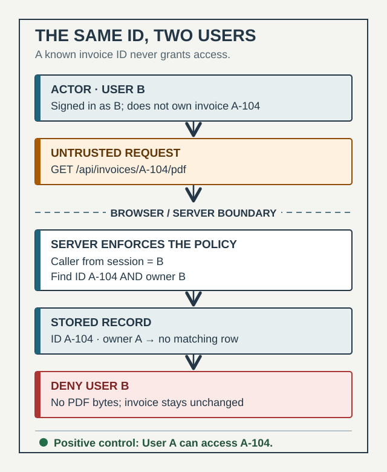

# Cheatsheets

<!-- Generated from web/src/lib/cheatsheets/. Do not edit by hand.
     Edit the sheet there and run `pnpm gen:cheatsheets` (from web/) to regenerate. -->

Lookup material rather than reading material. A stage teaches a decision; a
sheet answers what that command was.

Drawn: 23 of 28. A sheet listed as not drawn is
registered on purpose — the gap is the point, so it can be seen and filled.

| Sheet | Group | Stage | Status |
|---|---|---|---|
| Software Architecture Patterns | Architecture | 03 | Drawn |
| Design Patterns | Architecture | 03 | Drawn |
| API Design | Architecture | 03 | Drawn |
| SOLID Principles | Design Principles | 03 | Drawn |
| Clean Code | Design Principles | 05 | Drawn |
| Git Cheat Sheet | Git | 04 | Drawn |
| Git Commands | Git | 04 | Drawn |
| Git Branching & Conventions | Git | 04 | Drawn |
| Coding Standards | Standards | 05 | Drawn |
| Documentation Change Check | Standards | 10 | Drawn |
| Software Development Life Cycle | Standards | — | Drawn |
| Testing | Standards | 06 | Drawn |
| Playwright | Standards | 06 | Drawn |
| Code Review | Standards | 07 | Drawn |
| Deployment Environments | Standards | 12 | Drawn |
| AWS Deployment | Standards | 13 | Drawn |
| Post-Deploy Verification | Standards | 14 | Drawn |
| CI/CD Pipeline | Standards | 11 | Drawn |
| GitHub Actions | Standards | 11 | Drawn |
| Incident Management | Standards | 16 | Drawn |
| Security Audit | Standards | 08 | Drawn |
| Caching | Architecture | 09 | Drawn |
| Infrastructure Scaling | Architecture | 09 | Drawn |
| JavaScript | Languages | — | Not drawn |
| Python | Languages | — | Not drawn |
| Java | Languages | — | Not drawn |
| Spring Boot | Languages | — | Not drawn |
| Express & Node | Languages | — | Not drawn |

---

## Software Architecture Patterns

Six ways to arrange a system, and what each one costs you.

Belongs to [03 — Architecture](../docs/03-architecture.md).

### Event-driven

Components communicate through events.

- **Event producer** — Emits events without knowing who consumes them. — The producer must not care how many consumers exist.
- **Event broker** — Holds the ordered stream — event 1 through event N. — Consumers read at their own pace, or replay from the start.
- **Event consumers** — Independent subscribers, each reacting to what it cares about. — Adding a consumer should not require touching the producer.

### Layered

Organize system into layers with separation of concerns.

- **Presentation layer** — What the user touches. — Depends downward only.
- **Business / application layer** — The rules that make this system this system. — The layer worth protecting from the other three.
- **Data access layer** — How persistence is reached, not where it lives. — Swapping the store should stop here.
- **Persistence layer** — The store itself. — The bottom of the stack.
- **Infrastructure** — Cross-cutting concerns every layer talks to. — Logging, config, auth — the things that refuse to layer.

### Monolithic

All components built and deployed as a single unit.

- **One deployable** — Posts, comments, groups, media and live streaming ship together. — One team, one release cadence, no distributed-systems tax.
- **One database** — Every feature reads and writes the same store. — Transactions across features stay trivial.
- **The cost** — Any change redeploys everything. — It bites when teams outgrow one release train.

### Microservices

Application is composed of small, independent services.

- **API gateway** — One entry point in front of many services. — Clients should not know the service topology.
- **Service per capability** — Catalog, cart, discount and order each deploy alone. — Teams need independent release cadence.
- **Database per service** — Each service owns its own store — four services, four databases. — Shared tables reintroduce the coupling the split was meant to remove.

### MVC

Separate application into Model, View and Controller.

- **View** — Renders state and forwards user actions to the controller. — Holds no rules of its own.
- **Controller** — Receives the action, requests data, renders the view. — The traffic director, not the brain.
- **Model** — Fetches and returns data, and updates the controller. — Where the rules and the persistence live.

### Master-slave

Distribute read/write workload between master and slaves.

- **Master (primary)** — Takes every write. — One writer keeps ordering simple.
- **Slave (replica)** — Serves reads, fed by replication from the master. — Read volume is the bottleneck, not write volume.
- **Replication lag** — A replica can answer with data the master already changed. — The trade this pattern asks you to accept.

Source: Software Architecture Patterns — Sathish Kumar Subramani.

## Design Patterns

The Gang of Four set, grouped by what each one is for.

Belongs to [03 — Architecture](../docs/03-architecture.md).

### Creational — how objects are created

- **Singleton** — Ensures a class has exactly one instance and one global access point. — Config managers, loggers, caches — cases where a second instance would be a bug, not a feature.
- **Factory Method** — Defines an interface for creating an object, letting subclasses choose the concrete class. — Object creation logic is complex enough that the caller should not have to know it.
- **Abstract Factory** — Creates families of related objects without naming their concrete classes. — A whole family needs to swap together — a UI theme, a database driver set.
- **Builder** — Builds a complex object step by step, separating construction from representation. — Many optional parameters would otherwise mean a constructor nobody can read.
- **Prototype** — Creates new objects by cloning an existing one rather than building from scratch. — A template instance already exists and copying it is cheaper than reconstructing it.

### Structural — how objects are composed

- **Adapter** — Converts the interface of a class into another interface clients expect. — Integrating third-party libraries or legacy systems whose interface you cannot change.
- **Bridge** — Decouples an abstraction from its implementation so both can vary independently. — An abstraction and its implementation would otherwise multiply combinations through subclassing.
- **Composite** — Composes objects into tree structures and treats a single object and a group of them the same way. — Part-whole hierarchies where the caller should not have to check which one it has.
- **Decorator** — Adds behavior to an object dynamically, without touching its class. — Layering concerns like logging, authorization or caching without subclassing for every combination.
- **Facade** — Provides one simplified interface to a complex subsystem. — Simplifying usage for callers who need the common path, not the whole subsystem’s surface.
- **Flyweight** — Shares objects to support large numbers of fine-grained instances efficiently. — Object count is high enough that per-instance memory is the actual bottleneck.
- **Proxy** — Controls access to an object through a surrogate that stands in for it. — Access control, lazy loading, or logging need to sit in front of the real object.

### Behavioral — how objects communicate

- **Chain of Responsibility** — Passes a request along a chain of handlers until one of them handles it. — The sender should not need to know which handler, if any, will act.
- **Command** — Encapsulates a request as an object, decoupling the invoker from the thing that executes it. — Queuing, logging or undoing actions requires treating a request as data.
- **Interpreter** — Defines a grammar and a way to interpret sentences written in it. — A small language recurs often enough to justify its own grammar rather than ad hoc parsing.
- **Iterator** — Traverses a collection’s elements without exposing how the collection is stored. — Callers need to walk a collection without depending on its internal structure.
- **Mediator** — Centralizes communication between objects so they reference the mediator instead of each other. — A group of objects’ interactions have become a tangle of direct references.
- **Memento** — Captures and restores an object’s internal state without exposing that state directly. — Undo functionality needs a snapshot that does not break encapsulation to take.
- **Observer** — Notifies multiple dependents automatically when an object’s state changes. — Event handling, UI updates, notifications — anywhere one change fans out to many reactions.
- **State** — Lets an object alter its behavior when its internal state changes, as if it changed class. — A single object’s behavior branches heavily on a status field that keeps growing.
- **Strategy** — Defines a family of algorithms, encapsulates each one, and makes them interchangeable. — Payment methods, sorting, compression — the algorithm varies but the caller’s shape does not.
- **Template Method** — Defines the skeleton of an algorithm in a base class, letting subclasses override specific steps. — Several variants share most of a process and differ only in a few well-defined steps.
- **Visitor** — Adds new operations to an object structure without modifying the classes it operates on. — New operations arrive more often than new element types do.

Source: Software Design Patterns — Unrecorded — see reference/cheatsheet-sources.md.

## API Design

From HTTP fundamentals through versioning, auth and rate limits.

Belongs to [03 — Architecture](../docs/03-architecture.md).

### Fundamentals and protocol

- **API types** — REST, GraphQL, gRPC, SOAP — different answers to the same question of how a client asks a server for something.
- **Request-response lifecycle** — Client sends a request, server processes it, server returns a response — the shape every API type still fits inside.
- **HTTP methods and status codes** — GET, POST, PUT, PATCH, DELETE map to intent; status codes and headers carry the outcome.
- **Payload basics** — JSON, XML and form data as wire formats; URLs, HTTPS and TLS as the transport underneath them.

### Designing the resource

- **REST principles** — Resource-based URLs, CRUD operations mapped onto HTTP methods, consistent naming.
- **Versioning and idempotency** — A breaking change ships as a new version rather than breaking every client already live; idempotent methods are safe to retry.
- **Request and response shape** — A consistent JSON structure, pagination for large result sets, filtering and sorting as query parameters.
- **Error responses** — A standardized error shape, so a client can branch on it instead of parsing prose.

### Auth and validation

- **API keys and JWT** — A key identifies the caller; a JWT carries claims about who they are without a database round trip to check.
- **OAuth 2.0 and OpenID Connect** — Delegated authorization and identity on top of it — a client acts on a user’s behalf without holding their password.
- **RBAC and session vs token** — Role-based access control decides what an authenticated caller may do; sessions and tokens are two different ways to carry "who is this" between requests.
- **Input validation** — Validate and sanitize at the boundary, with error codes and exceptions that say what failed rather than that something did.

### Data and performance

- **SQL vs NoSQL** — Relational structure and transactions against flexible schema and horizontal scale — the trade the data model makes.
- **Caching** — Redis or similar in front of a slow read path, with rate limiting and compression protecting what caching does not.
- **Async processing and load balancing** — Work too slow for a request-response cycle moves off it; load balancing spreads traffic once one server is not enough.

### Docs, testing and security

- **OpenAPI and Swagger** — A machine-readable API specification that also generates interactive documentation and client SDKs.
- **Testing** — Unit and integration tests, automated mocks, and manual exploration with a tool like Postman.
- **Transport and injection defenses** — HTTPS and CORS at the edge; defenses against XSS, CSRF and SQL injection in the application.
- **Secrets** — Credentials and keys live outside the codebase, with logging and monitoring watching for misuse.

### Deployment and advanced patterns

- **Gateways and containers** — An API gateway as the single entry point in front of many services; Docker and Kubernetes as how those services run.
- **CI/CD** — Pipelines that build, test and deploy on every change rather than on a manual release day.
- **Beyond REST** — GraphQL and gRPC as alternatives to REST; WebSockets and webhooks for the cases a request-response cycle does not fit.
- **Microservices communication** — Services talk to each other the same way clients talk to the API — the design principles above apply internally too.

Source: Master Plan for API Design — Shalini Goyal.

## Caching

Choose reusable work, set a freshness rule, invalidate after writes, and verify the same user outcome.

Belongs to [09 — Performance Optimization](../docs/09-performance-optimization.md).

### Choose the boundary

Cache a result only when its ownership scope and tolerated staleness are defined. These are application decisions, not a command to add a cache everywhere.

- **Reusable result** — A public catalog description can be a candidate for reuse. A faster response is useful only if it still answers the intended user operation. — Use evidence that the repeated work contributes to the measured slow path.
- **Current business decision** — Validate stock, charge status and authorization against the appropriate authoritative state. A cached description is not permission to sell, charge or disclose. — Before accepting an order, confirming payment or returning protected data.
- **Key and ownership** — Include every input that changes the result, such as product, locale or tenant. A tenant-specific cache key does not grant access; authorization still belongs at the data boundary. — Test the same identifier as two users or tenants before sharing a cached result.

### Set lifetime and tags

TTL means time to live: a freshness or expiry interval under the chosen cache policy. Retention is how long an entry remains stored; neither term promises persistence on every host.

- `cacheComponents: true` — Enable Cache Components in the example application before using the Next.js use cache directive. This playbook is teaching the API; it does not enable runtime caching here. — Check the installed framework version and hosting behavior.
- `'use cache'` — Mark an async function, component or module scope for caching. Read cookies, headers and other request-specific values outside that scope, then pass the needed inputs. — Reuse an eligible result, with its input and ownership boundaries already defined.

  *Illustrative public-description read; example domain, not this app*

  ```
  import { cacheLife, cacheTag } from 'next/cache'

  export async function readDescription(productId: string) {
    'use cache'
    cacheLife('minutes')
    cacheTag(`catalog:${productId}`)
    const response = await fetch(
      `https://catalog.example/products/${encodeURIComponent(productId)}`,
    )
    if (!response.ok) throw new Error('Catalog read failed')
    const { id, description } = await response.json()
    return { id, description }
  }
  ```

- `cacheLife / cacheTag` — Choose a lifetime consistent with tolerated staleness and tag the reads a successful write will invalidate. Tags label entries; they are not authorization checks. — Describe the expected read after a write, not only how long the entry might be retained.
- **Hosting and retention** — Default runtime memory can be instance-local and ephemeral, especially on serverless hosts. Check the configured cache handler before assuming reuse across requests or deployments. — A published lifetime is not evidence that a particular instance still holds the entry.

### Invalidate after a write

The write must succeed before invalidating affected reads. Invalidation changes the next matching data read; it does not automatically refresh every open browser view.

- `updateTag(tag)` — Server Actions only: expire matching entries immediately so the next matching read waits for fresh data. — Use after a successful write when the actor must read their own change. It is not available in Route Handlers.
- `revalidateTag(tag, 'max')` — Server Actions or Route Handlers: mark tagged data stale; the next visit can receive stale data while revalidation runs in the background. — Use when stale-while-revalidate behavior is acceptable. The call itself does not eagerly refresh every tagged page.
- `revalidateTag(tag, { expire: 0 })` — From a Route Handler that requires immediate expiry, make the next matching read block for fresh data. — Use when stale content is unacceptable and updateTag is unavailable. Avoid the deprecated single-argument revalidateTag form.

### Read CDN evidence

CDN means content delivery network. CF-Cache-Status describes Cloudflare response caching, not Next.js application-cache entries. These examples do not imply this site uses Cloudflare.

- **HIT** — Cloudflare found the response in its cache. — A hit does not prove the application data reflects the latest write.
- **MISS** — The request was eligible for Cloudflare caching but the response was absent, so the origin served it. — A first or cold request can miss without a fault.
- **BYPASS** — Cloudflare considered the request eligible, but the response or policy prevented storing the response. — Inspect the relevant response headers and cache rules before changing the policy.
- **DYNAMIC** — Cloudflare considered the request ineligible for cache at request time. — Check eligibility rules; do not treat this as a missing Next.js tag.
- **Freshness and retention** — A freshness interval controls when origin validation is required. An expired entry may still be retained; stale serving depends on the applicable revalidation policy. — Keep CDN headers and application-cache tags as separate controls.
- `curl -sS -D - -o /dev/null https://catalog.example/products/demo` — Read response headers for an explicitly illustrative URL. Inspect CF-Cache-Status and the applicable Cache-Control headers on a real test endpoint. — Use a safe read endpoint; do not infer application-cache behavior from a CDN header.

### Verify the change

A cache hit is diagnostic evidence, not proof of a better or correct user outcome.

- **Comparable outcome** — Compare the same observer, start/end events, segment, workload, observation window and cold/warm cache state. A p95 is the duration at the 95th percentile of the stated population. — Record the sample, timeout/failure rule, errors and correctness as well as latency; a single lab run is not a field p95.
- **Freshness and isolation** — After the write, confirm the intended reader sees the expected state. Repeat as another user or tenant and confirm protected data is not disclosed. — Keep the cache change only when the freshness rule, authorization and user target still hold.

Sources:

Source: [use cache](https://nextjs.org/docs/app/api-reference/directives/use-cache) — Next.js.

Source: [cacheLife](https://nextjs.org/docs/app/api-reference/functions/cacheLife) — Next.js.

Source: [cacheTag](https://nextjs.org/docs/app/api-reference/functions/cacheTag) — Next.js.

Source: [updateTag](https://nextjs.org/docs/app/api-reference/functions/updateTag) — Next.js.

Source: [revalidateTag](https://nextjs.org/docs/app/api-reference/functions/revalidateTag) — Next.js.

Source: [Cloudflare cache responses](https://developers.cloudflare.com/cache/concepts/cache-responses/) — Cloudflare.

Source: [Retention vs Freshness (TTL)](https://developers.cloudflare.com/cache/concepts/retention-vs-freshness/) — Cloudflare.

## Infrastructure Scaling

Find the constrained resource, compare routing choices, plan for overload, and prove the user outcome.

Belongs to [09 — Performance Optimization](../docs/09-performance-optimization.md).

### Locate the limit

This is infrastructure scaling. Stage 09's Scaling to a team section describes team practice. Routing and added capacity are candidates to justify with evidence, not routine fixes for every slow request.

- **Constrained resource** — Name the user outcome, workload and limiting resource using measurements. CPU, memory, connections, storage or a shared dependency can constrain different operations. — A utilization chart alone does not define the observer, duration or customer harm.
- **Vertical capacity** — Increase resources on one instance when evidence shows its resource limit is the constraint. — Check the remaining limit, failure exposure and cost rather than assuming a larger instance is faster.
- **Horizontal capacity** — Add replicas when the work can be safely distributed and the shared dependencies can support it. — Check state, session and connection assumptions before adding targets.
- **Routing and dependencies** — A load balancer distributes requests. More application replicas do not establish more capacity in a shared database; reducing expensive work is a different candidate. — Check the dependency that remains shared and identify what the proposed change actually relieves.

### Choose routing

The following are AWS Application Load Balancer (ALB) target-group algorithms. A provider-specific setting is not a universal algorithm list. Sticky sessions can bypass subsequent routing choices.

- **Round robin** — Distribute requests across healthy targets in sequential order under normal routing conditions. — An ALB default suited to similarly costly requests and similarly capable targets; stickiness affects subsequent target selection.
- **Least outstanding requests** — Choose the target with the fewest in-flight requests. — An ALB option for varying request cost or target capability. It does not support slow start; sticky sessions affect subsequent selection.
- **Weighted random** — Randomly distribute requests across healthy targets; optional Automatic Target Weights anomaly mitigation can adjust distribution. — ALB weighted random does not support sticky sessions or slow start. Check the intended workload and feature compatibility.
- `aws elbv2 describe-target-group-attributes --target-group-arn "$TARGET_GROUP_ARN"` — Read target-group attributes without changing routing. TARGET_GROUP_ARN must name your permitted test group; AWS credentials and read permission are required. — Inspect routing, stickiness and health settings before proposing a mutation.

### Check health and overload

Health checks and routing do not create unlimited capacity. Define the operation the probe represents and the behavior when capacity or targets fail.

- **Health checks and fail-open** — ALB normally routes to healthy targets. If all registered targets are unhealthy, it fails open and can route to them regardless of health status. — A failed probe is not proof that all traffic to that target has stopped; inspect health/routing thresholds as well as the reason code.
- **Draining and failure capacity** — Deregistration allows in-flight work time to finish. Check remaining target and dependency capacity while a target or zone is unavailable. — A connection terminated before draining completes can fail a request; do not equate a removed target with completed customer work.
- **Admission and degradation** — Keep admitted work and queues bounded. Under overload, use a defined safe degraded response or reject excess work instead of letting backlog grow without a limit. — Degrade only when the user contract permits it; stale payment or authorization state is not a safe shortcut.
- **Retries and uncertain outcomes** — Retries add work to an overloaded service. Use a bounded retry policy and establish whether a timed-out side effect already succeeded before replay. — A charge or write may have completed before the timeout. Reconcile uncertain outcomes rather than assuming retry means recovery.

### Prove the outcome

There is no universal requests-per-second target or replica count. Example workloads are illustrative; measure the same operation before and after.

- **User latency and errors** — Compare the same start/end observer, segment, workload and collection window. Define the percentile population and keep failures visible. A p95 is the duration at the 95th percentile of that population. — A faster routing or server span does not prove the user operation improved.
- **Resource and delayed work** — Check the limiting resource, shared dependencies and oldest pending work where applicable. Verify capacity during failure as well as normal traffic. — A healthy homepage or an empty request queue does not prove that downstream work completed.
- **Correctness and cost** — Retest state/session assumptions and actual customer outcomes. Compare resource cost, record unresolved limits, and keep or revert the change from that evidence. — Adding replicas is not a win if the outcome still misses its target or correctness regresses.

Sources:

Source: [Application Load Balancer target-group attributes](https://docs.aws.amazon.com/elasticloadbalancing/latest/application/edit-target-group-attributes.html) — AWS.

Source: [Application Load Balancer target-group health checks](https://docs.aws.amazon.com/elasticloadbalancing/latest/application/target-group-health-checks.html) — AWS.

Source: [Handling Overload](https://sre.google/sre-book/handling-overload/) — Google SRE.

## SOLID Principles

Five rules for code that stays easy to change, test and extend.

Belongs to [03 — Architecture](../docs/03-architecture.md).

### The five principles

- **Single Responsibility** — A class should have only one reason to change. — A class handling users, email and reports together is three responsibilities pretending to be one.

  *Violation*

  ```
  class UserManager {
    saveUser(u: User) { /* … */ }
    sendWelcomeEmail(u: User) { /* … */ }
    generateReport(u: User) { /* … */ }
  }
  ```

  *Correct*

  ```
  class UserRepository {
    save(u: User) { /* … */ }
  }
  class WelcomeEmailer {
    send(u: User) { /* … */ }
  }
  class UserReport {
    generate(u: User) { /* … */ }
  }
  ```

- **Open/Closed** — Open for extension, closed for modification — add behavior without editing what already works. — A new type keeps requiring an `if`/`else if` added to existing code instead of a new class.

  *Violation*

  ```
  function area(shape: Shape) {
    if (shape.kind === "circle") return Math.PI * shape.r ** 2
    if (shape.kind === "rect") return shape.w * shape.h
    // every new shape edits this function
  }
  ```

  *Correct*

  ```
  interface Shape { area(): number }
  class Circle implements Shape {
    area() { return Math.PI * this.r ** 2 }
  }
  // a new shape adds a class, this function never changes
  ```

- **Liskov Substitution** — A subclass must be usable anywhere its superclass is, without breaking the caller’s expectations. — A subclass throws on a method its parent’s contract promises will work — Ostrich extending Bird and refusing to fly.

  *Violation*

  ```
  class Bird { fly() { /* … */ } }
  class Ostrich extends Bird {
    fly() { throw new Error("Ostriches can’t fly") }
  }
  ```

  *Correct*

  ```
  class Bird {}
  class FlyingBird extends Bird { fly() { /* … */ } }
  class Ostrich extends Bird {} // never promises flight
  ```

- **Interface Segregation** — Clients should not be forced to depend on methods they do not use. — One fat interface makes every implementer stub out methods that do not apply to it.

  *Violation*

  ```
  interface Worker {
    work(): void
    eat(): void
  }
  class Robot implements Worker {
    work() { /* … */ }
    eat() { throw new Error("Robots don’t eat") }
  }
  ```

  *Correct*

  ```
  interface Workable { work(): void }
  interface Eatable { eat(): void }
  class Robot implements Workable {
    work() { /* … */ }
  }
  ```

- **Dependency Inversion** — High-level modules depend on abstractions, not on concrete low-level modules. — Swapping an implementation — a database, a payment provider — should not require editing the code that uses it.

  *Violation*

  ```
  class UserService {
    private db = new MySqlDatabase()
  }
  ```

  *Correct*

  ```
  interface Database { connect(): void }
  class UserService {
    constructor(private db: Database) {}
  }
  ```


Source: SOLID Principles — Cheat Sheet — Raja Kumar.

## Clean Code

Five habits that separate code that works from code that lasts.

Belongs to [05 — Development](../docs/05-development.md).

### Five habits

- **Write for humans** — Code is read far more often than it is written — optimise for the next reader, not the interpreter.

  *Before*

  ```
  const d = (a: number, b: number) => a * b * 0.1
  ```

  *After*

  ```
  const calculateDiscount = (price: number, quantity: number) =>
    price * quantity * DISCOUNT_RATE
  ```

- **Keep it simple** — The straightforward solution beats the clever one once someone else has to maintain it.

  *Before*

  ```
  const isEven = (n: number) => !(n & 1) === !0
  ```

  *After*

  ```
  const isEven = (n: number) => n % 2 === 0
  ```

- **Avoid duplicates** — The same logic in two places is one bug waiting to be fixed in only one of them.

  *Before*

  ```
  function total(items) {
    return items.reduce((s, i) => s + i.price * i.qty, 0)
  }
  function subtotal(cart) {
    return cart.reduce((s, i) => s + i.price * i.qty, 0)
  }
  ```

  *After*

  ```
  function lineTotal(item: LineItem) { return item.price * item.qty }
  function total(items: LineItem[]) {
    return items.reduce((s, i) => s + lineTotal(i), 0)
  }
  ```

- **Be consistent** — One naming style, one structure, one way of doing a repeated thing — consistency is what makes code skimmable.

  *Before*

  ```
  function get_user(id) { /* … */ }
  function fetchOrder(id) { /* … */ }
  function Load_Invoice(id) { /* … */ }
  ```

  *After*

  ```
  function getUser(id: string) { /* … */ }
  function getOrder(id: string) { /* … */ }
  function getInvoice(id: string) { /* … */ }
  ```

- **Refactor regularly** — Clean code is a habit applied continuously, not a one-time pass before a release. — The Boy Scout Rule: leave the code a little cleaner than you found it, every time you touch it.

### Four more, named as acronyms

From a second gathered source — "6 Golden Rules to Write Clean Code" by Neo Kim. Its other two rules, DRY and KISS, are the same ideas as "Avoid duplicates" and "Keep it simple" above.

- **SOC — Separation of concerns** — Keep distinct responsibilities in distinct places, so a change to one does not ripple into the other. — The class-level version of this is SOLID’s Single Responsibility Principle — see `solid-principles`.
- **DYC — Document your code** — Comments and docs explain *why* a decision was made — the code itself already says what it does.
- **TDD — Test-driven development** — Write the failing test before the code that makes it pass. — This repo’s own iron law: "NO PRODUCTION CODE WITHOUT A FAILING TEST FIRST" (`CLAUDE.md`) — see `testing`.
- **YAGNI — You ain’t gonna need it** — Do not build for a requirement that does not exist yet — speculative flexibility is a cost paid today for a maybe.

Source: Clean Code Principles Every Junior Developer Should Know — Unrecorded — see reference/cheatsheet-sources.md.

## Git Cheat Sheet

Essential commands from init to push, plus the four-area mental model.

Belongs to [04 — Project Setup](../docs/04-project-setup.md).

### Start a repository

- `git init` — Create a new Git repository in the current directory. — Starting a brand-new project. Run once, at the beginning.
- `git clone <repo-url>` — Clone an existing repository into a new directory. — Joining a project that already exists on GitHub, GitLab, or another remote.

### Check your changes

- `git status` — See modified, staged, and untracked files. — Before staging, before committing, before switching branches. The single most-typed git command.
- `git diff` — See changes that have not been staged yet. — Reviewing what you changed before deciding what to stage.

### Stage and commit

- `git add <file>` — Stage a specific file for the next commit. — When you want to commit some changes but not all of them.
- `git add .` — Stage all changes in the current directory. — When every change belongs in the same commit. Check git status first.
- `git commit -m "message"` — Save staged changes with a meaningful message. — After staging. The message describes what changed, not what you did to the diff.
- `git log --oneline` — View a compact commit history (one line per commit). — Finding a recent commit, checking what landed, verifying branch state.

### Branches

- `git branch` — List local branches. The current branch is marked with an asterisk. — Checking which branch you are on, or seeing what branches exist.
- `git branch <branch-name>` — Create a new branch at the current commit. — Starting a feature or fix. Does not switch to the new branch.
- `git switch <branch-name>` — Switch to another branch. — Moving between branches. Replaces the older git checkout for branch switching.
- `git switch -c <branch-name>` — Create and switch to a new branch in one step. — The common case: you want a new branch and you want to be on it immediately.
- `git branch -d <branch-name>` — Delete a branch that has been merged. — After merging. Use -D (capital) to force-delete an unmerged branch.

### Sync with remote

- `git fetch` — Download remote changes without merging them. — When you want to see what changed on the remote before integrating.
- `git pull` — Fetch and integrate changes from remote into your current branch. — Getting the latest changes. Equivalent to git fetch + git merge.
- `git push` — Upload your local commits to the remote. — After committing locally and wanting others to see the work.
- `git push -u origin <branch>` — Push a new branch to the remote and set it as the upstream. — The first push of a new branch. After this, plain git push works.

### Merge and rebase

Use merge to preserve history. Use rebase for a cleaner, linear history (it rewrites commits). This project uses merge (--no-ff) and never rebases.

- `git merge <branch-name>` — Merge another branch into your current branch. Creates a merge commit. — Integrating finished work. The merge commit records when and what was integrated.
- `git rebase <branch-name>` — Reapply your commits on top of another branch. Rewrites commit history. — Cleaning up a feature branch before merging, when a linear history matters more than preserving the original commit sequence.

### Undo changes

Be careful with git reset --hard. It permanently discards local changes.

- `git restore <file>` — Discard unstaged changes in a file, reverting it to the last committed state. — When you edited a file and want to throw those changes away.
- `git restore --staged <file>` — Unstage a file without deleting the changes. — When you staged something by mistake but still want to keep the edits.
- `git revert <commit-id>` — Create a new commit that undoes an earlier commit. — Safely undoing a change that has already been pushed. Preserves history.
- `git reset --soft HEAD~1` — Undo the last commit while keeping the changes staged. — When you committed too early and want to amend or re-split the work.

### Tags

- `git tag` — List all tags. — Checking which versions have been tagged.
- `git tag v1.0.0` — Create a lightweight tag at the current commit. — Marking a release or milestone.
- `git push origin v1.0.0` — Push a specific tag to the remote. — Tags are not pushed by default. Push them explicitly after creating.

### The Git model

The four areas: Working Directory (your local files) → Staging Area (changes ready to commit) → Local Repository (your Git history) → Remote Repository (e.g. GitHub). The workflow is: modify files, git add, git commit, git push.

- **Working Directory** — Your local files. Every edit starts here.
- **Staging Area** — Changes you have selected for the next commit with git add.
- **Local Repository** — Your commit history, stored in the .git directory.
- **Remote Repository** — The shared history on GitHub, GitLab, or another host.

Source: Git Cheat Sheet — Essential Commands Every Developer Should Know — Unrecorded.

## Git Commands

The ones worth memorising, and the ones worth looking up.

Belongs to [04 — Project Setup](../docs/04-project-setup.md).

### Basics

The work → stage → commit → push loop, and the commands each step names.

- `git init` — Creates a new repository in the current directory. — Starting a project from nothing.
- `git clone <url>` — Copies an existing repository, history included. — Starting from someone else’s history instead of your own.
- `git status` — Lists modified, staged and untracked files. — Before every commit, so nothing surprising goes in.
- `git diff` — Shows changes that have not been staged yet. — Checking exactly what changed before you stage it.
- `git add <file> / git add .` — Stages a specific file, or every change. — The line between "changed" and "about to be committed".
- `git commit -m "message"` — Saves the staged changes with a message. — One logical change per commit, not one commit per save.
- `git log --oneline` — A compact, one-line-per-commit history. — Scanning recent history without the full commit body noise.
- `git branch <name> / git switch <name> / git switch -c <name>` — Create a branch, switch to one, or do both in one step. — `-c` is the one you reach for starting new work.
- `git fetch / git pull / git push` — Download remote changes without merging, download and merge, or upload local commits. — `fetch` first if you want to see what changed before merging it in.
- `git merge <branch> / git rebase <branch>` — Combine another branch into yours — merge keeps both histories, rebase replays yours on top. — Merge to preserve what happened; rebase for a clean, linear log.
- `git restore <file> / git revert <commit> / git reset --soft HEAD~1` — Three different undos: discard an unstaged edit, add a new commit that undoes an old one, or uncommit while keeping the changes staged. — Restore for a typo, revert once history is shared, reset only on a branch nobody else has pulled.

### Beyond commit and push

The commands that stop being optional once a project outlives its first week.

- `git stash` — Saves uncommitted changes without creating a commit. — Switching context mid-task without a half-finished commit to clean up later.
- `git cherry-pick <commit-id>` — Copies one specific commit onto the current branch. — You need that one fix, not the whole branch it shipped on.
- `git rebase main` — Replays your branch’s commits on top of main, keeping history linear. — Tidying a feature branch’s log before it merges.
- `git reflog` — Recovers commits that look lost — nothing is gone until it is garbage-collected. — After a reset or a branch delete you immediately regret.
- `git bisect start / bad / good <commit-id>` — Binary-searches history for the exact commit that introduced a bug. — A regression exists somewhere in fifty commits and reading them one at a time is not an option.
- `git reset --hard <commit-id> vs git revert <commit-id>` — Reset rewrites history to a point; revert adds a new commit undoing an old one. — Reset only on history nobody else has pulled — revert is the safe default once it is shared.

Source: Git Commands — Unrecorded — see reference/cheatsheet-sources.md.

## Git Branching & Conventions

Trunk-based against GitFlow, and the commit format this repo uses.

Belongs to [04 — Project Setup](../docs/04-project-setup.md).

### Branching strategies

What each one adds over "just branch off main", and what it costs.

- **Feature branching** — Each feature gets its own branch, deleted once merged. — The default almost everyone starts from — no process beyond it is assumed.
- **Gitflow** — Dedicated branches for features, releases, hotfixes, plus a permanent development branch alongside main. — Scheduled releases with real time between them — the ceremony pays for itself on a slow cadence, not a fast one.
- **GitLab Flow** — Adds environment branches — staging, production — so main stays release-ready and environments are named, not inferred. — Multiple deploy targets that do not all track main directly.
- **GitHub Flow** — Branch, open a PR, merge to main. Main is the only deployable branch and stays production-ready. — Continuous deployment with no separate release branch to keep in sync.
- **Trunk-based** — Branches are short-lived, merged within a day; large work ships incrementally behind feature flags. — Fast-moving teams where a long-lived branch would drift from main faster than it could be reviewed.

### This repo’s convention

From CLAUDE.md, not the gathered graphic — closest to GitHub Flow with an extra promotion step.

- **Branch naming** — `feat/<kebab-topic>` or `fix/<kebab-topic>`, no ticket numbers; `docs/<date>-<topic>` carries a date, `feat`/`fix` do not.
- **Commit format** — Conventional Commits — `type(scope): subject`, subject lowercase, describing the change rather than the diff.
- **The flow** — Work branches merge to `develop`, never to `main` — `main` is production and deploys on push. `develop` promotes to `main` by pull request, which the user merges. — Not a fast-forward: `main` can sit ahead of `develop` by its own promotion-merge commits.
- **Merging** — `--no-ff` always, never squash or rebase, with a hand-written merge subject and a bullet-summary body. — History should show what shipped as one unit, not lose the branch shape a rebase or squash would erase.

Source: Git Branching Strategies — Nikki Siapno.

## Coding Standards

The smells worth refactoring on sight.

Belongs to [05 — Development](../docs/05-development.md).

### Code smells

From Refactoring.Guru’s taxonomy, condensed to five categories. Not bugs — signs the code is getting harder to change, read or extend.

- **Bloaters** — Methods, classes or parameter lists that have grown too large to reason about. — A long method, a large class, or a parameter list nobody can call without checking the signature.
- **Object-orientation abusers** — Cases where OOP exists in the codebase but is not doing its job — switch statements standing in for polymorphism. — A type check or a chain of `if`/`else` decides behavior that a class hierarchy should decide instead.
- **Change preventers** — Structures that make one change ripple into many files that should not need to move together. — Divergent change (one class changed for many reasons) or shotgun surgery (one change touches many classes).
- **Dispensables** — Code that provides little or no value — duplicate code, dead code, unnecessary abstraction. — Deleting it would not be missed, and keeping it costs a reader’s attention every time they pass it.
- **Couplers** — Classes or modules that depend on each other more than their job requires. — Feature envy (a method more interested in another class than its own) or a message chain three calls deep.

Source: [Code Smell](https://refactoring.guru/refactoring/smells) — AIAI LAB, citing Refactoring.Guru.

## Documentation Change Check

Choose the document, record the facts, and check what a change makes stale.

Belongs to [10 — Documentation](../docs/10-documentation.md).

### Choose a form for the reader

Choose for the task; four reader needs do not require four files. Open Stage 10 for worked examples and practice.

- **Tutorial** — A guided learning exercise with a safe starting point and an achievable result. — The reader needs to learn a skill by doing it.
- **How-to guide** — Steps for a known task, with prerequisites and an observable completion condition. — The reader needs to get work done.
- **Reference** — Exact names, types, allowed values, defaults and absence behavior for the applicable version. — The reader needs a fact, such as a retry option or response field.
- **Explanation** — Concepts, reasons and tradeoffs that help the reader understand a choice. — The reader needs context rather than a procedure.

### Adapt the record prompts

These are playbook prompts, not a mandatory document inventory or fixed template. MADR metadata and confirmation are optional; use the detail the decision needs.

- **README entry point** — Purpose and reader; actual prerequisites, safe configuration/access, tested setup commands, expected result and a help route. — Follow the setup from a fresh clone without private instructions; record the first gap.
- **Decision record** — Significant choice, context, decision, reasons, alternatives, consequences and current status/date. — Include costs and obligations, not only benefits. Link the source or revision the choice applies to.
- **Factual reference** — Name/type, allowed values, default or absence, applicable version, authoritative source and review trigger. — Distinguish missing, null and empty according to the actual contract.
- **Change/check record** — Reader/task, changed fact, affected documents, source/revision, check, expected/observed result, owner and review trigger. — Keep this in the change or review record; a separate document is optional.

### Trace the changed fact

Checks and owner/review prompts are this playbook’s application guidance. Generation or a checked box does not establish that a source is correct.

- **Configuration** — Update the configuration reference, safe example and affected setup instructions. Compare missing/invalid/default behavior with the actual validator. — Name the maintainer and validator-change trigger.
- **Response contract** — Update reference and example responses. Run the applicable generator, inspect the expected diff and verify serializer behavior, including optional-field omission. — Name the contract owner and response-change trigger.
- **Replaced decision** — Write the replacement ADR. Preserve the old reasoning, expose its current superseded status and date, and link old and new records in both directions. — Follow the old entry point and confirm the replacement is discoverable.
- **Setup or release procedure** — Update the README and linked procedure when commands, access or environment change. Follow the documented path safely and record its result and limits. — Name the responsible maintainer and procedure-change trigger.

### Publish only supported claims

- **Label the evidence** — Record revision, check, expected and observed result, and limits. Reading is not execution; compiling does not establish runtime behavior or recovery.
- **Review an AI draft** — Ground it in supplied sources and have a reviewer check facts, versions, examples and privacy. Claim validation only when the corresponding evidence exists.
- **Use safe examples** — Use synthetic data and safe placeholders. Keep real credentials and private records out; do not invent project commands, provider guarantees or incident outcomes.

Sources:

Source: [Diátaxis primer](https://diataxis.fr/start-here/) — Daniele Procida.

Source: [Documenting Architecture Decisions](https://cognitect.com/blog/2011/11/15/documenting-architecture-decisions) — Michael Nygard / Cognitect.

Source: [MADR 4.0.0 template](https://github.com/adr/madr/blob/4.0.0/template/adr-template.md) — MADR contributors.

Source: [About READMEs](https://docs.github.com/en/repositories/managing-your-repositorys-settings-and-features/customizing-your-repository/about-readmes) — GitHub.

Source: [What to look for in a code review: Documentation](https://google.github.io/eng-practices/review/reviewer/looking-for.html#documentation) — Google Engineering Practices.

## Software Development Life Cycle

The seven phases every stage in this playbook is a close-up of.

### The seven phases

Followed through one running example — adding password reset to a small app — so each phase shows what it actually produces, and what the next phase does with it, rather than naming its output in the abstract.

- **1. Planning** — Define the problem, objectives, scope, resources and risks. — Password reset: the problem is support tickets from locked-out users, not a feature anyone asked for by name. The objective is cutting those tickets to zero. The scope decision — email links only, no SMS — is made here, and so is the risk that matters most: the reset flow itself could let an attacker learn which emails have an account.
- **2. Requirements analysis** — Gather and analyze functional and non-functional requirements. — The functional requirement: a user who forgets their password can request a reset link by email and set a new one. The non-functional requirement is what Planning’s risk turns into something checkable: the link must expire in 30 minutes, and requesting one must say “check your email” whether or not that address has an account — so the flow itself can’t be used to test which emails are registered.
- **3. Design** — System architecture, database design, UI/UX and component detail. — The non-functional requirement forces a real decision here, not just a nice one: a `password_reset_tokens` table storing a hashed token and an expiry, never the token itself — because a token readable in the database is a token a database leak hands out. One endpoint to request a reset, one to redeem it, and a single “check your email” screen that never says whether the address existed.
- **4. Development** — Write clean, efficient code and build the application. — Four small pull requests rather than one large one: the request endpoint, token generation and hashing, the redeem endpoint, the email template. Small enough that a reviewer can actually check the hashing decision from Design landed in the code, not just that something got built.
- **5. Testing** — Test for functionality, performance, security and bugs. — Does a valid token reset the password? Does an expired one get rejected? Requesting five reset emails in a minute — does the sixth get rate-limited? And the one Design exists to prevent: does requesting a reset for an email that isn’t registered look identical to requesting one that is?
- **6. Deployment** — Release the application to the production environment. — Shipped behind a feature flag to 5% of traffic first, watching the error rate and how many reset emails actually arrive, before widening to everyone. A flag exists so a bad rollout is a flip, not a revert.
- **7. Maintenance** — Monitor, fix issues, improve performance, and add new features. — Three months on, support tickets show reset emails landing in spam. The fix is an SPF/DKIM record, not a code change — the kind of fix this phase exists for, and the reason “maintenance” outlasts every other phase rather than closing when they do.

### How different methodologies run the loop

Same seven phases every time — what changes is whether they run once, in a short repeating slice, or continuously.

- **Waterfall** — Runs the seven phases once, in strict sequence — each phase finishes and is signed off before the next starts. — Requirements that are genuinely fixed and unlikely to change: regulated or safety-critical builds, fixed-price contracts.
- **Agile / Scrum** — Runs a thin slice of all seven phases every sprint (one to four weeks), re-planning and re-prioritising each time. — Requirements that will keep changing as the product is used — most product work, this playbook’s own stage 02 included.
- **DevOps / Continuous** — Collapses development, testing and deployment into one automated pipeline; a change can go from commit to production the same day. — A team with the automation to make releasing safe often — this playbook’s own default, see stage 11 (CI/CD).

Source: Software Development Life Cycle (SDLC) — Unrecorded — see reference/cheatsheet-sources.md.

## Testing

The five types, why the pyramid is shaped that way, and what this repo runs.

Belongs to [06 — Testing](../docs/06-testing.md).

### Five types

- **Unit testing** — Tests individual functions, components or classes in isolation, before they interact with anything else. — Common tools: Jest, Vitest, Mocha.

  *Vitest*

  ```
  import { expect, test } from 'vitest'

  test('adds numbers correctly', () => {
    expect(add(2, 3)).toBe(5)
  })
  ```

- **Integration testing** — Tests how multiple components or services interact — an API with a database, service-to-service, queue-to-worker. — Catches bugs in the contract between systems, not inside either one. Common tools: Supertest, Postman, Jest with mocks.
- **End-to-end (E2E) testing** — Simulates a complete user workflow, start to finish, through the real interface. — Validates the system the way a user actually experiences it. Common tools: Playwright, Cypress, Selenium.
- **Performance testing** — Tests system behaviour under load, to find bottlenecks before users hit them. — Common tools: k6, Apache JMeter, Lighthouse.
- **Security testing** — Proactively searches for vulnerabilities — SQL injection, XSS, broken authentication — before an attacker does. — Common tools: Snyk, OWASP ZAP, SonarQube.

### The pyramid — why the proportions matter

Same five types, arranged by how many of each you should actually write. The shape is the point: broad and cheap at the bottom, narrow and expensive at the top.

- **Unit tests — the base** — The most numerous by far. Fast, isolated, cheap to write and to run. — This repo's own split: the `unit` and `dom` Vitest projects, run on every push — by far the largest of the three suites, and fast enough to run that often without slowing anyone down.
- **Integration tests — the middle** — Fewer than unit tests. Slower, because real collaborators are involved instead of mocks. — This repo leans light here by design — most of what would be an integration test is instead an E2E check against a real build.
- **E2E tests — the top** — The fewest, and the slowest and most brittle by nature — a real browser, a real build, every layer in between. — This repo's own audit suite — the smallest of the three by test count, run against a production build before every merge rather than on every commit.

Source: [The 5 Pillars of Testing](https://dev.to/prateekbka/the-5-pillars-of-testing-a-senior-developers-cheat-sheet-1ckj) — Prateek Agrawal.

## Playwright

Locators, assertions, fixtures and debugging — the API this repo's own e2e suite runs on.

Belongs to [06 — Testing](../docs/06-testing.md).

### Locators & assertions

- `getByRole()` — Finds an element by its ARIA role — the most resilient locator, since it survives markup changes that would break a CSS selector.
- `getByText() / getByLabel() / getByTestId()` — Find by visible text, by label, or by a `data-testid` attribute — reach for these before a raw CSS or XPath selector.
- `page.getByRole('listitem').filter({ hasText: 'Product' }).getByRole('button')` — Locator chaining narrows down which of several matching elements you mean.
- `toBeVisible() / toHaveText() / toContainText()` — Web-first assertions — visibility, exact text, and substring match.
- `toHaveURL() / toHaveTitle() / toHaveCount()` — Assert page URL, page title, or the number of matched elements.

### Actions & waiting

- `click() / fill() / type() / press(key)` — Click an element, set an input's value, type with real keyboard events, or press a single key.
- `check() / uncheck() / selectOption() / hover()` — Toggle a checkbox, choose a dropdown option, or hover an element.
- **Auto-waiting** — Every action waits for its element to become actionable before running — no manual wait needed for the common case.
- `waitForURL() / waitForResponse() / waitForLoadState()` — Wait for a URL change, a matching network response, or a load state (`domcontentloaded`, `networkidle`).
- **Avoid waitForTimeout()** — A fixed wait is a guess about timing. It is the single most common cause of a flaky test in this API.

### Test structure, fixtures & core concepts

- `test() / test.describe() / test.beforeEach() / test.afterEach()` — Define a test, group related tests, and run setup or teardown around each one.
- `test.use() / test.extend()` — Reusable setup shared across tests via fixtures, rather than repeated in every test body.
- **Browser → Context → Page** — The three-level model: one browser, many isolated contexts (like incognito sessions), each context holding one or more pages. — Every test gets a fresh context by default, which is what makes tests independent of each other without extra setup.
- **This repo's own convention** — A test name states the property being checked *and* the reason it matters, so a failure reads as an explanation rather than a label.

  *e2e/audit.spec.ts*

  ```
  test('the sweep observes every disclosure open at least once, since a sweep that quietly stops opening things is indistinguishable from a clean pass', async ({ page }) => {
    // ...
  })
  ```


### Debugging & CI

- `npx playwright test --ui` — UI mode — an interactive view of every test, step by step, as it runs.
- `npx playwright test --debug` — Step-by-step debugging with the Inspector.
- `npx playwright show-trace trace.zip` — Opens the trace viewer — a full recording of a run, worth more than a screenshot when a test fails only in CI.
- **CI/CD integration** — Run headless, fail fast on the first failure, and collect a trace only on failure rather than on every run. — This repo's own audit runs a fresh production build via `webServer`, on a port that stays clear of the dev server (TD-27).

Source: Playwright Quick Revision Cheat Sheet — Unrecorded — see reference/cheatsheet-sources.md.

## Code Review

Five review axes, the severity system, and how large a PR should be.

Belongs to [07 — Code Review](../docs/07-code-review.md).

### Review process

- **1. Understand the context** — Read the PR description and linked ticket before touching the diff. Know what the change is trying to do.
- **2. Read the tests first** — Tests show what the author thinks the code should do. Mismatches between intent and test are the highest-signal findings.
- **3. Walk the implementation** — Read the diff file by file. The implementation is where the edge cases, authorization gaps, and naming issues live.
- **4. Label every finding** — Every comment carries a severity — Critical, Required, Consider, Nit, or FYI — so the author knows what blocks the merge.
- **5. Check the verification** — Confirm the author tested what they claim. A preview URL, a screenshot, a test run — not just "it works on my machine."

### Five review axes

- **Correctness** — Does it do what it claims? Edge cases and error paths, not just the happy path. Do the tests test the right thing, or the implementation?
- **Readability** — Could another engineer follow it without you? 1000 lines where 100 suffice is a failure. Abstractions have to earn their complexity.
- **Architecture** — Does it fit the system? Does the refactor reduce complexity, or relocate it? Is feature logic leaking into a shared module?
- **Security** — Input validated at the boundary. Secrets out of code, logs and version control. External data is untrusted until proven otherwise.
- **Performance** — N+1 query patterns. Unbounded loops and unconstrained fetching. Missing pagination. Large objects in hot paths.

### Severity labels

Lead with leverage. If you have one structural problem and ten nits, the structural problem is the review.

- **Critical** — Blocks the merge. Data loss, security breach, production outage.
- **Required** — No prefix — must fix. A correctness or UX bug the user will hit.
- **Consider** — Worth thinking about. A real alternative the author may not have seen.
- **Nit** — The author may ignore. Polish, naming preferences, style the linter does not enforce.
- **FYI** — No action needed. Context for the author — a related decision, a known limitation, a pointer to prior art.

### Change sizing

- **~100 lines** — Good. Reviewable in one pass, easy to revert, high comment density.
- **~300 lines** — Acceptable if it is one logical change. Past this, reviewers start skimming.
- **~1000 lines** — Split it. Schema in one PR, backend in another, UI in a third. Each merges independently behind a flag.

Source: [Code Review and Quality](https://github.com/nicepkg/agent-skills) — Addy Osmani.

## Deployment Environments

Six environments from local to production — what each catches and what it cannot.

Belongs to [12 — Staging](../docs/12-staging.md).

### Six environments

Not every project uses all six. Solo, you typically run local, preview and production. The middle three earn their place when a team, a compliance process, or a third-party integration demands them.

- **Local / Dev** — Your machine. Fast iteration, expected errors, no shared state. The only environment where a broken build costs nobody else. — Always. Every change starts here.
- **Preview** — A per-branch deploy at its own URL, created automatically on every pull request and torn down on merge. Fully isolated from other branches. — Every pull request. The default pre-production check for solo and small-team work.
- **QA** — A structured testing hub owned by a QA function. A release candidate is deployed here, tested against production-shaped data, and signed off before promotion. — When a dedicated QA role owns regression sign-off and needs a stable target that is not production.
- **Test / Integration** — Validates that components talk to each other. Runs integration and contract tests against real (or realistic) dependencies rather than mocks. — When integration tests need infrastructure CI cannot provide — a real database, a message queue, an external API sandbox.
- **Staging** — A long-lived deploy mirroring production as closely as possible. Tracks a shared branch, runs production-equivalent infrastructure, connects to production-shaped data. — When something demands a stable URL: a third-party callback, a client demo, a compliance sign-off, or a QA process that compares one release to the last.
- **Production** — Live, serving real users. The only environment whose failures have real consequences. — After every other environment has done its job. Changes arrive here via the deployment pipeline, never directly.

### Preview vs staging

The choice stage 12 teaches. Most solo developers need preview and not staging. Add staging when something concrete demands a stable URL.

- **Isolation** — Preview: one per PR, fully isolated — your work cannot break another branch. Staging: shared, all in-flight work deploys to the same environment.
- **Lifecycle** — Preview: spins up on PR open, torn down on merge. Staging: long-lived, maintained continuously whether or not anyone is using it.
- **Who tests** — Preview: the author and their reviewers. Staging: QA engineers, stakeholders, third-party integrators who need a stable URL.
- **Feedback speed** — Preview: minutes from push to a live URL. Staging: hours to days, because deploys are queued and shared state must be coordinated.
- **Cost model** — Preview: pay per use, scales to zero when no PRs are open. Staging: fixed cost, runs idle, still drifts and still generates alerts.
- **Confidence** — Preview: high confidence that one change works. Staging: lower for any single change, higher for the release as a whole.
- **What breaks when it fails** — Preview: one PR's review is blocked. Staging: the whole team's deployment queue backs up, and isolating the cause is forensic work.

Source: [Dev, QA, preview, test, staging, and production environments](https://northflank.com/blog/what-are-dev-qa-preview-test-staging-and-production-environments) — Northflank.

## AWS Deployment

ECS strategies, the GitHub Actions pipeline, and the costs Vercel hides.

Belongs to [13 — Production Deployment](../docs/13-production-deployment.md).

### ECS deployment strategies

Predefined configurations for traffic shifting. Canary and linear require an Application Load Balancer. NLB supports only AllAtOnce.

- `ECSCanary10Percent5Minutes` — 10% of traffic shifts first, remaining 90% after 5 minutes. — Quick validation with a short bake window. The default starting point for most services.
- `ECSCanary10Percent15Minutes` — 10% first, remaining 90% after 15 minutes. — Higher-risk changes where you want more time to watch metrics before committing.
- `ECSLinear10PercentEvery1Minutes` — 10% every 1 minute until 100%. About 10 minutes total. — Gradual rollout with ten data points instead of one. Catches regressions that only appear under load.
- `ECSLinear10PercentEvery3Minutes` — 10% every 3 minutes until 100%. About 30 minutes total. — Slow, cautious rollout. Services where a rollback during business hours is expensive.
- `ECSAllAtOnce` — All traffic shifts immediately to the new task set. — When speed matters more than caution, or when the service is behind a separate traffic gate.

### GitHub Actions → ECS pipeline

The six steps from push to stable deployment. OIDC means no long-lived AWS credentials stored in GitHub.

- `actions/checkout@v4` — Clone the repository. — Every workflow. Nothing else has access to the code without it.
- `aws-actions/configure-aws-credentials@v4` — Exchange a GitHub OIDC token for temporary AWS credentials via STS. Set role-to-assume and aws-region. — Every AWS workflow. Requires id-token: write permission and an IAM role with a trust policy for token.actions.githubusercontent.com.
- `aws-actions/amazon-ecr-login@v2` — Authenticate Docker to your Elastic Container Registry. Outputs the registry URL. — Before docker push. mask-password defaults to true since v2.
- `docker build + push` — Build the image and push it tagged with the commit SHA. Every image traceable to a commit. — After ECR login. Use ${{ github.sha }} as the tag, not latest.
- `aws-actions/amazon-ecs-render-task-definition@v1` — Take a task definition JSON file and swap the image field to the new tag. Outputs an updated file path. — After push. Keep the task definition JSON in the repo (.aws/task-definition.json).
- `aws-actions/amazon-ecs-deploy-task-definition@v2` — Register the new task definition revision and call UpdateService. Set wait-for-service-stability: true and wait-max-delay-seconds: 30. — The final step. Without wait-for-service-stability, the workflow reports success while the circuit breaker silently rolls back.

### Costs Vercel hides

Monthly cost for a small ECS Fargate service in US East. Vercel Pro ($20/seat) includes all of these. Ranges are order-of-magnitude, designed to stay useful across pricing updates.

- **Application Load Balancer** — $22–27/month. Routing, TLS termination, load balancing. Charged hourly ($0.0225/hr) plus per LCU. — Every ECS service that receives HTTP traffic. There is no free tier for ALB.
- **NAT Gateway** — $35–100/month. Outbound internet from private subnets. $0.045/hr to exist, $0.045/GB processed. — Every private subnet that needs to reach the internet. The classic bill shock. VPC endpoints ($7/mo each) cut the traffic that flows through it.
- **Fargate (one task)** — $18–40/month. Per-second billing: $0.04048/vCPU-hour, $0.004445/GB-hour. — Every running container. Blue/green doubles the cost briefly during deployment (both task sets running).
- **Data transfer** — $5–20/month. Inter-AZ ($0.01/GB each direction), internet egress ($0.09/GB after 100 GB free), NAT processing. — Scales with traffic. Multi-AZ architectures multiply inter-AZ charges across every request-response pair.
- **CloudWatch** — $5–15/month. Log ingestion ($0.50/GB), metrics ($0.30/metric), alarms ($0.10 each), dashboards ($3 each after the first three). — Every service that logs or monitors. Set retention policies or archived logs grow indefinitely at $0.03/GB/month.
- **ECR** — $1–2/month. Storage at $0.10/GB. Transfer free within the same region. — Every container image. The storage cost is trivial; the real cost is NAT Gateway traffic from pulling images in private subnets.

## Post-Deploy Verification

The ten-minute checklist, Vercel verification, and the six-command AWS ECS sequence.

Belongs to [14 — Post-Deployment Verification](../docs/14-post-deployment-verification.md).

### The ten-minute checklist

Platform-agnostic. Run after every production deploy, in order. The specific tools differ between Vercel and AWS; the sequence does not.

- **0–1 min** — Is it up? Load the production URL in a real browser. Hard refresh to bypass your cache. — Every deploy, no exceptions. A private window is safer than a hard refresh.
- **1–3 min** — Walk the critical path. Sign up, log in, checkout, create the core object. Run the smoke suite if you have one. — Every deploy. The smoke suite automates what you would walk manually.
- **3–5 min** — Check error rates. Any new issue type first seen after this deploy is your change until proven otherwise. — Every deploy. A rise in error volume against your baseline, or errors mentioning files you just changed.
- **5–7 min** — Check latency and traffic. Did p75 change? Is traffic still flowing? Any spike in 4xx or 5xx? — Every deploy. A sudden drop to zero means something is broken upstream of your error tracking.
- **7–10 min** — Check the specific thing you shipped. Verify the actual change with production data, not just general health. — Every deploy. The earlier checks are general health; this one confirms the feature works as intended.

### Vercel verification

Vercel-specific tools for the ten-minute check. Each maps to a time block above.

- `pnpm test:prod` — Run the @smoke suite against the live production URL. The same critical path you would walk manually, automated. — Minutes 1–3. After every promotion to main.
- **Vercel Analytics** — p75 latency and traffic volume, filterable by route. A deploy that doubles p75 on one route is a bad deploy even with zero errors. — Minutes 5–7. Check the routes you changed plus the top-traffic routes.
- `VERCEL_DEPLOYMENT_ID` — Tag Sentry releases with the deployment ID (available at build time). Filter errors by release to isolate this deploy from background noise. — Minutes 3–5. Sentry filtered by release is the fastest way to find new error types.
- **Deployment URL** — Load the immutable URL directly: https://<project>-<hash>.vercel.app. Confirms the right build is live, not a cached older version. — Minute 0–1. The deployment URL bypasses CDN caching and DNS.

### AWS ECS verification

Six commands, in order. The pivot is describe-target-health: the check that services-stable does not do.

- `aws ecs wait services-stable` — Block until runningCount matches desiredCount. Polls every 15 seconds, times out after ~10 minutes. — First. A timeout means tasks are failing to start or failing health checks.
- `aws ecs describe-services --query deployments` — Verify one PRIMARY deployment with rolloutState COMPLETED, runningCount matching desiredCount, failedTasks 0. — After services-stable passes. Two PRIMARY entries means an older deployment is still draining.
- `aws elbv2 describe-target-health` — Every registered target should report State: healthy. This is the check services-stable does not do reliably. — Always run separately from services-stable. A service can be "stable" with all tasks failing health checks.
- `aws ecs describe-services --query events` — Look for "has reached a steady state." Repeated task-stop-and-restart events mean something is crashing on startup. — After target health passes. The events tell you what happened, not just the current state.
- `aws ecs describe-tasks --query containers` — healthStatus HEALTHY on every container. This is the Docker-level health check, distinct from ALB target health. — Both must pass: ALB target health (routing) and container health (process-level).
- `aws logs tail /ecs/<log-group> --since 15m` — Inspect logs for error bursts. Use filter-log-events with --filter-pattern "ERROR" for targeted search. — Last. Even if everything above is green, an error burst in the logs means something is wrong.

Source: [Smoke Testing vs Sanity Testing vs Regression Testing](https://www.altexsoft.com/blog/smoke-testing/) — AltexSoft.

## CI/CD Pipeline

The stages every pipeline runs, what fails at each one, and which tool plays which role.

Belongs to [11 — CI/CD](../docs/11-ci-cd.md).

### Integration, delivery, deployment

CD stands for two different things. Which one you have is settled by a single question: does a human still press a button?

- **Continuous integration** — Every push is merged into the shared branch and built and tested automatically, on a clean machine. — The floor everything else stands on. Without it the two below have nothing trustworthy to ship.
- **Continuous delivery** — Every passing build is packaged and proven deployable. Releasing it stays a human decision. — Coordinated launches, regulated work, anything where *when* to ship is a business call rather than an engineering one.
- **Continuous deployment** — Every passing build goes to production with no human gate at all. — Only once the verification of stage 14 and the rollback of stage 13 are already in place. Teams arrive here after those exist, not before.
- **Why automate any of it** — A defect found minutes after the push that caused it costs a fraction of the same defect found three days later in someone else’s branch. — Compressing that interval is the whole return. Every other benefit follows from it.
- **What it does not buy** — A pipeline does not improve code. It tells you sooner what the code already is. — Teams that add CI without changing review or test habits get faster news about the same defects, and are surprised.
- **The feedback loop** — Each stage reports back to whoever pushed, by the route they actually read. — A failure nobody sees is a failure that ships, and this is the half of the pipeline most often left unfinished.

### The pipeline stages

Ordered cheapest failure first. Each stage costs more to run than the one above it, so the cheap ones go first and spare you the expensive ones entirely.

- **Build from source** — Compiles or bundles from a clean checkout — never from a machine that already has the answer cached. — Catches the uncommitted file and the undeclared dependency: the “works on my laptop” class, found in seconds.
- **Code analysis** — Lint, type check, static analysis. Nothing is executed. — Seconds, not minutes, because no test runner boots. Put it before the tests and most bad pushes never reach them.
- **Unit tests** — Functions and modules in isolation, with no network, database or filesystem in play. — The bulk of the suite. Fast enough that a developer runs them before pushing, not only in CI.
- **Integration tests** — Modules against their real collaborators: a database, an HTTP API, a queue. — Where wiring errors surface. Slower and flakier than unit tests, which is exactly why they sit below them.
- **Security scanning** — Dependency CVEs, committed secrets, known-vulnerable code patterns. — Dependabot and secret scanning are the cheap always-on version; SAST is the thorough one that earns a slower job.
- **Package the artifact** — The deployable thing — a container image, a bundle, a signed binary — tagged with the commit SHA. — What ships must be the exact bytes that passed. Rebuilding at deploy time breaks that guarantee.
- **Deploy** — Push the tagged artifact to a registry, then let the orchestrator or platform roll it out. — The strategy for *how* it rolls out — blue/green, canary, rolling — belongs to stage 13, not here.

### Who plays each role

The stages above are the same everywhere; the tools filling them swap freely. This playbook runs GitHub Actions onto Vercel — the plate above shows the identical shape with Jenkins and Kubernetes.

- **Runner** — GitHub Actions, GitLab CI, Jenkins, CircleCI. — Executes the stages. See `github-actions` for the syntax this playbook actually writes.
- **Build tool** — Maven or Gradle on the JVM, pnpm or npm on Node, Cargo, the Go toolchain. — Invoked *by* the runner. Keep the command identical to the one you run locally.
- **Quality gate** — SonarQube, CodeQL, ESLint with `tsc`. — A gate has a threshold and fails the build when it is crossed. Without a threshold you have a report, and reports stop nothing.
- **Artifact registry** — GitHub Container Registry, Docker Hub, Amazon ECR, Nexus. — Where the packaged artifact waits between build and deploy. Retention policy matters — rollback reads from here.
- **Runtime target** — Kubernetes, ECS or Fargate, Vercel, Cloud Run. — What pulls the artifact and runs it. Covered by stage 13; `aws-deployment` has the AWS specifics.
- **Provisioning** — Terraform, CloudFormation, Pulumi. — Creates the infrastructure the artifact lands on. Runs in its own pipeline on its own cadence — not on every application push.
- **Configuration management** — Ansible, Chef, Puppet. — Shapes long-lived servers after provisioning. Largely displaced by immutable images wherever containers are used.

### Commands worth knowing

The pipeline runs these; you run the same ones locally when it goes red. Tool-agnostic on purpose — swap the build and deploy lines for your stack, the shape does not move.

- `pnpm install --frozen-lockfile` — Installs exactly what the lockfile pins, and fails if it has drifted. — Every CI install. Plain `pnpm install` may quietly update the lockfile on a runner, so the build tests something the repo does not contain.
- `mvn clean install` — Cleans, compiles, runs tests, packages, installs to the local repo. — The JVM equivalent. `mvn clean package` when nothing downstream needs the local install.
- `mvn sonar:sonar` — Publishes analysis to SonarQube and applies the configured quality gate. — A threshold is what makes it a gate. Analysis published without one changes nothing about whether the build passes.
- `docker build -t app:$GIT_SHA .` — Builds the image and tags it with the commit it came from. — Always tag with the SHA. See the Docker section for why `latest` cannot serve here.
- `docker push registry/app:$GIT_SHA` — Uploads the tagged image to the registry the deploy target pulls from. — After the gate passes, before the deploy step. The registry is the handoff between CI and CD.
- `kubectl apply -f deployment.yml` — Applies the manifest, creating or updating what it describes. — Declarative deploys. It returns as soon as the API accepts the change, not when the rollout finishes.
- `kubectl rollout status deploy/app` — Blocks until the rollout completes or times out, exiting non-zero on failure. — The line that makes a deploy step actually fail when the deploy fails. Without it `apply` exits 0 and a crash-looping pod ships green.
- `kubectl rollout undo deploy/app` — Reverts to the previous ReplicaSet. — The fastest rollback Kubernetes offers. Works only while the previous ReplicaSet is still retained.
- `terraform plan -out=tfplan` — Computes the change set and writes it to a file. — In CI, always to a file. Applying a freshly recomputed plan can apply something the reviewer never saw.
- `terraform apply tfplan` — Applies exactly the saved plan, with no recomputation. — The half that changes infrastructure, and the half worth putting behind a manual approval.
- `ansible-playbook -i inventory deploy.yml` — Runs the playbook against the hosts in the inventory. — Long-lived servers. Add `--check` for a dry run before the real one.

### Docker in the pipeline

The artifact most pipelines actually produce. What is worth knowing here is what makes an image reproducible and rollback-able, not the Dockerfile syntax.

- **Tag with the commit, never `latest`** — Every image carries the SHA it was built from. — `latest` is a moving pointer, so it cannot name a rollback target and cannot tell you what is running.
- **Multi-stage build** — Build in one stage with the full toolchain, then copy only the artifact into a slim runtime stage. — Cuts image size sharply and keeps compilers, build secrets and dev dependencies out of what ships.
- **Layer order is cache strategy** — Copy the lockfile and install dependencies *before* copying source. — A source-only change then reuses the dependency layer. Copying everything first invalidates the install on every commit.
- **`.dockerignore`** — Keeps `.git`, `node_modules` and local env files out of the build context. — Both a speed and a safety measure — anything in the context can end up in a layer.
- **Scan the image, not only the source** — Dependency scanning reads your lockfile; image scanning also reads the base image’s OS packages. — A clean lockfile on a stale base image is a common and invisible gap.
- **Registry retention is part of rollback** — Rollback pulls from the registry, so retention decides how far back you can actually go. — A policy shorter than your rollback window silently deletes the thing you would roll back to. Check it against stage 13, do not assume.

### Traps

The failures that make a pipeline stop being trusted. Most are not pipeline bugs — they are ways a green run can mean less than it appears to.

- **Green because nothing ran** — A path filter, an early exit or a misconfigured matrix reports success without executing the tests. — Assert that the tests *ran*, not only that the step exited 0. This repo hit the same shape twice — see TD-26 and TD-45 in `docs/tracker.md`.
- **Passes locally, fails on the runner** — Almost always an undeclared dependency, a file never committed, or a test that depended on execution order. — The runner’s clean checkout is the honest environment. Your machine is the one with the state.
- **Secrets echoed into logs** — A `set -x`, a debug print or a failing command that dumps its environment puts the token into a retained log. — Not recoverable by re-running. Rotate the credential; the log may already be read.
- **A pipeline nobody can run locally** — If the only way to reproduce a failure is to push again, every debug cycle costs a full run. — Keep the steps as scripts the developer can invoke directly, with the workflow file calling them.
- **Flaky tests retried into green** — A blanket retry that turns red into green teaches the team that red means "try again". — Quarantine the flake and fix it. A blanket retry defers the decision without ever making it.
- **Bypassing the gate under deadline** — The gate gets skipped exactly when the pressure that causes mistakes is highest. — If it is bypassable it will be bypassed; branch protection is the mechanism, not team discipline.

### Practices that keep it useful

A pipeline nobody trusts gets worked around, and a worked-around pipeline is worse than none: the branch looks guarded when it is not.

- **Keep the gate under ten minutes** — Past roughly ten minutes people stop waiting for the result and start merging on optimism. — Three levers, in order of payoff: cheapest-failure-first ordering, dependency caching, parallel jobs.
- **Build once, promote the same artifact** — One build feeds staging and production. The artifact is promoted, never rebuilt per environment. — Rebuilding per environment tests one set of bytes and ships another. Environment differences belong in config, not in the build.
- **Version every artifact** — Tag with the commit SHA. Never deploy `latest`. — Rollback needs a specific thing to roll back *to*, and `latest` moves, so it cannot name the build you want back.
- **Test at every stage** — Each stage catches a class of failure the others cannot see. — Consolidating everything into one “run the tests” step trades the whole cheapest-first ordering for one slow verdict.
- **Keep the pipeline in the repo** — Workflow files are reviewed, versioned and rolled back exactly like the code they gate. — A pipeline configured only through a web UI has no history, no review, and no way to explain when it changed.
- **Fail loudly, to the person who pushed** — Route the failure to where that developer already looks, and make the message say which stage and why. — A red build that only the dashboard knows about may as well be green.

Source: [CI/CD Workflow — Simplified Visual Guide](https://blog.bytebytego.com) — ByteByteGo.

## GitHub Actions

Workflow syntax, common patterns, and secrets handling for the CI gate this playbook teaches.

Belongs to [11 — CI/CD](../docs/11-ci-cd.md).

### Workflow syntax

The skeleton every workflow starts from — the seven triggers this playbook actually uses.

- **`on: push`** — Runs on every push to matched branches. — The CI gate — `push: { branches: [main] }` plus `pull_request`.
- **`on: pull_request`** — Runs when a PR is opened, updated, or reopened. — Every PR gets a gate run. Pairs with `push` on the main branch.
- **`on: deployment_status`** — Fires when an external deploy (Vercel) reports success or failure. — E2E tests against the real preview URL, not a dev server.
- **`on: schedule`** — Cron-syntax trigger — `schedule: [{ cron: "0 6 * * 1" }]`. — Weekly tasks: dependency audits, stale-branch cleanup.
- **`on: workflow_dispatch`** — Manual trigger with optional input parameters. — One-off tasks: database migrations, manual deploys, cache clears.
- **`jobs:` → `steps:`** — A job runs on one runner. Steps run sequentially inside it. — One job for a pipeline under five minutes. Split to parallel jobs past that. For what the steps should *be*, see `ci-cd`.
- **`uses:` vs `run:`** — `uses` calls a published action. `run` executes a shell command. — `uses` for checkout, setup, and artifact upload. `run` for your own scripts.

### Common patterns

Patterns that keep a pipeline fast, cheap, and maintainable.

- **Concurrency + cancel-in-progress** — `concurrency: { group: ci-${{ github.ref }}, cancel-in-progress: true }` — one run per branch. — Every CI workflow. Three pushes cost one run, not three.
- **Matrix strategy** — `strategy: { matrix: { node: [18, 20] } }` — runs the job once per combination. — Testing across Node versions or OS variants. Not needed for a single-target pipeline.
- **Conditional steps** — `if: failure()` or `if: github.event_name == 'pull_request'` — run a step only when a condition holds. — Upload artifacts on failure. Skip expensive steps on draft PRs.
- **Artifact upload/download** — `actions/upload-artifact` saves files between jobs or for download. `download-artifact` retrieves them. — Playwright traces on failure. Build output passed to a deploy job.
- **Cache** — `actions/setup-node` with `cache: pnpm` caches the package store across runs. — Every Node.js workflow. Cuts install from ~25s to ~5s on a warm cache.
- **Reusable workflows** — `on: workflow_call` turns a workflow into a callable subroutine with inputs and secrets. — Monorepos or multiple services sharing the same CI shape.

### Secrets and permissions

Credential handling — the part where mistakes are not recoverable by re-running.

- **`secrets.*` context** — Repository or environment secrets, never echoed to logs. — API tokens, deploy keys, any credential. Never in the workflow file itself.
- **OIDC token exchange** — `permissions: { id-token: write }` lets the runner mint a short-lived JWT. The cloud provider exchanges it for temporary credentials. — AWS, GCP, Azure deployments. Replaces long-lived access keys with per-run tokens that cannot leak.
- **`permissions:` block** — Scopes the `GITHUB_TOKEN` to only what the workflow needs. — Every workflow. Principle of least privilege — `contents: read` unless you need to push.
- **Environment protection rules** — Require manual approval, restrict to specific branches, add wait timers. — Production deploy workflows. A human gate before the automated one ships.

## Incident Management

First response, safe mitigation, updates, recovery proof, and follow-up in one lookup.

Belongs to [16 — Incident Management](../docs/16-incident-management.md).

### Declare and coordinate

Use local severity policy. These labels are examples, not universal response deadlines.

- **Confirm impact** — Check the affected customer operation, including background completion and oldest pending work. Record observed impact, start time, unknowns, and responder. — At the first credible signal. A healthy homepage does not clear a stalled worker.
- **Declare** — Open one incident record and timeline when impact or credible risk needs coordinated attention. Name the owner and a provisional severity. — Before the exact cause or user count is known. Reassess severity as evidence changes.
- **Critical / Major / Minor** — Critical: widespread outage, credible compromise, data loss, or blocked payments. Major: important customer work blocked or degraded. Minor: limited impact with a safe workaround. — Apply your service’s agreed policy; a small user count does not make data loss minor.
- **Own the response** — One incident commander owns decisions, timeline, and updates; a solo responder may hold all roles. Set an update reminder. — At declaration and whenever responders change.
- **Escalate / hand off** — Send impact, severity, incident link, actions and results, unknowns, and the help needed. Keep ownership until the receiver explicitly accepts it and the next action. — Use the agreed acknowledgment deadline and fallback; escalate immediately if harm grows.

### Limit harm and keep people informed

Investigate enough to choose a safe action; keep communicating while diagnosis continues.

- **Choose a mitigation** — Check evidence, prerequisites, possible harm, stop condition, and the customer operation that will prove the action helped. Record operator, time, and observed result. — Before rollback, disabling a feature, adding capacity, degrading service, or fixing forward.
- **Rollback** — Confirm a relevant change, a known-good target, and schema compatibility. Application rollback does not undo a database migration. — Only when the change plausibly caused impact and the old version can safely run.
- **Uncertain outcomes** — Hold retries or replay until an authoritative result or reliable record establishes what already happened. Keep unresolved items for reviewed reconciliation. — A timeout may have happened after a send, charge, or write succeeded.
- **Possible compromise** — Use the security response route to contain access and protect evidence. Keep credentials and customer data out of public incident channels. — Availability returning does not establish that access is safe.
- **Customer update** — State observed impact, current action, unknowns, and the next update time through a channel that remains reachable. Update at that time even without a change. — Throughout mitigation and investigation. The next update is not a recovery estimate.

### Prove recovery

Service recovery and follow-up closure are separate states.

- **Affected operation** — Verify that the customer operation meets its agreed criteria. Compare errors, latency, and actual outcomes with the baseline. — Before calling the incident resolved; a green provider status or homepage is insufficient.
- **Delayed work** — Account for the affected set: oldest pending age, completion, failures, confirmed side effects, eligible replay, expired work, and limitations disclosed to customers. — Before resuming uncertain work or announcing full recovery.
- **Observation window** — Observe normal work long enough for this service’s operation to complete; record why the window fits. — After mitigation and reconciliation, before the resolved update.
- **Recovery update** — Report verified customer impact and remaining limitations through the agreed channel. Keep unresolved investigation and prevention work open with owners. — After recovery checks pass, not merely after a mitigation command succeeds.

### Close the learning loop

- **Postmortem** — Record impact, an evidence-backed timeline, contributing conditions, detection and response gaps, and explicit unknowns. Describe system conditions without blaming the responder. — For major or critical incidents, while evidence is fresh.
- **Actions** — Give each corrective action an owner, due date, and completion evidence. Review overdue work; a ticket alone is not risk reduction. — Until the correction is verified or remaining risk has an explicit decision.
- **Runbook** — Update the safe action, stop conditions, escalation route, recovery checks, and rehearsal from what the incident taught. — After follow-up identifies a changed procedure or missing check.

Source: [Incident Response](https://sre.google/workbook/incident-response/) — Google SRE Workbook.

## Security Audit

Map the boundary, run the same invoice ID as two users, and leave a finding someone else can retest.

Belongs to [08 — Security Audit](../docs/08-security-audit.md).

### Name the boundary and policy

The invoice ID is untrusted even after sign-in. The browser crosses a trust boundary at every Server Action and route handler.

- **Protected asset** — Invoice body, billing address, PDF bytes, and the ability to change or delete the record. — Inventory what disclosure or modification would harm the customer.
- **Entry points** — List the read page, update and delete actions, and PDF export handler. Test the endpoint directly even if its button is hidden. — Before checking code or running a scanner.
- **Policy** — Only the invoice owner may read, update, delete, or export. A support admin needs an explicit grant; a known UUID is not permission. — Write the expected result before sending test requests.

### Probe with two users

Create User A and User B with separate invoices. Use B’s trusted session with A’s known invoice ID. A should still succeed on A’s own record.

- **Read** — As User B, open User A’s invoice URL. Deny the body and any useful existence detail. — Check page reads and direct data endpoints.
- **Update** — As User B, submit User A’s ID and a changed amount. Deny the action; confirm A’s amount is unchanged. — Check every mutation path, including direct action calls.
- **Delete** — As User B, submit User A’s ID to delete. Deny the action; confirm A’s invoice still exists unchanged. — Check destructive operations separately from reads.
- **Export** — As User B, request User A’s PDF by ID. Deny the request and return no PDF bytes. — A protected page does not protect a separate export handler.
- **Anonymous** — Repeat with no session. Deny all four operations, even with a valid invoice ID.
- **Admin without grant** — Try the same invoice as a support admin without a recorded grant. Deny access to the invoice body and PDF.
- **Positive control** — As User A, confirm each permitted operation succeeds on A’s own invoice. Denial alone does not prove the policy works.

### Inspect the enforcement path

- **Session-derived owner** — Derive the user on the server and scope the invoice lookup by both ID and owner. Never accept ownerId from the request as authority. — At every data access path, not only the page that links to it.
- **Direct entry points** — Recheck authorization inside each reachable Server Action and route handler. A hidden control or page-level guard is insufficient.
- **Related controls** — Trace raw SQL insertion, untrusted HTML, reset tokens, abusable endpoints, sensitive logs, secrets, dependencies, and deployed headers. — Record the applicable checks; do not mark an absent feature as tested.

### Leave a retestable finding

- **Evidence and impact** — Record the tested endpoint, actor, invoice ID, redacted request and response, date, and customer harm. Keep real invoice bytes out of the report.
- **Fix** — Scope the lookup to the caller’s permitted invoices before returning a body or producing PDF bytes.
- **Retest** — Repeat the same User B request: no PDF or record change. Repeat as User A: the permitted path still works.
- **Risk owner** — If risk remains, name the owner, reason, compensating control, and review date. Do not accept a cross-user leak because the ID is hard to guess.



Original diagram for this playbook.

Source: [Insecure Direct Object References testing](https://wstg.owasp.org/latest/4-Web_Application_Security_Testing/05-Authorization/04-Insecure_Direct_Object_References/) — OWASP Web Security Testing Guide.

## JavaScript

Array methods, async semantics, and the event loop.

*Not drawn yet.*

## Python

Data structures, comprehensions, and the standard library worth knowing.

*Not drawn yet.*

## Java

Collections, streams, and how the JVM spends memory.

*Not drawn yet.*

## Spring Boot

Annotations, bean lifecycle, and where configuration comes from.

*Not drawn yet.*

## Express & Node

Middleware order, routing, and what blocks the event loop.

*Not drawn yet.*
