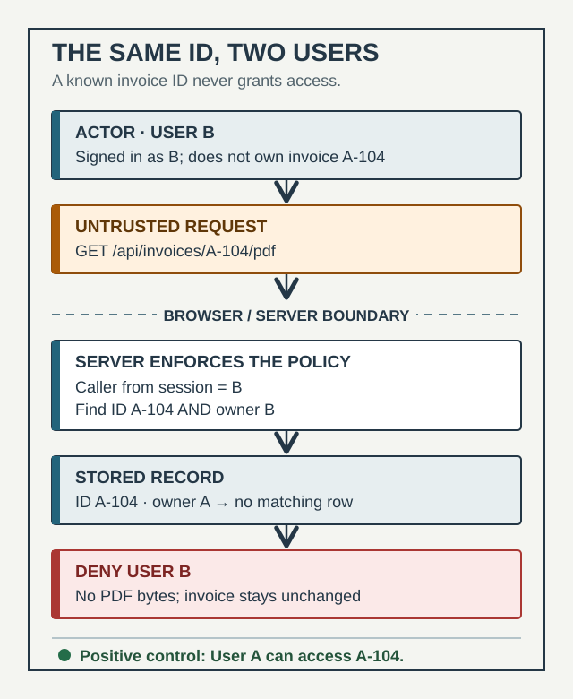

# Cheatsheets

<!-- Generated from web/src/lib/cheatsheets/. Do not edit by hand.
     Edit the sheet there and run `pnpm gen:cheatsheets` (from web/) to regenerate. -->

Look up a command or study a focused topic. Study sheets include worked
examples and local practice; stages teach lifecycle decisions.

Drawn: 28 of 31. A sheet listed as not drawn is
registered on purpose — the gap is the point, so it can be seen and filled.

| Sheet | Group | Stage | Status |
|---|---|---|---|
| Software Architecture Patterns | Architecture | 03 | Drawn |
| Design Patterns | Architecture | 03 | Drawn |
| API Design | Architecture | 03 | Drawn |
| SOLID Principles | Design Principles | 03 | Drawn |
| Clean Code | Design Principles | 05 | Drawn |
| Git Cheat Sheet | Git | 04 | Drawn |
| Git Commands | Git | 04 | Drawn |
| Git Branching & Conventions | Git | 04 | Drawn |
| Coding Standards | Standards | 05 | Drawn |
| Documentation Change Check | Standards | 10 | Drawn |
| Technical Debt Review | Standards | 17 | Drawn |
| Improvement Review | Standards | 18 | Drawn |
| Software Development Life Cycle | Standards | — | Drawn |
| Testing | Standards | 06 | Drawn |
| Playwright | Standards | 06 | Drawn |
| Code Review | Standards | 07 | Drawn |
| Deployment Environments | Standards | 12 | Drawn |
| AWS Deployment | Standards | 13 | Drawn |
| Post-Deploy Verification | Standards | 14 | Drawn |
| CI/CD Pipeline | Standards | 11 | Drawn |
| GitHub Actions | Standards | 11 | Drawn |
| Incident Management | Standards | 16 | Drawn |
| Security Audit | Standards | 08 | Drawn |
| Caching | Architecture | 09 | Drawn |
| Infrastructure Scaling | Architecture | 09 | Drawn |
| JavaScript | Languages | — | Drawn |
| DSA Patterns | Algorithms | — | Drawn |
| Node.js & Express | Languages | — | Drawn |
| Python | Languages | — | Not drawn |
| Java | Languages | — | Not drawn |
| Spring Boot | Languages | — | Not drawn |

---

## Software Architecture Patterns

Six ways to arrange a system, and what each one costs you.

Belongs to [03 — Architecture](../docs/03-architecture.md).

### Event-driven

Components communicate through events.

- **Event producer** — Emits events without knowing who consumes them. — The producer must not care how many consumers exist.
- **Event broker** — Holds the ordered stream — event 1 through event N. — Consumers read at their own pace, or replay from the start.
- **Event consumers** — Independent subscribers, each reacting to what it cares about. — Adding a consumer should not require touching the producer.

### Layered

Organize system into layers with separation of concerns.

- **Presentation layer** — What the user touches. — Depends downward only.
- **Business / application layer** — The rules that make this system this system. — The layer worth protecting from the other three.
- **Data access layer** — How persistence is reached, not where it lives. — Swapping the store should stop here.
- **Persistence layer** — The store itself. — The bottom of the stack.
- **Infrastructure** — Cross-cutting concerns every layer talks to. — Logging, config, auth — the things that refuse to layer.

### Monolithic

All components built and deployed as a single unit.

- **One deployable** — Posts, comments, groups, media and live streaming ship together. — One team, one release cadence, no distributed-systems tax.
- **One database** — Every feature reads and writes the same store. — Transactions across features stay trivial.
- **The cost** — Any change redeploys everything. — It bites when teams outgrow one release train.

### Microservices

Application is composed of small, independent services.

- **API gateway** — One entry point in front of many services. — Clients should not know the service topology.
- **Service per capability** — Catalog, cart, discount and order each deploy alone. — Teams need independent release cadence.
- **Database per service** — Each service owns its own store — four services, four databases. — Shared tables reintroduce the coupling the split was meant to remove.

### MVC

Separate application into Model, View and Controller.

- **View** — Renders state and forwards user actions to the controller. — Holds no rules of its own.
- **Controller** — Receives the action, requests data, renders the view. — The traffic director, not the brain.
- **Model** — Fetches and returns data, and updates the controller. — Where the rules and the persistence live.

### Master-slave

Distribute read/write workload between master and slaves.

- **Master (primary)** — Takes every write. — One writer keeps ordering simple.
- **Slave (replica)** — Serves reads, fed by replication from the master. — Read volume is the bottleneck, not write volume.
- **Replication lag** — A replica can answer with data the master already changed. — The trade this pattern asks you to accept.

Source: Software Architecture Patterns — Sathish Kumar Subramani.

## Design Patterns

The Gang of Four set, grouped by what each one is for.

Belongs to [03 — Architecture](../docs/03-architecture.md).

### Creational — how objects are created

- **Singleton** — Ensures a class has exactly one instance and one global access point. — Config managers, loggers, caches — cases where a second instance would be a bug, not a feature.
- **Factory Method** — Defines an interface for creating an object, letting subclasses choose the concrete class. — Object creation logic is complex enough that the caller should not have to know it.
- **Abstract Factory** — Creates families of related objects without naming their concrete classes. — A whole family needs to swap together — a UI theme, a database driver set.
- **Builder** — Builds a complex object step by step, separating construction from representation. — Many optional parameters would otherwise mean a constructor nobody can read.
- **Prototype** — Creates new objects by cloning an existing one rather than building from scratch. — A template instance already exists and copying it is cheaper than reconstructing it.

### Structural — how objects are composed

- **Adapter** — Converts the interface of a class into another interface clients expect. — Integrating third-party libraries or legacy systems whose interface you cannot change.
- **Bridge** — Decouples an abstraction from its implementation so both can vary independently. — An abstraction and its implementation would otherwise multiply combinations through subclassing.
- **Composite** — Composes objects into tree structures and treats a single object and a group of them the same way. — Part-whole hierarchies where the caller should not have to check which one it has.
- **Decorator** — Adds behavior to an object dynamically, without touching its class. — Layering concerns like logging, authorization or caching without subclassing for every combination.
- **Facade** — Provides one simplified interface to a complex subsystem. — Simplifying usage for callers who need the common path, not the whole subsystem’s surface.
- **Flyweight** — Shares objects to support large numbers of fine-grained instances efficiently. — Object count is high enough that per-instance memory is the actual bottleneck.
- **Proxy** — Controls access to an object through a surrogate that stands in for it. — Access control, lazy loading, or logging need to sit in front of the real object.

### Behavioral — how objects communicate

- **Chain of Responsibility** — Passes a request along a chain of handlers until one of them handles it. — The sender should not need to know which handler, if any, will act.
- **Command** — Encapsulates a request as an object, decoupling the invoker from the thing that executes it. — Queuing, logging or undoing actions requires treating a request as data.
- **Interpreter** — Defines a grammar and a way to interpret sentences written in it. — A small language recurs often enough to justify its own grammar rather than ad hoc parsing.
- **Iterator** — Traverses a collection’s elements without exposing how the collection is stored. — Callers need to walk a collection without depending on its internal structure.
- **Mediator** — Centralizes communication between objects so they reference the mediator instead of each other. — A group of objects’ interactions have become a tangle of direct references.
- **Memento** — Captures and restores an object’s internal state without exposing that state directly. — Undo functionality needs a snapshot that does not break encapsulation to take.
- **Observer** — Notifies multiple dependents automatically when an object’s state changes. — Event handling, UI updates, notifications — anywhere one change fans out to many reactions.
- **State** — Lets an object alter its behavior when its internal state changes, as if it changed class. — A single object’s behavior branches heavily on a status field that keeps growing.
- **Strategy** — Defines a family of algorithms, encapsulates each one, and makes them interchangeable. — Payment methods, sorting, compression — the algorithm varies but the caller’s shape does not.
- **Template Method** — Defines the skeleton of an algorithm in a base class, letting subclasses override specific steps. — Several variants share most of a process and differ only in a few well-defined steps.
- **Visitor** — Adds new operations to an object structure without modifying the classes it operates on. — New operations arrive more often than new element types do.

Source: Software Design Patterns — Unrecorded — see reference/cheatsheet-sources.md.

## API Design

From HTTP fundamentals through versioning, auth and rate limits.

Belongs to [03 — Architecture](../docs/03-architecture.md).

### Fundamentals and protocol

- **API types** — REST, GraphQL, gRPC, SOAP — different answers to the same question of how a client asks a server for something.
- **Request-response lifecycle** — Client sends a request, server processes it, server returns a response — the shape every API type still fits inside.
- **HTTP methods and status codes** — GET, POST, PUT, PATCH, DELETE map to intent; status codes and headers carry the outcome.
- **Payload basics** — JSON, XML and form data as wire formats; URLs, HTTPS and TLS as the transport underneath them.

### Designing the resource

- **REST principles** — Resource-based URLs, CRUD operations mapped onto HTTP methods, consistent naming.
- **Versioning and idempotency** — A breaking change ships as a new version rather than breaking every client already live; idempotent methods are safe to retry.
- **Request and response shape** — A consistent JSON structure, pagination for large result sets, filtering and sorting as query parameters.
- **Error responses** — A standardized error shape, so a client can branch on it instead of parsing prose.

### Auth and validation

- **API keys and JWT** — A key identifies the caller; a JWT carries claims about who they are without a database round trip to check.
- **OAuth 2.0 and OpenID Connect** — Delegated authorization and identity on top of it — a client acts on a user’s behalf without holding their password.
- **RBAC and session vs token** — Role-based access control decides what an authenticated caller may do; sessions and tokens are two different ways to carry "who is this" between requests.
- **Input validation** — Validate and sanitize at the boundary, with error codes and exceptions that say what failed rather than that something did.

### Data and performance

- **SQL vs NoSQL** — Relational structure and transactions against flexible schema and horizontal scale — the trade the data model makes.
- **Caching** — Redis or similar in front of a slow read path, with rate limiting and compression protecting what caching does not.
- **Async processing and load balancing** — Work too slow for a request-response cycle moves off it; load balancing spreads traffic once one server is not enough.

### Docs, testing and security

- **OpenAPI and Swagger** — A machine-readable API specification that also generates interactive documentation and client SDKs.
- **Testing** — Unit and integration tests, automated mocks, and manual exploration with a tool like Postman.
- **Transport and injection defenses** — HTTPS and CORS at the edge; defenses against XSS, CSRF and SQL injection in the application.
- **Secrets** — Credentials and keys live outside the codebase, with logging and monitoring watching for misuse.

### Deployment and advanced patterns

- **Gateways and containers** — An API gateway as the single entry point in front of many services; Docker and Kubernetes as how those services run.
- **CI/CD** — Pipelines that build, test and deploy on every change rather than on a manual release day.
- **Beyond REST** — GraphQL and gRPC as alternatives to REST; WebSockets and webhooks for the cases a request-response cycle does not fit.
- **Microservices communication** — Services talk to each other the same way clients talk to the API — the design principles above apply internally too.

Source: Master Plan for API Design — Shalini Goyal.

## Caching

Choose reusable work, set a freshness rule, invalidate after writes, and verify the same user outcome.

Belongs to [09 — Performance Optimization](../docs/09-performance-optimization.md).

### Choose the boundary

Cache a result only when its ownership scope and tolerated staleness are defined. These are application decisions, not a command to add a cache everywhere.

- **Reusable result** — A public catalog description can be a candidate for reuse. A faster response is useful only if it still answers the intended user operation. — Use evidence that the repeated work contributes to the measured slow path.
- **Current business decision** — Validate stock, charge status and authorization against the appropriate authoritative state. A cached description is not permission to sell, charge or disclose. — Before accepting an order, confirming payment or returning protected data.
- **Key and ownership** — Include every input that changes the result, such as product, locale or tenant. A tenant-specific cache key does not grant access; authorization still belongs at the data boundary. — Test the same identifier as two users or tenants before sharing a cached result.

### Set lifetime and tags

TTL means time to live: a freshness or expiry interval under the chosen cache policy. Retention is how long an entry remains stored; neither term promises persistence on every host.

- `cacheComponents: true` — Enable Cache Components in the example application before using the Next.js use cache directive. This playbook is teaching the API; it does not enable runtime caching here. — Check the installed framework version and hosting behavior.
- `'use cache'` — Mark an async function, component or module scope for caching. Read cookies, headers and other request-specific values outside that scope, then pass the needed inputs. — Reuse an eligible result, with its input and ownership boundaries already defined.

  *Illustrative public-description read; example domain, not this app*

  ```
  import { cacheLife, cacheTag } from 'next/cache'

  export async function readDescription(productId: string) {
    'use cache'
    cacheLife('minutes')
    cacheTag(`catalog:${productId}`)
    const response = await fetch(
      `https://catalog.example/products/${encodeURIComponent(productId)}`,
    )
    if (!response.ok) throw new Error('Catalog read failed')
    const { id, description } = await response.json()
    return { id, description }
  }
  ```

- `cacheLife / cacheTag` — Choose a lifetime consistent with tolerated staleness and tag the reads a successful write will invalidate. Tags label entries; they are not authorization checks. — Describe the expected read after a write, not only how long the entry might be retained.
- **Hosting and retention** — Default runtime memory can be instance-local and ephemeral, especially on serverless hosts. Check the configured cache handler before assuming reuse across requests or deployments. — A published lifetime is not evidence that a particular instance still holds the entry.

### Invalidate after a write

The write must succeed before invalidating affected reads. Invalidation changes the next matching data read; it does not automatically refresh every open browser view.

- `updateTag(tag)` — Server Actions only: expire matching entries immediately so the next matching read waits for fresh data. — Use after a successful write when the actor must read their own change. It is not available in Route Handlers.
- `revalidateTag(tag, 'max')` — Server Actions or Route Handlers: mark tagged data stale; the next visit can receive stale data while revalidation runs in the background. — Use when stale-while-revalidate behavior is acceptable. The call itself does not eagerly refresh every tagged page.
- `revalidateTag(tag, { expire: 0 })` — From a Route Handler that requires immediate expiry, make the next matching read block for fresh data. — Use when stale content is unacceptable and updateTag is unavailable. Avoid the deprecated single-argument revalidateTag form.

### Read CDN evidence

CDN means content delivery network. CF-Cache-Status describes Cloudflare response caching, not Next.js application-cache entries. These examples do not imply this site uses Cloudflare.

- **HIT** — Cloudflare found the response in its cache. — A hit does not prove the application data reflects the latest write.
- **MISS** — The request was eligible for Cloudflare caching but the response was absent, so the origin served it. — A first or cold request can miss without a fault.
- **BYPASS** — Cloudflare considered the request eligible, but the response or policy prevented storing the response. — Inspect the relevant response headers and cache rules before changing the policy.
- **DYNAMIC** — Cloudflare considered the request ineligible for cache at request time. — Check eligibility rules; do not treat this as a missing Next.js tag.
- **Freshness and retention** — A freshness interval controls when origin validation is required. An expired entry may still be retained; stale serving depends on the applicable revalidation policy. — Keep CDN headers and application-cache tags as separate controls.
- `curl -sS -D - -o /dev/null https://catalog.example/products/demo` — Read response headers for an explicitly illustrative URL. Inspect CF-Cache-Status and the applicable Cache-Control headers on a real test endpoint. — Use a safe read endpoint; do not infer application-cache behavior from a CDN header.

### Verify the change

A cache hit is diagnostic evidence, not proof of a better or correct user outcome.

- **Comparable outcome** — Compare the same observer, start/end events, segment, workload, observation window and cold/warm cache state. A p95 is the duration at the 95th percentile of the stated population. — Record the sample, timeout/failure rule, errors and correctness as well as latency; a single lab run is not a field p95.
- **Freshness and isolation** — After the write, confirm the intended reader sees the expected state. Repeat as another user or tenant and confirm protected data is not disclosed. — Keep the cache change only when the freshness rule, authorization and user target still hold.

Sources:

Source: [use cache](https://nextjs.org/docs/app/api-reference/directives/use-cache) — Next.js.

Source: [cacheLife](https://nextjs.org/docs/app/api-reference/functions/cacheLife) — Next.js.

Source: [cacheTag](https://nextjs.org/docs/app/api-reference/functions/cacheTag) — Next.js.

Source: [updateTag](https://nextjs.org/docs/app/api-reference/functions/updateTag) — Next.js.

Source: [revalidateTag](https://nextjs.org/docs/app/api-reference/functions/revalidateTag) — Next.js.

Source: [Cloudflare cache responses](https://developers.cloudflare.com/cache/concepts/cache-responses/) — Cloudflare.

Source: [Retention vs Freshness (TTL)](https://developers.cloudflare.com/cache/concepts/retention-vs-freshness/) — Cloudflare.

## Infrastructure Scaling

Find the constrained resource, compare routing choices, plan for overload, and prove the user outcome.

Belongs to [09 — Performance Optimization](../docs/09-performance-optimization.md).

### Locate the limit

This is infrastructure scaling. Stage 09's Scaling to a team section describes team practice. Routing and added capacity are candidates to justify with evidence, not routine fixes for every slow request.

- **Constrained resource** — Name the user outcome, workload and limiting resource using measurements. CPU, memory, connections, storage or a shared dependency can constrain different operations. — A utilization chart alone does not define the observer, duration or customer harm.
- **Vertical capacity** — Increase resources on one instance when evidence shows its resource limit is the constraint. — Check the remaining limit, failure exposure and cost rather than assuming a larger instance is faster.
- **Horizontal capacity** — Add replicas when the work can be safely distributed and the shared dependencies can support it. — Check state, session and connection assumptions before adding targets.
- **Routing and dependencies** — A load balancer distributes requests. More application replicas do not establish more capacity in a shared database; reducing expensive work is a different candidate. — Check the dependency that remains shared and identify what the proposed change actually relieves.

### Choose routing

The following are AWS Application Load Balancer (ALB) target-group algorithms. A provider-specific setting is not a universal algorithm list. Sticky sessions can bypass subsequent routing choices.

- **Round robin** — Distribute requests across healthy targets in sequential order under normal routing conditions. — An ALB default suited to similarly costly requests and similarly capable targets; stickiness affects subsequent target selection.
- **Least outstanding requests** — Choose the target with the fewest in-flight requests. — An ALB option for varying request cost or target capability. It does not support slow start; sticky sessions affect subsequent selection.
- **Weighted random** — Randomly distribute requests across healthy targets; optional Automatic Target Weights anomaly mitigation can adjust distribution. — ALB weighted random does not support sticky sessions or slow start. Check the intended workload and feature compatibility.
- `aws elbv2 describe-target-group-attributes --target-group-arn "$TARGET_GROUP_ARN"` — Read target-group attributes without changing routing. TARGET_GROUP_ARN must name your permitted test group; AWS credentials and read permission are required. — Inspect routing, stickiness and health settings before proposing a mutation.

### Check health and overload

Health checks and routing do not create unlimited capacity. Define the operation the probe represents and the behavior when capacity or targets fail.

- **Health checks and fail-open** — ALB normally routes to healthy targets. If all registered targets are unhealthy, it fails open and can route to them regardless of health status. — A failed probe is not proof that all traffic to that target has stopped; inspect health/routing thresholds as well as the reason code.
- **Draining and failure capacity** — Deregistration allows in-flight work time to finish. Check remaining target and dependency capacity while a target or zone is unavailable. — A connection terminated before draining completes can fail a request; do not equate a removed target with completed customer work.
- **Admission and degradation** — Keep admitted work and queues bounded. Under overload, use a defined safe degraded response or reject excess work instead of letting backlog grow without a limit. — Degrade only when the user contract permits it; stale payment or authorization state is not a safe shortcut.
- **Retries and uncertain outcomes** — Retries add work to an overloaded service. Use a bounded retry policy and establish whether a timed-out side effect already succeeded before replay. — A charge or write may have completed before the timeout. Reconcile uncertain outcomes rather than assuming retry means recovery.

### Prove the outcome

There is no universal requests-per-second target or replica count. Example workloads are illustrative; measure the same operation before and after.

- **User latency and errors** — Compare the same start/end observer, segment, workload and collection window. Define the percentile population and keep failures visible. A p95 is the duration at the 95th percentile of that population. — A faster routing or server span does not prove the user operation improved.
- **Resource and delayed work** — Check the limiting resource, shared dependencies and oldest pending work where applicable. Verify capacity during failure as well as normal traffic. — A healthy homepage or an empty request queue does not prove that downstream work completed.
- **Correctness and cost** — Retest state/session assumptions and actual customer outcomes. Compare resource cost, record unresolved limits, and keep or revert the change from that evidence. — Adding replicas is not a win if the outcome still misses its target or correctness regresses.

Sources:

Source: [Application Load Balancer target-group attributes](https://docs.aws.amazon.com/elasticloadbalancing/latest/application/edit-target-group-attributes.html) — AWS.

Source: [Application Load Balancer target-group health checks](https://docs.aws.amazon.com/elasticloadbalancing/latest/application/target-group-health-checks.html) — AWS.

Source: [Handling Overload](https://sre.google/sre-book/handling-overload/) — Google SRE.

## SOLID Principles

Five rules for code that stays easy to change, test and extend.

Belongs to [03 — Architecture](../docs/03-architecture.md).

### The five principles

- **Single Responsibility** — A class should have only one reason to change. — A class handling users, email and reports together is three responsibilities pretending to be one.

  *Violation*

  ```
  class UserManager {
    saveUser(u: User) { /* … */ }
    sendWelcomeEmail(u: User) { /* … */ }
    generateReport(u: User) { /* … */ }
  }
  ```

  *Correct*

  ```
  class UserRepository {
    save(u: User) { /* … */ }
  }
  class WelcomeEmailer {
    send(u: User) { /* … */ }
  }
  class UserReport {
    generate(u: User) { /* … */ }
  }
  ```

- **Open/Closed** — Open for extension, closed for modification — add behavior without editing what already works. — A new type keeps requiring an `if`/`else if` added to existing code instead of a new class.

  *Violation*

  ```
  function area(shape: Shape) {
    if (shape.kind === "circle") return Math.PI * shape.r ** 2
    if (shape.kind === "rect") return shape.w * shape.h
    // every new shape edits this function
  }
  ```

  *Correct*

  ```
  interface Shape { area(): number }
  class Circle implements Shape {
    area() { return Math.PI * this.r ** 2 }
  }
  // a new shape adds a class, this function never changes
  ```

- **Liskov Substitution** — A subclass must be usable anywhere its superclass is, without breaking the caller’s expectations. — A subclass throws on a method its parent’s contract promises will work — Ostrich extending Bird and refusing to fly.

  *Violation*

  ```
  class Bird { fly() { /* … */ } }
  class Ostrich extends Bird {
    fly() { throw new Error("Ostriches can’t fly") }
  }
  ```

  *Correct*

  ```
  class Bird {}
  class FlyingBird extends Bird { fly() { /* … */ } }
  class Ostrich extends Bird {} // never promises flight
  ```

- **Interface Segregation** — Clients should not be forced to depend on methods they do not use. — One fat interface makes every implementer stub out methods that do not apply to it.

  *Violation*

  ```
  interface Worker {
    work(): void
    eat(): void
  }
  class Robot implements Worker {
    work() { /* … */ }
    eat() { throw new Error("Robots don’t eat") }
  }
  ```

  *Correct*

  ```
  interface Workable { work(): void }
  interface Eatable { eat(): void }
  class Robot implements Workable {
    work() { /* … */ }
  }
  ```

- **Dependency Inversion** — High-level modules depend on abstractions, not on concrete low-level modules. — Swapping an implementation — a database, a payment provider — should not require editing the code that uses it.

  *Violation*

  ```
  class UserService {
    private db = new MySqlDatabase()
  }
  ```

  *Correct*

  ```
  interface Database { connect(): void }
  class UserService {
    constructor(private db: Database) {}
  }
  ```


Source: SOLID Principles — Cheat Sheet — Raja Kumar.

## Clean Code

Five habits that separate code that works from code that lasts.

Belongs to [05 — Development](../docs/05-development.md).

### Five habits

- **Write for humans** — Code is read far more often than it is written — optimise for the next reader, not the interpreter.

  *Before*

  ```
  const d = (a: number, b: number) => a * b * 0.1
  ```

  *After*

  ```
  const calculateDiscount = (price: number, quantity: number) =>
    price * quantity * DISCOUNT_RATE
  ```

- **Keep it simple** — The straightforward solution beats the clever one once someone else has to maintain it.

  *Before*

  ```
  const isEven = (n: number) => !(n & 1) === !0
  ```

  *After*

  ```
  const isEven = (n: number) => n % 2 === 0
  ```

- **Avoid duplicates** — The same logic in two places is one bug waiting to be fixed in only one of them.

  *Before*

  ```
  function total(items) {
    return items.reduce((s, i) => s + i.price * i.qty, 0)
  }
  function subtotal(cart) {
    return cart.reduce((s, i) => s + i.price * i.qty, 0)
  }
  ```

  *After*

  ```
  function lineTotal(item: LineItem) { return item.price * item.qty }
  function total(items: LineItem[]) {
    return items.reduce((s, i) => s + lineTotal(i), 0)
  }
  ```

- **Be consistent** — One naming style, one structure, one way of doing a repeated thing — consistency is what makes code skimmable.

  *Before*

  ```
  function get_user(id) { /* … */ }
  function fetchOrder(id) { /* … */ }
  function Load_Invoice(id) { /* … */ }
  ```

  *After*

  ```
  function getUser(id: string) { /* … */ }
  function getOrder(id: string) { /* … */ }
  function getInvoice(id: string) { /* … */ }
  ```

- **Refactor regularly** — Clean code is a habit applied continuously, not a one-time pass before a release. — The Boy Scout Rule: leave the code a little cleaner than you found it, every time you touch it.

### Four more, named as acronyms

From a second gathered source — "6 Golden Rules to Write Clean Code" by Neo Kim. Its other two rules, DRY and KISS, are the same ideas as "Avoid duplicates" and "Keep it simple" above.

- **SOC — Separation of concerns** — Keep distinct responsibilities in distinct places, so a change to one does not ripple into the other. — The class-level version of this is SOLID’s Single Responsibility Principle — see `solid-principles`.
- **DYC — Document your code** — Comments and docs explain *why* a decision was made — the code itself already says what it does.
- **TDD — Test-driven development** — Write the failing test before the code that makes it pass. — This repo’s own iron law: "NO PRODUCTION CODE WITHOUT A FAILING TEST FIRST" (`CLAUDE.md`) — see `testing`.
- **YAGNI — You ain’t gonna need it** — Do not build for a requirement that does not exist yet — speculative flexibility is a cost paid today for a maybe.

Source: Clean Code Principles Every Junior Developer Should Know — Unrecorded — see reference/cheatsheet-sources.md.

## Git Cheat Sheet

Essential commands from init to push, plus the four-area mental model.

Belongs to [04 — Project Setup](../docs/04-project-setup.md).

### Start a repository

- `git init` — Create a new Git repository in the current directory. — Starting a brand-new project. Run once, at the beginning.
- `git clone <repo-url>` — Clone an existing repository into a new directory. — Joining a project that already exists on GitHub, GitLab, or another remote.

### Check your changes

- `git status` — See modified, staged, and untracked files. — Before staging, before committing, before switching branches. The single most-typed git command.
- `git diff` — See changes that have not been staged yet. — Reviewing what you changed before deciding what to stage.

### Stage and commit

- `git add <file>` — Stage a specific file for the next commit. — When you want to commit some changes but not all of them.
- `git add .` — Stage all changes in the current directory. — When every change belongs in the same commit. Check git status first.
- `git commit -m "message"` — Save staged changes with a meaningful message. — After staging. The message describes what changed, not what you did to the diff.
- `git log --oneline` — View a compact commit history (one line per commit). — Finding a recent commit, checking what landed, verifying branch state.

### Branches

- `git branch` — List local branches. The current branch is marked with an asterisk. — Checking which branch you are on, or seeing what branches exist.
- `git branch <branch-name>` — Create a new branch at the current commit. — Starting a feature or fix. Does not switch to the new branch.
- `git switch <branch-name>` — Switch to another branch. — Moving between branches. Replaces the older git checkout for branch switching.
- `git switch -c <branch-name>` — Create and switch to a new branch in one step. — The common case: you want a new branch and you want to be on it immediately.
- `git branch -d <branch-name>` — Delete a branch that has been merged. — After merging. Use -D (capital) to force-delete an unmerged branch.

### Sync with remote

- `git fetch` — Download remote changes without merging them. — When you want to see what changed on the remote before integrating.
- `git pull` — Fetch and integrate changes from remote into your current branch. — Getting the latest changes. Equivalent to git fetch + git merge.
- `git push` — Upload your local commits to the remote. — After committing locally and wanting others to see the work.
- `git push -u origin <branch>` — Push a new branch to the remote and set it as the upstream. — The first push of a new branch. After this, plain git push works.

### Merge and rebase

Use merge to preserve history. Use rebase for a cleaner, linear history (it rewrites commits). This project uses merge (--no-ff) and never rebases.

- `git merge <branch-name>` — Merge another branch into your current branch. Creates a merge commit. — Integrating finished work. The merge commit records when and what was integrated.
- `git rebase <branch-name>` — Reapply your commits on top of another branch. Rewrites commit history. — Cleaning up a feature branch before merging, when a linear history matters more than preserving the original commit sequence.

### Undo changes

Be careful with git reset --hard. It permanently discards local changes.

- `git restore <file>` — Discard unstaged changes in a file, reverting it to the last committed state. — When you edited a file and want to throw those changes away.
- `git restore --staged <file>` — Unstage a file without deleting the changes. — When you staged something by mistake but still want to keep the edits.
- `git revert <commit-id>` — Create a new commit that undoes an earlier commit. — Safely undoing a change that has already been pushed. Preserves history.
- `git reset --soft HEAD~1` — Undo the last commit while keeping the changes staged. — When you committed too early and want to amend or re-split the work.

### Tags

- `git tag` — List all tags. — Checking which versions have been tagged.
- `git tag v1.0.0` — Create a lightweight tag at the current commit. — Marking a release or milestone.
- `git push origin v1.0.0` — Push a specific tag to the remote. — Tags are not pushed by default. Push them explicitly after creating.

### The Git model

The four areas: Working Directory (your local files) → Staging Area (changes ready to commit) → Local Repository (your Git history) → Remote Repository (e.g. GitHub). The workflow is: modify files, git add, git commit, git push.

- **Working Directory** — Your local files. Every edit starts here.
- **Staging Area** — Changes you have selected for the next commit with git add.
- **Local Repository** — Your commit history, stored in the .git directory.
- **Remote Repository** — The shared history on GitHub, GitLab, or another host.

Source: Git Cheat Sheet — Essential Commands Every Developer Should Know — Unrecorded.

## Git Commands

The ones worth memorising, and the ones worth looking up.

Belongs to [04 — Project Setup](../docs/04-project-setup.md).

### Basics

The work → stage → commit → push loop, and the commands each step names.

- `git init` — Creates a new repository in the current directory. — Starting a project from nothing.
- `git clone <url>` — Copies an existing repository, history included. — Starting from someone else’s history instead of your own.
- `git status` — Lists modified, staged and untracked files. — Before every commit, so nothing surprising goes in.
- `git diff` — Shows changes that have not been staged yet. — Checking exactly what changed before you stage it.
- `git add <file> / git add .` — Stages a specific file, or every change. — The line between "changed" and "about to be committed".
- `git commit -m "message"` — Saves the staged changes with a message. — One logical change per commit, not one commit per save.
- `git log --oneline` — A compact, one-line-per-commit history. — Scanning recent history without the full commit body noise.
- `git branch <name> / git switch <name> / git switch -c <name>` — Create a branch, switch to one, or do both in one step. — `-c` is the one you reach for starting new work.
- `git fetch / git pull / git push` — Download remote changes without merging, download and merge, or upload local commits. — `fetch` first if you want to see what changed before merging it in.
- `git merge <branch> / git rebase <branch>` — Combine another branch into yours — merge keeps both histories, rebase replays yours on top. — Merge to preserve what happened; rebase for a clean, linear log.
- `git restore <file> / git revert <commit> / git reset --soft HEAD~1` — Three different undos: discard an unstaged edit, add a new commit that undoes an old one, or uncommit while keeping the changes staged. — Restore for a typo, revert once history is shared, reset only on a branch nobody else has pulled.

### Beyond commit and push

The commands that stop being optional once a project outlives its first week.

- `git stash` — Saves uncommitted changes without creating a commit. — Switching context mid-task without a half-finished commit to clean up later.
- `git cherry-pick <commit-id>` — Copies one specific commit onto the current branch. — You need that one fix, not the whole branch it shipped on.
- `git rebase main` — Replays your branch’s commits on top of main, keeping history linear. — Tidying a feature branch’s log before it merges.
- `git reflog` — Recovers commits that look lost — nothing is gone until it is garbage-collected. — After a reset or a branch delete you immediately regret.
- `git bisect start / bad / good <commit-id>` — Binary-searches history for the exact commit that introduced a bug. — A regression exists somewhere in fifty commits and reading them one at a time is not an option.
- `git reset --hard <commit-id> vs git revert <commit-id>` — Reset rewrites history to a point; revert adds a new commit undoing an old one. — Reset only on history nobody else has pulled — revert is the safe default once it is shared.

Source: Git Commands — Unrecorded — see reference/cheatsheet-sources.md.

## Git Branching & Conventions

Trunk-based against GitFlow, and the commit format this repo uses.

Belongs to [04 — Project Setup](../docs/04-project-setup.md).

### Branching strategies

What each one adds over "just branch off main", and what it costs.

- **Feature branching** — Each feature gets its own branch, deleted once merged. — The default almost everyone starts from — no process beyond it is assumed.
- **Gitflow** — Dedicated branches for features, releases, hotfixes, plus a permanent development branch alongside main. — Scheduled releases with real time between them — the ceremony pays for itself on a slow cadence, not a fast one.
- **GitLab Flow** — Adds environment branches — staging, production — so main stays release-ready and environments are named, not inferred. — Multiple deploy targets that do not all track main directly.
- **GitHub Flow** — Branch, open a PR, merge to main. Main is the only deployable branch and stays production-ready. — Continuous deployment with no separate release branch to keep in sync.
- **Trunk-based** — Branches are short-lived, merged within a day; large work ships incrementally behind feature flags. — Fast-moving teams where a long-lived branch would drift from main faster than it could be reviewed.

### This repo’s convention

From CLAUDE.md, not the gathered graphic — closest to GitHub Flow with an extra promotion step.

- **Branch naming** — `feat/<kebab-topic>` or `fix/<kebab-topic>`, no ticket numbers; `docs/<date>-<topic>` carries a date, `feat`/`fix` do not.
- **Commit format** — Conventional Commits — `type(scope): subject`, subject lowercase, describing the change rather than the diff.
- **The flow** — Work branches merge to `develop`, never to `main` — `main` is production and deploys on push. `develop` promotes to `main` by pull request, which the user merges. — Not a fast-forward: `main` can sit ahead of `develop` by its own promotion-merge commits.
- **Merging** — `--no-ff` always, never squash or rebase, with a hand-written merge subject and a bullet-summary body. — History should show what shipped as one unit, not lose the branch shape a rebase or squash would erase.

Source: Git Branching Strategies — Nikki Siapno.

## Coding Standards

The smells worth refactoring on sight.

Belongs to [05 — Development](../docs/05-development.md).

### Code smells

From Refactoring.Guru’s taxonomy, condensed to five categories. Not bugs — signs the code is getting harder to change, read or extend.

- **Bloaters** — Methods, classes or parameter lists that have grown too large to reason about. — A long method, a large class, or a parameter list nobody can call without checking the signature.
- **Object-orientation abusers** — Cases where OOP exists in the codebase but is not doing its job — switch statements standing in for polymorphism. — A type check or a chain of `if`/`else` decides behavior that a class hierarchy should decide instead.
- **Change preventers** — Structures that make one change ripple into many files that should not need to move together. — Divergent change (one class changed for many reasons) or shotgun surgery (one change touches many classes).
- **Dispensables** — Code that provides little or no value — duplicate code, dead code, unnecessary abstraction. — Deleting it would not be missed, and keeping it costs a reader’s attention every time they pass it.
- **Couplers** — Classes or modules that depend on each other more than their job requires. — Feature envy (a method more interested in another class than its own) or a message chain three calls deep.

Source: [Code Smell](https://refactoring.guru/refactoring/smells) — AIAI LAB, citing Refactoring.Guru.

## Documentation Change Check

Choose the document, record the facts, and check what a change makes stale.

Belongs to [10 — Documentation](../docs/10-documentation.md).

### Choose a form for the reader

Choose for the task; four reader needs do not require four files. Open Stage 10 for worked examples and practice.

- **Tutorial** — A guided learning exercise with a safe starting point and an achievable result. — The reader needs to learn a skill by doing it.
- **How-to guide** — Steps for a known task, with prerequisites and an observable completion condition. — The reader needs to get work done.
- **Reference** — Exact names, types, allowed values, defaults and absence behavior for the applicable version. — The reader needs a fact, such as a retry option or response field.
- **Explanation** — Concepts, reasons and tradeoffs that help the reader understand a choice. — The reader needs context rather than a procedure.

### Adapt the record prompts

These are playbook prompts, not a mandatory document inventory or fixed template. MADR metadata and confirmation are optional; use the detail the decision needs.

- **README entry point** — Purpose and reader; actual prerequisites, safe configuration/access, tested setup commands, expected result and a help route. — Follow the setup from a fresh clone without private instructions; record the first gap.
- **Decision record** — Significant choice, context, decision, reasons, alternatives, consequences and current status/date. — Include costs and obligations, not only benefits. Link the source or revision the choice applies to.
- **Factual reference** — Name/type, allowed values, default or absence, applicable version, authoritative source and review trigger. — Distinguish missing, null and empty according to the actual contract.
- **Change/check record** — Reader/task, changed fact, affected documents, source/revision, check, expected/observed result, owner and review trigger. — Keep this in the change or review record; a separate document is optional.

### Trace the changed fact

Checks and owner/review prompts are this playbook’s application guidance. Generation or a checked box does not establish that a source is correct.

- **Configuration** — Update the configuration reference, safe example and affected setup instructions. Compare missing/invalid/default behavior with the actual validator. — Name the maintainer and validator-change trigger.
- **Response contract** — Update reference and example responses. Run the applicable generator, inspect the expected diff and verify serializer behavior, including optional-field omission. — Name the contract owner and response-change trigger.
- **Replaced decision** — Write the replacement ADR. Preserve the old reasoning, expose its current superseded status and date, and link old and new records in both directions. — Follow the old entry point and confirm the replacement is discoverable.
- **Setup or release procedure** — Update the README and linked procedure when commands, access or environment change. Follow the documented path safely and record its result and limits. — Name the responsible maintainer and procedure-change trigger.

### Publish only supported claims

- **Label the evidence** — Record revision, check, expected and observed result, and limits. Reading is not execution; compiling does not establish runtime behavior or recovery.
- **Review an AI draft** — Ground it in supplied sources and have a reviewer check facts, versions, examples and privacy. Claim validation only when the corresponding evidence exists.
- **Use safe examples** — Use synthetic data and safe placeholders. Keep real credentials and private records out; do not invent project commands, provider guarantees or incident outcomes.

Sources:

Source: [Diátaxis primer](https://diataxis.fr/start-here/) — Daniele Procida.

Source: [Documenting Architecture Decisions](https://cognitect.com/blog/2011/11/15/documenting-architecture-decisions) — Michael Nygard / Cognitect.

Source: [MADR 4.0.0 template](https://github.com/adr/madr/blob/4.0.0/template/adr-template.md) — MADR contributors.

Source: [About READMEs](https://docs.github.com/en/repositories/managing-your-repositorys-settings-and-features/customizing-your-repository/about-readmes) — GitHub.

Source: [What to look for in a code review: Documentation](https://google.github.io/eng-practices/review/reviewer/looking-for.html#documentation) — Google Engineering Practices.

## Technical Debt Review

Recognize a design cost, choose a response from evidence, and check what retirement affects.

Belongs to [17 — Maintenance](../docs/17-maintenance.md).

### Recognize the debt

Fowler’s two axes describe care in the decision (reckless or prudent) and awareness of taking on debt (deliberate or inadvertent). The four cases below paraphrase the gathered illustration. A category does not determine repayment urgency, blame or whether a change is worthwhile.

- **Reckless / deliberate** — The team knowingly skips design work without weighing the future cost.
- **Prudent / deliberate** — The team weighs the consequences and accepts a design compromise to gain an earlier release.
- **Reckless / inadvertent** — The team lacks design knowledge and creates a costly structure without recognizing the debt.
- **Prudent / inadvertent** — A capable team learns through building and later sees a better design than it could see at the start.

### Decide from evidence

These review prompts are the playbook’s application guidance, not a scoring system prescribed by Fowler. Open Stage 17 for exercises and fuller operational context.

- **Observed recurring cost** — Link repeated edits, defects or delayed changes to the affected behavior and investigate the cause. — Repeated bugs alone do not establish that the design needs replacing.
- **Impact and deadline** — Record who is affected, the cost or risk of waiting, and any real deadline. Keep unknown exposure explicit.
- **Smallest useful change** — Identify a bounded improvement, its likely next touch and the future work it could make cheaper. Compare the expected benefit with the effort.
- **Owner and review date** — Name an owner, link the evidence, and set a review date and a trigger for reconsidering the decision.

### Choose a response

Establish checks for current behavior before restructuring fragile code, then rerun them after each small change. Keep feature changes separate enough to review; tests provide evidence within their coverage.

- **Nearby refactor** — Improve the area you are already changing when the cleanup helps that task. Keep the structural change small and check affected callers.
- **Planned incremental change** — Give a larger restructuring an owner, compatibility steps and checkpoints. Make small changes while keeping the system usable.
- **Deliberate deferral** — Record why carrying the cost is acceptable for now, the owner and the review trigger. A rarely touched area may not repay the effort to change it.

### Retire with evidence

Retirement changes behavior. These playbook checks apply the deprecation guidance to a removal decision.

- **Discover consumers** — Check callers, jobs, integrations, runtime usage and support knowledge. Check telemetry coverage and the relevant usage cycle before treating low counts as evidence of disuse. — Missing telemetry leaves usage unknown; rare recovery or administrative paths may still matter.
- **Migration and communication** — Identify affected owners, communicate the change and provide a migration route where needed. Prefer a reversible disable step where practical, with a way to detect trouble and recover.
- **Verify removal and effects** — Check remaining behavior and remove stale flags, configuration, dependencies, tests and docs. Account separately for stored data, subscriptions and external effects. — Version control can restore tracked code; it cannot restore deleted production data or undo notifications, billing or broken external contracts.

Sources:

Source: [Technical Debt Quadrant](https://martinfowler.com/bliki/TechnicalDebtQuadrant.html) — Martin Fowler (2009); unchanged illustration.

Source: [Workflows of Refactoring](https://martinfowler.com/articles/workflowsOfRefactoring/fallback.html) — Martin Fowler.

Source: [Software Engineering at Google: Deprecation](https://abseil.io/resources/swe-book/html/ch15.html) — Hyrum Wright / Google; edited by Tom Manshreck.

Source: [Illustration reuse policy](https://martinfowler.com/faq.html) — Martin Fowler.

## Improvement Review

Record a prediction, compare the evidence, and decide what to keep, adapt, revert or investigate.

Belongs to [18 — Continuous Improvement](../docs/18-continuous-improvement.md).

### Frame the problem

These prompts adapt the sources for this playbook. Adjust the record to the change; the sources do not prescribe these fields or a fixed review cadence. Open Stage 18 for worked examples and exercises.

- **Task and outcome type** — Name the affected task and audience. Separate product outcomes, such as task success, from delivery/process signals, such as delivery time. — Faster delivery does not prove user benefit. Individual activity counts do not measure productivity.
- **Observations and sources** — Record what people did or said, with source links or IDs. Keep interpretation separate and retain contrary cases and serious minority needs. — Check AI-assisted analysis against original sources. Synthetic feedback is not evidence from users.
- **Alternatives and unknowns** — Compare a small repair, a new capability, further research and doing nothing. Record gaps, likely effort, maintenance cost and reversibility.

### Plan the change

Write the prediction and review method before acting. Fit the measure to the task; a delivery-time measure need not be a completion rate.

- **Hypothesis and bounded action** — State why a small change might help, who will encounter it and the effort or exposure limit.
- **Baseline and expected result** — Record the population, date window, event meanings, numerator/denominator where applicable, comparison method and desired change. — Distinguish users, sessions and repeated attempts. A target is a decision aid, not a universal sample size or significance threshold.
- **Guardrails and recovery** — Define what must remain acceptable, harm/stop conditions, how to detect them and how to contain harm or roll back. — Route active incidents and urgent security issues immediately; do not wait for the routine review.
- **Owner and review** — Name the action owner and decision maker. Set an actual review date, measurement method and who monitors guardrails before then.

### Study the result

Record the evidence and its limits even when the action is complete. A better-looking rate or a before/after change alone does not establish useful or causal improvement.

- **Actual outcome** — Compare observed results with the prediction using the recorded population, window and measure. Link counts, observations and contrary cases; state what remains inconclusive.
- **Data quality and comparability** — Check missing events, retries, changed definitions or audiences, seasonality and concurrent changes before interpreting movement. — For randomized experiments, check assignment and telemetry quality and account for repeated looks; a convenient early result cannot choose the winner.
- **Harm and tradeoffs** — Inspect guardrails, affected groups and unintended costs. Record whether the benefit justifies the tradeoffs and contain harm when stop conditions are met.

### Decide and follow up

For any decision, record reasons, remaining uncertainty, an owner and the next check. Inconclusive is an evidence status: it may accompany a temporary keep or another action without implying success.

- **Keep** — Retain the change when the evidence and tradeoffs justify it. If keeping it temporarily with inconclusive evidence, explain why and what would trigger reconsideration.
- **Adapt** — Revise the hypothesis or bounded action in light of the result. Write a new prediction and review method before trying the revision.
- **Revert** — Reverse or disable the change when harm or unacceptable tradeoffs warrant it. Verify recovery and check for effects that rollback cannot undo.
- **Investigate further** — Name the uncertainty and the observation or data-quality check that could resolve it. Limit further exposure and set the next review; do not force a positive conclusion.

Sources:

Source: [PDSA Cycle](https://deming.org/explore/pdsa/) — The W. Edwards Deming Institute.

Source: [Measuring the User Experience on a Large Scale: User-Centered Metrics for Web Applications](https://research.google/pubs/measuring-the-user-experience-on-a-large-scale-user-centered-metrics-for-web-applications/) — Kerry Rodden, Hilary Hutchinson and Xin Fu / Google; CHI 2010.

Source: [Patterns of Trustworthy Experimentation: During-Experiment Stage](https://www.microsoft.com/en-us/research/articles/patterns-of-trustworthy-experimentation-during-experiment-stage/) — Widad Machmouchi, Somit Gupta and Ruhan Zhang / Microsoft; 2021.

Source: [Analyse a research session](https://www.gov.uk/service-manual/user-research/analyse-a-research-session) — User research community / GOV.UK.

## Software Development Life Cycle

The seven phases every stage in this playbook is a close-up of.

### The seven phases

Followed through one running example — adding password reset to a small app — so each phase shows what it actually produces, and what the next phase does with it, rather than naming its output in the abstract.

- **1. Planning** — Define the problem, objectives, scope, resources and risks. — Password reset: the problem is support tickets from locked-out users, not a feature anyone asked for by name. The objective is cutting those tickets to zero. The scope decision — email links only, no SMS — is made here, and so is the risk that matters most: the reset flow itself could let an attacker learn which emails have an account.
- **2. Requirements analysis** — Gather and analyze functional and non-functional requirements. — The functional requirement: a user who forgets their password can request a reset link by email and set a new one. The non-functional requirement is what Planning’s risk turns into something checkable: the link must expire in 30 minutes, and requesting one must say “check your email” whether or not that address has an account — so the flow itself can’t be used to test which emails are registered.
- **3. Design** — System architecture, database design, UI/UX and component detail. — The non-functional requirement forces a real decision here, not just a nice one: a `password_reset_tokens` table storing a hashed token and an expiry, never the token itself — because a token readable in the database is a token a database leak hands out. One endpoint to request a reset, one to redeem it, and a single “check your email” screen that never says whether the address existed.
- **4. Development** — Write clean, efficient code and build the application. — Four small pull requests rather than one large one: the request endpoint, token generation and hashing, the redeem endpoint, the email template. Small enough that a reviewer can actually check the hashing decision from Design landed in the code, not just that something got built.
- **5. Testing** — Test for functionality, performance, security and bugs. — Does a valid token reset the password? Does an expired one get rejected? Requesting five reset emails in a minute — does the sixth get rate-limited? And the one Design exists to prevent: does requesting a reset for an email that isn’t registered look identical to requesting one that is?
- **6. Deployment** — Release the application to the production environment. — Shipped behind a feature flag to 5% of traffic first, watching the error rate and how many reset emails actually arrive, before widening to everyone. A flag exists so a bad rollout is a flip, not a revert.
- **7. Maintenance** — Monitor, fix issues, improve performance, and add new features. — Three months on, support tickets show reset emails landing in spam. The fix is an SPF/DKIM record, not a code change — the kind of fix this phase exists for, and the reason “maintenance” outlasts every other phase rather than closing when they do.

### How different methodologies run the loop

Same seven phases every time — what changes is whether they run once, in a short repeating slice, or continuously.

- **Waterfall** — Runs the seven phases once, in strict sequence — each phase finishes and is signed off before the next starts. — Requirements that are genuinely fixed and unlikely to change: regulated or safety-critical builds, fixed-price contracts.
- **Agile / Scrum** — Runs a thin slice of all seven phases every sprint (one to four weeks), re-planning and re-prioritising each time. — Requirements that will keep changing as the product is used — most product work, this playbook’s own stage 02 included.
- **DevOps / Continuous** — Collapses development, testing and deployment into one automated pipeline; a change can go from commit to production the same day. — A team with the automation to make releasing safe often — this playbook’s own default, see stage 11 (CI/CD).

Source: Software Development Life Cycle (SDLC) — Unrecorded — see reference/cheatsheet-sources.md.

## Testing

The five types, why the pyramid is shaped that way, and what this repo runs.

Belongs to [06 — Testing](../docs/06-testing.md).

### Five types

- **Unit testing** — Tests individual functions, components or classes in isolation, before they interact with anything else. — Common tools: Jest, Vitest, Mocha.

  *Vitest*

  ```
  import { expect, test } from 'vitest'

  test('adds numbers correctly', () => {
    expect(add(2, 3)).toBe(5)
  })
  ```

- **Integration testing** — Tests how multiple components or services interact — an API with a database, service-to-service, queue-to-worker. — Catches bugs in the contract between systems, not inside either one. Common tools: Supertest, Postman, Jest with mocks.
- **End-to-end (E2E) testing** — Simulates a complete user workflow, start to finish, through the real interface. — Validates the system the way a user actually experiences it. Common tools: Playwright, Cypress, Selenium.
- **Performance testing** — Tests system behaviour under load, to find bottlenecks before users hit them. — Common tools: k6, Apache JMeter, Lighthouse.
- **Security testing** — Proactively searches for vulnerabilities — SQL injection, XSS, broken authentication — before an attacker does. — Common tools: Snyk, OWASP ZAP, SonarQube.

### The pyramid — why the proportions matter

Same five types, arranged by how many of each you should actually write. The shape is the point: broad and cheap at the bottom, narrow and expensive at the top.

- **Unit tests — the base** — The most numerous by far. Fast, isolated, cheap to write and to run. — This repo's own split: the `unit` and `dom` Vitest projects, run on every push — by far the largest of the three suites, and fast enough to run that often without slowing anyone down.
- **Integration tests — the middle** — Fewer than unit tests. Slower, because real collaborators are involved instead of mocks. — This repo leans light here by design — most of what would be an integration test is instead an E2E check against a real build.
- **E2E tests — the top** — The fewest, and the slowest and most brittle by nature — a real browser, a real build, every layer in between. — This repo's own audit suite — the smallest of the three by test count, run against a production build before every merge rather than on every commit.

Source: [The 5 Pillars of Testing](https://dev.to/prateekbka/the-5-pillars-of-testing-a-senior-developers-cheat-sheet-1ckj) — Prateek Agrawal.

## Playwright

Locators, assertions, fixtures and debugging — the API this repo's own e2e suite runs on.

Belongs to [06 — Testing](../docs/06-testing.md).

### Locators & assertions

- `getByRole()` — Finds an element by its ARIA role — the most resilient locator, since it survives markup changes that would break a CSS selector.
- `getByText() / getByLabel() / getByTestId()` — Find by visible text, by label, or by a `data-testid` attribute — reach for these before a raw CSS or XPath selector.
- `page.getByRole('listitem').filter({ hasText: 'Product' }).getByRole('button')` — Locator chaining narrows down which of several matching elements you mean.
- `toBeVisible() / toHaveText() / toContainText()` — Web-first assertions — visibility, exact text, and substring match.
- `toHaveURL() / toHaveTitle() / toHaveCount()` — Assert page URL, page title, or the number of matched elements.

### Actions & waiting

- `click() / fill() / type() / press(key)` — Click an element, set an input's value, type with real keyboard events, or press a single key.
- `check() / uncheck() / selectOption() / hover()` — Toggle a checkbox, choose a dropdown option, or hover an element.
- **Auto-waiting** — Every action waits for its element to become actionable before running — no manual wait needed for the common case.
- `waitForURL() / waitForResponse() / waitForLoadState()` — Wait for a URL change, a matching network response, or a load state (`domcontentloaded`, `networkidle`).
- **Avoid waitForTimeout()** — A fixed wait is a guess about timing. It is the single most common cause of a flaky test in this API.

### Test structure, fixtures & core concepts

- `test() / test.describe() / test.beforeEach() / test.afterEach()` — Define a test, group related tests, and run setup or teardown around each one.
- `test.use() / test.extend()` — Reusable setup shared across tests via fixtures, rather than repeated in every test body.
- **Browser → Context → Page** — The three-level model: one browser, many isolated contexts (like incognito sessions), each context holding one or more pages. — Every test gets a fresh context by default, which is what makes tests independent of each other without extra setup.
- **This repo's own convention** — A test name states the property being checked *and* the reason it matters, so a failure reads as an explanation rather than a label.

  *e2e/audit.spec.ts*

  ```
  test('the sweep observes every disclosure open at least once, since a sweep that quietly stops opening things is indistinguishable from a clean pass', async ({ page }) => {
    // ...
  })
  ```


### Debugging & CI

- `npx playwright test --ui` — UI mode — an interactive view of every test, step by step, as it runs.
- `npx playwright test --debug` — Step-by-step debugging with the Inspector.
- `npx playwright show-trace trace.zip` — Opens the trace viewer — a full recording of a run, worth more than a screenshot when a test fails only in CI.
- **CI/CD integration** — Run headless, fail fast on the first failure, and collect a trace only on failure rather than on every run. — This repo's own audit runs a fresh production build via `webServer`, on a port that stays clear of the dev server (TD-27).

Source: Playwright Quick Revision Cheat Sheet — Unrecorded — see reference/cheatsheet-sources.md.

## Code Review

Five review axes, the severity system, and how large a PR should be.

Belongs to [07 — Code Review](../docs/07-code-review.md).

### Review process

- **1. Understand the context** — Read the PR description and linked ticket before touching the diff. Know what the change is trying to do.
- **2. Read the tests first** — Tests show what the author thinks the code should do. Mismatches between intent and test are the highest-signal findings.
- **3. Walk the implementation** — Read the diff file by file. The implementation is where the edge cases, authorization gaps, and naming issues live.
- **4. Label every finding** — Every comment carries a severity — Critical, Required, Consider, Nit, or FYI — so the author knows what blocks the merge.
- **5. Check the verification** — Confirm the author tested what they claim. A preview URL, a screenshot, a test run — not just "it works on my machine."

### Five review axes

- **Correctness** — Does it do what it claims? Edge cases and error paths, not just the happy path. Do the tests test the right thing, or the implementation?
- **Readability** — Could another engineer follow it without you? 1000 lines where 100 suffice is a failure. Abstractions have to earn their complexity.
- **Architecture** — Does it fit the system? Does the refactor reduce complexity, or relocate it? Is feature logic leaking into a shared module?
- **Security** — Input validated at the boundary. Secrets out of code, logs and version control. External data is untrusted until proven otherwise.
- **Performance** — N+1 query patterns. Unbounded loops and unconstrained fetching. Missing pagination. Large objects in hot paths.

### Severity labels

Lead with leverage. If you have one structural problem and ten nits, the structural problem is the review.

- **Critical** — Blocks the merge. Data loss, security breach, production outage.
- **Required** — No prefix — must fix. A correctness or UX bug the user will hit.
- **Consider** — Worth thinking about. A real alternative the author may not have seen.
- **Nit** — The author may ignore. Polish, naming preferences, style the linter does not enforce.
- **FYI** — No action needed. Context for the author — a related decision, a known limitation, a pointer to prior art.

### Change sizing

- **~100 lines** — Good. Reviewable in one pass, easy to revert, high comment density.
- **~300 lines** — Acceptable if it is one logical change. Past this, reviewers start skimming.
- **~1000 lines** — Split it. Schema in one PR, backend in another, UI in a third. Each merges independently behind a flag.

Source: [Code Review and Quality](https://github.com/nicepkg/agent-skills) — Addy Osmani.

## Deployment Environments

Six environments from local to production — what each catches and what it cannot.

Belongs to [12 — Staging](../docs/12-staging.md).

### Six environments

Not every project uses all six. Solo, you typically run local, preview and production. The middle three earn their place when a team, a compliance process, or a third-party integration demands them.

- **Local / Dev** — Your machine. Fast iteration, expected errors, no shared state. The only environment where a broken build costs nobody else. — Always. Every change starts here.
- **Preview** — A per-branch deploy at its own URL, created automatically on every pull request and torn down on merge. Fully isolated from other branches. — Every pull request. The default pre-production check for solo and small-team work.
- **QA** — A structured testing hub owned by a QA function. A release candidate is deployed here, tested against production-shaped data, and signed off before promotion. — When a dedicated QA role owns regression sign-off and needs a stable target that is not production.
- **Test / Integration** — Validates that components talk to each other. Runs integration and contract tests against real (or realistic) dependencies rather than mocks. — When integration tests need infrastructure CI cannot provide — a real database, a message queue, an external API sandbox.
- **Staging** — A long-lived deploy mirroring production as closely as possible. Tracks a shared branch, runs production-equivalent infrastructure, connects to production-shaped data. — When something demands a stable URL: a third-party callback, a client demo, a compliance sign-off, or a QA process that compares one release to the last.
- **Production** — Live, serving real users. The only environment whose failures have real consequences. — After every other environment has done its job. Changes arrive here via the deployment pipeline, never directly.

### Preview vs staging

The choice stage 12 teaches. Most solo developers need preview and not staging. Add staging when something concrete demands a stable URL.

- **Isolation** — Preview: one per PR, fully isolated — your work cannot break another branch. Staging: shared, all in-flight work deploys to the same environment.
- **Lifecycle** — Preview: spins up on PR open, torn down on merge. Staging: long-lived, maintained continuously whether or not anyone is using it.
- **Who tests** — Preview: the author and their reviewers. Staging: QA engineers, stakeholders, third-party integrators who need a stable URL.
- **Feedback speed** — Preview: minutes from push to a live URL. Staging: hours to days, because deploys are queued and shared state must be coordinated.
- **Cost model** — Preview: pay per use, scales to zero when no PRs are open. Staging: fixed cost, runs idle, still drifts and still generates alerts.
- **Confidence** — Preview: high confidence that one change works. Staging: lower for any single change, higher for the release as a whole.
- **What breaks when it fails** — Preview: one PR's review is blocked. Staging: the whole team's deployment queue backs up, and isolating the cause is forensic work.

Source: [Dev, QA, preview, test, staging, and production environments](https://northflank.com/blog/what-are-dev-qa-preview-test-staging-and-production-environments) — Northflank.

## AWS Deployment

ECS strategies, the GitHub Actions pipeline, and the costs Vercel hides.

Belongs to [13 — Production Deployment](../docs/13-production-deployment.md).

### ECS deployment strategies

Predefined configurations for traffic shifting. Canary and linear require an Application Load Balancer. NLB supports only AllAtOnce.

- `ECSCanary10Percent5Minutes` — 10% of traffic shifts first, remaining 90% after 5 minutes. — Quick validation with a short bake window. The default starting point for most services.
- `ECSCanary10Percent15Minutes` — 10% first, remaining 90% after 15 minutes. — Higher-risk changes where you want more time to watch metrics before committing.
- `ECSLinear10PercentEvery1Minutes` — 10% every 1 minute until 100%. About 10 minutes total. — Gradual rollout with ten data points instead of one. Catches regressions that only appear under load.
- `ECSLinear10PercentEvery3Minutes` — 10% every 3 minutes until 100%. About 30 minutes total. — Slow, cautious rollout. Services where a rollback during business hours is expensive.
- `ECSAllAtOnce` — All traffic shifts immediately to the new task set. — When speed matters more than caution, or when the service is behind a separate traffic gate.

### GitHub Actions → ECS pipeline

The six steps from push to stable deployment. OIDC means no long-lived AWS credentials stored in GitHub.

- `actions/checkout@v4` — Clone the repository. — Every workflow. Nothing else has access to the code without it.
- `aws-actions/configure-aws-credentials@v4` — Exchange a GitHub OIDC token for temporary AWS credentials via STS. Set role-to-assume and aws-region. — Every AWS workflow. Requires id-token: write permission and an IAM role with a trust policy for token.actions.githubusercontent.com.
- `aws-actions/amazon-ecr-login@v2` — Authenticate Docker to your Elastic Container Registry. Outputs the registry URL. — Before docker push. mask-password defaults to true since v2.
- `docker build + push` — Build the image and push it tagged with the commit SHA. Every image traceable to a commit. — After ECR login. Use ${{ github.sha }} as the tag, not latest.
- `aws-actions/amazon-ecs-render-task-definition@v1` — Take a task definition JSON file and swap the image field to the new tag. Outputs an updated file path. — After push. Keep the task definition JSON in the repo (.aws/task-definition.json).
- `aws-actions/amazon-ecs-deploy-task-definition@v2` — Register the new task definition revision and call UpdateService. Set wait-for-service-stability: true and wait-max-delay-seconds: 30. — The final step. Without wait-for-service-stability, the workflow reports success while the circuit breaker silently rolls back.

### Costs Vercel hides

Monthly cost for a small ECS Fargate service in US East. Vercel Pro ($20/seat) includes all of these. Ranges are order-of-magnitude, designed to stay useful across pricing updates.

- **Application Load Balancer** — $22–27/month. Routing, TLS termination, load balancing. Charged hourly ($0.0225/hr) plus per LCU. — Every ECS service that receives HTTP traffic. There is no free tier for ALB.
- **NAT Gateway** — $35–100/month. Outbound internet from private subnets. $0.045/hr to exist, $0.045/GB processed. — Every private subnet that needs to reach the internet. The classic bill shock. VPC endpoints ($7/mo each) cut the traffic that flows through it.
- **Fargate (one task)** — $18–40/month. Per-second billing: $0.04048/vCPU-hour, $0.004445/GB-hour. — Every running container. Blue/green doubles the cost briefly during deployment (both task sets running).
- **Data transfer** — $5–20/month. Inter-AZ ($0.01/GB each direction), internet egress ($0.09/GB after 100 GB free), NAT processing. — Scales with traffic. Multi-AZ architectures multiply inter-AZ charges across every request-response pair.
- **CloudWatch** — $5–15/month. Log ingestion ($0.50/GB), metrics ($0.30/metric), alarms ($0.10 each), dashboards ($3 each after the first three). — Every service that logs or monitors. Set retention policies or archived logs grow indefinitely at $0.03/GB/month.
- **ECR** — $1–2/month. Storage at $0.10/GB. Transfer free within the same region. — Every container image. The storage cost is trivial; the real cost is NAT Gateway traffic from pulling images in private subnets.

## Post-Deploy Verification

The ten-minute checklist, Vercel verification, and the six-command AWS ECS sequence.

Belongs to [14 — Post-Deployment Verification](../docs/14-post-deployment-verification.md).

### The ten-minute checklist

Platform-agnostic. Run after every production deploy, in order. The specific tools differ between Vercel and AWS; the sequence does not.

- **0–1 min** — Is it up? Load the production URL in a real browser. Hard refresh to bypass your cache. — Every deploy, no exceptions. A private window is safer than a hard refresh.
- **1–3 min** — Walk the critical path. Sign up, log in, checkout, create the core object. Run the smoke suite if you have one. — Every deploy. The smoke suite automates what you would walk manually.
- **3–5 min** — Check error rates. Any new issue type first seen after this deploy is your change until proven otherwise. — Every deploy. A rise in error volume against your baseline, or errors mentioning files you just changed.
- **5–7 min** — Check latency and traffic. Did p75 change? Is traffic still flowing? Any spike in 4xx or 5xx? — Every deploy. A sudden drop to zero means something is broken upstream of your error tracking.
- **7–10 min** — Check the specific thing you shipped. Verify the actual change with production data, not just general health. — Every deploy. The earlier checks are general health; this one confirms the feature works as intended.

### Vercel verification

Vercel-specific tools for the ten-minute check. Each maps to a time block above.

- `pnpm test:prod` — Run the @smoke suite against the live production URL. The same critical path you would walk manually, automated. — Minutes 1–3. After every promotion to main.
- **Vercel Analytics** — p75 latency and traffic volume, filterable by route. A deploy that doubles p75 on one route is a bad deploy even with zero errors. — Minutes 5–7. Check the routes you changed plus the top-traffic routes.
- `VERCEL_DEPLOYMENT_ID` — Tag Sentry releases with the deployment ID (available at build time). Filter errors by release to isolate this deploy from background noise. — Minutes 3–5. Sentry filtered by release is the fastest way to find new error types.
- **Deployment URL** — Load the immutable URL directly: https://<project>-<hash>.vercel.app. Confirms the right build is live, not a cached older version. — Minute 0–1. The deployment URL bypasses CDN caching and DNS.

### AWS ECS verification

Six commands, in order. The pivot is describe-target-health: the check that services-stable does not do.

- `aws ecs wait services-stable` — Block until runningCount matches desiredCount. Polls every 15 seconds, times out after ~10 minutes. — First. A timeout means tasks are failing to start or failing health checks.
- `aws ecs describe-services --query deployments` — Verify one PRIMARY deployment with rolloutState COMPLETED, runningCount matching desiredCount, failedTasks 0. — After services-stable passes. Two PRIMARY entries means an older deployment is still draining.
- `aws elbv2 describe-target-health` — Every registered target should report State: healthy. This is the check services-stable does not do reliably. — Always run separately from services-stable. A service can be "stable" with all tasks failing health checks.
- `aws ecs describe-services --query events` — Look for "has reached a steady state." Repeated task-stop-and-restart events mean something is crashing on startup. — After target health passes. The events tell you what happened, not just the current state.
- `aws ecs describe-tasks --query containers` — healthStatus HEALTHY on every container. This is the Docker-level health check, distinct from ALB target health. — Both must pass: ALB target health (routing) and container health (process-level).
- `aws logs tail /ecs/<log-group> --since 15m` — Inspect logs for error bursts. Use filter-log-events with --filter-pattern "ERROR" for targeted search. — Last. Even if everything above is green, an error burst in the logs means something is wrong.

Source: [Smoke Testing vs Sanity Testing vs Regression Testing](https://www.altexsoft.com/blog/smoke-testing/) — AltexSoft.

## CI/CD Pipeline

The stages every pipeline runs, what fails at each one, and which tool plays which role.

Belongs to [11 — CI/CD](../docs/11-ci-cd.md).

### Integration, delivery, deployment

CD stands for two different things. Which one you have is settled by a single question: does a human still press a button?

- **Continuous integration** — Every push is merged into the shared branch and built and tested automatically, on a clean machine. — The floor everything else stands on. Without it the two below have nothing trustworthy to ship.
- **Continuous delivery** — Every passing build is packaged and proven deployable. Releasing it stays a human decision. — Coordinated launches, regulated work, anything where *when* to ship is a business call rather than an engineering one.
- **Continuous deployment** — Every passing build goes to production with no human gate at all. — Only once the verification of stage 14 and the rollback of stage 13 are already in place. Teams arrive here after those exist, not before.
- **Why automate any of it** — A defect found minutes after the push that caused it costs a fraction of the same defect found three days later in someone else’s branch. — Compressing that interval is the whole return. Every other benefit follows from it.
- **What it does not buy** — A pipeline does not improve code. It tells you sooner what the code already is. — Teams that add CI without changing review or test habits get faster news about the same defects, and are surprised.
- **The feedback loop** — Each stage reports back to whoever pushed, by the route they actually read. — A failure nobody sees is a failure that ships, and this is the half of the pipeline most often left unfinished.

### The pipeline stages

Ordered cheapest failure first. Each stage costs more to run than the one above it, so the cheap ones go first and spare you the expensive ones entirely.

- **Build from source** — Compiles or bundles from a clean checkout — never from a machine that already has the answer cached. — Catches the uncommitted file and the undeclared dependency: the “works on my laptop” class, found in seconds.
- **Code analysis** — Lint, type check, static analysis. Nothing is executed. — Seconds, not minutes, because no test runner boots. Put it before the tests and most bad pushes never reach them.
- **Unit tests** — Functions and modules in isolation, with no network, database or filesystem in play. — The bulk of the suite. Fast enough that a developer runs them before pushing, not only in CI.
- **Integration tests** — Modules against their real collaborators: a database, an HTTP API, a queue. — Where wiring errors surface. Slower and flakier than unit tests, which is exactly why they sit below them.
- **Security scanning** — Dependency CVEs, committed secrets, known-vulnerable code patterns. — Dependabot and secret scanning are the cheap always-on version; SAST is the thorough one that earns a slower job.
- **Package the artifact** — The deployable thing — a container image, a bundle, a signed binary — tagged with the commit SHA. — What ships must be the exact bytes that passed. Rebuilding at deploy time breaks that guarantee.
- **Deploy** — Push the tagged artifact to a registry, then let the orchestrator or platform roll it out. — The strategy for *how* it rolls out — blue/green, canary, rolling — belongs to stage 13, not here.

### Who plays each role

The stages above are the same everywhere; the tools filling them swap freely. This playbook runs GitHub Actions onto Vercel — the plate above shows the identical shape with Jenkins and Kubernetes.

- **Runner** — GitHub Actions, GitLab CI, Jenkins, CircleCI. — Executes the stages. See `github-actions` for the syntax this playbook actually writes.
- **Build tool** — Maven or Gradle on the JVM, pnpm or npm on Node, Cargo, the Go toolchain. — Invoked *by* the runner. Keep the command identical to the one you run locally.
- **Quality gate** — SonarQube, CodeQL, ESLint with `tsc`. — A gate has a threshold and fails the build when it is crossed. Without a threshold you have a report, and reports stop nothing.
- **Artifact registry** — GitHub Container Registry, Docker Hub, Amazon ECR, Nexus. — Where the packaged artifact waits between build and deploy. Retention policy matters — rollback reads from here.
- **Runtime target** — Kubernetes, ECS or Fargate, Vercel, Cloud Run. — What pulls the artifact and runs it. Covered by stage 13; `aws-deployment` has the AWS specifics.
- **Provisioning** — Terraform, CloudFormation, Pulumi. — Creates the infrastructure the artifact lands on. Runs in its own pipeline on its own cadence — not on every application push.
- **Configuration management** — Ansible, Chef, Puppet. — Shapes long-lived servers after provisioning. Largely displaced by immutable images wherever containers are used.

### Commands worth knowing

The pipeline runs these; you run the same ones locally when it goes red. Tool-agnostic on purpose — swap the build and deploy lines for your stack, the shape does not move.

- `pnpm install --frozen-lockfile` — Installs exactly what the lockfile pins, and fails if it has drifted. — Every CI install. Plain `pnpm install` may quietly update the lockfile on a runner, so the build tests something the repo does not contain.
- `mvn clean install` — Cleans, compiles, runs tests, packages, installs to the local repo. — The JVM equivalent. `mvn clean package` when nothing downstream needs the local install.
- `mvn sonar:sonar` — Publishes analysis to SonarQube and applies the configured quality gate. — A threshold is what makes it a gate. Analysis published without one changes nothing about whether the build passes.
- `docker build -t app:$GIT_SHA .` — Builds the image and tags it with the commit it came from. — Always tag with the SHA. See the Docker section for why `latest` cannot serve here.
- `docker push registry/app:$GIT_SHA` — Uploads the tagged image to the registry the deploy target pulls from. — After the gate passes, before the deploy step. The registry is the handoff between CI and CD.
- `kubectl apply -f deployment.yml` — Applies the manifest, creating or updating what it describes. — Declarative deploys. It returns as soon as the API accepts the change, not when the rollout finishes.
- `kubectl rollout status deploy/app` — Blocks until the rollout completes or times out, exiting non-zero on failure. — The line that makes a deploy step actually fail when the deploy fails. Without it `apply` exits 0 and a crash-looping pod ships green.
- `kubectl rollout undo deploy/app` — Reverts to the previous ReplicaSet. — The fastest rollback Kubernetes offers. Works only while the previous ReplicaSet is still retained.
- `terraform plan -out=tfplan` — Computes the change set and writes it to a file. — In CI, always to a file. Applying a freshly recomputed plan can apply something the reviewer never saw.
- `terraform apply tfplan` — Applies exactly the saved plan, with no recomputation. — The half that changes infrastructure, and the half worth putting behind a manual approval.
- `ansible-playbook -i inventory deploy.yml` — Runs the playbook against the hosts in the inventory. — Long-lived servers. Add `--check` for a dry run before the real one.

### Docker in the pipeline

The artifact most pipelines actually produce. What is worth knowing here is what makes an image reproducible and rollback-able, not the Dockerfile syntax.

- **Tag with the commit, never `latest`** — Every image carries the SHA it was built from. — `latest` is a moving pointer, so it cannot name a rollback target and cannot tell you what is running.
- **Multi-stage build** — Build in one stage with the full toolchain, then copy only the artifact into a slim runtime stage. — Cuts image size sharply and keeps compilers, build secrets and dev dependencies out of what ships.
- **Layer order is cache strategy** — Copy the lockfile and install dependencies *before* copying source. — A source-only change then reuses the dependency layer. Copying everything first invalidates the install on every commit.
- **`.dockerignore`** — Keeps `.git`, `node_modules` and local env files out of the build context. — Both a speed and a safety measure — anything in the context can end up in a layer.
- **Scan the image, not only the source** — Dependency scanning reads your lockfile; image scanning also reads the base image’s OS packages. — A clean lockfile on a stale base image is a common and invisible gap.
- **Registry retention is part of rollback** — Rollback pulls from the registry, so retention decides how far back you can actually go. — A policy shorter than your rollback window silently deletes the thing you would roll back to. Check it against stage 13, do not assume.

### Traps

The failures that make a pipeline stop being trusted. Most are not pipeline bugs — they are ways a green run can mean less than it appears to.

- **Green because nothing ran** — A path filter, an early exit or a misconfigured matrix reports success without executing the tests. — Assert that the tests *ran*, not only that the step exited 0. This repo hit the same shape twice — see TD-26 and TD-45 in `docs/tracker.md`.
- **Passes locally, fails on the runner** — Almost always an undeclared dependency, a file never committed, or a test that depended on execution order. — The runner’s clean checkout is the honest environment. Your machine is the one with the state.
- **Secrets echoed into logs** — A `set -x`, a debug print or a failing command that dumps its environment puts the token into a retained log. — Not recoverable by re-running. Rotate the credential; the log may already be read.
- **A pipeline nobody can run locally** — If the only way to reproduce a failure is to push again, every debug cycle costs a full run. — Keep the steps as scripts the developer can invoke directly, with the workflow file calling them.
- **Flaky tests retried into green** — A blanket retry that turns red into green teaches the team that red means "try again". — Quarantine the flake and fix it. A blanket retry defers the decision without ever making it.
- **Bypassing the gate under deadline** — The gate gets skipped exactly when the pressure that causes mistakes is highest. — If it is bypassable it will be bypassed; branch protection is the mechanism, not team discipline.

### Practices that keep it useful

A pipeline nobody trusts gets worked around, and a worked-around pipeline is worse than none: the branch looks guarded when it is not.

- **Keep the gate under ten minutes** — Past roughly ten minutes people stop waiting for the result and start merging on optimism. — Three levers, in order of payoff: cheapest-failure-first ordering, dependency caching, parallel jobs.
- **Build once, promote the same artifact** — One build feeds staging and production. The artifact is promoted, never rebuilt per environment. — Rebuilding per environment tests one set of bytes and ships another. Environment differences belong in config, not in the build.
- **Version every artifact** — Tag with the commit SHA. Never deploy `latest`. — Rollback needs a specific thing to roll back *to*, and `latest` moves, so it cannot name the build you want back.
- **Test at every stage** — Each stage catches a class of failure the others cannot see. — Consolidating everything into one “run the tests” step trades the whole cheapest-first ordering for one slow verdict.
- **Keep the pipeline in the repo** — Workflow files are reviewed, versioned and rolled back exactly like the code they gate. — A pipeline configured only through a web UI has no history, no review, and no way to explain when it changed.
- **Fail loudly, to the person who pushed** — Route the failure to where that developer already looks, and make the message say which stage and why. — A red build that only the dashboard knows about may as well be green.

Source: [CI/CD Workflow — Simplified Visual Guide](https://blog.bytebytego.com) — ByteByteGo.

## GitHub Actions

Workflow syntax, common patterns, and secrets handling for the CI gate this playbook teaches.

Belongs to [11 — CI/CD](../docs/11-ci-cd.md).

### Workflow syntax

The skeleton every workflow starts from — the seven triggers this playbook actually uses.

- **`on: push`** — Runs on every push to matched branches. — The CI gate — `push: { branches: [main] }` plus `pull_request`.
- **`on: pull_request`** — Runs when a PR is opened, updated, or reopened. — Every PR gets a gate run. Pairs with `push` on the main branch.
- **`on: deployment_status`** — Fires when an external deploy (Vercel) reports success or failure. — E2E tests against the real preview URL, not a dev server.
- **`on: schedule`** — Cron-syntax trigger — `schedule: [{ cron: "0 6 * * 1" }]`. — Weekly tasks: dependency audits, stale-branch cleanup.
- **`on: workflow_dispatch`** — Manual trigger with optional input parameters. — One-off tasks: database migrations, manual deploys, cache clears.
- **`jobs:` → `steps:`** — A job runs on one runner. Steps run sequentially inside it. — One job for a pipeline under five minutes. Split to parallel jobs past that. For what the steps should *be*, see `ci-cd`.
- **`uses:` vs `run:`** — `uses` calls a published action. `run` executes a shell command. — `uses` for checkout, setup, and artifact upload. `run` for your own scripts.

### Common patterns

Patterns that keep a pipeline fast, cheap, and maintainable.

- **Concurrency + cancel-in-progress** — `concurrency: { group: ci-${{ github.ref }}, cancel-in-progress: true }` — one run per branch. — Every CI workflow. Three pushes cost one run, not three.
- **Matrix strategy** — `strategy: { matrix: { node: [18, 20] } }` — runs the job once per combination. — Testing across Node versions or OS variants. Not needed for a single-target pipeline.
- **Conditional steps** — `if: failure()` or `if: github.event_name == 'pull_request'` — run a step only when a condition holds. — Upload artifacts on failure. Skip expensive steps on draft PRs.
- **Artifact upload/download** — `actions/upload-artifact` saves files between jobs or for download. `download-artifact` retrieves them. — Playwright traces on failure. Build output passed to a deploy job.
- **Cache** — `actions/setup-node` with `cache: pnpm` caches the package store across runs. — Every Node.js workflow. Cuts install from ~25s to ~5s on a warm cache.
- **Reusable workflows** — `on: workflow_call` turns a workflow into a callable subroutine with inputs and secrets. — Monorepos or multiple services sharing the same CI shape.

### Secrets and permissions

Credential handling — the part where mistakes are not recoverable by re-running.

- **`secrets.*` context** — Repository or environment secrets, never echoed to logs. — API tokens, deploy keys, any credential. Never in the workflow file itself.
- **OIDC token exchange** — `permissions: { id-token: write }` lets the runner mint a short-lived JWT. The cloud provider exchanges it for temporary credentials. — AWS, GCP, Azure deployments. Replaces long-lived access keys with per-run tokens that cannot leak.
- **`permissions:` block** — Scopes the `GITHUB_TOKEN` to only what the workflow needs. — Every workflow. Principle of least privilege — `contents: read` unless you need to push.
- **Environment protection rules** — Require manual approval, restrict to specific branches, add wait timers. — Production deploy workflows. A human gate before the automated one ships.

## Incident Management

First response, safe mitigation, updates, recovery proof, and follow-up in one lookup.

Belongs to [16 — Incident Management](../docs/16-incident-management.md).

### Declare and coordinate

Use local severity policy. These labels are examples, not universal response deadlines.

- **Confirm impact** — Check the affected customer operation, including background completion and oldest pending work. Record observed impact, start time, unknowns, and responder. — At the first credible signal. A healthy homepage does not clear a stalled worker.
- **Declare** — Open one incident record and timeline when impact or credible risk needs coordinated attention. Name the owner and a provisional severity. — Before the exact cause or user count is known. Reassess severity as evidence changes.
- **Critical / Major / Minor** — Critical: widespread outage, credible compromise, data loss, or blocked payments. Major: important customer work blocked or degraded. Minor: limited impact with a safe workaround. — Apply your service’s agreed policy; a small user count does not make data loss minor.
- **Own the response** — One incident commander owns decisions, timeline, and updates; a solo responder may hold all roles. Set an update reminder. — At declaration and whenever responders change.
- **Escalate / hand off** — Send impact, severity, incident link, actions and results, unknowns, and the help needed. Keep ownership until the receiver explicitly accepts it and the next action. — Use the agreed acknowledgment deadline and fallback; escalate immediately if harm grows.

### Limit harm and keep people informed

Investigate enough to choose a safe action; keep communicating while diagnosis continues.

- **Choose a mitigation** — Check evidence, prerequisites, possible harm, stop condition, and the customer operation that will prove the action helped. Record operator, time, and observed result. — Before rollback, disabling a feature, adding capacity, degrading service, or fixing forward.
- **Rollback** — Confirm a relevant change, a known-good target, and schema compatibility. Application rollback does not undo a database migration. — Only when the change plausibly caused impact and the old version can safely run.
- **Uncertain outcomes** — Hold retries or replay until an authoritative result or reliable record establishes what already happened. Keep unresolved items for reviewed reconciliation. — A timeout may have happened after a send, charge, or write succeeded.
- **Possible compromise** — Use the security response route to contain access and protect evidence. Keep credentials and customer data out of public incident channels. — Availability returning does not establish that access is safe.
- **Customer update** — State observed impact, current action, unknowns, and the next update time through a channel that remains reachable. Update at that time even without a change. — Throughout mitigation and investigation. The next update is not a recovery estimate.

### Prove recovery

Service recovery and follow-up closure are separate states.

- **Affected operation** — Verify that the customer operation meets its agreed criteria. Compare errors, latency, and actual outcomes with the baseline. — Before calling the incident resolved; a green provider status or homepage is insufficient.
- **Delayed work** — Account for the affected set: oldest pending age, completion, failures, confirmed side effects, eligible replay, expired work, and limitations disclosed to customers. — Before resuming uncertain work or announcing full recovery.
- **Observation window** — Observe normal work long enough for this service’s operation to complete; record why the window fits. — After mitigation and reconciliation, before the resolved update.
- **Recovery update** — Report verified customer impact and remaining limitations through the agreed channel. Keep unresolved investigation and prevention work open with owners. — After recovery checks pass, not merely after a mitigation command succeeds.

### Close the learning loop

- **Postmortem** — Record impact, an evidence-backed timeline, contributing conditions, detection and response gaps, and explicit unknowns. Describe system conditions without blaming the responder. — For major or critical incidents, while evidence is fresh.
- **Actions** — Give each corrective action an owner, due date, and completion evidence. Review overdue work; a ticket alone is not risk reduction. — Until the correction is verified or remaining risk has an explicit decision.
- **Runbook** — Update the safe action, stop conditions, escalation route, recovery checks, and rehearsal from what the incident taught. — After follow-up identifies a changed procedure or missing check.

Source: [Incident Response](https://sre.google/workbook/incident-response/) — Google SRE Workbook.

## Security Audit

Map the boundary, run the same invoice ID as two users, and leave a finding someone else can retest.

Belongs to [08 — Security Audit](../docs/08-security-audit.md).

### Name the boundary and policy

The invoice ID is untrusted even after sign-in. The browser crosses a trust boundary at every Server Action and route handler.

- **Protected asset** — Invoice body, billing address, PDF bytes, and the ability to change or delete the record. — Inventory what disclosure or modification would harm the customer.
- **Entry points** — List the read page, update and delete actions, and PDF export handler. Test the endpoint directly even if its button is hidden. — Before checking code or running a scanner.
- **Policy** — Only the invoice owner may read, update, delete, or export. A support admin needs an explicit grant; a known UUID is not permission. — Write the expected result before sending test requests.

### Probe with two users

Create User A and User B with separate invoices. Use B’s trusted session with A’s known invoice ID. A should still succeed on A’s own record.

- **Read** — As User B, open User A’s invoice URL. Deny the body and any useful existence detail. — Check page reads and direct data endpoints.
- **Update** — As User B, submit User A’s ID and a changed amount. Deny the action; confirm A’s amount is unchanged. — Check every mutation path, including direct action calls.
- **Delete** — As User B, submit User A’s ID to delete. Deny the action; confirm A’s invoice still exists unchanged. — Check destructive operations separately from reads.
- **Export** — As User B, request User A’s PDF by ID. Deny the request and return no PDF bytes. — A protected page does not protect a separate export handler.
- **Anonymous** — Repeat with no session. Deny all four operations, even with a valid invoice ID.
- **Admin without grant** — Try the same invoice as a support admin without a recorded grant. Deny access to the invoice body and PDF.
- **Positive control** — As User A, confirm each permitted operation succeeds on A’s own invoice. Denial alone does not prove the policy works.

### Inspect the enforcement path

- **Session-derived owner** — Derive the user on the server and scope the invoice lookup by both ID and owner. Never accept ownerId from the request as authority. — At every data access path, not only the page that links to it.
- **Direct entry points** — Recheck authorization inside each reachable Server Action and route handler. A hidden control or page-level guard is insufficient.
- **Related controls** — Trace raw SQL insertion, untrusted HTML, reset tokens, abusable endpoints, sensitive logs, secrets, dependencies, and deployed headers. — Record the applicable checks; do not mark an absent feature as tested.

### Leave a retestable finding

- **Evidence and impact** — Record the tested endpoint, actor, invoice ID, redacted request and response, date, and customer harm. Keep real invoice bytes out of the report.
- **Fix** — Scope the lookup to the caller’s permitted invoices before returning a body or producing PDF bytes.
- **Retest** — Repeat the same User B request: no PDF or record change. Repeat as User A: the permitted path still works.
- **Risk owner** — If risk remains, name the owner, reason, compensating control, and review date. Do not accept a cross-user leak because the ID is hard to guess.



Original diagram for this playbook.

Source: [Insecure Direct Object References testing](https://wstg.owasp.org/latest/4-Web_Application_Security_Testing/05-Authorization/04-Insecure_Direct_Object_References/) — OWASP Web Security Testing Guide.

## JavaScript

Write, debug and explain JavaScript through eight focused sections. Open a topic for worked examples and local practice, then compare your reasoning with the solution.

### Fundamentals

Keep valid input while distinguishing values, identity and conversion. Examples use modern JavaScript; run independent blocks as strict scripts (add "use strict") or as ECMAScript modules. Explain it: when should zero count as a supplied value?

#### Values and references

Compare values, types and shared object identity\.

A primitive, such as a number, boolean or string, is an immutable value\. An object can be mutated\. Assigning an object value to another binding gives both bindings access to the same object; making a new object creates a different identity even if its fields look equal\. Strict equality \(===\) compares without type conversion: 0 and the string "0" have different types, so they are not strictly equal\. Loose equality \(==\) applies defined conversions; in this example the string becomes a number, producing true\. Number\("0"\) makes that conversion explicit\.

Trace identity and conversion

```
const original = { count: 0 };
const alias = original;
alias.count = 1;
console.log(original.count);          // 1
console.log(alias === original);      // true
console.log({ count: 1 } === alias);  // false
console.log(0 === '0', 0 == '0');      // false, true
console.log(Number('0'));             // 0
```

Common mistake: treating equal\-looking objects as equal references\. JavaScript passes argument values; an object argument is not a new copy of its contents\.

#### Absence, defaults and equality

Choose absence rules without discarding valid falsy values\.

undefined often marks a missing value; null is an explicit absence by convention\. Both are nullish\. The ?? operator falls back only for those two values\. The \|\| operator instead falls back for every falsy value, including 0, false and empty text\. Both short\-circuit, so the right expression runs only when a fallback is needed\.

Common mistake: using a default as validation\. ?? preserves NaN, and Number\(''\) is 0\. Validate the allowed type and range separately\. NaN === NaN is false; Number\.isNaN detects it\. Object\.is treats NaN as equal to itself and distinguishes signed zero, so it is not a universal replacement for ===\.

##### Practice

###### Preserve valid defaults

Repair fallback so 0, false and empty text stay supplied values, while null and undefined become missing\. Predict the full output before revealing the repair\. Does your operator also validate numeric input?

Context: Modern JavaScript in strict mode\. Run independent blocks as strict scripts \(add "use strict"\) or ECMAScript modules\. Inputs are supplied in the snippet\.

Bug: valid values disappear

```
function fallback(value) { return value || 'missing'; }
console.log([0, false, '', null, undefined].map(fallback));
```

Solution: Preserve valid defaults

The bug returns five missing strings\. The repair returns \[0, false, "", "missing", "missing"\]\.

Repair: default only for absence

```
function fallback(value) { return value ?? 'missing'; }
console.log([0, false, '', null, undefined].map(fallback));
```

Why it works

?? chooses the right value only for null or undefined\. It preserves the other inputs even though they are falsy\. This is an absence policy, not validation: NaN would remain NaN\.

Follow-up

Choose a separate validation rule for a nonnegative finite quantity\. Explain why defaulting and validating answer different questions\.

#### Decisions, operators and loops

Write branches and stop at the first inclusive match\.

if/else selects a branch\. Comparisons such as \>= produce booleans; \&\& and \|\| short\-circuit and return an operand, not necessarily a boolean\. A conditional expression test ? yes : no selects one value\. Use for\.\.\.of for array values, an indexed for when the position matters, and while while a condition remains true\. break exits a loop; continue skips to its next iteration\. return exits the function\. Here the first eligible value includes the minimum itself\.

First eligible age: boundary and empty input

```
function firstEligibleAge(ages, minimum) {
  for (const age of ages) {
    if (age >= minimum) return age;
  }
  return null;
}
console.log(firstEligibleAge([15, 18, 21], 18)); // 18
console.log(firstEligibleAge([], 18));           // null
```

Common mistake: using \> when the boundary is inclusive, forgetting a return after the loop, or using for\.\.\.in \(property keys\) when you need array values\. Explain it: why does the empty case reach null?

#### Process simple label text

Split, trim and normalize labels without changing their order\.

Strings are immutable: trim, toLowerCase and slice return values rather than changing the original string\. split separates text at a delimiter\. For simple comma\-delimited labels, trim each part, lowercase it, and skip empty results\. Keep order and duplicates; this task is not deduplication\.

String operations return new values

```
const text = ' JavaScript ';
console.log(text.trim().toLowerCase()); // javascript
console.log(text);                      // unchanged
console.log('JavaScript'.slice(0, 4));   // Java
```

Common mistake: forgetting to use a string method’s return value, or treating split as a full CSV parser\. Inputs here are strings with simple commas; quoted CSV and Unicode normalization are outside the contract\. Explain it: what should consecutive commas produce?

##### Practice

###### Normalize simple labels

Write normalizeLabels\(text\) for a string of simple comma\-delimited labels\. Trim and lowercase each part; discard empty parts, keeping order and duplicates\. Check " JS, css , JS, ", "" and " , "\. Quoted CSV and Unicode normalization are outside this contract\.

Context: Modern JavaScript in strict mode\. Run this block as a strict script \(add "use strict"\) or an ECMAScript module\.

Solution: Normalize simple labels

The results are \["js", "css", "js"\], \[\] and \[\]\.

Reference solution

```
function normalizeLabels(text) {
  const labels = [];
  for (const part of text.split(',')) {
    const label = part.trim().toLowerCase();
    if (label !== '') labels.push(label);
  }
  return labels;
}
```

Why it works

Iteration visits each split part in order\. The explicit condition skips empty strings after trimming; it never removes a repeated nonempty label\.

Follow-up

Compare a filter/map pipeline with the loop\. Where should the empty check happen?

### Scope and closures

Modern JavaScript; run each block separately with "use strict". Locate the binding a function reads, then track when it becomes usable. Explain it: why can a name be in scope but still throw when read?

#### Blocks, functions and initialization

Find the binding and the moment it becomes usable\.

let and const belong to their enclosing block\. var belongs to the containing function; top\-level behavior depends on script, module and host context\. A plain nested block does not contain it\. An inner let or const shadows an outer name throughout its block\. Before its declaration initializes that binding, reads throw ReferenceError: this interval is the temporal dead zone\.

Two different block behaviors

```
let label = 'outer';
{
  let label = 'inner';
  var escaped = 7;
  console.log(label); // inner
}
console.log(label, escaped); // outer, 7
```

Common mistake: saying let does not exist until its line runs\. The binding already shadows the outer name\. typeof an undeclared name can return "undefined", but typeof a binding in its temporal dead zone throws\. const prevents reassignment, not property mutation\.

##### Practice

###### Shadowing and initialization

Predict the log sequence\. Explain why the inner read cannot use the outer value, even though the inner initialization appears later\. What changes if the inner declaration becomes var?

Context: Modern JavaScript in strict mode\. Run independent blocks as strict scripts \(add "use strict"\) or ECMAScript modules\. Inputs are supplied in the snippet\. The explicit function keeps the var follow\-up function\-scoped rather than host\-global\.

Trace the inner name

```
function inspect() {
  let value = 'outer';
  try {
    console.log(value);
    { console.log(value); let value = 'inner'; }
  } catch (error) { console.log(error.name); }
  console.log(value);
}
inspect();
```

Solution: Shadowing and initialization

The logs are outer, ReferenceError, outer\. The inner initialization is never reached\.

Why it works

The inner lexical binding shadows the outer binding throughout the nested block, but is uninitialized at the read\. The catch observes its temporal\-dead\-zone error; execution then continues after the try/catch\. Replacing inner let with var is a SyntaxError here, because var would conflict with the function’s existing let value\.

Follow-up

Read typeof value in the inner block before initialization\. It still throws; typeof only avoids an error for an undeclared name\.

#### Declaration availability and function values

Distinguish an early callable declaration from an uninitialized const\.

An ordinary function declaration in a function body is available before its textual declaration\. A const\-held function expression cannot be read until the const initialization runs\. The runtime initializes the binding before execution reaches the declaration; it does not move source lines\. Both forms produce callable values once initialized\.

Keep the comparison inside an explicit function

```
function inspectFunctions() {
  console.log(declared()); // ready
  function declared() { return 'ready'; }
  try { held(); }
  catch (error) { console.log(error.name); } // ReferenceError
  const held = () => 'ready';
  console.log(held()); // ready
}
inspectFunctions();
```

Common mistake: assuming every way to write a function has identical early\-call behavior\. Explain it: is the second failure caused by calling the function or by reading its uninitialized binding?

#### A closure keeps access to a binding

Read live lexical state after the creating call returns\.

A function carries access to the lexical environment in which it was created, even after the surrounding call returns\. It reads the current binding rather than a frozen snapshot\. In the example, set changes the same value that read later observes\. A separate makeReader call would create another value binding\.

Read after the creating call returns

```
function makeReader() {
  let value = 1;
  return {
    read: () => value,
    set: (next) => { value = next; },
  };
}
const reader = makeReader();
reader.set(2);
console.log(reader.read()); // 2
```

Common mistake: putting private state outside a factory when instances need independent state\. Calls through one returned function share that factory invocation’s bindings; separate factory calls can keep separate bindings\.

##### Practice

###### Closure factory

Implement makeCounter so each factory call starts at zero and returns a function that increments before returning\. Predict the three logged values, then explain which invocation owns each count binding\.

Context: Modern JavaScript in strict mode\. The starter intentionally leaves the factory body for you to write\. Run the reference as a strict script \(add "use strict"\) or an ECMAScript module\.

Starter: complete the factory

```
function makeCounter() {
  // Return an incrementing counter.
}
const first = makeCounter();
const second = makeCounter();
console.log(first(), first(), second());
```

Solution: Closure factory

The reference logs 1, 2, 1\. Further calls through first and second return 3 and 2\.

Reference solution

```
function makeCounter() {
  let count = 0;
  return () => ++count;
}
const first = makeCounter();
const second = makeCounter();
console.log(first(), first(), second());
```

Why it works

Each makeCounter call creates its own count binding\. The function returned as first keeps access to the first binding and changes it on each call\. second retains the other binding\. Both functions access live bindings\.

Follow-up

Move count outside makeCounter\. Predict the same calls when both returned functions now share one binding\.

### Functions and this

Modern JavaScript; run each block separately with "use strict". Follow arguments, return values and the call site. Explain it: what information disappears when a method is passed as a callback?

#### Default parameters and rest arguments

Define missing arguments and collect a numeric rest list\.

A default parameter is used for an omitted argument or undefined, not null or zero\. A rest parameter collects remaining arguments into an array; it must be last\. Spread at a call does the reverse, supplying values from an iterable as separate arguments\. Use a numeric contract here instead of silently accepting strings\.

Defaults are undefined\-only

```
function choose(value = 20) { return value; }
console.log(choose(), choose(undefined), choose(null), choose(0));
// 20, 20, null, 0
```

Common mistake: using a default as validation or confusing \.\.\.values in a declaration with \.\.\.values at a call\. Explain it: why do both total\(\) and total\(\.\.\.\[\]\) return zero?

##### Practice

###### Total numeric rest arguments

Write total\(\.\.\.values\) for numeric arguments only\. Return their sum, including zero and negatives; no arguments must produce 0\. Try total\(2, 3\), total\(\), total\(0, \-2, 2\) and total\(\.\.\.\[2, 3\]\)\.

Context: Modern JavaScript in strict mode\. Run this block as a strict script \(add "use strict"\) or an ECMAScript module\.

Solution: Total numeric rest arguments

The four results are 5, 0, 0 and 5\.

Reference solution

```
function total(...values) {
  return values.reduce((sum, value) => sum + value, 0);
}
```

Why it works

Rest collects arguments into an array\. The initial zero makes the empty reduction defined\. Spreading an array at the call supplies the same separate numeric arguments\.

Follow-up

What would change if strings were allowed? Choose a validation policy before broadening this numeric contract\.

#### Functions as values and callbacks

Pass a callable value and return the result you intend\.

A function declaration names a callable value; an expression or arrow can produce a function value too\. Parameters receive arguments, and return supplies the result\. Falling through without returning produces undefined\. Passing a callback passes the function itself; the receiving code decides when and how to call it\.

An expression returns; a block needs return

```
const double = (value) => value * 2;
const forgot = (value) => { value * 2; };
console.log(double(3)); // 6
console.log(forgot(3)); // undefined
```

Common mistake: writing a block\-bodied arrow without return when a result is required\. Do not call a callback while registering it unless you mean to pass its result\.

#### Ordinary receivers and lexical arrows

Keep the ordinary receiver or retain lexical this\.

For an ordinary function, the receiver follows the call\. meter\.read\(\) supplies meter as this\. A detached strict call supplies undefined, so reading this\.value throws\. bind creates a new function that preserves the receiver; it neither calls nor changes the original function\. An arrow instead retains the surrounding this binding\.

An arrow retains the explicit method boundary

```
const meter = {
  value: 7,
  makeReader() { return () => this.value; },
};
const read = meter.makeReader();
console.log(read());                         // 7
console.log(read.bind({ value: 99 })());     // 7
```

Common mistake: expecting an object literal to bind an arrow to that object\. Create an arrow inside an ordinary method when it should retain that method call’s receiver\. Calling bind on that arrow cannot replace its lexical this; avoid host\-dependent top\-level this puzzles\.

##### Practice

###### Repair a detached receiver

The detached function below throws in strict mode\. Supply a callback named read that returns 7 when invoked without a receiver\. Explain both bind and a wrapper alternative; could binding an arrow replace its captured this?

Context: Modern JavaScript in strict mode\. Run independent blocks as strict scripts \(add "use strict"\) or ECMAScript modules\. Inputs are supplied in the snippet\.

Bug: the method loses its receiver

```
const meter = { value: 7, read() { return this.value; } };
const read = meter.read;
console.log(read());
```

Solution: Repair a detached receiver

The bug throws TypeError\. The bound callback in the repair logs 7\.

Repair: carry the receiver with the function

```
const meter = { value: 7, read() { return this.value; } };
const read = meter.read.bind(meter);
console.log(read());
```

Why it works

Detachment keeps the function value but loses the method call’s receiver\. bind creates a new function that carries meter\. A wrapper, \(\) =\> meter\.read\(\), also works by making a method call when invoked; it looks up the current method at that time\. An arrow already has lexical this, so bind cannot replace it\.

Follow-up

Replace meter\.read after creating each callback\. The bound callback keeps the original function; the wrapper looks up the replacement when called\.

### Objects and data

Modern JavaScript; run each block separately with "use strict". Trace property lookup and a changed object path. Explain it: what does an instance own, and what can it find through its prototype?

#### Destructure and read optional data

Extract fields and preserve zero when optional settings are absent\.

Dot access uses a known property name; brackets allow a computed key\. Destructuring extracts properties and can rename them\. A destructuring default applies only to undefined\. Optional chaining stops at null or undefined and returns undefined; combine it with ?? when nullish data should use a fallback\. These examples assume an absent setting or a plain object, not arbitrary validation inputs\.

Renaming and defaults have their own rules

```
const { pageSize: size = 20 } = { pageSize: null };
const { pageSize: missing = 20 } = {};
const key = 'pageSize';
console.log(size, missing, { pageSize: 0 }[key]); // null, 20, 0
```

Common mistake: describing a destructuring default as a null fallback\. An existing null stays null until you apply a separate nullish policy\. Explain it: how does optional access differ from validating pageSize?

##### Practice

###### Read optional settings

Write readPageSize\(settings\)\. An absent setting, absent pageSize, undefined or null pageSize yields 20; preserve 0\. Assume an absent setting or a plain object\. Explain why destructuring defaults alone do not satisfy the null case\.

Context: Modern JavaScript in strict mode\. Run this block as a strict script \(add "use strict"\) or an ECMAScript module\.

Solution: Read optional settings

Missing or nullish data gives 20; \{ pageSize: 0 \} gives 0\.

Reference solution

```
function readPageSize(settings) {
  return settings?.pageSize ?? 20;
}
```

Why it works

Optional chaining handles an absent settings object; ?? handles a nullish property\. A destructuring default handles undefined but preserves a supplied null\. Neither form validates a type or range\.

Follow-up

Check null, undefined, \{\}, \{pageSize: undefined\}, \{pageSize: null\} and \{pageSize: 0\}\.

#### Own properties and inherited methods

Follow own properties and shared prototype methods\.

Read a property with dot notation for a known name or brackets for a computed key\. Lookup checks the object’s own properties, then follows its prototype chain until a match or null\. An own property can shadow an inherited one\. Class syntax uses this mechanism: ordinary instance methods live on the class prototype, while this\.name below creates an own field\.

An instance owns its name, not its method

```
class Account {
  constructor(name) { this.name = name; }
  label() { return this.name; }
}
const account = new Account('Ada');
console.log(Object.hasOwn(account, 'name'));  // true
console.log(Object.hasOwn(account, 'label')); // false
console.log(account['label']());             // Ada
```

Common mistake: assuming every constructor call copies the method into the instance\. Instances share the prototype method; their own state can differ\.

#### A new outer object can still share nested state

Copy the changed path while keeping the original intact\.

Object spread copies own enumerable properties into a new outer object\. If a property holds an object, the copied property still refers to that nested object\. Copy every object on the path you intend to change when the original must remain untouched; untouched sibling objects may deliberately stay shared\.

Common mistake: calling spread a deep clone\. It does not copy the source prototype or non\-enumerable properties either\. The repair below concerns plain data objects; it is not a general cloning algorithm\.

##### Practice

###### Nested\-copy repair

The spread copy below unexpectedly changes original\. Explain why, then repair the update so original stays light and the updated settings object is distinct\. Start the repair from fresh input\.

Context: Modern JavaScript in strict mode\. Each block starts with a fresh plain object\. Use a strict script \(add "use strict"\) or an ECMAScript module\.

Bug: one level copied

```
const original = { name: 'Ada', settings: { theme: 'light' } };
const copy = { ...original };
copy.settings.theme = 'dark';
console.log(original.settings.theme);
console.log(copy.settings === original.settings);
```

Solution: Nested\-copy repair

The bug logs dark and true\. The repaired block logs light, dark and false\. Running a repair after the bug without fresh input would not undo the earlier mutation\.

Repair: copy the changed path

```
const original = { name: 'Ada', settings: { theme: 'light' } };
const updated = {
  ...original,
  settings: { ...original.settings, theme: 'dark' },
};
console.log(original.settings.theme, updated.settings.theme);
console.log(updated.settings === original.settings);
```

Why it works

The first spread creates a different outer object but copies the settings reference\. The repair creates a new settings object before changing theme, leaving the fresh original untouched\. Only the changed path needs copying here\.

Follow-up

Add an untouched sibling object named profile\. It can deliberately stay shared; explain why that does not make the settings repair fail\.

### Collections and problem solving

Modern JavaScript; run each block separately with "use strict". Transform, select, aggregate and order values without surprising the caller. Explain it: which method expresses the result you need, and what happens on empty input?

#### Choose by the result you need

Select a result shape before choosing an array method\.

map produces a transformed array; filter keeps all matches; find returns the first matching value or undefined\. some asks whether at least one item matches, while every asks whether all do\. Iteration fits side effects when no transformed result is needed\. Array copies remain shallow, and callbacks can mutate the objects inside them\. The worked doubledAboveTwo example uses filter then map: numbers greater than 2 become doubled values, with \[\] for empty input and no change to the numeric input\.

Different questions, different result shapes

```
const values = [1, 2, 3];
console.log(values.map(n => n * 2));    // [2, 4, 6]
console.log(values.filter(n => n > 1)); // [2, 3]
console.log(values.find(n => n > 5));   // undefined
console.log(values.some(n => n > 5));   // false
console.log([].every(n => n > 5));      // true
```

Select, then transform: unchanged input

```
function doubledAboveTwo(values) {
  return values.filter(n => n > 2).map(n => n * 2);
}
console.log(doubledAboveTwo([1, 3, 2, 4]));
console.log(doubledAboveTwo([]));
```

Common mistake: confusing no matches with an empty result of the same type\. On an empty array, some is false, every is true, find is undefined, and map/filter return empty arrays\.

#### Aggregate explicitly; sort deliberately

Define the empty total and avoid changing a caller’s order\.

reduce passes the returned accumulator into the next callback\. An explicit starting value explains the result for an empty collection\. For sorting, sort changes its input array, whereas toSorted creates a sorted copy\. Default ordering compares strings; an ascending numeric comparator returns a \- b\.

A total with a defined empty case

```
const sum = values => values.reduce((total, n) => total + n, 0);
console.log(sum([2, 3]), sum([])); // 5, 0
```

Common mistake: omitting the initial accumulator and then failing on an empty array, or mutating a caller’s input with sort\. A loop may be clearer than reduce for complicated logic\.

##### Practice

###### Sort without mutating input

Repair sorted so it returns ascending numbers while leaving the caller’s array unchanged\. Predict the default sort result and the original array after the buggy call\. Include empty input in your check\.

Context: Modern JavaScript in strict mode\. Run independent blocks as strict scripts \(add "use strict"\) or ECMAScript modules\. Inputs are supplied in the snippet\.

Bug: default ordering and mutation

```
function sorted(values) { return values.sort(); }
const values = [10, 2, 1];
console.log(sorted(values));
console.log(values);
```

Solution: Sort without mutating input

The bug logs \[1, 10, 2\] twice\. The repair logs \[1, 2, 10\] and then the unchanged \[10, 2, 1\]\. It returns a distinct empty array for empty input\.

Repair: copying numeric sort

```
function sorted(values) { return values.toSorted((a, b) => a - b); }
const values = [10, 2, 1];
console.log(sorted(values));
console.log(values);
```

Why it works

sort orders string forms by default and mutates the array it receives\. toSorted copies the array and uses the numeric comparator\. Its copy is shallow: sorting objects would still preserve their identities\.

Follow-up

Compare \[\.\.\.values\]\.sort\(\(a, b\) =\> a \- b\) with this repair\. Both copy the outer array before returning the sorted result\.

#### Map, Set and a key policy

Count values and choose whether identity or a field defines a duplicate\.

Map associates keys with values; use get/set/has/delete and size rather than object\-property access\. Set stores unique values with add/has/delete and size\. Both iterate in insertion order\. A frequency Map can count labels without object\-prototype key collisions\. Primitive keys use SameValueZero equality \(including NaN with itself\); object keys compare by identity\. Two records with equal fields remain distinct unless you choose a field as their deduplication key\.

Counts, first\-seen order and object identity

```
const labels = ['js', 'css', 'js'];
const counts = new Map();
for (const label of labels) counts.set(label, (counts.get(label) ?? 0) + 1);
console.log([...counts]); // [['js', 2], ['css', 1]]
console.log([...new Set(labels)]); // ['js', 'css']
const records = [{ id: 1 }, { id: 1 }];
const keyed = new Map(records.map(record => [record.id, record]));
console.log(new Set(records).size, keyed.size); // 2, 1
console.log(keyed.get(1) === records[1]);        // true
```

Common mistake: assuming new Set\(records\) deduplicates equal\-looking records\. Decide which key identifies a record and which duplicate wins\. The example uses id and keeps the last record for a repeated id, in first\-seen key order\. Explain it: why is the Set size different from the keyed Map size?

#### Plan, test and explain a small algorithm

Plan two passes, test edges and state the cost assumptions\.

Clarify the contract first: case\-sensitive string labels, unchanged input, first value appearing exactly once, null when none exists\. Plan two passes: count each label in a Map, then scan original order for a count of one\. Two sequential passes still make a linear number of visits; they are not a nested loop\. Counting each candidate by scanning the array again can take quadratic comparisons\.

Tests should include an empty list, one label, all repeated labels, mixed case, and an empty\-string label\. Under expected constant\-time Map access and unit\-cost key operations, the plan takes expected O\(n\) time and O\(k\) auxiliary entries for k distinct labels \(at most n\)\. JavaScript requires average sublinear Map access, not universal O\(1\); long string\-key costs depend on the representation\. Explain it: why does the second pass preserve the requested order?

##### Practice

###### Find the first unique label

Given a case\-sensitive string array, return its first label that occurs exactly once, or null if none exists\. Keep input unchanged\. State a plan, implement firstUniqueLabel\(labels\), test edges and compare its cost with repeated scanning\. \["js", "css", "js", "html"\] must return "css"\.

Context: Modern JavaScript in strict mode\. Run this block as a strict script \(add "use strict"\) or an ECMAScript module\.

Solution: Find the first unique label

Count labels, then scan original order\. \[\] and \["js", "js"\] yield null; \[""\] yields "" and \["JS", "js"\] yields "JS"\.

Reference solution

```
function firstUniqueLabel(labels) {
  const counts = new Map();
  for (const label of labels) counts.set(label, (counts.get(label) ?? 0) + 1);
  for (const label of labels) {
    if (counts.get(label) === 1) return label;
  }
  return null;
}
```

Why it works

The first pass counts without modifying input\. The second returns the earliest label with count one, including an empty string\. With expected constant\-time Map operations and unit\-cost keys, two passes take expected O\(n\) time and O\(k\) auxiliary storage\. Repeated scanning can take O\(n²\)\. Map access is only specified to be average sublinear; string\-key costs need separate assumptions\.

Follow-up

Test empty input, one label, all repeated, mixed case, empty text and a unique label at the end\. Why is testing the returned label’s truthiness wrong?

### Promises and errors

Modern JavaScript. Run independent demonstrations separately; combine the shared lookup fixture with the definitions and caller named by each example. The optional fixture implementation follows its contract and adapter.

Imagine a screen needs a person’s display name\. A profile lookup supplies the record later, but its caller continues now\. How can that caller observe success, failure and cleanup? Follow one lookup from an error\-first callback through a returned promise, a transformation and an awaited caller\.

Start with functions, callbacks, basic loops and try/catch\. By the end, trace what returns immediately, what becomes available later and who owns each failure\. Open the topics in order for the connected walkthrough, then explain the model and apply it to two different tasks\.

#### The function returns before its result arrives

Separate the callback’s return from the caller’s completion\.

Our simulated readProfile\(id, done\) lookup calls done once, after the current synchronous code finishes\. It passes either an error or a profile\. ID 1 supplies \{ name: 'Ada' \}; ID 99 reports “Profile 99 was not found”\. There is no network request or timer\-duration assumption\. Treat this contract as given; its optional implementation appears after the promise adapter\.

A caller using the callback directly

```
readProfile(1, (error, profile) => {
  if (error) {
    console.log(`caught: ${error.message}`);
    return;
  }
  console.log(profile.name);
});
console.log('request started');
```

With the lookup fixture, this prints request started, then Ada\. Registering a callback does not wait for it to run\. The caller continues; later, the lookup invokes the callback\.

A return from the wrong function

```
function wrongName(id) {
  readProfile(id, (error, profile) => {
    if (error) return 'Guest';
    return profile.name;
  });
}
console.log(wrongName(1)); // undefined
```

There are two functions here\. return profile\.name returns from the callback\. wrongName has already reached its end without returning a value, and readProfile ignores the callback’s return value\. A longer lookup cannot change which function a return belongs to\. The caller needs a completion contract\.

#### Return a promise now, observe its outcome later

Distinguish the promise object from its eventual value\.

A promise is an object representing an eventual outcome\. The caller can receive that object immediately and attach work to its outcome\. The lookup still decides when its result becomes available; creating a promise does not move work onto another JavaScript thread\.

Promise states in the lookup

| State | Meaning here | What the caller has |
| --- | --- | --- |
| Pending | The callback has not supplied an outcome yet\. | The promise object\. |
| Fulfilled | The lookup supplied a profile\. | A fulfillment handler can receive that profile\. |
| Rejected | The lookup supplied an error\. | A rejection handler can receive that reason\. |

Fulfilled and rejected are the two settled states\. Once settled, a promise cannot switch to the other result\. Resolved is a different term: a promise can adopt another promise that is still pending\. The adapter below resolves with a plain profile object, so that particular resolution fulfills it\.

#### Connect the callback to a returned promise

Identify the executor and the two functions supplied to it\.

Wrap this callback boundary once\. The function passed to new Promise is its executor\. The constructor calls it immediately and supplies resolve and reject, two functions tied to that new promise\. We do not define these arguments ourselves\.

The lookup adapter

```
function loadProfile(id) {
  return new Promise((resolve, reject) => {
    readProfile(id, (error, profile) => {
      if (error) {
        reject(error);
        return;
      }
      resolve(profile);
    });
  });
}
```

The constructor invokes the executor now; readProfile invokes \(error, profile\) =\> \.\.\. later\. That later callback retains access to resolve and reject\. Calling resolve\(profile\) supplies the promise’s outcome; it does not return the profile from loadProfile\.

From call to reaction

| Moment | What happens | What has returned? |
| --- | --- | --- |
| Call loadProfile\(1\)\. | The constructor creates a promise and runs its executor\. | loadProfile is still running\. |
| Call readProfile\. | The lookup registers its later callback\. | readProfile returns; the executor reaches its end\. |
| Return from loadProfile\. | The caller can attach handlers\. | The pending promise, before the profile\. |
| Invoke the lookup callback\. | Call resolve\(profile\) or reject\(error\)\. | The callback finishes\. |
| Run a registered reaction\. | Receive the value or reason\. | Its return determines a derived promise’s outcome\. |

A synchronous executor throw can reject the promise\. A throw from a later callback does not travel backward into the finished executor\. This adapter explicitly passes reported callback errors to reject\. Keep transformations in the promise chain so their throws become chain rejections\.

#### Optional: the simulated lookup implementation

Use this shared fixture when trying the demonstrations\.

This fixture uses standard JavaScript promises to schedule its callback after current synchronous work\. Promise\.resolve\(\) supplies a fulfilled promise; then schedules its handler\. This is an implementation detail of the simulation, not a requirement for callback APIs in general\. The Scheduling section covers queue ordering\.

Shared lookup fixture

```
const profiles = new Map([
  [1, { name: 'Ada' }],
  [2, { name: 'Lin' }],
]);

function readProfile(id, done) {
  Promise.resolve().then(() => {
    const profile = profiles.get(id);
    if (!profile) {
      done(new Error(`Profile ${id} was not found`));
      return;
    }
    done(null, profile);
  });
}
```

Combine this fixture with the adapter and the definitions needed by the caller you want to try\. Run each demonstration independently so its output is clear\. The fixture ignores the callback’s return\. If that callback throws, then rejects its own derived promise, which this callback\-style API does not return; avoid throwing from it\. The adapter reports errors explicitly and leaves transformations to the returned chain\.

#### Transform the result and return the chain

Give the caller ownership of the complete display\-name operation\.

The screen needs an uppercase display name and a completion message on either outcome\. With the fixture and adapter defined, this version uses promise methods:

Display name with then

```
function displayNameWithThen(id) {
  return loadProfile(id)
    .then(profile => profile.name.toUpperCase())
    .finally(() => console.log(`finished ${id}`));
}
```

Each then creates a new promise\. It does not replace the value inside the original promise\.

Which promise carries which value?

| Expression | Eventual fulfillment value |
| --- | --- |
| loadProfile\(id\) | A profile such as \{ name: 'Ada' \}\. |
| \.then\(profile =\> profile\.name\.toUpperCase\(\)\) | The string 'ADA'\. |
| \.finally\(\.\.\.\), when cleanup succeeds | The same 'ADA'\. |

Returning the chain lets the caller observe the whole operation\. Omitting the outer return makes this ordinary function return undefined while the lookup continues\. Omitting the return inside a block\-bodied handler instead fulfills its derived promise with undefined\. Identify which function lost its return\. A handler throw rejects the promise returned by then; returning another promise makes that link follow its outcome\.

#### Trace a failed lookup through cleanup

Follow id 99 without inventing a profile to transform\.

For displayNameWithThen\(99\), the lookup fails before there is any profile to uppercase\. Trace the same operation’s rejection:

A rejection from lookup to caller

| Boundary | What happens |
| --- | --- |
| Callback → adapter | The callback supplies an error; reject\(error\) rejects the lookup promise\. |
| Lookup promise → then | The success handler is skipped\. With no rejection handler here, the derived promise rejects with the same reason\. |
| Derived promise → finally | Cleanup prints finished 99\. Successful cleanup preserves the rejection\. |
| Returned promise → awaited caller | Await throws that reason; the caller’s surrounding catch can handle it\. |

Successful cleanup does not turn a failed lookup into success\. A throwing cleanup can replace the original outcome\. Promise\.finally ignores an ordinary returned value, but waits for a returned promise; a rejected cleanup promise replaces the outcome too\. A return statement in a JavaScript finally block can override an earlier return or throw\. Keep cleanup separate from choosing a result\.

#### Express the same operation with async and await

Compare the two forms, then trace the awaited caller\.

Display name with await

```
async function displayNameWithAwait(id) {
  try {
    const profile = await loadProfile(id);
    return profile.name.toUpperCase();
  } finally {
    console.log(`finished ${id}`);
  }
}
```

An async function returns a promise\. At await, this invocation pauses until the awaited outcome is available; other JavaScript work can run\. Fulfillment supplies profile\. Rejection throws at that expression and travels through finally before this function’s returned promise rejects\. A transformation error, such as uppercasing a non\-string name, also propagates\.

There is no recovery in either display\-name version\. The caller decides whether to show a fallback, retry or report the error\. Adding a catch that only logs and returns normally would turn rejection into fulfillment, possibly with undefined\.

Caller: fixture, adapter and await version

```
async function demo() {
  for (const id of [1, 99]) {
    try {
      console.log(await displayNameWithAwait(id));
    } catch (error) {
      console.log(`caught: ${error.message}`);
    }
  }
}
demo().catch(error => console.error(error));
```

Caller output

```
finished 1
ADA
finished 99
caught: Profile 99 was not found
```

Cleanup runs before the display\-name promise settles\. Only then does the caller’s await resume to print the name or catch the rejection\. The loop awaits each call, so request 99 starts after the first result is handled\. Replace displayNameWithAwait\(id\) with displayNameWithThen\(id\) for the same observable outcomes here\.

#### Validation, recovery and cleanup

Validate known inputs, recover selectively and always run cleanup\.

throw transfers control to the nearest matching catch\. Handle an expected invalid input at the boundary that owns its recovery; rethrow unexpected failures\. finally runs on success, a return, or a thrown error, so it is a place for cleanup\. Keep cleanup from overriding the result or failure: do not return from finally\. Here work and cleanup are synchronous injected functions, and cleanup is assumed not to throw\.

Run cleanup without swallowing the work failure

```
class InvalidInput extends Error {}
function runChecked(value, work, cleanup) {
  try {
    if (!Number.isFinite(value)) throw new InvalidInput('finite number required');
    return work(value);
  } finally {
    cleanup();
  }
}
function recoverInput(value, work, cleanup) {
  try { return runChecked(value, work, cleanup); }
  catch (error) {
    if (error instanceof InvalidInput) return null;
    throw error;
  }
}
console.log(runChecked(2, n => n + 5, () => console.log('cleanup')));
// cleanup, then 7
```

Common mistake: catching every failure and reporting success, or returning from finally and hiding an earlier error\. The wrapper runs cleanup once after success or failure, including failed validation\. InvalidInput marks the validation failure this boundary owns; other errors propagate\. Explain it: which boundary decides whether an invalid input can be recovered?

#### Choose what completes a batch

Compare an all\-success result with a partial\-results report\.

A report can still be useful when one profile is missing\. With the fixture and adapter defined, give allSettled the lookup promises and inspect every outcome:

A report retaining both outcomes

```
async function profileReport() {
  const outcomes = await Promise.allSettled([
    loadProfile(1),
    loadProfile(99),
  ]);
  for (const outcome of outcomes) {
    if (outcome.status === 'fulfilled') {
      console.log(`ok: ${outcome.value.name}`);
    } else {
      console.log(`failed: ${outcome.reason.message}`);
    }
  }
}
profileReport().catch(error => console.error(error));
```

This prints ok: Ada, then failed: Profile 99 was not found\. allSettled waits for every input to settle, then fulfills with records in input order\. Fulfilled records have value; rejected records have reason\. profileReport prints the records and returns no value, so its own promise fulfills with undefined\. It calls loadProfile directly, without display\-name cleanup messages\.

Choose the completion contract

| Requirement | Method and result |
| --- | --- |
| Every lookup must succeed\. | Promise\.all fulfills with values or rejects when an input rejection reaches it\. It does not give a full outcome report\. |
| Keep each success and failure\. | Promise\.allSettled fulfills with status records after every input settles, including an empty input\. |
| First fulfillment / first settlement\. | Promise\.any / Promise\.race\. any rejects if all inputs reject; race follows the first settlement\. |

Calling the lookup functions initiates work; the join does not call them for you\. Neither all nor allSettled cancels work already started\. Concurrent initiation does not guarantee parallel JavaScript execution\. Choose the caller’s contract before choosing the method\.

#### Explain promises and chaining in an interview

Give a model answer, then test the boundary with a follow\-up\.

##### What does loadProfile\(1\) return before the callback runs?

A promise representing the lookup\. Its executor has already registered the callback, but the profile is not available to the caller yet\. The caller observes its outcome through a handler or await\.

Weak answer: The profile itself\.

Follow-up: Returning a profile from the executor does not fulfill the promise; the executor’s return value is ignored\.

##### Does then change the original promise?

It returns a new promise\. Returning a normal value fulfills that derived promise; throwing rejects it; returning another promise makes it follow that outcome\.

Weak answer: It updates the promise\.

Follow-up: A handler returning nothing supplies undefined to the derived promise\.

#### Explain awaiting and batch ownership

Identify who observes rejection and what keeps running\.

##### Does await block JavaScript? When does local try/catch need it?

Await suspends this async invocation while the operation is pending\. Await inside a local try makes a rejection throw at that boundary\. Simply returning a pending promise forwards its eventual rejection to the caller without that local catch seeing it\.

Follow-up: Use await when local error handling or cleanup must span the operation\. Direct forwarding is useful when the caller owns those responsibilities\.

##### Would Promise\.all cancel the remaining lookups after one fails?

No\. It joins the promises and rejects its aggregate when an input rejection reaches it; started work can continue\. Use all when partial success is unusable, and allSettled when the caller needs each outcome\.

Follow-up: Calling the lookup functions initiates work\. Promise\.all does not call those functions for you\.

#### Transfer: save a batch in order

Make the caller observe each save, and stop initiation on failure\.

The caller must observe every save; item 3 must not start if item 2 fails\. Identify the returned promise\. forEach discards callback results, so awaiting it cannot join those promises\. Use for\.\.\.of with await when one save must finish before the next starts\.

Try Async iteration repair below, then check your saveAll with this fixture\. The executor stores its supplied resolving function in releaseFirst so you can finish the first save manually\.

Check the repaired saveAll initiation order

```
let releaseFirst;
const firstSave = new Promise(resolve => { releaseFirst = resolve; });
const started = [];
const save = item => {
  started.push(item);
  return item === 1 ? firstSave : Promise.resolve();
};
const done = saveAll([1, 2], save);
console.log(started.join(','));
releaseFirst();
done.then(result => console.log(result)).catch(error => console.error(error));
```

The repair prints 1, then complete\. At the first log, item 1 is still pending and item 2 has not started\. The original bug prints 1,2 at that point\. Naming for\.\.\.of alone is not an explanation: show how rejection reaches the awaited caller\.

Test these contracts separately

| Input and save behavior | Required outcome |
| --- | --- |
| Empty items | Fulfill with complete; never call save\. |
| \[1, 2\], both fulfill | Start in order and fulfill only after both saves\. |
| \[1, 2, 3\], save 2 rejects | Reject saveAll with that error; save 3 never starts\. |

##### Practice

###### Async iteration repair

save returns a promise\. Repair saveAll so saves finish one at a time in input order, complete is reported only after the last save, and a rejection reaches the awaited caller\. What happens to item 3 if saving item 2 fails?

Context: Modern JavaScript in strict mode\. Function definitions below take items and an injected save\(item\); no top\-level await is needed\. To try them, call report\(items, save\) from your async harness\. Saves in the completion check are deliberately held pending\.

Bug: completion before saves finish

```
async function saveAll(items, save) {
  await items.forEach(async (item) => {
    await save(item);
  });
  return 'complete';
}
```

Solution: Async iteration repair

The bug can return complete while saves are pending\. The repair finishes saving 1 before starting 2\. If save 2 rejects, saveAll rejects with that error and item 3 never starts; report catches the error from its awaited call\.

Repair and awaited caller

```
async function saveAll(items, save) {
  for (const item of items) {
    await save(item);
  }
  return 'complete';
}

async function report(items, save) {
  try {
    console.log(await saveAll(items, save));
  } catch (error) {
    console.error(error.message);
  }
}
```

Why it works

forEach returns undefined and discards the promises returned by its async callbacks\. Awaiting that return value cannot join them\. The for\.\.\.of repair awaits each save and propagates failure\. With successful saves the caller logs complete only after all saves finish\.

Follow-up

If saves are independent and may start together, await Promise\.all\(items\.map\(save\)\) can join them instead\. It rejects when an input rejects, but does not cancel saves already started\. Choose this only when sequential completion is not required\.

#### Transfer: produce a partial\-results report

Retain each result and explain its correspondence to the input\.

Attempt Retain partial results below with one fulfillment, one rejection and empty input\. Distinguish an outcome record from a recovered value\. State input order versus completion order, and say what continues after failure\. Choosing allSettled should follow from the report’s requirements\.

Then trace id 1 and id 99 through the producer, adapter, transformation, cleanup and caller without rereading\. At each boundary, say what returns immediately, what arrives later and who owns an error\. Explain what changes if the transformation throws\. Return to the unclear boundary’s walkthrough and reconstruct the behavior\.

##### Practice

###### Retain partial results

Write collectOutcomes\(promises\) to return every fulfillment/rejection record in input order\. Test Promise\.resolve\(2\), Promise\.reject\("offline"\) and empty input\. Use an awaited caller so the resulting records stay observable\.

Context: Modern JavaScript in strict mode\. Run this block as a strict script \(add "use strict"\) or an ECMAScript module\.

Solution: Retain partial results

The records are \{status: "fulfilled", value: 2\} and \{status: "rejected", reason: "offline"\}; empty input gives \[\]\.

Reference solution

```
async function collectOutcomes(promises) {
  return await Promise.allSettled(promises);
}
```

Why it works

allSettled observes every input and keeps failures as records rather than rejecting for them\. Result order follows input order, even if completion order differs\. Promise\.all instead rejects on an input failure; neither operation cancels started work\.

Follow-up

Hold the first promise pending and settle the second first\. Does the result array change order?

### Scheduling

Modern JavaScript; run each block separately with "use strict". Predict one isolated callback before making broader claims about a runtime. Explain it: does a zero-delay timer get to interrupt current synchronous code?

#### Finish current code before queued callbacks

Finish synchronous work before processing the isolated queue\.

Current synchronous statements run to completion\. A fulfilled promise can enqueue a reaction; queueMicrotask explicitly enqueues another microtask\. In the worked example, queued waits for both synchronous lines\. Microtasks added in this isolated context run in enqueue order before the later timer in the practice trace\.

Run together inside one fresh timer callback

```
console.log('current');
queueMicrotask(() => console.log('queued'));
console.log('still current');
// current, still current, queued
```

Common mistake: reading the position of a callback’s function body in the source as its execution time\. Enqueuing it and running it are separate events\.

##### Practice

###### Scheduling trace

Predict the five log lines and explain why the zero\-delay timer cannot run between the two synchronous lines\. Account for both the promise reaction and queueMicrotask registration\.

Context: Modern JavaScript in strict mode\. Execute these statements together inside one fresh timer callback, with no unrelated work\. This isolates the trace from earlier async continuations; it is an order check, not a timer\-duration check\.

Predict this isolated trace

```
console.log('sync 1');
Promise.resolve().then(() => console.log('promise'));
queueMicrotask(() => console.log('microtask'));
setTimeout(() => console.log('timer'), 0);
console.log('sync 2');
```

Solution: Scheduling trace

sync 1, sync 2, promise, microtask, timer\.

Why it works

The current synchronous statements finish first\. The fulfilled promise queues its reaction before queueMicrotask queues the next callback, so those run in that order before the timer\. A timer delay is a threshold, not an appointment\. This trace establishes no browser rendering, Node I/O\-phase race, nextTick/setImmediate or ES\-module ordering claim\.

Follow-up

Move the queueMicrotask statement above Promise\.resolve\. Predict sync 1, sync 2, microtask, promise, timer: the synchronous lines still finish first, but the enqueue order changes\.

#### Keep the host boundary visible

Keep timer thresholds and runtime\-specific claims separate\.

A zero\-delay timer cannot interrupt the current callback, and its delay is a threshold rather than an exact execution time\. Browser tasks and microtask checkpoints are a browser host model\. Node has event\-loop phases; the terms are not interchangeable\. The examples deliberately avoid unrelated work\.

Common mistake: turning this trace into a browser paint rule or a timer\-versus\-I/O prediction\. It establishes no nextTick/setImmediate, ES\-module evaluation or I/O\-phase ordering claim\. Moving an enqueue can change microtask order without changing which lines are synchronous\.

### Modules

These examples are ECMAScript modules, which are automatically strict. Treat the labelled files as separate modules; import/export requires module loading by the host. Explain it: which names are exported, and which are local?

#### Named exports, a default and local scope

Supply a module with one named value and one default function\.

An ES module exposes only what it exports; other top\-level names stay module\-local\. A named import must match an exported name \(it may be renamed locally with as\)\. A default import does not use braces and may choose a local name\. This totals\.js supplies one named currency and one default function; total is the function’s local name, not an additional named export\.

totals\.js — ECMAScript module

```
export const currency = 'USD';
const initial = 0; // module-local
export default function total(values) {
  return values.reduce((sum, value) => sum + value, initial);
}
```

Common mistake: assuming a function’s name makes a default export into a named export\. Explain it: why can another file import currency but not the local name initial?

#### Run two real module files

Repair main\.js, then run it alongside the supplied module\.

Save the supplied source as totals\.js and the importing file as main\.js in the same directory\. Load main\.js as an ECMAScript module in a host with module support\. The relative import includes the \.js extension\. The starter imports a name totals\.js does not export, so module linking fails before its logs run\. Repair main\.js against that supplied file; the solution produces USD 5 0\.

Common mistake: treating import/export as ordinary script syntax\. Use the labelled ECMAScript module files here\. Explain it: why can a default import use a local name different from total?

##### Practice

###### Repair a module boundary

Using the supplied totals\.js above, repair only main\.js so it imports the default total function and named currency\. Load main\.js as an ECMAScript module; \[2, 3\] and \[\] must produce USD 5 0\. Explain why the original import fails before logging\.

Context: ECMAScript modules, automatically strict\. Save the exact supplied totals\.js from Named exports, a default and local scope beside main\.js\. This starter and solution are main\.js only; load them as modules rather than ordinary scripts\.

main\.js — broken named import

```
import { total, currency } from './totals.js';
console.log(currency, total([2, 3]), total([]));
```

Solution: Repair a module boundary

Use a default import without braces for total, plus the named import currency\. The repaired program logs USD 5 0\.

main\.js — repaired imports

```
import total, { currency } from './totals.js';
console.log(currency, total([2, 3]), total([]));
```

Why it works

totals\.js has no named export total\. Its default export may be given the local name total by the importer; currency must match the named export\. The helper initial remains local to totals\.js\.

Follow-up

Rename the default import to sum and update its calls\. Why would importing \{ initial \} still fail?

Sources:

Source: [JavaScript Guide](https://developer.mozilla.org/en-US/docs/Web/JavaScript/Guide) — MDN contributors.

Source: [Promise constructor](https://developer.mozilla.org/en-US/docs/Web/JavaScript/Reference/Global_Objects/Promise/Promise) — MDN contributors.

Source: [Promise.then](https://developer.mozilla.org/en-US/docs/Web/JavaScript/Reference/Global_Objects/Promise/then) — MDN contributors.

Source: [Promise.finally](https://developer.mozilla.org/en-US/docs/Web/JavaScript/Reference/Global_Objects/Promise/finally) — MDN contributors.

Source: [Equality comparisons and sameness](https://developer.mozilla.org/en-US/docs/Web/JavaScript/Guide/Equality_comparisons_and_sameness) — MDN contributors.

Source: [let: scope and temporal dead zone](https://developer.mozilla.org/en-US/docs/Web/JavaScript/Reference/Statements/let) — MDN contributors.

Source: [Closures](https://developer.mozilla.org/en-US/docs/Web/JavaScript/Guide/Closures) — MDN contributors.

Source: [this](https://developer.mozilla.org/en-US/docs/Web/JavaScript/Reference/Operators/this) — MDN contributors.

Source: [Spread syntax](https://developer.mozilla.org/en-US/docs/Web/JavaScript/Reference/Operators/Spread_syntax) — MDN contributors.

Source: [Inheritance and the prototype chain](https://developer.mozilla.org/en-US/docs/Web/JavaScript/Guide/Inheritance_and_the_prototype_chain) — MDN contributors.

Source: [Array: choosing methods and avoiding mutation](https://developer.mozilla.org/en-US/docs/Web/JavaScript/Reference/Global_Objects/Array) — MDN contributors.

Source: [forEach: callback results and promises](https://developer.mozilla.org/en-US/docs/Web/JavaScript/Reference/Global_Objects/Array/forEach) — MDN contributors.

Source: [Using promises](https://developer.mozilla.org/en-US/docs/Web/JavaScript/Guide/Using_promises) — MDN contributors.

Source: [Event loops (browser host)](https://html.spec.whatwg.org/multipage/webappapis.html#event-loops) — WHATWG HTML Living Standard.

Source: [The Node.js event loop](https://nodejs.org/learn/asynchronous-work/event-loop-timers-and-nexttick) — Node.js project.

Source: [Data types and data structures](https://developer.mozilla.org/en-US/docs/Web/JavaScript/Guide/Data_structures) — MDN contributors.

Source: [Nullish coalescing](https://developer.mozilla.org/en-US/docs/Web/JavaScript/Reference/Operators/Nullish_coalescing) — MDN contributors.

Source: [Function bind](https://developer.mozilla.org/en-US/docs/Web/JavaScript/Reference/Global_Objects/Function/bind) — MDN contributors.

Source: [Array reduce](https://developer.mozilla.org/en-US/docs/Web/JavaScript/Reference/Global_Objects/Array/reduce) — MDN contributors.

Source: [Control flow and error handling](https://developer.mozilla.org/en-US/docs/Web/JavaScript/Guide/Control_flow_and_error_handling) — MDN contributors.

Source: [Loops and iteration](https://developer.mozilla.org/en-US/docs/Web/JavaScript/Guide/Loops_and_iteration) — MDN contributors.

Source: [Text formatting](https://developer.mozilla.org/en-US/docs/Web/JavaScript/Guide/Text_formatting) — MDN contributors.

Source: [Keyed collections](https://developer.mozilla.org/en-US/docs/Web/JavaScript/Guide/Keyed_collections) — MDN contributors.

Source: [Default and rest parameters](https://developer.mozilla.org/en-US/docs/Web/JavaScript/Guide/Functions) — MDN contributors.

Source: [Destructuring](https://developer.mozilla.org/en-US/docs/Web/JavaScript/Reference/Operators/Destructuring) — MDN contributors.

Source: [Optional chaining](https://developer.mozilla.org/en-US/docs/Web/JavaScript/Reference/Operators/Optional_chaining) — MDN contributors.

Source: [Promise.allSettled](https://developer.mozilla.org/en-US/docs/Web/JavaScript/Reference/Global_Objects/Promise/allSettled) — MDN contributors.

Source: [Map access guarantees](https://developer.mozilla.org/en-US/docs/Web/JavaScript/Reference/Global_Objects/Map) — MDN contributors.

Source: [JavaScript modules](https://developer.mozilla.org/en-US/docs/Web/JavaScript/Guide/Modules) — MDN contributors.

## Node.js & Express

Trace Node execution, repair an Express API and defend its input, identity and lifecycle boundaries.

### Runtime and concurrency

Choose a topic to inspect its worked example and interview answer\. Try the local exercise before revealing its reasoning\. Examples use Node 22 JavaScript \(\.mjs unless explicitly stated\) and Express 5\.3\.0\. HTTP factories do not listen until the test or startup owner calls listen\.

#### Separate language, host and framework

JavaScript defines language behavior\. Node supplies files, sockets and process APIs; Express adds routing over Node HTTP\. A browser supplies a different host, including the DOM\.

JavaScript defines language behavior\. Node supplies files, sockets and process APIs; Express adds routing over Node HTTP\. A browser supplies a different host, including the DOM\.

Separate language, host and framework — standalone \.mjs / exported factory

```
console.log(typeof process, typeof document)
```

Separate language, host and framework result

| Observation | Reasoning |
| --- | --- |
| object undefined: a server process has no browser document\. | JavaScript defines language behavior\. Node supplies files, sockets and process APIs; Express adds routing over Node HTTP\. A browser supplies a different host, including the DOM\. |

Common mistake: Importing Express does not create a listening socket\. Create an app, register routes, then explicitly listen\.

##### Is Node a language?

No\. V8 executes JavaScript; Node supplies host APIs and a process lifecycle\. Express is an optional library\.

Follow-up: Would moving this file to a browser preserve its file access?

##### Practice

###### Separate language, host and framework practice

Would moving this file to a browser preserve its file access?

Context: Original reading\-list API exercise\. State the assumption and explain the failure boundary before revealing the answer\.

Solution: Separate language, host and framework practice

No\. Host capabilities change; use a server endpoint or a browser\-supported file API\.

Why it works

No\. Host capabilities change; use a server endpoint or a browser\-supported file API\. Importing Express does not create a listening socket\. Create an app, register routes, then explicitly listen\.

Follow-up

Which test would fail if this boundary were removed?

#### Find what blocks other requests

A callback runs JavaScript to completion on its event\-loop thread\. Network readiness usually uses OS polling; file and some crypto work uses the libuv pool\. Worker threads run JavaScript on separate threads\.

A callback runs JavaScript to completion on its event\-loop thread\. Network readiness usually uses OS polling; file and some crypto work uses the libuv pool\. Worker threads run JavaScript on separate threads\.

Find what blocks other requests — standalone \.mjs / exported factory

```
async function sum() { let n = 0; for (let i = 0; i < 1000; i++) n += i; return n; }
console.log(await sum())
```

Find what blocks other requests result

| Observation | Reasoning |
| --- | --- |
| 499500: async wraps the result in a promise but the loop still executes synchronously\. | A callback runs JavaScript to completion on its event\-loop thread\. Network readiness usually uses OS polling; file and some crypto work uses the libuv pool\. Worker threads run JavaScript on separate threads\. |

Common mistake: Adding async to CPU work does not offload it\. Bound the work, split it carefully, or use a worker pool for CPU\-heavy tasks\.

##### Why can an async route freeze other clients?

Its synchronous segment monopolizes the event loop\. Await only yields when execution suspends; it does not move prior work to another thread\.

Follow-up: A route calls a costly synchronous hash before await\. Where do you intervene?

##### Practice

###### Find what blocks other requests practice

A route calls a costly synchronous hash before await\. Where do you intervene?

Context: Original reading\-list API exercise\. State the assumption and explain the failure boundary before revealing the answer\.

Solution: Find what blocks other requests practice

Use an appropriate asynchronous password\-hashing API and bound concurrent jobs; for custom CPU work consider a bounded Worker pool\.

Why it works

Use an appropriate asynchronous password\-hashing API and bound concurrent jobs; for custom CPU work consider a bounded Worker pool\. Adding async to CPU work does not offload it\. Bound the work, split it carefully, or use a worker pool for CPU\-heavy tasks\.

Follow-up

Which test would fail if this boundary were removed?

#### Overlap independent work deliberately

Concurrency keeps several operations in flight\. Parallelism executes work simultaneously\. Start independent I/O together, but wait for a prerequisite before consuming its result\.

Concurrency keeps several operations in flight\. Parallelism executes work simultaneously\. Start independent I/O together, but wait for a prerequisite before consuming its result\.

Overlap independent work deliberately — standalone \.mjs / exported factory

```
const trace = [];
async function read(id) { trace.push(id); return id; }
console.log(await Promise.all([read('book'), read('owner')]));
console.log(trace)
```

Overlap independent work deliberately result

| Observation | Reasoning |
| --- | --- |
| Both calls start before Promise\.all receives their promises; results preserve input order\. | Concurrency keeps several operations in flight\. Parallelism executes work simultaneously\. Start independent I/O together, but wait for a prerequisite before consuming its result\. |

Common mistake: Promise\.all neither starts work by itself nor cancels surviving operations when one fails\. Limit fan\-out for a large list\.

##### When is sequential await required?

When the second operation needs the first result or ordering is part of correctness\. Independent I/O can overlap, subject to capacity limits\.

Follow-up: How would you fetch 10,000 records without 10,000 concurrent requests?

##### Practice

###### Overlap independent work deliberately practice

How would you fetch 10,000 records without 10,000 concurrent requests?

Context: Original reading\-list API exercise\. State the assumption and explain the failure boundary before revealing the answer\.

Solution: Overlap independent work deliberately practice

Use a fixed worker count or bounded batches; choose the limit against downstream capacity and cancellation requirements\.

Why it works

Use a fixed worker count or bounded batches; choose the limit against downstream capacity and cancellation requirements\. Promise\.all neither starts work by itself nor cancels surviving operations when one fails\. Limit fan\-out for a large list\.

Follow-up

Which test would fail if this boundary were removed?

### Async and events

Choose a topic to inspect its worked example and interview answer\. Try the local exercise before revealing its reasoning\. Examples use Node 22 JavaScript \(\.mjs unless explicitly stated\) and Express 5\.3\.0\. HTTP factories do not listen until the test or startup owner calls listen\.

#### Predict only guaranteed ordering

At a CommonJS entry point, nextTick drains before promise microtasks\. ESM evaluation already runs as a microtask, changing this relationship\. Timer delays are thresholds, not appointments\.

At a CommonJS entry point, nextTick drains before promise microtasks\. ESM evaluation already runs as a microtask, changing this relationship\. Timer delays are thresholds, not appointments\.

Predict only guaranteed ordering — CJS or ESM entry point

```
console.log('sync');
process.nextTick(() => console.log('tick'));
Promise.resolve().then(() => console.log('promise'));
console.log('end');
```

Predict only guaranteed ordering result

| Observation | Reasoning |
| --- | --- |
| CJS: sync, end, tick, promise\. ESM: sync, end, promise, tick\. Neither establishes timeout versus immediate ordering\. | At a CommonJS entry point, nextTick drains before promise microtasks\. ESM evaluation already runs as a microtask, changing this relationship\. Timer delays are thresholds, not appointments\. |

Common mistake: A trace observed once is not a universal ordering proof\. Recursive nextTick can starve I/O\.

##### Why do module contexts change this example?

ESM evaluation runs within the microtask machinery; CJS entry evaluation reaches the nextTick drain first\. State the entry context before predicting output\.

Follow-up: Add queueMicrotask after the promise\. What relationship can you defend?

##### Practice

###### Predict only guaranteed ordering practice

Add queueMicrotask after the promise\. What relationship can you defend?

Context: Original reading\-list API exercise\. State the assumption and explain the failure boundary before revealing the answer\.

Solution: Predict only guaranteed ordering practice

The promise reaction and queueMicrotask preserve enqueue order within that queue\. Do not extend that claim to arbitrary timers\.

Why it works

The promise reaction and queueMicrotask preserve enqueue order within that queue\. Do not extend that claim to arbitrary timers\. A trace observed once is not a universal ordering proof\. Recursive nextTick can starve I/O\.

Follow-up

Which test would fail if this boundary were removed?

#### Return the work whose failure matters

A caller can await and catch only the promise it receives\. A detached promise needs its own failure owner\. Use finally to release acquired resources on either outcome\.

A caller can await and catch only the promise it receives\. A detached promise needs its own failure owner\. Use finally to release acquired resources on either outcome\.

Return the work whose failure matters — standalone \.mjs / exported factory

```
const trace = [];
async function work() { try { return await Promise.reject(new Error('offline')); } finally { trace.push('released'); } }
try { await work(); } catch (e) { console.log(e.message, trace[0]); }
```

Return the work whose failure matters result

| Observation | Reasoning |
| --- | --- |
| offline released: finally runs before the rejection reaches the caller\. | A caller can await and catch only the promise it receives\. A detached promise needs its own failure owner\. Use finally to release acquired resources on either outcome\. |

Common mistake: Dropping a promise disconnects its failure from the surrounding try/catch\. Return or await it; do not hide failure with an empty catch\.

##### Does Promise\.all cancel on rejection?

No\. It rejects its aggregate result; already\-started work continues unless the operation supports explicit cancellation\.

Follow-up: One of three writes fails\. Is Promise\.all a transaction?

##### Practice

###### Return the work whose failure matters practice

One of three writes fails\. Is Promise\.all a transaction?

Context: Original reading\-list API exercise\. State the assumption and explain the failure boundary before revealing the answer\.

Solution: Return the work whose failure matters practice

No\. Some writes may already have committed\. Use a repository transaction where atomicity is required, or design explicit compensation\.

Why it works

No\. Some writes may already have committed\. Use a repository transaction where atomicity is required, or design explicit compensation\. Dropping a promise disconnects its failure from the surrounding try/catch\. Return or await it; do not hide failure with an empty catch\.

Follow-up

Which test would fail if this boundary were removed?

#### Own listener lifetime

EventEmitter calls listeners synchronously in registration order\. An unhandled error event can terminate the process\. Remove listeners when their owner ends\.

EventEmitter calls listeners synchronously in registration order\. An unhandled error event can terminate the process\. Remove listeners when their owner ends\.

Own listener lifetime — standalone \.mjs / exported factory

```
import { EventEmitter } from 'node:events';
const bus = new EventEmitter();
const seen = [];
bus.once('book', id => seen.push(id));
bus.emit('book', 1); bus.emit('book', 2);
console.log(seen, bus.listenerCount('book'));
```

Own listener lifetime result

| Observation | Reasoning |
| --- | --- |
| \[1\] and 0: once removes the listener before a later emission\. | EventEmitter calls listeners synchronously in registration order\. An unhandled error event can terminate the process\. Remove listeners when their owner ends\. |

Common mistake: Registering a listener per request on a shared emitter without removing it retains closures and duplicates delivery\.

##### Does an async listener make emit await it?

No\. emit invokes listeners synchronously; returned promises do not make emit an asynchronous completion barrier\. Own their rejection explicitly\.

Follow-up: How do you repair a subscription that outlives a disconnected client?

##### Practice

###### Own listener lifetime practice

How do you repair a subscription that outlives a disconnected client?

Context: Original reading\-list API exercise\. State the assumption and explain the failure boundary before revealing the answer\.

Solution: Own listener lifetime practice

Keep the handler reference, remove it on disconnect/abort, and make cleanup idempotent\. Also handle the emitter error channel\.

Why it works

Keep the handler reference, remove it on disconnect/abort, and make cleanup idempotent\. Also handle the emitter error channel\. Registering a listener per request on a shared emitter without removing it retains closures and duplicates delivery\.

Follow-up

Which test would fail if this boundary were removed?

### Modules and packages

Choose a topic to inspect its worked example and interview answer\. Try the local exercise before revealing its reasoning\. Examples use Node 22 JavaScript \(\.mjs unless explicitly stated\) and Express 5\.3\.0\. HTTP factories do not listen until the test or startup owner calls listen\.

#### Choose an explicit module contract

Use \.mjs for ESM and \.cjs for CommonJS when teaching standalone files\. ESM has import/export and top\-level await; CommonJS has require/module\.exports\. Package type affects \.js\.

Use \.mjs for ESM and \.cjs for CommonJS when teaching standalone files\. ESM has import/export and top\-level await; CommonJS has require/module\.exports\. Package type affects \.js\.

Choose an explicit module contract — standalone \.mjs / exported factory

```
import { basename } from 'node:path';
console.log(basename('/reading/books.json'));
```

Choose an explicit module contract result

| Observation | Reasoning |
| --- | --- |
| books\.json: this \.mjs file imports a named built\-in export\. | Use \.mjs for ESM and \.cjs for CommonJS when teaching standalone files\. ESM has import/export and top\-level await; CommonJS has require/module\.exports\. Package type affects \.js\. |

Common mistake: Do not assume every require/import interop shape is identical\. Pin the package contract; include relative ESM file extensions\. Module caches and cycles can expose partially initialized state\.

##### Is module state per request?

No\. A loaded module is reused within its process/module graph\. Exported mutable objects can become shared state across requests\.

Follow-up: Two modules import a shared Map\. Is it shared across separate processes?

##### Practice

###### Choose an explicit module contract practice

Two modules import a shared Map\. Is it shared across separate processes?

Context: Original reading\-list API exercise\. State the assumption and explain the failure boundary before revealing the answer\.

Solution: Choose an explicit module contract practice

No\. Each process has its own memory and module cache; use an external store when cross\-process state is required\.

Why it works

No\. Each process has its own memory and module cache; use an external store when cross\-process state is required\. Do not assume every require/import interop shape is identical\. Pin the package contract; include relative ESM file extensions\. Module caches and cycles can expose partially initialized state\.

Follow-up

Which test would fail if this boundary were removed?

#### Distinguish install and runtime dependencies

Dependencies are packages needed at runtime; devDependencies support development and checks\. A lockfile records a resolved dependency graph\. Scripts are named commands, not Node module resolution rules\.

Dependencies are packages needed at runtime; devDependencies support development and checks\. A lockfile records a resolved dependency graph\. Scripts are named commands, not Node module resolution rules\.

Distinguish install and runtime dependencies — standalone \.mjs / exported factory

```
import { mkdtemp, writeFile, readFile, rm } from 'node:fs/promises';
import { tmpdir } from 'node:os';
import { join } from 'node:path';
const dir = await mkdtemp(join(tmpdir(), 'package-contract-'));
try {
 const manifest = { type: 'module', scripts: { test: 'node --test' }, dependencies: { express: '^5.3.0' }, devDependencies: { typescript: '5.9.3' } };
 await writeFile(join(dir, 'package.json'), JSON.stringify(manifest));
 const installedContract = JSON.parse(await readFile(join(dir, 'package.json'), 'utf8'));
 console.log(installedContract.type, installedContract.scripts.test, installedContract.dependencies.express);
} finally { await rm(dir, { recursive: true, force: true }); }
// ^5.3.0 permits >=5.3.0 <6.0.0 under normal semver rules.
// npm ci requires a matching package-lock.json and removes existing node_modules.
// This filesystem demo does not install packages or simulate npm's resolver.
```

Distinguish install and runtime dependencies result

| Observation | Reasoning |
| --- | --- |
| The temporary package\.json round\-trips module, node \-\-test and ^5\.3\.0\. The caret permits compatible major\-5 updates; a committed lockfile records exact resolutions\. This example performs no install\. | Dependencies are packages needed at runtime; devDependencies support development and checks\. A lockfile records a resolved dependency graph\. Scripts are named commands, not Node module resolution rules\. |

Common mistake: A caret range can resolve a newer compatible release on a fresh resolution\. Commit a lockfile; npm ci rejects package/lock disagreement and performs a clean locked install\. This repository uses pnpm\.

##### Does a lockfile prevent all supply\-chain risk?

No\. It makes resolution repeatable, but the locked package itself may be vulnerable or malicious\. Review updates and test the installed graph\.

Follow-up: Should Express used only by example tests be a production dependency here?

##### Practice

###### Distinguish install and runtime dependencies practice

Should Express used only by example tests be a production dependency here?

Context: Original reading\-list API exercise\. State the assumption and explain the failure boundary before revealing the answer\.

Solution: Distinguish install and runtime dependencies practice

No\. This static reference imports teaching data only\. Express belongs in exact devDependencies for verification\.

Why it works

No\. This static reference imports teaching data only\. Express belongs in exact devDependencies for verification\. A caret range can resolve a newer compatible release on a fresh resolution\. Commit a lockfile; npm ci rejects package/lock disagreement and performs a clean locked install\. This repository uses pnpm\.

Follow-up

Which test would fail if this boundary were removed?

#### Reject invalid configuration before listening

Environment variables are strings or absent\. Parse and bound configuration once during startup; do not discover invalid settings after accepting requests\.

Environment variables are strings or absent\. Parse and bound configuration once during startup; do not discover invalid settings after accepting requests\.

Reject invalid configuration before listening — standalone \.mjs / exported factory

```
function port(value) {
 if (typeof value !== 'string' || !/^\d+$/.test(value)) throw new Error('PORT required');
 const n = Number(value);
 if (!Number.isInteger(n) || n < 1 || n > 65535) throw new Error('PORT range');
 return n;
}
console.log(port('3200'));
```

Reject invalid configuration before listening result

| Observation | Reasoning |
| --- | --- |
| 3200 is a number; empty strings, decimals and out\-of\-range values are rejected\. | Environment variables are strings or absent\. Parse and bound configuration once during startup; do not discover invalid settings after accepting requests\. |

Common mistake: Number\(''\) is zero and parseInt accepts trailing junk\. Validate the full representation before conversion\. Never print secret configuration values\.

##### Why fail before listen?

An invalid process should not advertise readiness or accept partial traffic\. Startup validation yields a clear failure rather than scattered request errors\.

Follow-up: What should happen for PORT=3200oops?

##### Practice

###### Reject invalid configuration before listening practice

What should happen for PORT=3200oops?

Context: Original reading\-list API exercise\. State the assumption and explain the failure boundary before revealing the answer\.

Solution: Reject invalid configuration before listening practice

Reject startup\. Do not silently accept the numeric prefix or fall back to a surprising port\.

Why it works

Reject startup\. Do not silently accept the numeric prefix or fall back to a surprising port\. Number\(''\) is zero and parseInt accepts trailing junk\. Validate the full representation before conversion\. Never print secret configuration values\.

Follow-up

Which test would fail if this boundary were removed?

### Files and streams

Choose a topic to inspect its worked example and interview answer\. Try the local exercise before revealing its reasoning\. Examples use Node 22 JavaScript \(\.mjs unless explicitly stated\) and Express 5\.3\.0\. HTTP factories do not listen until the test or startup owner calls listen\.

#### Count bytes rather than letters

A Buffer stores bytes\. UTF\-8 uses multiple bytes for many characters; JavaScript string length counts UTF\-16 code units\. Transport limits are generally byte limits\.

A Buffer stores bytes\. UTF\-8 uses multiple bytes for many characters; JavaScript string length counts UTF\-16 code units\. Transport limits are generally byte limits\.

Count bytes rather than letters — standalone \.mjs / exported factory

```
const text = 'é';
console.log(text.length, Buffer.byteLength(text, 'utf8'));
console.log(Buffer.from(text, 'utf8').toString('utf8'));
```

Count bytes rather than letters result

| Observation | Reasoning |
| --- | --- |
| 1 2 then é: one code unit becomes two UTF\-8 bytes\. | A Buffer stores bytes\. UTF\-8 uses multiple bytes for many characters; JavaScript string length counts UTF\-16 code units\. Transport limits are generally byte limits\. |

Common mistake: Do not size Content\-Length from string\.length\. Use Buffer\.byteLength or let the HTTP library calculate it\. Buffer\.alloc initializes memory; unsafe allocation requires complete overwrite\.

##### Can you decode each arbitrary stream chunk independently?

A multi\-byte character may span chunks\. Use an incremental decoder or stream encoding support that preserves incomplete sequences\.

Follow-up: What byte limit should accept exactly two copies of é?

##### Practice

###### Count bytes rather than letters practice

What byte limit should accept exactly two copies of é?

Context: Original reading\-list API exercise\. State the assumption and explain the failure boundary before revealing the answer\.

Solution: Count bytes rather than letters practice

Four UTF\-8 bytes\. A character\-count limit and a byte\-count limit are different contracts\.

Why it works

Four UTF\-8 bytes\. A character\-count limit and a byte\-count limit are different contracts\. Do not size Content\-Length from string\.length\. Use Buffer\.byteLength or let the HTTP library calculate it\. Buffer\.alloc initializes memory; unsafe allocation requires complete overwrite\.

Follow-up

Which test would fail if this boundary were removed?

#### Clean up files even on failure

Use asynchronous fs APIs and explicit paths\. Temporary directories isolate examples; finally removes them\. URL\-to\-path conversion needs fileURLToPath when starting from import\.meta\.url\.

Use asynchronous fs APIs and explicit paths\. Temporary directories isolate examples; finally removes them\. URL\-to\-path conversion needs fileURLToPath when starting from import\.meta\.url\.

Clean up files even on failure — standalone \.mjs / exported factory

```
import { mkdtemp, writeFile, readFile, rm } from 'node:fs/promises';
import { tmpdir } from 'node:os';
import { join } from 'node:path';
const dir = await mkdtemp(join(tmpdir(), 'reading-'));
try { const file = join(dir, 'books.txt'); await writeFile(file, 'one'); console.log(await readFile(file, 'utf8')); }
finally { await rm(dir, { recursive: true, force: true }); }
```

Clean up files even on failure result

| Observation | Reasoning |
| --- | --- |
| one: the write completes before the read and the temporary tree is removed afterwards\. | Use asynchronous fs APIs and explicit paths\. Temporary directories isolate examples; finally removes them\. URL\-to\-path conversion needs fileURLToPath when starting from import\.meta\.url\. |

Common mistake: path\.normalize is lexical cleanup, not permission checking\. Prefer a server\-side ID\-to\-path allowlist; symlinks and filesystem races complicate containment checks\.

##### Does async fs mean no threads?

Many filesystem operations use the libuv pool\. Await releases the JavaScript continuation while native work proceeds, but pool capacity is still finite\.

Follow-up: Should a download route join an arbitrary user path to a root?

##### Practice

###### Clean up files even on failure practice

Should a download route join an arbitrary user path to a root?

Context: Original reading\-list API exercise\. State the assumption and explain the failure boundary before revealing the answer\.

Solution: Clean up files even on failure practice

Prefer an allowlisted resource ID resolved on the server, then enforce authorization\. Joining a path alone does not establish access rights\.

Why it works

Prefer an allowlisted resource ID resolved on the server, then enforce authorization\. Joining a path alone does not establish access rights\. path\.normalize is lexical cleanup, not permission checking\. Prefer a server\-side ID\-to\-path allowlist; symlinks and filesystem races complicate containment checks\.

Follow-up

Which test would fail if this boundary were removed?

#### Let a slow receiver limit production

Streams move chunks without loading the entire body\. When write returns false, pause production until drain\. pipeline coordinates backpressure, completion and error cleanup\.

Streams move chunks without loading the entire body\. When write returns false, pause production until drain\. pipeline coordinates backpressure, completion and error cleanup\.

Let a slow receiver limit production — standalone \.mjs / exported factory

```
import { Readable, Writable } from 'node:stream';
import { pipeline } from 'node:stream/promises';
const chunks = [];
await pipeline(Readable.from(['book', 'list']), new Writable({
 highWaterMark: 1,
 write(chunk, encoding, done) { chunks.push(chunk.toString()); setImmediate(done); }
}));
console.log(chunks.join('-'));
```

Let a slow receiver limit production result

| Observation | Reasoning |
| --- | --- |
| book\-list appears after both writes finish\. The low threshold makes the producer wait for the receiver\. | Streams move chunks without loading the entire body\. When write returns false, pause production until drain\. pipeline coordinates backpressure, completion and error cleanup\. |

Common mistake: Ignoring write\(false\) can grow memory\. highWaterMark is a pressure threshold, not a hard global memory cap; handle pipeline rejection and client aborts\.

##### Why prefer pipeline to manually chaining data events?

It handles flow control and propagates failures across the chain\. Manual data listeners often ignore backpressure and leak resources on errors\.

Follow-up: A destination fails after the first chunk\. What must the caller observe?

##### Practice

###### Let a slow receiver limit production practice

A destination fails after the first chunk\. What must the caller observe?

Context: Original reading\-list API exercise\. State the assumption and explain the failure boundary before revealing the answer\.

Solution: Let a slow receiver limit production practice

The pipeline promise rejects and the chain is destroyed\. Catch the error at the owning boundary; do not report a successful complete export\.

Why it works

The pipeline promise rejects and the chain is destroyed\. Catch the error at the owning boundary; do not report a successful complete export\. Ignoring write\(false\) can grow memory\. highWaterMark is a pressure threshold, not a hard global memory cap; handle pipeline rejection and client aborts\.

Follow-up

Which test would fail if this boundary were removed?

### HTTP foundations

Choose a topic to inspect its worked example and interview answer\. Try the local exercise before revealing its reasoning\. Examples use Node 22 JavaScript \(\.mjs unless explicitly stated\) and Express 5\.3\.0\. HTTP factories do not listen until the test or startup owner calls listen\.

#### See the server beneath Express

A native HTTP request is a readable stream and its response is writable\. Headers describe the representation; end terminates the message\. This example exposes a factory so tests choose loopback port 0\.

A native HTTP request is a readable stream and its response is writable\. Headers describe the representation; end terminates the message\. This example exposes a factory so tests choose loopback port 0\.

See the server beneath Express — standalone \.mjs / exported factory

```
import { createServer } from 'node:http';
export function makeServer() { return createServer((req, res) => {
 res.writeHead(200, { 'Content-Type': 'application/json' });
 res.end(JSON.stringify({ method: req.method }));
}); }
```

See the server beneath Express result

| Observation | Reasoning |
| --- | --- |
| GET produces 200 with a JSON object containing method GET\. No socket is opened until listen is called\. | A native HTTP request is a readable stream and its response is writable\. Headers describe the representation; end terminates the message\. This example exposes a factory so tests choose loopback port 0\. |

Common mistake: Receiving request headers does not imply the entire body has arrived\. Bound and validate streamed input before using it\.

##### What does Express add here?

Routing, middleware composition and request/response conveniences over the same HTTP lifecycle\. It does not remove streaming or disconnect concerns\.

Follow-up: Who closes a server created by an integration test?

##### Practice

###### See the server beneath Express practice

Who closes a server created by an integration test?

Context: Original reading\-list API exercise\. State the assumption and explain the failure boundary before revealing the answer\.

Solution: See the server beneath Express practice

The fixture owner, in finally, including connections that could otherwise keep the process alive\.

Why it works

The fixture owner, in finally, including connections that could otherwise keep the process alive\. Receiving request headers does not imply the entire body has arrived\. Bound and validate streamed input before using it\.

Follow-up

Which test would fail if this boundary were removed?

#### Choose the intended HTTP effect

GET is safe: it requests retrieval\. PUT and DELETE are idempotent in intended effect; repeating DELETE may return a different status\. POST generally needs an explicit deduplication contract for retries\.

GET is safe: it requests retrieval\. PUT and DELETE are idempotent in intended effect; repeating DELETE may return a different status\. POST generally needs an explicit deduplication contract for retries\.

Choose the intended HTTP effect — standalone \.mjs / exported factory

```
import express from 'express';
export function makeApp() { const app = express();
 app.get('/books', (req, res) => res.json([{ id: 'b1' }]));
 app.delete('/books/:id', (req, res) => res.status(204).end());
 return app;
}
```

Choose the intended HTTP effect result

| Observation | Reasoning |
| --- | --- |
| GET returns JSON; DELETE ends with 204 and no body\. Express HEAD on the GET route sends headers without the response body\. | GET is safe: it requests retrieval\. PUT and DELETE are idempotent in intended effect; repeating DELETE may return a different status\. POST generally needs an explicit deduplication contract for retries\. |

Common mistake: Do not send JSON with 204 or assume status\(200\) ends a response\. PATCH is not inherently idempotent; it depends on the operation\.

##### Does idempotent mean identical responses?

No\. It describes the intended server effect across repeated identical requests, not identical status codes, timestamps or logs\.

Follow-up: A retry increments a counter twice\. Can you call that operation idempotent?

##### Practice

###### Choose the intended HTTP effect practice

A retry increments a counter twice\. Can you call that operation idempotent?

Context: Original reading\-list API exercise\. State the assumption and explain the failure boundary before revealing the answer\.

Solution: Choose the intended HTTP effect practice

No\. Replace with an explicit target state or define a durable idempotency key and result contract\.

Why it works

No\. Replace with an explicit target state or define a durable idempotency key and result contract\. Do not send JSON with 204 or assume status\(200\) ends a response\. PATCH is not inherently idempotent; it depends on the operation\.

Follow-up

Which test would fail if this boundary were removed?

#### Cancel the operation that owns the work

An outbound deadline should signal cancellation to fetch, and the owner must catch failure\. An incoming response timeout does not automatically cancel downstream work\.

An outbound deadline should signal cancellation to fetch, and the owner must catch failure\. An incoming response timeout does not automatically cancel downstream work\.

Cancel the operation that owns the work — standalone \.mjs / exported factory

```
import { createServer } from 'node:http';
const server = createServer((req, res) => {
 // Deliberately never respond: the caller must bound its wait.
 res.on('close', () => {});
});
await new Promise((resolve, reject) => { server.once('error', reject); server.listen(0, '127.0.0.1', resolve); });
const controller = new AbortController();
const deadline = setTimeout(() => controller.abort(new Error('deadline')), 50);
try {
 await fetch('http://127.0.0.1:' + server.address().port, { signal: controller.signal });
 throw new Error('unexpected completion');
} catch (error) {
 console.log(controller.signal.aborted, error.message);
} finally {
 clearTimeout(deadline); server.closeAllConnections();
 await new Promise(resolve => server.close(resolve));
}
```

Cancel the operation that owns the work result

| Observation | Reasoning |
| --- | --- |
| true deadline: the local server deliberately leaves the response pending\. The deadline aborts the fetch; finally clears the timer and closes the server\. The check depends on cancellation, never on exact elapsed milliseconds\. | An outbound deadline should signal cancellation to fetch, and the owner must catch failure\. An incoming response timeout does not automatically cancel downstream work\. |

Common mistake: A Promise\.race timeout only stops waiting\. It does not terminate the losing operation\. Clear timers in finally and propagate cancellation to APIs that support it\.

##### Is client disconnect the same as server timeout?

No\. A disconnect means the peer is gone; a server timeout is a local deadline policy\. Either may require cancelling owned work and releasing resources\.

Follow-up: A timed\-out report continues using database capacity\. What is missing?

##### Practice

###### Cancel the operation that owns the work practice

A timed\-out report continues using database capacity\. What is missing?

Context: Original reading\-list API exercise\. State the assumption and explain the failure boundary before revealing the answer\.

Solution: Cancel the operation that owns the work practice

Cancellation or a bounded downstream operation\. A response status alone cannot reclaim unrelated ongoing work\.

Why it works

Cancellation or a bounded downstream operation\. A response status alone cannot reclaim unrelated ongoing work\. A Promise\.race timeout only stops waiting\. It does not terminate the losing operation\. Clear timers in finally and propagate cancellation to APIs that support it\.

Follow-up

Which test would fail if this boundary were removed?

### Express flow

Choose a topic to inspect its worked example and interview answer\. Try the local exercise before revealing its reasoning\. Examples use Node 22 JavaScript \(\.mjs unless explicitly stated\) and Express 5\.3\.0\. HTTP factories do not listen until the test or startup owner calls listen\.

#### Mount a small API without starting it

An app factory registers behavior and returns an app\. The listener belongs to startup\. Routers group paths; a mount prefix combines with their local route paths\.

An app factory registers behavior and returns an app\. The listener belongs to startup\. Routers group paths; a mount prefix combines with their local route paths\.

Mount a small API without starting it — standalone \.mjs / exported factory

```
import express from 'express';
export function makeApp() { const app = express(); const router = express.Router();
 router.get('/:id', (req, res) => res.json({ id: req.params.id, base: req.baseUrl }));
 app.use('/books', router); return app;
}
```

Mount a small API without starting it result

| Observation | Reasoning |
| --- | --- |
| /books/b1 returns id b1 and base /books\. The router route sees its local /:id path\. | An app factory registers behavior and returns an app\. The listener belongs to startup\. Routers group paths; a mount prefix combines with their local route paths\. |

Common mistake: Calling listen during import makes tests contend for ports and creates hidden lifecycle ownership\.

##### Why inject services into a factory?

Tests can supply deterministic dependencies, while production startup wires real ones\. Route code stays separate from connection and shutdown ownership\.

Follow-up: How do two tests use this API without sharing a port?

##### Practice

###### Mount a small API without starting it practice

How do two tests use this API without sharing a port?

Context: Original reading\-list API exercise\. State the assumption and explain the failure boundary before revealing the answer\.

Solution: Mount a small API without starting it practice

Each creates its own app and listens on loopback port 0; each closes its listener in finally\.

Why it works

Each creates its own app and listens on loopback port 0; each closes its listener in finally\. Calling listen during import makes tests contend for ports and creates hidden lifecycle ownership\.

Follow-up

Which test would fail if this boundary were removed?

#### Trace enter, next and response

Middleware runs in registration order\. next hands control to the next matching layer; it does not end the current JavaScript function\. Returning prevents fall\-through in your function\.

Middleware runs in registration order\. next hands control to the next matching layer; it does not end the current JavaScript function\. Returning prevents fall\-through in your function\.

Trace enter, next and response — standalone \.mjs / exported factory

```
import express from 'express';
export function makeApp() { const app = express();
 app.use((req, res, next) => { res.locals.trace = ['enter']; next(); res.locals.trace.push('exit'); });
 app.get('/books', (req, res) => { res.locals.trace.push('route'); return res.json(res.locals.trace); });
 return app;
}
```

Trace enter, next and response result

| Observation | Reasoning |
| --- | --- |
| The serialized body is \[enter, route\]\. The exit entry is added after the downstream handler returns, after serialization\. | Middleware runs in registration order\. next hands control to the next matching layer; it does not end the current JavaScript function\. Returning prevents fall\-through in your function\. |

Common mistake: Sending a response and then calling next can reach another sender\. A fulfilled async middleware promise does not automatically call next\.

##### Does return res\.json call the next middleware?

No\. json ends the response; return exits that function\. A middleware that neither responds nor calls next leaves the request pending\.

Follow-up: Put a JSON parser after a body\-reading route\. Why does input disappear?

##### Practice

###### Trace enter, next and response practice

Put a JSON parser after a body\-reading route\. Why does input disappear?

Context: Original reading\-list API exercise\. State the assumption and explain the failure boundary before revealing the answer\.

Solution: Trace enter, next and response practice

The route runs before parsing\. Register parsing before consumers; then validate the parsed value separately\.

Why it works

The route runs before parsing\. Register parsing before consumers; then validate the parsed value separately\. Sending a response and then calling next can reach another sender\. A fulfilled async middleware promise does not automatically call next\.

Follow-up

Which test would fail if this boundary were removed?

#### Use Express 5 path and query rules

Path params, query parameters and body are separate inputs\. Set the query parser explicitly to simple\. Express 5 wildcard names are required; braces express optional path portions\.

Path params, query parameters and body are separate inputs\. Set the query parser explicitly to simple\. Express 5 wildcard names are required; braces express optional path portions\.

Use Express 5 path and query rules — standalone \.mjs / exported factory

```
import express from 'express';
export function makeApp() { const app = express(); app.set('query parser', 'simple');
 app.get('/files/:file{.:ext}', (req, res) => res.json(req.params));
 app.get('/{*rest}', (req, res) => res.status(404).json({ missing: true }));
 return app;
}
```

Use Express 5 path and query rules result

| Observation | Reasoning |
| --- | --- |
| /files/notes\.txt yields file notes and ext txt\. /files/notes also matches\. The final wildcard includes the root\. | Path params, query parameters and body are separate inputs\. Set the query parser explicitly to simple\. Express 5 wildcard names are required; braces express optional path portions\. |

Common mistake: A broad route registered first can swallow a specific route\. Express 4 path syntax is not a safe copy into Express 5\.

##### Is req\.query\.page always a string?

No\. Repeated keys can produce arrays; nested\-looking keys remain parser\-dependent\. Validate the actual shape and reject ambiguous input\.

Follow-up: What should ?page=1\&page=2 do in a bounded list API?

##### Practice

###### Use Express 5 path and query rules practice

What should ?page=1\&page=2 do in a bounded list API?

Context: Original reading\-list API exercise\. State the assumption and explain the failure boundary before revealing the answer\.

Solution: Use Express 5 path and query rules practice

Reject ambiguity rather than picking a hidden first/last policy\. Document any different policy explicitly\.

Why it works

Reject ambiguity rather than picking a hidden first/last policy\. Document any different policy explicitly\. A broad route registered first can swallow a specific route\. Express 4 path syntax is not a safe copy into Express 5\.

Follow-up

Which test would fail if this boundary were removed?

### Input and responses

Choose a topic to inspect its worked example and interview answer\. Try the local exercise before revealing its reasoning\. Examples use Node 22 JavaScript \(\.mjs unless explicitly stated\) and Express 5\.3\.0\. HTTP factories do not listen until the test or startup owner calls listen\.

#### Reject malformed and unexpected input

Parsing turns bytes into values\. Validation decides whether those values meet the API contract\. Authorization is a later permission decision\. Restrict media type, body size, object shape, keys and value ranges\.

Parsing turns bytes into values\. Validation decides whether those values meet the API contract\. Authorization is a later permission decision\. Restrict media type, body size, object shape, keys and value ranges\.

Reject malformed and unexpected input — standalone \.mjs / exported factory

```
import express from 'express';
export function makeApp() { const app = express(); app.use(express.json({ limit: '1kb' }));
 app.post('/books', (req, res) => { const b = req.body;
 if (!b || Array.isArray(b) || typeof b.title !== 'string' || !b.title.trim() || b.title.length > 100 || Object.keys(b).some(k => k !== 'title')) return res.status(400).json({ error: 'invalid book' });
 return res.status(201).json({ id: 'b1', title: b.title.trim() });
 }); app.use((err, req, res, next) => { if (res.headersSent) return next(err); res.status(err.type === 'entity.too.large' ? 413 : 400).json({ error: 'invalid body' }); }); return app;
}
```

Reject malformed and unexpected input result

| Observation | Reasoning |
| --- | --- |
| A valid title produces 201; missing body, arrays, unknown keys and bad types produce 400\. Malformed JSON fails in the parser before the route\. | Parsing turns bytes into values\. Validation decides whether those values meet the API contract\. Authorization is a later permission decision\. Restrict media type, body size, object shape, keys and value ranges\. |

Common mistake: Never spread req\.body into a privileged record\. Explicitly select allowed properties; a parser is not a schema validator\.

##### Why reject unknown keys?

It prevents accidental mass assignment and makes the input contract explicit\. Whether to reject or ignore is a deliberate API policy\.

Follow-up: Try title=42 and an ownerId field\. What happens?

##### Practice

###### Reject malformed and unexpected input practice

Try title=42 and an ownerId field\. What happens?

Context: Original reading\-list API exercise\. State the assumption and explain the failure boundary before revealing the answer\.

Solution: Reject malformed and unexpected input practice

Both are rejected\. The server must derive ownership from trusted identity rather than accepting a caller\-selected owner\.

Why it works

Both are rejected\. The server must derive ownership from trusted identity rather than accepting a caller\-selected owner\. Never spread req\.body into a privileged record\. Explicitly select allowed properties; a parser is not a schema validator\.

Follow-up

Which test would fail if this boundary were removed?

#### Send exactly one response

Set status and headers before writing the body\. json serializes and ends; end terminates without requiring a body\. A JavaScript return only exits the current function\.

Set status and headers before writing the body\. json serializes and ends; end terminates without requiring a body\. A JavaScript return only exits the current function\.

Send exactly one response — standalone \.mjs / exported factory

```
import express from 'express';
export function makeApp() { const app = express();
 app.get('/books/:id', (req, res) => {
 if (req.params.id !== 'b1') return res.status(404).json({ error: 'missing' });
 return res.status(200).json({ id: 'b1' });
 }); return app;
}
```

Send exactly one response result

| Observation | Reasoning |
| --- | --- |
| b1 returns 200; another ID returns one 404 response and never reaches the success sender\. | Set status and headers before writing the body\. json serializes and ends; end terminates without requiring a body\. A JavaScript return only exits the current function\. |

Common mistake: Without the first return, execution reaches the success branch and attempts a second response\. headersSent means headers are committed, not that delivery succeeded\.

##### Can changing status after write repair a partial response?

No\. Once headers are committed, delegate errors to the appropriate close/error path; do not append a new JSON error document\.

Follow-up: A route only calls res\.status\(202\)\. Is it finished?

##### Practice

###### Send exactly one response practice

A route only calls res\.status\(202\)\. Is it finished?

Context: Original reading\-list API exercise\. State the assumption and explain the failure boundary before revealing the answer\.

Solution: Send exactly one response practice

No\. It must send or end the response, or explicitly continue to a handler that does\.

Why it works

No\. It must send or end the response, or explicitly continue to a handler that does\. Without the first return, execution reaches the success branch and attempts a second response\. headersSent means headers are committed, not that delivery succeeded\.

Follow-up

Which test would fail if this boundary were removed?

#### Bound and order list queries

Choose defaults for absent input, reject repeats and malformed shapes, then bound the page size\. Stable ordering prevents arbitrary reshuffling; concurrent dataset changes may still require cursor/snapshot semantics\.

Choose defaults for absent input, reject repeats and malformed shapes, then bound the page size\. Stable ordering prevents arbitrary reshuffling; concurrent dataset changes may still require cursor/snapshot semantics\.

Bound and order list queries — standalone \.mjs / exported factory

```
import express from 'express';
export function makeApp() { const app = express(); app.set('query parser', 'simple');
 const books = [{ id: 'b2' }, { id: 'b1' }];
 app.get('/books', (req, res) => { const value = req.query.limit;
 if (value !== undefined && (typeof value !== 'string' || !/^[1-9]\d*$/.test(value) || Number(value) > 2)) return res.status(400).end();
 return res.json([...books].sort((a,b) => a.id.localeCompare(b.id)).slice(0, value === undefined ? 2 : Number(value)));
 }); return app;
}
```

Bound and order list queries result

| Observation | Reasoning |
| --- | --- |
| Absent limit returns b1,b2; limit=1 returns b1\. Repeated keys, zero, decimals and values above two fail\. | Choose defaults for absent input, reject repeats and malformed shapes, then bound the page size\. Stable ordering prevents arbitrary reshuffling; concurrent dataset changes may still require cursor/snapshot semantics\. |

Common mistake: Sorting the shared array in place mutates process state\. Copy before sorting; bound work as well as output size for real large collections\.

##### Does offset pagination guarantee no duplicates during writes?

No\. Insertions and deletions can shift offsets\. Use a defined stable cursor and ordering key when that matters\.

Follow-up: What does limit\[bad\]=1 mean with simple parsing?

##### Practice

###### Bound and order list queries practice

What does limit\[bad\]=1 mean with simple parsing?

Context: Original reading\-list API exercise\. State the assumption and explain the failure boundary before revealing the answer\.

Solution: Bound and order list queries practice

It is a different literal key, not limit\. This example ignores unknown query keys; a stricter API can explicitly reject them\.

Why it works

It is a different literal key, not limit\. This example ignores unknown query keys; a stricter API can explicitly reject them\. Sorting the shared array in place mutates process state\. Copy before sorting; bound work as well as output size for real large collections\.

Follow-up

Which test would fail if this boundary were removed?

### Errors and boundaries

Choose a topic to inspect its worked example and interview answer\. Try the local exercise before revealing its reasoning\. Examples use Node 22 JavaScript \(\.mjs unless explicitly stated\) and Express 5\.3\.0\. HTTP factories do not listen until the test or startup owner calls listen\.

#### Forward the promise you return

Express 5 forwards rejected promises returned by handlers\. Awaiting a failing dependency inside an async handler connects its rejection to the request error boundary\.

Express 5 forwards rejected promises returned by handlers\. Awaiting a failing dependency inside an async handler connects its rejection to the request error boundary\.

Forward the promise you return — standalone \.mjs / exported factory

```
import express from 'express';
export function makeApp() { const app = express();
 app.get('/books', async () => { await Promise.reject(new Error('private database detail')); });
 app.use((err, req, res, next) => { if (res.headersSent) return next(err); res.status(500).json({ error: 'internal' }); });
 return app;
}
```

Forward the promise you return result

| Observation | Reasoning |
| --- | --- |
| GET /books produces a generic 500 without leaking the dependency error message\. | Express 5 forwards rejected promises returned by handlers\. Awaiting a failing dependency inside an async handler connects its rejection to the request error boundary\. |

Common mistake: Starting a promise without returning or awaiting it detaches the failure\. Do not both call next\(err\) and rethrow the same error\.

##### Does a fulfilled async handler advance automatically?

No\. It must respond or call next\. Promise rejection forwarding only supplies the error path\.

Follow-up: A dependency rejects after a route has responded\. Can Express replace the response?

##### Practice

###### Forward the promise you return practice

A dependency rejects after a route has responded\. Can Express replace the response?

Context: Original reading\-list API exercise\. State the assumption and explain the failure boundary before revealing the answer\.

Solution: Forward the promise you return practice

No\. Own detached work outside the response lifecycle, or await it before responding\. Log safely and never attempt a second send\.

Why it works

No\. Own detached work outside the response lifecycle, or await it before responding\. Log safely and never attempt a second send\. Starting a promise without returning or awaiting it detaches the failure\. Do not both call next\(err\) and rethrow the same error\.

Follow-up

Which test would fail if this boundary were removed?

#### Bridge callbacks explicitly

A future callback runs after the surrounding handler stack has returned\. A try/catch around scheduling does not catch a later throw; pass callback errors to next\.

A future callback runs after the surrounding handler stack has returned\. A try/catch around scheduling does not catch a later throw; pass callback errors to next\.

Bridge callbacks explicitly — standalone \.mjs / exported factory

```
import express from 'express';
export function makeApp() { const app = express();
 app.get('/books', (req, res, next) => { setImmediate(() => { next(new Error('offline')); }); });
 app.use((err, req, res, next) => { if (res.headersSent) return next(err); res.status(500).json({ error: 'internal' }); });
 return app;
}
```

Bridge callbacks explicitly result

| Observation | Reasoning |
| --- | --- |
| The scheduled error reaches the four\-argument handler and returns 500\. | A future callback runs after the surrounding handler stack has returned\. A try/catch around scheduling does not catch a later throw; pass callback errors to next\. |

Common mistake: Throwing inside setImmediate bypasses the original handler try/catch and can crash the process\. Bridge once, or use a promise adapter and await it\.

##### Which error channel should a callback API use?

Its documented callback error argument\. Convert or forward that error at the boundary; do not assume Express can see arbitrary future throws\.

Follow-up: How would you repair readFile\(path, callback\) in a route?

##### Practice

###### Bridge callbacks explicitly practice

How would you repair readFile\(path, callback\) in a route?

Context: Original reading\-list API exercise\. State the assumption and explain the failure boundary before revealing the answer\.

Solution: Bridge callbacks explicitly practice

Check err and return next\(err\); otherwise send once\. Alternatively await the fs/promises API in an async handler\.

Why it works

Check err and return next\(err\); otherwise send once\. Alternatively await the fs/promises API in an async handler\. Throwing inside setImmediate bypasses the original handler try/catch and can crash the process\. Bridge once, or use a promise adapter and await it\.

Follow-up

Which test would fail if this boundary were removed?

#### Separate missing routes from failures

No matching route is an ordinary 404, not an exception\. Install a 404 fallback after routes, then a four\-argument final error handler\. Expose only explicitly trusted error types\.

No matching route is an ordinary 404, not an exception\. Install a 404 fallback after routes, then a four\-argument final error handler\. Expose only explicitly trusted error types\.

Separate missing routes from failures — standalone \.mjs / exported factory

```
import express from 'express';
export function makeApp() { const app = express();
 app.get('/fail', () => { throw Object.assign(new Error('secret'), { status: 401 }); });
 app.use((req, res) => res.status(404).json({ error: 'missing' }));
 app.use((err, req, res, next) => { if (res.headersSent) return next(err); return res.status(500).json({ error: 'internal' }); });
 return app;
}
```

Separate missing routes from failures result

| Observation | Reasoning |
| --- | --- |
| /unknown returns 404; /fail returns 500 even though an arbitrary error object carries status 401\. | No matching route is an ordinary 404, not an exception\. Install a 404 fallback after routes, then a four\-argument final error handler\. Expose only explicitly trusted error types\. |

Common mistake: Blindly trusting err\.status or exposing err\.message can leak implementation details or misclassify failures\. Use a controlled application error class when deliberate exposure is needed\.

##### Why does the handler need four parameters?

Express identifies error middleware by its error\-handling signature\. Keep err, req, res and next even if some are used only in delegation\.

Follow-up: What if a streamed response fails after headers are sent?

##### Practice

###### Separate missing routes from failures practice

What if a streamed response fails after headers are sent?

Context: Original reading\-list API exercise\. State the assumption and explain the failure boundary before revealing the answer\.

Solution: Separate missing routes from failures practice

Delegate with next\(err\); the default error handler may close the connection\. A new JSON 500 cannot replace bytes already sent\.

Why it works

Delegate with next\(err\); the default error handler may close the connection\. A new JSON 500 cannot replace bytes already sent\. Blindly trusting err\.status or exposing err\.message can leak implementation details or misclassify failures\. Use a controlled application error class when deliberate exposure is needed\.

Follow-up

Which test would fail if this boundary were removed?

### Data and state

Choose a topic to inspect its worked example and interview answer\. Try the local exercise before revealing its reasoning\. Examples use Node 22 JavaScript \(\.mjs unless explicitly stated\) and Express 5\.3\.0\. HTTP factories do not listen until the test or startup owner calls listen\.

#### Inject the reading\-list repository

Routes translate HTTP\. Services enforce application rules\. Repositories own storage access\. This fixture is a single\-process Map, not a database or a durable store\.

Routes translate HTTP\. Services enforce application rules\. Repositories own storage access\. This fixture is a single\-process Map, not a database or a durable store\.

Inject the reading\-list repository — standalone \.mjs / exported factory

```
export function service(repository) { return {
 async read(id) { const book = await repository.find(id); return book ?? null; }
}; }
const fixture = new Map([['b1', { id: 'b1', ownerId: 'u1' }]]);
console.log(await service({ find: async id => fixture.get(id) }).read('b1'));
```

Inject the reading\-list repository result

| Observation | Reasoning |
| --- | --- |
| The service returns b1 from the injected fixture\. A missing lookup returns null rather than inventing an HTTP status\. | Routes translate HTTP\. Services enforce application rules\. Repositories own storage access\. This fixture is a single\-process Map, not a database or a durable store\. |

Common mistake: Importing a global connection into every route hides dependencies and couples tests to production startup\. Keep wiring at the application boundary\.

##### Where does a database error become HTTP 500?

At the HTTP error boundary\. The repository reports storage failure; the route/service must not disguise failure as a successful empty list\.

Follow-up: How do you test dependency failure without a live database?

##### Practice

###### Inject the reading\-list repository practice

How do you test dependency failure without a live database?

Context: Original reading\-list API exercise\. State the assumption and explain the failure boundary before revealing the answer\.

Solution: Inject the reading\-list repository practice

Inject a repository whose method rejects, send a real local request, then assert generic 500 and resource cleanup\.

Why it works

Inject a repository whose method rejects, send a real local request, then assert generic 500 and resource cleanup\. Importing a global connection into every route hides dependencies and couples tests to production startup\. Keep wiring at the application boundary\.

Follow-up

Which test would fail if this boundary were removed?

#### Reproduce an await race

A single JavaScript thread can still race across await\. Each continuation can act on a stale read\. Module state is process\-local and disappears on restart\.

A single JavaScript thread can still race across await\. Each continuation can act on a stale read\. Module state is process\-local and disappears on restart\.

Reproduce an await race — standalone \.mjs / exported factory

```
let count = 0;
async function increment() { const previous = count; await Promise.resolve(); count = previous + 1; }
await Promise.all([increment(), increment()]);
console.log(count);
```

Reproduce an await race result

| Observation | Reasoning |
| --- | --- |
| 1 rather than 2: both operations read zero before either resumed to write\. | A single JavaScript thread can still race across await\. Each continuation can act on a stale read\. Module state is process\-local and disappears on restart\. |

Common mistake: Assuming single\-threaded means race\-free loses updates\. Local locks do not coordinate independent processes or provide durability\.

##### Can moving the Map to another module fix the race?

No\. Module organization does not make read\-modify\-write atomic\. Use an appropriate atomic storage operation or transaction for shared durable state\.

Follow-up: Four workers each enforce a local limit of ten\. Is the global limit ten?

##### Practice

###### Reproduce an await race practice

Four workers each enforce a local limit of ten\. Is the global limit ten?

Context: Original reading\-list API exercise\. State the assumption and explain the failure boundary before revealing the answer\.

Solution: Reproduce an await race practice

No\. Independent memory can permit forty aggregate operations; use coordinated state for a global policy\.

Why it works

No\. Independent memory can permit forty aggregate operations; use coordinated state for a global policy\. Assuming single\-threaded means race\-free loses updates\. Local locks do not coordinate independent processes or provide durability\.

Follow-up

Which test would fail if this boundary were removed?

#### Define a durable deduplication contract

A transaction groups writes so they commit together\. A uniqueness constraint arbitrates duplicate keys under concurrency\. An idempotency record must bind the key to the request and committed result\.

A transaction groups writes so they commit together\. A uniqueness constraint arbitrates duplicate keys under concurrency\. An idempotency record must bind the key to the request and committed result\.

Define a durable deduplication contract — standalone \.mjs / exported factory

```
// Interface-only repository sketch; no database driver is implied.
// transaction(async tx => {
//   const existing = await tx.lookupKey(ownerId, key);
//   if (existing) return tx.sameRequestOrConflict(existing, input);
//   const book = await tx.insertBook(input);
//   await tx.saveKeyAndResult(ownerId, key, input, book);
//   return book;
// });
```

Define a durable deduplication contract result

| Observation | Reasoning |
| --- | --- |
| The repository must enforce a unique owner/key and atomically commit the book with its result record\. A conflicting concurrent transaction retries or reads the committed result\. | A transaction groups writes so they commit together\. A uniqueness constraint arbitrates duplicate keys under concurrency\. An idempotency record must bind the key to the request and committed result\. |

Common mistake: A Map cache before a write can lose keys on crash or diverge across workers\. It cannot provide distributed exactly\-once effects\.

##### Why store a request fingerprint with an idempotency key?

Reusing a key for different input must conflict rather than silently returning an unrelated result\. Define retention and retry behavior too\.

Follow-up: A payment provider is outside your DB transaction\. What remains unresolved?

##### Practice

###### Define a durable deduplication contract practice

A payment provider is outside your DB transaction\. What remains unresolved?

Context: Original reading\-list API exercise\. State the assumption and explain the failure boundary before revealing the answer\.

Solution: Define a durable deduplication contract practice

Atomicity across the external effect and local record\. Use provider idempotency plus a durable workflow/outbox and reconciliation; do not promise exactly\-once from this sketch\.

Why it works

Atomicity across the external effect and local record\. Use provider idempotency plus a durable workflow/outbox and reconciliation; do not promise exactly\-once from this sketch\. A Map cache before a write can lose keys on crash or diverge across workers\. It cannot provide distributed exactly\-once effects\.

Follow-up

Which test would fail if this boundary were removed?

### Security

Choose a topic to inspect its worked example and interview answer\. Try the local exercise before revealing its reasoning\. Examples use Node 22 JavaScript \(\.mjs unless explicitly stated\) and Express 5\.3\.0\. HTTP factories do not listen until the test or startup owner calls listen\.

#### Check ownership after trusted identity

Authentication establishes identity; authorization decides whether that identity may access this book\. The principal below is injected by the test fixture, never read from an arbitrary caller header\. The fixture models a Bearer\-verifier boundary: production middleware must verify the credential before injecting its principal\.

Authentication establishes identity; authorization decides whether that identity may access this book\. The principal below is injected by the test fixture, never read from an arbitrary caller header\. The fixture models a Bearer\-verifier boundary: production middleware must verify the credential before injecting its principal\.

Check ownership after trusted identity — standalone \.mjs / exported factory

```
import express from 'express';
export function makeApp(principal = null) { const app = express();
 const books = new Map([['b1', { id: 'b1', ownerId: 'u1' }]]);
 app.get('/books/:id', (req, res) => {
 if (!principal) return res.set('WWW-Authenticate', 'Bearer').status(401).end();
 const book = books.get(req.params.id);
 if (!book) return res.status(404).end();
 if (book.ownerId !== principal.id) return res.status(403).end();
 return res.json(book);
 }); return app;
}
```

Check ownership after trusted identity result

| Observation | Reasoning |
| --- | --- |
| No principal gives 401; u2 requesting b1 gives 403; u1 gets b1; an authenticated lookup of an absent ID gives 404\. | Authentication establishes identity; authorization decides whether that identity may access this book\. The principal below is injected by the test fixture, never read from an arbitrary caller header\. The fixture models a Bearer\-verifier boundary: production middleware must verify the credential before injecting its principal\. |

Common mistake: An X\-User\-ID header is caller input, not proof of identity\. Production needs a shown trusted verifier/session boundary\. Consider a consistent 404 policy if hiding existence is required\.

##### Is knowing an object ID sufficient permission?

No\. Check the authenticated principal against the object policy on every request\. Unpredictable IDs do not replace authorization\.

Follow-up: Add a list route\. Can you filter only after returning data?

##### Practice

###### Check ownership after trusted identity practice

Add a list route\. Can you filter only after returning data?

Context: Original reading\-list API exercise\. State the assumption and explain the failure boundary before revealing the answer\.

Solution: Check ownership after trusted identity practice

No\. Scope the query to authorized objects on the server before returning any data; test both permitted and denied principals\.

Why it works

No\. Scope the query to authorized objects on the server before returning any data; test both permitted and denied principals\. An X\-User\-ID header is caller input, not proof of identity\. Production needs a shown trusted verifier/session boundary\. Consider a consistent 404 policy if hiding existence is required\.

Follow-up

Which test would fail if this boundary were removed?

#### Describe credentials without inventing authentication

A session cookie typically carries an opaque session ID; server storage holds session state\. Signed tokens carry claims but signatures do not hide them\. Decoding a JWT does not verify it\.

A session cookie typically carries an opaque session ID; server storage holds session state\. Signed tokens carry claims but signatures do not hide them\. Decoding a JWT does not verify it\.

Describe credentials without inventing authentication — standalone \.mjs / exported factory

```
import express from 'express';
export function makeApp() { const app = express();
 app.get('/cookie-demo', (req, res) => { res.cookie('demo', 'fixture-only', { httpOnly: true, secure: true, sameSite: 'lax', maxAge: 60000 }); res.status(204).end(); });
 return app;
}
```

Describe credentials without inventing authentication result

| Observation | Reasoning |
| --- | --- |
| The Set\-Cookie header includes HttpOnly, Secure, SameSite=Lax and an expiry\. This is a header demonstration, not a working login or browser acceptance test\. | A session cookie typically carries an opaque session ID; server storage holds session state\. Signed tokens carry claims but signatures do not hide them\. Decoding a JWT does not verify it\. |

Common mistake: Do not put secrets in signed\-but\-readable claims\. Passwords need purpose\-built password hashing\. Session revocation, token expiry, key rotation and TLS are separate responsibilities\.

##### What is the token revocation tradeoff?

Stateless verification is convenient, but short lifetimes bound exposure; immediate revocation needs coordinated state such as a denylist/session version\. Sessions also need a durable shared store when scaled\.

Follow-up: Does HttpOnly prevent all CSRF?

##### Practice

###### Describe credentials without inventing authentication practice

Does HttpOnly prevent all CSRF?

Context: Original reading\-list API exercise\. State the assumption and explain the failure boundary before revealing the answer\.

Solution: Describe credentials without inventing authentication practice

No\. It prevents script access to the cookie, while browsers may still attach it to requests\. CSRF defenses address that separate boundary\.

Why it works

No\. It prevents script access to the cookie, while browsers may still attach it to requests\. CSRF defenses address that separate boundary\. Do not put secrets in signed\-but\-readable claims\. Passwords need purpose\-built password hashing\. Session revocation, token expiry, key rotation and TLS are separate responsibilities\.

Follow-up

Which test would fail if this boundary were removed?

#### Separate browser sharing from permission

CORS tells browsers which origins may read responses\. It is not API authentication\. Cookie\-authenticated mutations also need CSRF defenses because a request may be sent even when response reading is blocked\.

CORS tells browsers which origins may read responses\. It is not API authentication\. Cookie\-authenticated mutations also need CSRF defenses because a request may be sent even when response reading is blocked\.

Separate browser sharing from permission — standalone \.mjs / exported factory

```
import express from 'express';
export function makeApp() { const app = express();
 app.get('/books', (req, res) => { res.vary('Origin');
 if (req.get('Origin') === 'https://reader.example') res.set('Access-Control-Allow-Origin', 'https://reader.example');
 res.json([]); }); return app;
}
```

Separate browser sharing from permission result

| Observation | Reasoning |
| --- | --- |
| Only the allowlisted origin receives the sharing header\. Node fetch still reads the response for a denied origin: it does not enforce browser CORS\. | CORS tells browsers which origins may read responses\. It is not API authentication\. Cookie\-authenticated mutations also need CSRF defenses because a request may be sent even when response reading is blocked\. |

Common mistake: Reflecting every Origin with credentials grants untrusted sites access\. This GET\-only header demo does not implement preflight, credential policy or CSRF validation\.

##### Can curl bypass CORS?

CORS constrains browser script response access, not all HTTP clients\. The server must authenticate and authorize requests independently\.

Follow-up: What would you add for a cookie\-authenticated mutation?

##### Practice

###### Separate browser sharing from permission practice

What would you add for a cookie\-authenticated mutation?

Context: Original reading\-list API exercise\. State the assumption and explain the failure boundary before revealing the answer\.

Solution: Separate browser sharing from permission practice

A defined CSRF token/origin\-check policy, appropriate SameSite cookies and authorization\. Test actual browser cross\-origin behavior before claiming browser enforcement\.

Why it works

A defined CSRF token/origin\-check policy, appropriate SameSite cookies and authorization\. Test actual browser cross\-origin behavior before claiming browser enforcement\. Reflecting every Origin with credentials grants untrusted sites access\. This GET\-only header demo does not implement preflight, credential policy or CSRF validation\.

Follow-up

Which test would fail if this boundary were removed?

#### Trust only the deployment boundary

Forwarded headers are untrusted unless a known proxy rewrites them\. Configure trust for the actual topology; avoid blanket trust\. Parameterized queries separate values from SQL structure; dynamic identifiers need allowlists\.

Forwarded headers are untrusted unless a known proxy rewrites them\. Configure trust for the actual topology; avoid blanket trust\. Parameterized queries separate values from SQL structure; dynamic identifiers need allowlists\.

Trust only the deployment boundary — standalone \.mjs / exported factory

```
import express from 'express';
export function makeApp() { const app = express(); app.set('trust proxy', false);
 app.get('/ip', (req, res) => res.json({ ip: req.ip })); return app;
}
```

Trust only the deployment boundary result

| Observation | Reasoning |
| --- | --- |
| A forged X\-Forwarded\-For does not replace the socket peer IP with trust proxy false\. Production behind a proxy needs an explicit, topology\-specific trust policy\. | Forwarded headers are untrusted unless a known proxy rewrites them\. Configure trust for the actual topology; avoid blanket trust\. Parameterized queries separate values from SQL structure; dynamic identifiers need allowlists\. |

Common mistake: Trusting any forwarded header lets callers forge rate\-limit identity or scheme\. Path normalization and SQL string escaping are not general authorization boundaries\.

##### Can you parameterize a table name like a value?

Usually not\. Use an explicit server\-side allowlist for identifiers and the chosen driver parameter API for values; do not build SQL by concatenating user text\.

Follow-up: Your service has both direct and proxied paths\. Is trust one hop always safe?

##### Practice

###### Trust only the deployment boundary practice

Your service has both direct and proxied paths\. Is trust one hop always safe?

Context: Original reading\-list API exercise\. State the assumption and explain the failure boundary before revealing the answer\.

Solution: Trust only the deployment boundary practice

No\. Unequal path lengths may let clients control a trusted position\. Restrict network paths and configure trusted proxy addresses/topology\.

Why it works

No\. Unequal path lengths may let clients control a trusted position\. Restrict network paths and configure trusted proxy addresses/topology\. Trusting any forwarded header lets callers forge rate\-limit identity or scheme\. Path normalization and SQL string escaping are not general authorization boundaries\.

Follow-up

Which test would fail if this boundary were removed?

### Test and debug

Choose a topic to inspect its worked example and interview answer\. Try the local exercise before revealing its reasoning\. Examples use Node 22 JavaScript \(\.mjs unless explicitly stated\) and Express 5\.3\.0\. HTTP factories do not listen until the test or startup owner calls listen\.

#### Test functions and protocol separately

A pure function test isolates rules\. A real HTTP test catches parser, route and response wiring\. Give each test its own app, listener and fixture state, then close them in finally\.

A pure function test isolates rules\. A real HTTP test catches parser, route and response wiring\. Give each test its own app, listener and fixture state, then close them in finally\.

Test functions and protocol separately — standalone \.mjs / exported factory

```
import assert from 'node:assert/strict';
import { createServer } from 'node:http';
function validTitle(value) { return typeof value === 'string' && value.trim().length > 0; }
assert.equal(validTitle('book'), true);
assert.equal(validTitle('  '), false);
assert.equal(validTitle(12), false);
const server = createServer((req, res) => {
 res.writeHead(200, { 'Content-Type': 'application/json' });
 res.end(JSON.stringify({ title: 'book' }));
});
await new Promise((resolve, reject) => { server.once('error', reject); server.listen(0, '127.0.0.1', resolve); });
try {
 const response = await fetch('http://127.0.0.1:' + server.address().port);
 assert.equal(response.status, 200);
 assert.match(response.headers.get('content-type'), /application\/json/);
 assert.deepEqual(await response.json(), { title: 'book' });
 console.log('rules pass; HTTP passes');
} finally { server.closeAllConnections(); await new Promise(resolve => server.close(resolve)); }
```

Test functions and protocol separately result

| Observation | Reasoning |
| --- | --- |
| rules pass; HTTP passes: independent assertions check the pure validator and a real loopback status, JSON content type and response body\. The finally block closes all connections and the server\. | A pure function test isolates rules\. A real HTTP test catches parser, route and response wiring\. Give each test its own app, listener and fixture state, then close them in finally\. |

Common mistake: Mocking res\.json everywhere can leave a broken route untested\. Combine focused unit checks with real loopback request assertions\.

##### Why await the test request?

The test must observe completion and failure before cleanup\. A floating promise can make a test pass before its assertion runs\.

Follow-up: What does a parser\-after\-route mutation expose?

##### Practice

###### Test functions and protocol separately practice

What does a parser\-after\-route mutation expose?

Context: Original reading\-list API exercise\. State the assumption and explain the failure boundary before revealing the answer\.

Solution: Test functions and protocol separately practice

A real POST should stop returning 201\. A pure validator test alone cannot detect the wiring defect\.

Why it works

A real POST should stop returning 201\. A pure validator test alone cannot detect the wiring defect\. Mocking res\.json everywhere can leave a broken route untested\. Combine focused unit checks with real loopback request assertions\.

Follow-up

Which test would fail if this boundary were removed?

#### Choose failures at each boundary

Test malformed bytes, oversized bodies, valid JSON with wrong shape, missing identity, wrong owner, absent resource and rejected dependencies separately\. Each exercises a different boundary\.

Test malformed bytes, oversized bodies, valid JSON with wrong shape, missing identity, wrong owner, absent resource and rejected dependencies separately\. Each exercises a different boundary\.

Choose failures at each boundary — standalone \.mjs / exported factory

```
const cases = [
 ['malformed JSON', 400], ['oversized JSON', 413],
 ['wrong owner', 403], ['missing book', 404], ['dependency failure', 500]
];
console.log(cases.map(([name, status]) => `${name}:${status}`).join('|'));
```

Choose failures at each boundary result

| Observation | Reasoning |
| --- | --- |
| The matrix distinguishes client syntax, capacity, permission, absence and server failure\. Expected statuses are an API policy, not evidence until real requests assert them\. | Test malformed bytes, oversized bodies, valid JSON with wrong shape, missing identity, wrong owner, absent resource and rejected dependencies separately\. Each exercises a different boundary\. |

Common mistake: Checking only successful responses leaves the data\-leak branch and cleanup paths untested\. Assert response bodies do not expose secrets on failures\.

##### Should every error become 400?

No\. That hides server failures and destroys operational meaning\. Classify trusted validation errors; keep unknown failures generic 500\.

Follow-up: Which mutation should your ownership test catch?

##### Practice

###### Choose failures at each boundary practice

Which mutation should your ownership test catch?

Context: Original reading\-list API exercise\. State the assumption and explain the failure boundary before revealing the answer\.

Solution: Choose failures at each boundary practice

Removing or reversing the owner comparison must let a forbidden test fail\. Include both allowed and denied branches so deny\-all also fails\.

Why it works

Removing or reversing the owner comparison must let a forbidden test fail\. Include both allowed and denied branches so deny\-all also fails\. Checking only successful responses leaves the data\-leak branch and cleanup paths untested\. Assert response bodies do not expose secrets on failures\.

Follow-up

Which test would fail if this boundary were removed?

#### Correlate work without leaking credentials

Measure event\-loop delay, CPU and downstream timings together\. A slow dependency can produce latency without blocking JavaScript\. Growing listeners or retained request objects can cause leaks\.

Measure event\-loop delay, CPU and downstream timings together\. A slow dependency can produce latency without blocking JavaScript\. Growing listeners or retained request objects can cause leaks\.

Correlate work without leaking credentials — standalone \.mjs / exported factory

```
import { AsyncLocalStorage } from 'node:async_hooks';
const context = new AsyncLocalStorage();
await context.run({ requestId: 'r1' }, async () => {
 await Promise.resolve(); console.log(context.getStore().requestId);
});
console.log(context.getStore());
```

Correlate work without leaking credentials result

| Observation | Reasoning |
| --- | --- |
| r1 then undefined: the async continuation carries its context, while the outer scope has no store\. | Measure event\-loop delay, CPU and downstream timings together\. A slow dependency can produce latency without blocking JavaScript\. Growing listeners or retained request objects can cause leaks\. |

Common mistake: AsyncLocalStorage propagates context; it does not redact secrets\. Log allowlisted fields, avoid credentials/full bodies, and compare heap/listener trends under repeatable load\.

##### How do you distinguish CPU blocking from slow I/O?

Correlate event\-loop delay and CPU profiles with request/dependency spans\. Latency alone cannot identify the cause\.

Follow-up: A shared emitter gains one listener per request\. What evidence helps?

##### Practice

###### Correlate work without leaking credentials practice

A shared emitter gains one listener per request\. What evidence helps?

Context: Original reading\-list API exercise\. State the assumption and explain the failure boundary before revealing the answer\.

Solution: Correlate work without leaking credentials practice

Track listener count after completion and take heap snapshots under controlled load\. Confirm cleanup rather than only raising the listener\-warning threshold\.

Why it works

Track listener count after completion and take heap snapshots under controlled load\. Confirm cleanup rather than only raising the listener\-warning threshold\. AsyncLocalStorage propagates context; it does not redact secrets\. Log allowlisted fields, avoid credentials/full bodies, and compare heap/listener trends under repeatable load\.

Follow-up

Which test would fail if this boundary were removed?

### Operate and explain

Choose a topic to inspect its worked example and interview answer\. Try the local exercise before revealing its reasoning\. Examples use Node 22 JavaScript \(\.mjs unless explicitly stated\) and Express 5\.3\.0\. HTTP factories do not listen until the test or startup owner calls listen\.

#### Give lifecycle one owner

Validate configuration and initialize dependencies before readiness\. On SIGTERM stop admitting new work, drain current requests, close dependencies and enforce a final deadline\. Liveness and readiness answer different questions\.

Validate configuration and initialize dependencies before readiness\. On SIGTERM stop admitting new work, drain current requests, close dependencies and enforce a final deadline\. Liveness and readiness answer different questions\.

Give lifecycle one owner — standalone \.mjs / exported factory

```
import { createServer } from 'node:http';
export function makeLifecycle(closeDependencies = async () => {}, budget = 1000) {
 let ready = false, stopping;
 const server = createServer((req, res) => {
  res.statusCode = ready ? 200 : 503; res.end(ready ? 'ready' : 'draining');
 });
 async function start(port = 0) {
  try {
   await new Promise((resolve, reject) => { server.once('error', reject); server.listen(port, '127.0.0.1', resolve); });
   ready = true;
  } catch (error) { await closeDependencies(); throw error; }
 }
 function stop() {
  if (stopping) return stopping;
  ready = false;
  stopping = (async () => {
   let deadline;
   try {
    await Promise.race([
     (async () => { await new Promise((resolve, reject) => server.close(error => error ? reject(error) : resolve())); await closeDependencies(); })(),
     new Promise((resolve, reject) => { deadline = setTimeout(() => { server.closeAllConnections(); reject(new Error('shutdown deadline')); }, budget); })
    ]);
   } finally { clearTimeout(deadline); }
  })();
  return stopping;
 }
 function installSignals() {
  const terminate = () => { stop().then(() => process.exit(0), () => process.exit(1)); };
  process.once('SIGTERM', terminate);
  return () => process.off('SIGTERM', terminate);
 }
 return { server, start, stop, installSignals, isReady: () => ready };
}
// Startup owner: initialize dependencies, await start(), then installSignals().
// Final process exit bounds handles the application does not own explicitly.
// Upgraded sockets need separate tracking; closeAllConnections covers HTTP.
```

Give lifecycle one owner result

| Observation | Reasoning |
| --- | --- |
| start marks readiness only after listening\. stop clears readiness immediately and returns the same promise on repeat calls\. Draining plus dependency cleanup has one total budget; timeout rejects and the signal owner exits unsuccessfully\. HTTP and upgraded connections have different cleanup needs\. | Validate configuration and initialize dependencies before readiness\. On SIGTERM stop admitting new work, drain current requests, close dependencies and enforce a final deadline\. Liveness and readiness answer different questions\. |

Common mistake: A real process also owns dependency handles and upgraded connections\. Bound their cleanup and exit on a final process deadline\. Do not continue normal service after a fatal uncaught exception\.

##### When should readiness turn false?

Before draining, so routing stops admitting new work\. A process can still be alive while not ready to accept traffic\.

Follow-up: What if the listener fails with EADDRINUSE?

##### Practice

###### Give lifecycle one owner practice

What if the listener fails with EADDRINUSE?

Context: Original reading\-list API exercise\. State the assumption and explain the failure boundary before revealing the answer\.

Solution: Give lifecycle one owner practice

Treat startup as failed, close initialized dependencies and exit unsuccessfully\. Never report readiness after listen failure\.

Why it works

Treat startup as failed, close initialized dependencies and exit unsuccessfully\. Never report readiness after listen failure\. A real process also owns dependency handles and upgraded connections\. Bound their cleanup and exit on a final process deadline\. Do not continue normal service after a fatal uncaught exception\.

Follow-up

Which test would fail if this boundary were removed?

#### Budget capacity across processes

Processes isolate JavaScript heaps\. Workers can parallelize CPU work; more processes also multiply connection pools and local caches\. Shared durable state belongs outside a single process\.

Processes isolate JavaScript heaps\. Workers can parallelize CPU work; more processes also multiply connection pools and local caches\. Shared durable state belongs outside a single process\.

Budget capacity across processes — standalone \.mjs / exported factory

```
const processes = 4; const poolPerProcess = 5;
console.log(processes * poolPerProcess);
```

Budget capacity across processes result

| Observation | Reasoning |
| --- | --- |
| 20 potential connections: a per\-process pool limit is multiplied by the process count\. | Processes isolate JavaScript heaps\. Workers can parallelize CPU work; more processes also multiply connection pools and local caches\. Shared durable state belongs outside a single process\. |

Common mistake: Scaling replicas without a dependency budget can overload the database\. Retries multiply load too; use bounded attempts, backoff/jitter and an explicit retryable\-error policy\.

##### Will more workers fix a slow database?

Not necessarily\. They may increase pressure on the bottleneck\. Measure saturation, limit concurrency and tune the whole dependency budget\.

Follow-up: Four replicas each retry three times\. Why can an outage worsen?

##### Practice

###### Budget capacity across processes practice

Four replicas each retry three times\. Why can an outage worsen?

Context: Original reading\-list API exercise\. State the assumption and explain the failure boundary before revealing the answer\.

Solution: Budget capacity across processes practice

They amplify failing work and compete for exhausted capacity\. Bound retries and use idempotent effects, backoff and admission control\.

Why it works

They amplify failing work and compete for exhausted capacity\. Bound retries and use idempotent effects, backoff and admission control\. Scaling replicas without a dependency budget can overload the database\. Retries multiply load too; use bounded attempts, backoff/jitter and an explicit retryable\-error policy\.

Follow-up

Which test would fail if this boundary were removed?

#### Bound memory and work explicitly

Payload size, concurrent work and request rate are different limits\. A process\-local counter demonstrates admission control but cannot enforce a global distributed quota\.

Payload size, concurrent work and request rate are different limits\. A process\-local counter demonstrates admission control but cannot enforce a global distributed quota\.

Bound memory and work explicitly — standalone \.mjs / exported factory

```
export function gate(limit) { let active = 0;
 return async function run(work) {
 if (active >= limit) throw new Error('busy');
 active++; try { return await work(); } finally { active--; }
 };
}
const run = gate(1); console.log(await run(async () => 'done'));
```

Bound memory and work explicitly result

| Observation | Reasoning |
| --- | --- |
| done: the slot is released on success or rejection\. A second overlapping operation is rejected while one is active\. | Payload size, concurrent work and request rate are different limits\. A process\-local counter demonstrates admission control but cannot enforce a global distributed quota\. |

Common mistake: A concurrency gate is not requests\-per\-minute rate limiting\. Local counters reset on restart and diverge across replicas; queues need bounded capacity too\.

##### Why release in finally?

Both rejected and successful work must release their slot, or capacity leaks until all future requests are rejected\.

Follow-up: A job never resolves\. Does finally guarantee a bounded lifetime?

##### Practice

###### Bound memory and work explicitly practice

A job never resolves\. Does finally guarantee a bounded lifetime?

Context: Original reading\-list API exercise\. State the assumption and explain the failure boundary before revealing the answer\.

Solution: Bound memory and work explicitly practice

No\. The operation needs its own cancellation/deadline contract\. finally runs only when control leaves the try block\.

Why it works

No\. The operation needs its own cancellation/deadline contract\. finally runs only when control leaves the try block\. A concurrency gate is not requests\-per\-minute rate limiting\. Local counters reset on restart and diverge across replicas; queues need bounded capacity too\.

Follow-up

Which test would fail if this boundary were removed?

#### Explain, repair and defend a reading\-list API

Review the API as a chain: trusted identity, bounded parsing, shape validation, ownership, awaited service, one response and a safe error boundary\. Keep each boundary visible when constraints change\.

Review the API as a chain: trusted identity, bounded parsing, shape validation, ownership, awaited service, one response and a safe error boundary\. Keep each boundary visible when constraints change\.

Explain, repair and defend a reading\-list API — standalone \.mjs / exported factory

```
// Deliberately broken interface sketch; do not run as an API.
// app.post('/books', async (req, res) => {
//   const ownerId = req.get('X-User-ID');
//   repository.save({ ...req.body, ownerId });
//   res.status(201);
// });
```

##### Practice

###### Explain, repair and defend a reading\-list API practice

Repair the sketch, name tests, then change the constraint to retries after a timeout\.

Context: Original reading\-list API exercise\. State the assumption and explain the failure boundary before revealing the answer\.

Solution: Explain, repair and defend a reading\-list API practice

Use trusted verifier middleware and JSON size limits before the route; derive ownerId from verified identity, select title only, await save, and return status\(201\)\.json\(book\)\. Test missing identity, malformed/oversized input, wrong types, denied access, rejected save and success\. For retries define durable idempotency keys tied to principal/input and atomic result storage; a Map is insufficient\.

Reference repair — \.mjs factory with trusted injected test identity

```
import express from 'express';
export function makeApp(principal, repository) {
 const app = express(); app.use(express.json({ limit: '1kb' }));
 app.use((err, req, res, next) => { if (res.headersSent) return next(err); return res.status(err.type === 'entity.too.large' ? 413 : 400).json({error:'invalid body'}); });
 app.post('/books', async (req, res) => {
  if (!principal) return res.set('WWW-Authenticate', 'Bearer').status(401).end();
  const b = req.body;
  if (!b || Array.isArray(b) || typeof b.title !== 'string' || !b.title.trim() || b.title.length > 100 || Object.keys(b).some(k => k !== 'title')) return res.status(400).end();
  const book = await repository.save({ title: b.title.trim(), ownerId: principal.id });
  return res.status(201).json(book);
 });
 app.use((err, req, res, next) => { if (res.headersSent) return next(err); return res.status(500).json({error:'internal'}); });
 return app;
}
```

Why it works

Use trusted verifier middleware and JSON size limits before the route; derive ownerId from verified identity, select title only, await save, and return status\(201\)\.json\(book\)\. Test missing identity, malformed/oversized input, wrong types, denied access, rejected save and success\. For retries define durable idempotency keys tied to principal/input and atomic result storage; a Map is insufficient\. Fixing only the missing send still leaves authorization and persistence failures\. Review the entire request lifecycle, not the first visible symptom\.

Follow-up

Which test would fail if this boundary were removed?

Sources:

Source: [Node 22 documentation](https://nodejs.org/docs/latest-v22.x/api/) — Node.js contributors / OpenJS.

Source: [Express 5 error handling](https://expressjs.com/en/guide/error-handling/) — Express contributors / OpenJS.

Source: [Authorization](https://cheatsheetseries.owasp.org/cheatsheets/Authorization_Cheat_Sheet.html) — OWASP.

## Python

Data structures, comprehensions, and the standard library worth knowing.

*Not drawn yet.*

## Java

Collections, streams, and how the JVM spends memory.

*Not drawn yet.*

## Spring Boot

Annotations, bean lifecycle, and where configuration comes from.

*Not drawn yet.*

## DSA Patterns

Learn fifteen problem-solving patterns through everyday stories, tiny traces, JavaScript and attempt-first practice.

### Foundations

Choose a topic, follow its small example, then try the local problem before opening the solution\.

#### Count work and room

Compare checking every pair of socks with checking each sock once\.

Compare checking every pair of socks with checking each sock once\. Describe growth rather than guessing elapsed seconds\.

For n items a scan makes n visits; all unordered pairs make n\(n\-1\)/2 comparisons\.

Count work and room trace

| Moment | State | Meaning |
| --- | --- | --- |
| n = 4 | scan 4; pairs 6 | Small inputs hide growth |
| n = 8 | scan 8; pairs 28 | Pair work grows faster |

Count work and room — JavaScript

```
// A single scan: n additions, one running total.
function total(values) {
  let sum = 0;
  for (const x of values) sum += x;
  return sum;
}
```

O is an upper growth bound; Θ gives matching upper/lower growth\. Expected cost averages over the stated randomness/model; amortized cost spreads work over a sequence\. Neither promises a fast individual operation\.

Use fixed\-cost indexed access, comparison and arithmetic here\. Numbers and intermediate sums/counts must remain finite safe integers\. Hash claims assume expected constant\-time operations; JavaScript Map does not guarantee that bound\. Sorting claims use a comparison\-sort model, not a language guarantee\. Count copies, recursion and required output separately\.

##### Does a nested loop always mean quadratic?

No\. Count total work; a moving boundary or stack may make only n removals across all iterations\.

Follow-up: Which input assumption does your argument need? Give a counterexample when it is removed\.

##### Practice

###### Count work and room practice

Compare a scan and all unordered pairs for n = 10\.

Context: Original local exercise\. Use the published function and input contract; predict the result and explain it before revealing\. External transfer practice: https://usaco\.guide/bronze/time\-comp

Solution: Count work and room practice

10 visits versus 45 pairs\.

Why it works

No\. Count total work; a moving boundary or stack may make only n removals across all iterations\. O is an upper growth bound; Θ gives matching upper/lower growth\. Expected cost averages over the stated randomness/model; amortized cost spreads work over a sequence\. Neither promises a fast individual operation\.

#### Choose a container

Use a row of labelled boxes, a lookup notebook, a plate stack or a waiting line depending on what comes next\.

Use a row of labelled boxes, a lookup notebook, a plate stack or a waiting line depending on what comes next\. Arrays index boxes; Maps associate keys with values; stacks take the newest; queues take the oldest\.

Searching a notebook page by page repeats work; indexed and keyed access organize it\.

Choose a container trace

| Moment | State | Meaning |
| --- | --- | --- |
| Array | values\[0\] | First indexed slot |
| Stack | push then pop | Last in, first out |
| Queue | append, advance head | First in, first out |

Choose a container — JavaScript

```
const leaf = { value: 2, left: null, right: null };
const root = { value: 1, left: leaf, right: null };
const end = { value: 2, next: null };
const head = { value: 1, next: end };
const adj = [[1], [0], []];
const sorted = [3, 1, 2].slice().sort((a, b) => a - b);
```

Objects are connected by references: two variables can point at the same node\. Recursion pauses one call while child calls run; each paused call consumes storage\. Sorting changes positions, so carry original indices when they matter\. The shown tree has no sharing or cycles\.

A copied array costs O\(n\) storage\. Stack/queue storage depends on how many pending items remain; a head\-index queue retains its visited prefix until discarded\. Sort workspace depends on the engine\.

##### Why avoid shift for a BFS queue?

A head index avoids repeated removal from the front and supports the linear traversal model\.

Follow-up: Which input assumption does your argument need? Give a counterexample when it is removed\.

##### Practice

###### Choose a container practice

In adj \[\[1\], \[0\], \[\]\], which vertex is isolated? Are two \{value: 2\} objects identical?

Context: Original local exercise\. Use the published function and input contract; predict the result and explain it before revealing\. External transfer practice: https://usaco\.guide/silver/intro\-tree

Solution: Choose a container practice

Vertex 2 is isolated\. Separately created objects have different identities\.

Why it works

A head index avoids repeated removal from the front and supports the linear traversal model\. Objects are connected by references: two variables can point at the same node\. Recursion pauses one call while child calls run; each paused call consumes storage\. Sorting changes positions, so carry original indices when they matter\. The shown tree has no sharing or cycles\.

#### Explain a solution

Walk an interviewer through a small example before writing loops\.

Restate the contract: valid input, returned output, mutation and endpoints\. Give a simple baseline, choose a mechanism and name its state\. Trace a tiny example, justify the safe step, derive work and room, then test empty input, duplicates and a boundary\. Explain what breaks if an assumption changes\. Local questions are original practice, not claims about employer question frequency\.

### Scan and remember

Choose a topic, follow its small example, then try the local problem before opening the solution\.

#### Hash complements

Match two grocery prices to a budget by remembering prices already checked\.

Match two grocery prices to a budget by remembering prices already checked\. Return distinct original positions adding to a target; signed integers and duplicates are allowed\.

Trying every pair costs O\(n²\)\. A Map holds one earlier position for each price\.

Hash complements trace

| Moment | State | Meaning |
| --- | --- | --- |
| Read 3 | \{ \} | Need 6 for target 9 |
| Read 6 | 3 → 0 | Return \[0, 1\] |

Hash complements — JavaScript

```
function findPair(values, target) {
  const seen = new Map();
  for (let i = 0; i < values.length; i++) {
    const need = target - values[i];
    if (seen.has(need)) return [seen.get(need), i];
    seen.set(values[i], i);
  }
  return null;
}
```

The map contains only earlier positions, so a match uses two different items\. If no earlier complement exists, storing this item makes it available to later ones\. Ordered range queries need another structure\.

Expected O\(n\) time and O\(n\) extra map storage under the hash model; the returned pair uses O\(1\)\.

##### Why query before insertion?

Inserting first could let one item match itself\. Two equal prices still work when the earlier occurrence is stored\.

Follow-up: Which input assumption does your argument need? Give a counterexample when it is removed\.

##### Practice

###### Hash complements practice

Evaluate findPair\(\[4, 4\], 8\) and findPair\(\[4\], 8\)\. Then close the worked example and implement the function from its contract\. Compare your code and reasoning with the solution\.

Context: Original local exercise\. Use the published function and input contract; predict the result and explain it before revealing\. External transfer practice: https://cses\.fi/problemset/task/1640

Solution: Hash complements practice

\[0, 1\] and null\.

Reference implementation

```
function findPair(values, target) {
  const seen = new Map();
  for (let i = 0; i < values.length; i++) {
    const need = target - values[i];
    if (seen.has(need)) return [seen.get(need), i];
    seen.set(values[i], i);
  }
  return null;
}
```

Why it works

Inserting first could let one item match itself\. Two equal prices still work when the earlier occurrence is stored\. The map contains only earlier positions, so a match uses two different items\. If no earlier complement exists, storing this item makes it available to later ones\. Ordered range queries need another structure\.

#### Two pointers

Two shoppers stand at opposite ends of an ordered price shelf\.

Two shoppers stand at opposite ends of an ordered price shelf\. Find a pair in an already ascending array\. Return positions or null\.

Trying every pair repeats work; ordering lets a failed comparison eliminate an entire end\.

Two pointers trace

| Moment | State | Meaning |
| --- | --- | --- |
| \[1, 3, 6\], target 7 | left 0, right 2 | 1 \+ 6 = 7 |
| \[1, 3, 6\], target 8 | left 0 → 1 | 7 is too small |
| Next comparison | 3 \+ 6 = 9 | Move right; boundaries meet |

Two pointers — JavaScript

```
function findSortedPair(values, target) {
  let left = 0, right = values.length - 1;
  while (left < right) {
    const sum = values[left] + values[right];
    if (sum === target) return [left, right];
    if (sum < target) left++;
    else right--;
  }
  return null;
}
```

If the largest partner is too small with the left item, every other partner is too small too\. The symmetric argument removes the right item when the sum is too large\. Unsorted input breaks this proof\.

O\(n\) scan time, O\(1\) auxiliary storage\. Sorting unsorted input adds comparison\-sort work O\(n log n\); copy value/index pairs in O\(n\) space to preserve original positions\. Sort workspace is implementation\-dependent\.

##### Why is advancing left safe?

Every remaining partner is no larger than the right item, so none can rescue the current left item when their sum is too small\.

Follow-up: Which input assumption does your argument need? Give a counterexample when it is removed\.

##### Practice

###### Two pointers practice

Evaluate findSortedPair\(\[\-2, 0, 3, 5\], 3\)\. Then close the worked example and implement the function from its contract\. Compare your code and reasoning with the solution\.

Context: Original local exercise\. Use the published function and input contract; predict the result and explain it before revealing\. External transfer practice: https://cses\.fi/problemset/task/1084

Solution: Two pointers practice

\[0, 3\] is returned; \[1, 2\] would also be a valid pair\.

Reference implementation

```
function findSortedPair(values, target) {
  let left = 0, right = values.length - 1;
  while (left < right) {
    const sum = values[left] + values[right];
    if (sum === target) return [left, right];
    if (sum < target) left++;
    else right--;
  }
  return null;
}
```

Why it works

Every remaining partner is no larger than the right item, so none can rescue the current left item when their sum is too small\. If the largest partner is too small with the left item, every other partner is too small too\. The symmetric argument removes the right item when the sum is too large\. Unsorted input breaks this proof\.

#### Sliding window

Keep a row of songs on a tray, removing from the front until no song repeats\.

Keep a row of songs on a tray, removing from the front until no song repeats\. Return the longest contiguous segment of distinct values, including 0 for empty input\.

Restarting a set at each start can cost O\(n²\)\. Maintain the current tray instead\.

Sliding window trace

| Moment | State | Meaning |
| --- | --- | --- |
| Add A | \[A\] | best 1 |
| Add B | \[A, B\] | best 2 |
| Add A | \[B, A\] | Remove first A; best 2 |

Sliding window — JavaScript

```
function longestDistinct(values) {
  const counts = new Map();
  let left = 0, best = 0;
  for (let right = 0; right < values.length; right++) {
    const x = values[right];
    counts.set(x, (counts.get(x) ?? 0) + 1);
    while (counts.get(x) > 1) {
      const y = values[left++];
      const count = counts.get(y) - 1;
      if (count === 0) counts.delete(y);
      else counts.set(y, count);
    }
    best = Math.max(best, right - left + 1);
  }
  return best;
}
```

Only the newly added value can repeat; removing from the left repairs that duplicate and preserves contiguity\. Fixed windows remove exactly one item per shift\. Sum\-based shrinking needs a separate proof: \[4, \-3, 2\] with sum limit 3 loses the valid whole range if 4 is discarded immediately\.

Expected O\(n\) time: each item enters and leaves at most once, despite nested loops\. O\(d\) active distinct values; deleting zero counts matters\.

##### Why is the shrink loop not quadratic?

The left boundary never restarts\. Its total movement across the entire run is at most n\.

Follow-up: Which input assumption does your argument need? Give a counterexample when it is removed\.

##### Practice

###### Sliding window practice

Evaluate longestDistinct\(\[1, 2, 1, 3\]\) and longestDistinct\(\[\]\)\. Then close the worked example and implement the function from its contract\. Compare your code and reasoning with the solution\.

Context: Original local exercise\. Use the published function and input contract; predict the result and explain it before revealing\. External transfer practice: https://cses\.fi/problemset/task/1141

Solution: Sliding window practice

3 and 0\. The best segment is \[2, 1, 3\]\.

Reference implementation

```
function longestDistinct(values) {
  const counts = new Map();
  let left = 0, best = 0;
  for (let right = 0; right < values.length; right++) {
    const x = values[right];
    counts.set(x, (counts.get(x) ?? 0) + 1);
    while (counts.get(x) > 1) {
      const y = values[left++];
      const count = counts.get(y) - 1;
      if (count === 0) counts.delete(y);
      else counts.set(y, count);
    }
    best = Math.max(best, right - left + 1);
  }
  return best;
}
```

Why it works

The left boundary never restarts\. Its total movement across the entire run is at most n\. Only the newly added value can repeat; removing from the left repairs that duplicate and preserves contiguity\. Fixed windows remove exactly one item per shift\. Sum\-based shrinking needs a separate proof: \[4, \-3, 2\] with sum limit 3 loses the valid whole range if 4 is discarded immediately\.

#### Prefix sums

Keep a running receipt total; subtract two totals to price the items between them\.

Keep a running receipt total; subtract two totals to price the items between them\. Build totals before each position and query zero\-based half\-open ranges \[start, end\)\. Also count exact\-sum ranges with signed values\.

Adding each queried range costs its length; saved totals reuse that work\.

Prefix sums trace

| Moment | State | Meaning |
| --- | --- | --- |
| Input \[2, \-1, 3\] | prefix \[0, 2, 1, 4\] | Initial zero represents no items |
| Query \[1, 3\) | 4 \- 2 = 2 | Includes \-1 and 3 |
| Count target 0 in \[0, 0\] | 1 \+ 2 matches | Three nonempty ranges |

Prefix sums — JavaScript

```
function buildPrefix(values) {
  const prefix = [0];
  for (const x of values) prefix.push(prefix[prefix.length - 1] + x);
  return prefix;
}
function rangeSum(prefix, start, end) {
  return prefix[end] - prefix[start];
}
function countTargetRanges(values, target) {
  const counts = new Map([[0, 1]]);
  let sum = 0, answer = 0;
  for (const x of values) {
    sum += x;
    answer += counts.get(sum - target) ?? 0;
    counts.set(sum, (counts.get(sum) ?? 0) + 1);
  }
  return answer;
}
```

Subtracting removes exactly the earlier items\. A range sums to target when its earlier prefix equals current minus target\. Query before inserting to exclude an empty range; frequencies count different starts\. Updates invalidate later totals, and subtraction cannot recover range minima\.

O\(n\) build time/space and O\(1\) per range query\. Exact\-sum counting takes expected O\(n\) time and O\(n\) space with hashing\. Assume all totals, differences and counts stay safe integers\.

##### Why seed the frequency of zero?

It counts ranges starting at index zero, using the same difference rule as all other ranges\.

Follow-up: Which input assumption does your argument need? Give a counterexample when it is removed\.

##### Practice

###### Prefix sums practice

Count target\-zero ranges in \[1, \-1, 0\]\. Then close the worked example and implement the function from its contract\. Compare your code and reasoning with the solution\.

Context: Original local exercise\. Use the published function and input contract; predict the result and explain it before revealing\. External transfer practice: https://cses\.fi/problemset/task/1646

Solution: Prefix sums practice

3: \[1, \-1\], \[0\], and \[1, \-1, 0\]\.

Reference implementation

```
function buildPrefix(values) {
  const prefix = [0];
  for (const x of values) prefix.push(prefix[prefix.length - 1] + x);
  return prefix;
}
function rangeSum(prefix, start, end) {
  return prefix[end] - prefix[start];
}
function countTargetRanges(values, target) {
  const counts = new Map([[0, 1]]);
  let sum = 0, answer = 0;
  for (const x of values) {
    sum += x;
    answer += counts.get(sum - target) ?? 0;
    counts.set(sum, (counts.get(sum) ?? 0) + 1);
  }
  return answer;
}
```

Why it works

It counts ranges starting at index zero, using the same difference rule as all other ranges\. Subtracting removes exactly the earlier items\. A range sums to target when its earlier prefix equals current minus target\. Query before inserting to exclude an empty range; frequencies count different starts\. Updates invalidate later totals, and subtraction cannot recover range minima\.

### Search and intervals

Choose a topic, follow its small example, then try the local problem before opening the solution\.

#### Binary search

Find the first shelf label at least your number by repeatedly checking the middle\.

Find the first shelf label at least your number by repeatedly checking the middle\. Return the first index whose value is at least target, or array length; input is ascending\.

A linear scan works, but sorted comparisons can discard half the remaining region\.

Binary search trace

| Moment | State | Meaning |
| --- | --- | --- |
| \[2, 4, 4, 9\], target 4 | \[0, 4\), mid 2 | Keep \[0, 2\) |
| mid 1 | 4 is large enough | Keep \[0, 1\) |
| mid 0 | 2 is too small | Return 1 |

Binary search — JavaScript

```
function lowerBound(sorted, target) {
  let low = 0, high = sorted.length;
  while (low < high) {
    const mid = low + Math.floor((high - low) / 2);
    if (sorted[mid] < target) low = mid + 1;
    else high = mid;
  }
  return low;
}
```

Indices before low are too small; indices at or beyond high are large enough\. Each comparison preserves these claims and shrinks \[low, high\)\. Nonmonotone predicates break elimination\. Answer search transfers this to first feasible production time; Factory Machines bounds may need BigInt\.

O\(log\(n \+ 1\)\) time, O\(1\) extra space\. Sorting first is additional work\.

##### Why keep mid on equality?

An earlier equal value may exist\. Setting high to mid keeps that candidate boundary\.

Follow-up: Which input assumption does your argument need? Give a counterexample when it is removed\.

##### Practice

###### Binary search practice

Evaluate lowerBound\(\[2, 4, 4, 9\], 4\) and lowerBound\(\[\], 4\)\. Then close the worked example and implement the function from its contract\. Compare your code and reasoning with the solution\.

Context: Original local exercise\. Use the published function and input contract; predict the result and explain it before revealing\. External transfer practice: https://cses\.fi/problemset/task/1620

Solution: Binary search practice

1 and 0\.

Reference implementation

```
function lowerBound(sorted, target) {
  let low = 0, high = sorted.length;
  while (low < high) {
    const mid = low + Math.floor((high - low) / 2);
    if (sorted[mid] < target) low = mid + 1;
    else high = mid;
  }
  return low;
}
```

Why it works

An earlier equal value may exist\. Setting high to mid keeps that candidate boundary\. Indices before low are too small; indices at or beyond high are large enough\. Each comparison preserves these claims and shrinks \[low, high\)\. Nonmonotone predicates break elimination\. Answer search transfers this to first feasible production time; Factory Machines bounds may need BigInt\.

#### Interval sweep

Count people at a party by sorting door events rather than inspecting every minute\.

Count people at a party by sorting door events rather than inspecting every minute\. Return peak guests for visits \[start, end\), start \< end\.

Testing every pair of times repeats occupancy work; process changes only\.

Interval sweep trace

| Moment | State | Meaning |
| --- | --- | --- |
| Visits \[1, 3\), \[3, 5\) | \+1 at 1 | active 1 |
| Time 3 | \-1 then \+1 | peak remains 1 |

Interval sweep — JavaScript

```
function peakGuests(visits) {
  const events = [];
  for (const [start, end] of visits) {
    events.push([start, 1], [end, -1]);
  }
  events.sort((a, b) => a[0] - b[0] || a[1] - b[1]);
  let active = 0, best = 0;
  for (const [, delta] of events) {
    active += delta;
    best = Math.max(best, active);
  }
  return best;
}
```

Between events occupancy is unchanged\. Departures precede arrivals on ties because the ending guest is absent at end\. Closed endpoints need a different tie rule\. Merging computes union; selection chooses compatible visits; neither gives peak occupancy\.

O\(n log n\) comparison\-sort time, O\(n\) event storage plus implementation\-dependent sort workspace; visits are untouched\.

##### Why do departures win ties?

Half\-open visits do not overlap solely by touching endpoints\.

Follow-up: Which input assumption does your argument need? Give a counterexample when it is removed\.

##### Practice

###### Interval sweep practice

Evaluate peakGuests\(\[\[1, 4\], \[2, 3\], \[4, 5\]\]\)\. Then close the worked example and implement the function from its contract\. Compare your code and reasoning with the solution\.

Context: Original local exercise\. Use the published function and input contract; predict the result and explain it before revealing\. External transfer practice: https://cses\.fi/problemset/task/1619

Solution: Interval sweep practice

2\. At time 4 the first guest has left\.

Reference implementation

```
function peakGuests(visits) {
  const events = [];
  for (const [start, end] of visits) {
    events.push([start, 1], [end, -1]);
  }
  events.sort((a, b) => a[0] - b[0] || a[1] - b[1]);
  let active = 0, best = 0;
  for (const [, delta] of events) {
    active += delta;
    best = Math.max(best, active);
  }
  return best;
}
```

Why it works

Half\-open visits do not overlap solely by touching endpoints\. Between events occupancy is unchanged\. Departures precede arrivals on ties because the ending guest is absent at end\. Closed endpoints need a different tie rule\. Merging computes union; selection chooses compatible visits; neither gives peak occupancy\.

### Useful candidates

Choose a topic, follow its small example, then try the local problem before opening the solution\.

#### Monotonic stack

Keep possible shorter fences in a pile; a new short fence hides taller ones forever\.

Keep possible shorter fences in a pile; a new short fence hides taller ones forever\. Return the nearest strictly smaller earlier index, or \-1\.

Scanning backward from every item costs O\(n²\)\. Retain useful candidates in increasing height order\.

Monotonic stack trace

| Moment | State | Meaning |
| --- | --- | --- |
| \[2, 2, 1\] at index 0 | stack \[0\] | answer \-1 |
| At index 1 | pop equal 2; stack \[1\] | answer \-1 |
| At index 2 | pop 2; stack \[2\] | answer \-1 |

Monotonic stack — JavaScript

```
function previousSmaller(values) {
  const stack = [], answer = [];
  for (let i = 0; i < values.length; i++) {
    while (stack.length && values[stack[stack.length - 1]] >= values[i]) stack.pop();
    answer.push(stack.length ? stack[stack.length - 1] : -1);
    stack.push(i);
  }
  return answer;
}
```

A popped item is no smaller than this newer item, so it can never be the nearest smaller candidate for a future item\. Equal heights must be removed for strict comparison\. Changing the query changes the removal rule\. CSES uses one\-based positions and 0 for absent; this lesson uses zero\-based and \-1\.

O\(n\) amortized time because each index is pushed once and popped at most once\. O\(n\) working stack and O\(n\) required output\.

##### How can a while loop per item be linear?

Count pushes and pops over the whole run rather than charging n pops to every item\.

Follow-up: Which input assumption does your argument need? Give a counterexample when it is removed\.

##### Practice

###### Monotonic stack practice

Evaluate previousSmaller\(\[3, 1, 2, 2\]\)\. Then close the worked example and implement the function from its contract\. Compare your code and reasoning with the solution\.

Context: Original local exercise\. Use the published function and input contract; predict the result and explain it before revealing\. External transfer practice: https://cses\.fi/problemset/task/1645

Solution: Monotonic stack practice

\[\-1, \-1, 1, 1\]\.

Reference implementation

```
function previousSmaller(values) {
  const stack = [], answer = [];
  for (let i = 0; i < values.length; i++) {
    while (stack.length && values[stack[stack.length - 1]] >= values[i]) stack.pop();
    answer.push(stack.length ? stack[stack.length - 1] : -1);
    stack.push(i);
  }
  return answer;
}
```

Why it works

Count pushes and pops over the whole run rather than charging n pops to every item\. A popped item is no smaller than this newer item, so it can never be the nearest smaller candidate for a future item\. Equal heights must be removed for strict comparison\. Changing the query changes the removal rule\. CSES uses one\-based positions and 0 for absent; this lesson uses zero\-based and \-1\.

#### Top\-k heap

Keep the k largest contest scores in a basket with its smallest score at the handle\.

Keep the k largest contest scores in a basket with its smallest score at the handle\. Return the kth largest occurrence, counting duplicates; invalid k returns null\.

Sorting a copy costs O\(n log n\); a min\-heap retains only k candidates\.

Top\-k heap trace

| Moment | State | Meaning |
| --- | --- | --- |
| \[5, 2, 5\], k 2 | retain 5, 2 | root 2 |
| Insert last 5 | remove 2 | root 5 is rank 2 |

Top\-k heap — JavaScript

```
class MinHeap {
  constructor() { this.items = []; }
  push(x) {
    const a = this.items;
    a.push(x);
    let i = a.length - 1;
    while (i > 0) {
      const p = Math.floor((i - 1) / 2);
      if (a[p] <= a[i]) break;
      [a[p], a[i]] = [a[i], a[p]];
      i = p;
    }
  }
  pop() {
    const a = this.items, first = a[0], last = a.pop();
    if (a.length) {
      a[0] = last;
      let i = 0;
      while (2 * i + 1 < a.length) {
        let child = 2 * i + 1;
        if (child + 1 < a.length && a[child + 1] < a[child]) child++;
        if (a[i] <= a[child]) break;
        [a[i], a[child]] = [a[child], a[i]];
        i = child;
      }
    }
    return first;
  }
}
function kthLargest(values, k) {
  if (!Number.isInteger(k) || k < 1 || k > values.length) return null;
  const heap = new MinHeap();
  for (const x of values) {
    heap.push(x);
    if (heap.items.length > k) heap.pop();
  }
  return heap.items[0];
}
```

The helper stores a binary tree in an array: children are 2i\+1 and 2i\+2\. push bubbles upward; pop replaces the root and sinks it toward the smaller child\. The root is always smallest\. Removing it when capacity is exceeded leaves exactly the k largest occurrences seen\. This does not retain original rank positions\.

O\(n log\(k \+ 1\)\) time, O\(k\) extra storage, including the helper\. Each update crosses at most the logarithmic heap height; caller input is preserved\.

##### Why a min\-heap for largest scores?

Its minimum is the weakest retained candidate and the next one to discard\.

Follow-up: Which input assumption does your argument need? Give a counterexample when it is removed\.

##### Practice

###### Top\-k heap practice

Evaluate kthLargest\(\[5, 2, 5\], 2\) and kthLargest\(\[5\], 0\)\. Then close the worked example and implement the function from its contract\. Compare your code and reasoning with the solution\.

Context: Original local exercise\. Use the published function and input contract; predict the result and explain it before revealing\. External transfer practice: https://leetcode\.com/problems/kth\-largest\-element\-in\-an\-array/

Solution: Top\-k heap practice

5 and null\.

Reference implementation

```
class MinHeap {
  constructor() { this.items = []; }
  push(x) {
    const a = this.items;
    a.push(x);
    let i = a.length - 1;
    while (i > 0) {
      const p = Math.floor((i - 1) / 2);
      if (a[p] <= a[i]) break;
      [a[p], a[i]] = [a[i], a[p]];
      i = p;
    }
  }
  pop() {
    const a = this.items, first = a[0], last = a.pop();
    if (a.length) {
      a[0] = last;
      let i = 0;
      while (2 * i + 1 < a.length) {
        let child = 2 * i + 1;
        if (child + 1 < a.length && a[child + 1] < a[child]) child++;
        if (a[i] <= a[child]) break;
        [a[i], a[child]] = [a[child], a[i]];
        i = child;
      }
    }
    return first;
  }
}
function kthLargest(values, k) {
  if (!Number.isInteger(k) || k < 1 || k > values.length) return null;
  const heap = new MinHeap();
  for (const x of values) {
    heap.push(x);
    if (heap.items.length > k) heap.pop();
  }
  return heap.items[0];
}
```

Why it works

Its minimum is the weakest retained candidate and the next one to discard\. The helper stores a binary tree in an array: children are 2i\+1 and 2i\+2\. push bubbles upward; pop replaces the root and sinks it toward the smaller child\. The root is always smallest\. Removing it when capacity is exceeded leaves exactly the k largest occurrences seen\. This does not retain original rank positions\.

### Follow nodes

Choose a topic, follow its small example, then try the local problem before opening the solution\.

#### Fast and slow

Two walkers follow the same signposts, one taking twice as many steps\.

Two walkers follow the same signposts, one taking twice as many steps\. Detect a cycle in nodes with value and next fields; null ends the chain\.

Remembering all visited nodes works with O\(n\) storage\. Relative speed can detect repetition without that set\.

Fast and slow trace

| Moment | State | Meaning |
| --- | --- | --- |
| a → b → c → b | slow b, fast c | Different identities |
| Next round | slow c, fast c | Cycle detected |

Fast and slow — JavaScript

```
function hasCycle(head) {
  let slow = head, fast = head;
  while (fast !== null && fast.next !== null) {
    slow = slow.next;
    fast = fast.next.next;
    if (slow === fast) return true;
  }
  return false;
}
```

Inside a cycle the faster walker gains one position per round modulo cycle length, so they meet\. On an acyclic chain fast reaches null\. Compare node identity, not value: repeated labels do not imply a loop\. This requires one successor per node, not arbitrary graph branching\.

O\(n\) time for n distinct reachable nodes and O\(1\) auxiliary space\.

##### Do two equal values prove a cycle?

No\. Distinct nodes can carry equal values\. The walkers must reach the same object\.

Follow-up: Which input assumption does your argument need? Give a counterexample when it is removed\.

##### Practice

###### Fast and slow practice

Predict hasCycle\(null\), and a node whose next points to itself\. Then close the worked example and implement the function from its contract\. Compare your code and reasoning with the solution\.

Context: Original local exercise\. Use the published function and input contract; predict the result and explain it before revealing\. External transfer practice: https://leetcode\.com/problems/linked\-list\-cycle/

Solution: Fast and slow practice

false and true\.

Reference implementation

```
function hasCycle(head) {
  let slow = head, fast = head;
  while (fast !== null && fast.next !== null) {
    slow = slow.next;
    fast = fast.next.next;
    if (slow === fast) return true;
  }
  return false;
}
```

Why it works

No\. Distinct nodes can carry equal values\. The walkers must reach the same object\. Inside a cycle the faster walker gains one position per round modulo cycle length, so they meet\. On an acyclic chain fast reaches null\. Compare node identity, not value: repeated labels do not imply a loop\. This requires one successor per node, not arbitrary graph branching\.

#### Tree DFS

Count everyone in a family branch by counting each child branch and adding yourself\.

Count everyone in a family branch by counting each child branch and adding yourself\. Count binary\-tree nodes with value, left and right; absent children are null\. No cycles or shared children\.

A tree already divides into disjoint child subtrees; their counts combine without overlap\.

Tree DFS trace

| Moment | State | Meaning |
| --- | --- | --- |
| Root with two leaves | left 1, right 1 | 1 \+ 1 \+ 1 = 3 |
| Absent child | null | Contributes 0 |

Tree DFS — JavaScript

```
function treeSize(root) {
  if (root === null) return 0;
  return 1 + treeSize(root.left) + treeSize(root.right);
}
function treeSizeIterative(root) {
  const pending = root === null ? [] : [root];
  let count = 0;
  while (pending.length) {
    const node = pending.pop();
    count++;
    if (node.right !== null) pending.push(node.right);
    if (node.left !== null) pending.push(node.left);
  }
  return count;
}
```

The recursive base counts an empty branch as zero; induction combines two correct child counts and the root\. The iterative stack holds unvisited subtree roots; every node is removed once\. Deep recursion can overflow JavaScript call stacks, so use the iterative version for deep inputs\. Shared children would be counted twice\.

O\(n\) time\. Recursion uses O\(h\) call frames\. Iterative DFS uses O\(h\) pending roots as an upper bound for binary trees, O\(n\) worst case; on a single chain it keeps only one pending node\. Balance must not be assumed\.

##### Why count null as zero?

An absent branch has no node to add; this makes leaves evaluate to one without a special leaf case\.

Follow-up: Which input assumption does your argument need? Give a counterexample when it is removed\.

##### Practice

###### Tree DFS practice

Count a root with only one leaf child\. Then close the worked example and implement the function from its contract\. Compare your code and reasoning with the solution\.

Context: Original local exercise\. Use the published function and input contract; predict the result and explain it before revealing\. External transfer practice: https://cses\.fi/problemset/task/1674

Solution: Tree DFS practice

2 in both versions\.

Reference implementation

```
function treeSize(root) {
  if (root === null) return 0;
  return 1 + treeSize(root.left) + treeSize(root.right);
}
function treeSizeIterative(root) {
  const pending = root === null ? [] : [root];
  let count = 0;
  while (pending.length) {
    const node = pending.pop();
    count++;
    if (node.right !== null) pending.push(node.right);
    if (node.left !== null) pending.push(node.left);
  }
  return count;
}
```

Why it works

An absent branch has no node to add; this makes leaves evaluate to one without a special leaf case\. The recursive base counts an empty branch as zero; induction combines two correct child counts and the root\. The iterative stack holds unvisited subtree roots; every node is removed once\. Deep recursion can overflow JavaScript call stacks, so use the iterative version for deep inputs\. Shared children would be counted twice\.

### Connections

Choose a topic, follow its small example, then try the local problem before opening the solution\.

#### Graph traversal

Explore nearby bus stops before stops farther away; mark stops so a loop does not trap you\.

Explore nearby bus stops before stops farther away; mark stops so a loop does not trap you\. Use BFS for an unweighted shortest path and DFS to count undirected components\. Vertex IDs are 0\.\.V\-1 in number\[\]\[\] adjacency lists\.

Enumerating every route repeats vertices and can loop forever\. A discovered marker prevents revisits\.

Graph traversal trace

| Moment | State | Meaning |
| --- | --- | --- |
| adj \[\[1\], \[0, 2\], \[1\]\], start 0 | queue \[0\] | parent\[0\] = 0 |
| Visit 0 then 1 | queue \[0, 1, 2\] | parent\[2\] = 1 |
| Reach 2 | reverse parent chain | \[0, 1, 2\] |

Graph traversal — JavaScript

```
function shortestPath(adj, start, goal) {
  const parent = Array(adj.length).fill(-1), queue = [start];
  parent[start] = start;
  for (let head = 0; head < queue.length; head++) {
    const v = queue[head];
    if (v === goal) {
      const path = [v];
      while (path[path.length - 1] !== start) path.push(parent[path[path.length - 1]]);
      return path.reverse();
    }
    for (const w of adj[v]) if (parent[w] === -1) {
      parent[w] = v;
      queue.push(w);
    }
  }
  return null;
}
function countComponents(adj) {
  const seen = new Set();
  let count = 0;
  for (let start = 0; start < adj.length; start++) {
    if (seen.has(start)) continue;
    count++;
    const stack = [start];
    seen.add(start);
    while (stack.length) {
      const v = stack.pop();
      for (const w of adj[v]) if (!seen.has(w)) {
        seen.add(w);
        stack.push(w);
      }
    }
  }
  return count;
}
```

BFS discovers vertices in nondecreasing edge distance; the first parent gives a shortest route\. The queue uses a head index rather than shifting\. DFS exhausts each reachable undirected region before starting another, including isolated vertices\. Weighted shortest paths need a different proof\.

O\(V \+ E\) time and O\(V\) extra storage for adjacency\-list inputs; returned path adds O\(V\) output\. Constructing adjacency from edges would add O\(V \+ E\) storage\. Iterative traversal avoids deep recursive stacks\.

##### Why mark when adding to the queue?

It prevents multiple predecessors from enqueuing the same vertex and preserves the first shortest parent\.

Follow-up: Which input assumption does your argument need? Give a counterexample when it is removed\.

##### Practice

###### Graph traversal practice

Use adj \[\[1\], \[0\], \[\]\]\. Find path 0 to 2 and count components\. Then close the worked example and implement the function from its contract\. Compare your code and reasoning with the solution\.

Context: Original local exercise\. Use the published function and input contract; predict the result and explain it before revealing\. External transfer practice: https://cses\.fi/problemset/task/1667

Solution: Graph traversal practice

null and 2\.

Reference implementation

```
function shortestPath(adj, start, goal) {
  const parent = Array(adj.length).fill(-1), queue = [start];
  parent[start] = start;
  for (let head = 0; head < queue.length; head++) {
    const v = queue[head];
    if (v === goal) {
      const path = [v];
      while (path[path.length - 1] !== start) path.push(parent[path[path.length - 1]]);
      return path.reverse();
    }
    for (const w of adj[v]) if (parent[w] === -1) {
      parent[w] = v;
      queue.push(w);
    }
  }
  return null;
}
function countComponents(adj) {
  const seen = new Set();
  let count = 0;
  for (let start = 0; start < adj.length; start++) {
    if (seen.has(start)) continue;
    count++;
    const stack = [start];
    seen.add(start);
    while (stack.length) {
      const v = stack.pop();
      for (const w of adj[v]) if (!seen.has(w)) {
        seen.add(w);
        stack.push(w);
      }
    }
  }
  return count;
}
```

Why it works

It prevents multiple predecessors from enqueuing the same vertex and preserves the first shortest parent\. BFS discovers vertices in nondecreasing edge distance; the first parent gives a shortest route\. The queue uses a head index rather than shifting\. DFS exhausts each reachable undirected region before starting another, including isolated vertices\. Weighted shortest paths need a different proof\.

#### Topological order

Start cooking tasks whose ingredients are ready, then unlock dependent tasks\.

Start cooking tasks whose ingredients are ready, then unlock dependent tasks\. Return any valid order for directed prerequisites, or null if a cycle prevents one\.

Trying all permutations can work on tiny graphs, but indegrees expose ready tasks directly\.

Topological order trace

| Moment | State | Meaning |
| --- | --- | --- |
| Edges 0 → 2, 1 → 2 | indegree \[0, 0, 2\] | ready \[0, 1\] |
| Remove 0 then 1 | indegree\[2\] becomes 0 | append 2 |
| Order | \[0, 1, 2\] | Every prerequisite precedes its dependent |

Topological order — JavaScript

```
function topologicalOrder(adj) {
  const indegree = Array(adj.length).fill(0), ready = [];
  for (const edges of adj) for (const w of edges) indegree[w]++;
  for (let v = 0; v < adj.length; v++) if (indegree[v] === 0) ready.push(v);
  for (let head = 0; head < ready.length; head++) {
    for (const w of adj[ready[head]]) if (--indegree[w] === 0) ready.push(w);
  }
  return ready.length === adj.length ? ready : null;
}
```

Indegree counts remaining prerequisites\. Removing a ready vertex cannot violate an edge\. If vertices remain but none is ready, following remaining incoming edges eventually repeats a vertex, exposing a cycle\. A self\-loop is a cycle\. The selected Kahn queue is not a lexicographic priority queue\.

O\(V \+ E\) time and O\(V\) extra storage; every vertex enters once and each edge is removed once\.

##### Why is an incomplete order evidence of a cycle?

Every remaining vertex has a remaining predecessor\. A finite predecessor chain must repeat\.

Follow-up: Which input assumption does your argument need? Give a counterexample when it is removed\.

##### Practice

###### Topological order practice

Evaluate \[\[2\], \[2\], \[\]\] and \[\[0\]\]\. Then close the worked example and implement the function from its contract\. Compare your code and reasoning with the solution\.

Context: Original local exercise\. Use the published function and input contract; predict the result and explain it before revealing\. External transfer practice: https://cses\.fi/problemset/task/1679

Solution: Topological order practice

\[0, 1, 2\] and null\. Other valid orders are acceptable\.

Reference implementation

```
function topologicalOrder(adj) {
  const indegree = Array(adj.length).fill(0), ready = [];
  for (const edges of adj) for (const w of edges) indegree[w]++;
  for (let v = 0; v < adj.length; v++) if (indegree[v] === 0) ready.push(v);
  for (let head = 0; head < ready.length; head++) {
    for (const w of adj[ready[head]]) if (--indegree[w] === 0) ready.push(w);
  }
  return ready.length === adj.length ? ready : null;
}
```

Why it works

Every remaining vertex has a remaining predecessor\. A finite predecessor chain must repeat\. Indegree counts remaining prerequisites\. Removing a ready vertex cannot violate an edge\. If vertices remain but none is ready, following remaining incoming edges eventually repeats a vertex, exposing a cycle\. A self\-loop is a cycle\. The selected Kahn queue is not a lexicographic priority queue\.

### Choices and memory

Choose a topic, follow its small example, then try the local problem before opening the solution\.

#### Backtracking

Arrange letter tiles by choosing one, arranging the rest, then putting it back for the next choice\.

Arrange letter tiles by choosing one, arranging the rest, then putting it back for the next choice\. Return distinct permutations of at most eight lowercase ASCII letters, including one empty arrangement for empty text\.

Permuting indexed tiles then removing duplicates wastes work for repeated letters\. Choose letter frequencies instead\.

Backtracking trace

| Moment | State | Meaning |
| --- | --- | --- |
| aab | choose a, remaining a:1 b:1 | prefix a |
| choose a then b | emit aab | undo b then a |
| Other branches | aba, baa | No duplicate branches for equal tiles |

Backtracking — JavaScript

```
function uniquePermutations(text) {
  const counts = new Map();
  for (const ch of text) counts.set(ch, (counts.get(ch) ?? 0) + 1);
  const path = [], output = [];
  function visit() {
    if (path.length === text.length) { output.push(path.join('')); return; }
    for (const [ch, count] of counts) {
      if (count === 0) continue;
      counts.set(ch, count - 1);
      path.push(ch);
      visit();
      path.pop();
      counts.set(ch, count);
    }
  }
  visit();
  return output;
}
```

Each distinct output has exactly one sequence of letter choices\. Undo restores the state expected by sibling branches\. This enumerates all arrangements; it is excessive when only a count is needed\. ASCII makes text\.length agree with letter iteration\.

For n letters and U distinct outputs, O\(n·U \+ 1\) time with fixed alphabet, O\(n \+ 26\) working storage including recursion/path and O\(n·U \+ 1\) output storage\. Enumeration can be factorial\.

##### Why undo after recursion?

The next branch must start with the same remaining tiles and prefix as the previous branch did\.

Follow-up: Which input assumption does your argument need? Give a counterexample when it is removed\.

##### Practice

###### Backtracking practice

List uniquePermutations\("aab"\) and uniquePermutations\(""\)\. Then close the worked example and implement the function from its contract\. Compare your code and reasoning with the solution\.

Context: Original local exercise\. Use the published function and input contract; predict the result and explain it before revealing\. External transfer practice: https://cses\.fi/problemset/task/1622

Solution: Backtracking practice

aab, aba, baa; and \[""\]\. Order is immaterial\.

Reference implementation

```
function uniquePermutations(text) {
  const counts = new Map();
  for (const ch of text) counts.set(ch, (counts.get(ch) ?? 0) + 1);
  const path = [], output = [];
  function visit() {
    if (path.length === text.length) { output.push(path.join('')); return; }
    for (const [ch, count] of counts) {
      if (count === 0) continue;
      counts.set(ch, count - 1);
      path.push(ch);
      visit();
      path.pop();
      counts.set(ch, count);
    }
  }
  visit();
  return output;
}
```

Why it works

The next branch must start with the same remaining tiles and prefix as the previous branch did\. Each distinct output has exactly one sequence of letter choices\. Undo restores the state expected by sibling branches\. This enumerates all arrangements; it is excessive when only a count is needed\. ASCII makes text\.length agree with letter iteration\.

#### Dynamic programming

When climbing stairs, save the answer for each landing rather than recounting every route to it\.

When climbing stairs, save the answer for each landing rather than recounting every route to it\. For coin change, save a different fact: the fewest coins making each amount\. Coins are positive integers, reusable; amount is nonnegative\.

Recursive coin choices recompute the same remainder\. Largest\-coin\-first is not always optimal\.

Dynamic programming trace

| Moment | State | Meaning |
| --- | --- | --- |
| coins \[1, 3, 4\] | dp\[0\] = 0 | Empty amount needs no coins |
| Amounts 1\.\.4 | 1, 2, 1, 1 | Reuse smaller states |
| Amount 6 | min via 5, 3, 2 | 2 using 3 \+ 3 |

Dynamic programming — JavaScript

```
function minCoins(coins, amount) {
  const dp = Array(amount + 1).fill(Infinity);
  dp[0] = 0;
  for (let x = 1; x <= amount; x++) {
    for (const coin of coins) if (coin <= x) dp[x] = Math.min(dp[x], dp[x - coin] + 1);
  }
  return dp[amount] === Infinity ? -1 : dp[amount];
}
```

In any solution remove its last coin: what remains is a smaller amount\. Trying every allowed last coin covers an optimum; induction gives correct smaller answers\. Positive denominations make bottom\-up dependencies smaller\. Stairs often counts ways; this state minimizes count, so the recurrence uses min instead of addition\.

O\(cX\) time for c denominations and amount X; O\(X\) storage\. This is pseudo\-polynomial in numeric X, not polynomial in its digit count\. Input coins are preserved\.

##### Why does greedy fail for \[1, 3, 4\] and 6?

Greedy takes 4 \+ 1 \+ 1, three coins\. The optimum 3 \+ 3 uses two\.

Follow-up: Which input assumption does your argument need? Give a counterexample when it is removed\.

##### Practice

###### Dynamic programming practice

Evaluate minCoins\(\[2\], 3\) and minCoins\(\[2\], 0\)\. Then close the worked example and implement the function from its contract\. Compare your code and reasoning with the solution\.

Context: Original local exercise\. Use the published function and input contract; predict the result and explain it before revealing\. External transfer practice: https://cses\.fi/problemset/task/1634

Solution: Dynamic programming practice

\-1 and 0\.

Reference implementation

```
function minCoins(coins, amount) {
  const dp = Array(amount + 1).fill(Infinity);
  dp[0] = 0;
  for (let x = 1; x <= amount; x++) {
    for (const coin of coins) if (coin <= x) dp[x] = Math.min(dp[x], dp[x - coin] + 1);
  }
  return dp[amount] === Infinity ? -1 : dp[amount];
}
```

Why it works

Greedy takes 4 \+ 1 \+ 1, three coins\. The optimum 3 \+ 3 uses two\. In any solution remove its last coin: what remains is a smaller amount\. Trying every allowed last coin covers an optimum; induction gives correct smaller answers\. Positive denominations make bottom\-up dependencies smaller\. Stairs often counts ways; this state minimizes count, so the recurrence uses min instead of addition\.

### Defend a choice

Choose a topic, follow its small example, then try the local problem before opening the solution\.

#### Greedy selection

Pick a meeting that finishes soonest so the room is free for later meetings\.

Pick a meeting that finishes soonest so the room is free for later meetings\. Maximize the count of positive\-duration, half\-open, unweighted intervals\.

Trying every subset is exponential\. A safe exchange allows one permanent choice at a time\.

Greedy selection trace

| Moment | State | Meaning |
| --- | --- | --- |
| \[0, 3\), \[1, 2\), \[2, 4\) | choose \[1, 2\) | Earliest finish |
| Next compatible | choose \[2, 4\) | Count 2 |

Greedy selection — JavaScript

```
function maxCompatible(intervals) {
  const sorted = intervals.map(pair => [...pair]).sort((a, b) => a[1] - b[1]);
  let finish = -Infinity, count = 0;
  for (const [start, end] of sorted) if (start >= finish) {
    count++;
    finish = end;
  }
  return count;
}
```

Exchange the first meeting in an optimum for the earliest\-finishing meeting\. It ends no later, so every later meeting still fits\. Repeat on the remaining compatible meetings\. Rewards break this proof: \[0, 2\) worth 1 and \[0, 3\) worth 100 favor the longer meeting\. Arbitrary coin change also lacks this exchange\.

O\(n log n\) comparison\-sort time and O\(n\) explicit copy storage plus implementation\-dependent sort workspace; the scan is O\(n\)\. Equal endpoints are compatible\.

##### Why earliest finish instead of earliest start?

An early start can occupy the room for a long time\. Finishing early leaves at least as much room as the first choice in any optimum\.

Follow-up: Which input assumption does your argument need? Give a counterexample when it is removed\.

##### Practice

###### Greedy selection practice

Evaluate maxCompatible\(\[\[0, 3\], \[1, 2\], \[2, 4\]\]\)\. Then close the worked example and implement the function from its contract\. Compare your code and reasoning with the solution\.

Context: Original local exercise\. Use the published function and input contract; predict the result and explain it before revealing\. External transfer practice: https://cses\.fi/problemset/task/1629

Solution: Greedy selection practice

2, choosing \[1, 2\) and \[2, 4\)\.

Reference implementation

```
function maxCompatible(intervals) {
  const sorted = intervals.map(pair => [...pair]).sort((a, b) => a[1] - b[1]);
  let finish = -Infinity, count = 0;
  for (const [start, end] of sorted) if (start >= finish) {
    count++;
    finish = end;
  }
  return count;
}
```

Why it works

An early start can occupy the room for a long time\. Finishing early leaves at least as much room as the first choice in any optimum\. Exchange the first meeting in an optimum for the earliest\-finishing meeting\. It ends no later, so every later meeting still fits\. Repeat on the remaining compatible meetings\. Rewards break this proof: \[0, 2\) worth 1 and \[0, 3\) worth 100 favor the longer meeting\. Arbitrary coin change also lacks this exchange\.

#### Mixed choice

A receipt includes refunds\. Count contiguous groups with a specified total\.

Choose from the task, not from a familiar loop\. Ask whether order, a contiguous range, or repeated subproblems matter\. State what information you would keep and why a discarded candidate could never help later\.

##### Practice

###### Mixed choice practice

Receipts \[4, \-3, 2\] include refunds\. Count contiguous groups totaling 3\. Choose a mechanism and explain why discarding 4 immediately is unsafe\.

Context: Original exercise; decide before revealing\.

Solution: Mixed choice practice

One group: the whole array\. Use prefix frequencies for exact signed\-sum counting\.

Why it works

The later refund makes the initial 4 part of a valid total\. Positive\-sum shrinking would lose it\. Seed zero and query earlier prefixes before adding the current one\.

Sources:

Source: [Sum of Two Values](https://cses.fi/problemset/task/1640) — CSES problem set.

Source: [Apartments](https://cses.fi/problemset/task/1084) — CSES problem set.

Source: [Playlist](https://cses.fi/problemset/task/1141) — CSES problem set.

Source: [Static Range Sum Queries](https://cses.fi/problemset/task/1646) — CSES problem set.

Source: [Factory Machines](https://cses.fi/problemset/task/1620) — CSES problem set.

Source: [Restaurant Customers](https://cses.fi/problemset/task/1619) — CSES problem set.

Source: [Nearest Smaller Values](https://cses.fi/problemset/task/1645) — CSES problem set.

Source: [Kth Largest Element in an Array](https://leetcode.com/problems/kth-largest-element-in-an-array/) — LeetCode.

Source: [Linked List Cycle](https://leetcode.com/problems/linked-list-cycle/) — LeetCode.

Source: [Subordinates (adapt binary children to a general hierarchy)](https://cses.fi/problemset/task/1674) — CSES problem set.

Source: [Message Route](https://cses.fi/problemset/task/1667) — CSES problem set.

Source: [Course Schedule](https://cses.fi/problemset/task/1679) — CSES problem set.

Source: [Creating Strings](https://cses.fi/problemset/task/1622) — CSES problem set.

Source: [Minimizing Coins](https://cses.fi/problemset/task/1634) — CSES problem set.

Source: [Movie Festival](https://cses.fi/problemset/task/1629) — CSES problem set.

Source: [Time complexity](https://usaco.guide/bronze/time-comp) — Competitive Programming Initiative.

Source: [Tree introduction](https://usaco.guide/silver/intro-tree) — Competitive Programming Initiative.
